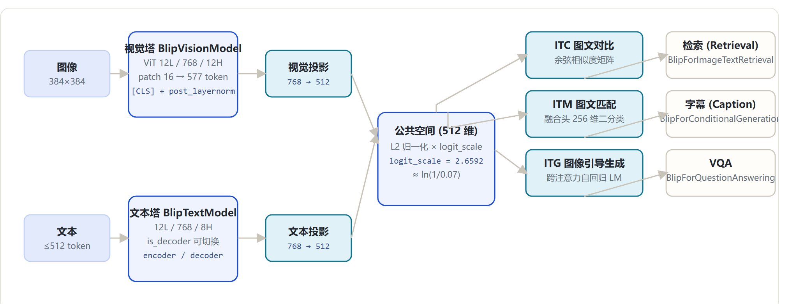
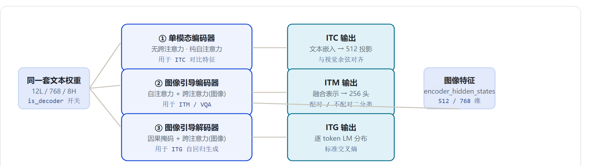
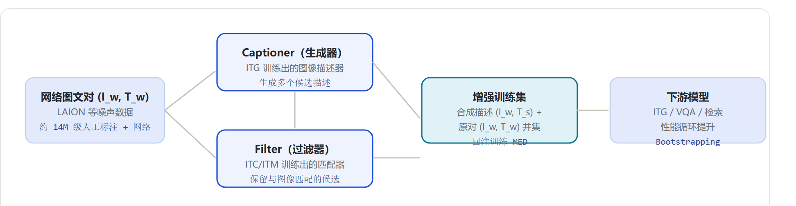

# BLIP：统一视觉语言理解与生成（Bootstrapping Language-Image Pre-training）

> 研读对象：`E:\transformers\src\transformers\models\blip\`
> transformers 版本：5.23.0.dev0（本笔记所有行号/字段均以此为准）
> 结论口径：源码逐字段核验 + 官方论文（arXiv:2201.12086, ICML 2022）+ HF 模型卡交叉验证；标注「待确认」处未编造

---

## 1. 一句话定位

**BLIP（Bootstrapping Language-Image Pre-training）** 是 Salesforce 在 ICML 2022 提出的**统一多模态框架**（论文 arXiv:2201.12086）：同一套参数（MED）以三种模式同时支持**图文检索、图像描述生成、VQA**，并用 **CapFilt** 机制从噪声网络图文对中「引导（Bootstrapping）」出高质量训练数据。它是 BLIP-2、InstructBLIP 的前身。

与 CLIP 只做「对齐/匹配」不同，BLIP 理解与生成通吃——这是它最大的定位差异。

---

## 2. 源码模块与类关系（先看清组织）

| 文件 | 职责 |
|---|---|
| `configuration_blip.py` | `BlipTextConfig` / `BlipVisionConfig` / `BlipConfig` |
| `modeling_blip.py` | 视觉塔 + 双塔模型 + 任务模型（字幕/VQA/检索） |
| `modeling_blip_text.py` | 文本 Transformer（encoder/decoder 可切换，含跨注意力） |
| `processing_blip.py` | Processor（分词 + 图像预处理合一） |
| `image_processing_blip.py` / `image_processing_pil_blip.py` | 图像预处理 |
| `convert_blip_original_pytorch_to_hf.py` | Salesforce 官方权重 → HF 格式 |

`modeling_blip.py` 类清单：

| 类 | 行号 | 职责 |
|---|---|---|
| `BlipVisionEmbeddings` | :172 | 视觉 patch 嵌入 + CLS + 位置编码 |
| `BlipTextEmbeddings` | :247 | 文本嵌入 |
| `BlipAttention` / `BlipMLP` | :285 / :348 | 注意力 / FFN |
| `BlipEncoderLayer` | :363 | 单层 Transformer（继承 `GradientCheckpointingLayer`） |
| `BlipEncoder` | :418 | 12 层编码器 |
| `BlipVisionModel` | :450 | 视觉塔（池化取 **[CLS]** + post_layernorm） |
| `BlipModel` | :509 | 双塔：ITC 对比 + ITM 匹配头（`get_image_features` / `get_text_features`） |
| `BlipForConditionalGeneration` | :769 | 图像描述生成（ITG，`GenerationMixin`） |
| `BlipForQuestionAnswering` | :942 | VQA（`GenerationMixin`） |
| `BlipForImageTextRetrieval` | :1165 | 图文检索（ITM/ITC 双头，含 `use_itm_head` 开关） |

`modeling_blip_text.py` 类清单（文本侧）：

| 类 | 行号 | 职责 |
|---|---|---|
| `BlipTextEmbeddings` | :46 | 文本嵌入 |
| `BlipTextSelfAttention` / `BlipTextAttention` | :93 / :217 | 自注意力（decoder 模式含 cross-attention 分支） |
| `BlipTextLayer` | :272 | 单层：`is_decoder` 为 True 时启用跨注意力（:280-282） |
| `BlipTextEncoder` | :321 | 12 层编码器 |
| `BlipTextPooler` | :372 | 池化 |
| `BlipTextLMHead` / `BlipTextOnlyMLMHead` | :406 / :423 | LM / MLM 预测头 |
| `BlipTextModel` | :460 | BERT 式文本模型，`is_decoder` 可切换（:498） |
| `BlipTextLMHeadModel` | :582 | 因果 LM 模型（`GenerationMixin`，默认 `is_decoder=True`） |

---

## 3. 配置字段

### 3.1 文本塔（BlipTextConfig，configuration_blip.py:27）

| 字段 | 默认值 | 说明 |
|---|---|---|
| model_type | `blip_text_model` | |
| vocab_size | **30524** | |
| hidden_size | 768 | |
| encoder_hidden_size | 768 | 跨注意力输入的维度（`BlipConfig.__post_init__` 强制 = 视觉塔 hidden） |
| intermediate_size | 3072 | |
| projection_dim | 768 | 文本投影维度 |
| num_hidden_layers | 12 | |
| num_attention_heads | 8 | |
| max_position_embeddings | 512 | |
| **is_decoder** | **True** | 默认按解码器初始化（ITG 用） |
| bos / eos / pad / sep | 30522 / 2 / 0 / 102 | |
| tie_word_embeddings | True | |

### 3.2 视觉塔（BlipVisionConfig，:77）

| 字段 | 默认值 | 说明 |
|---|---|---|
| model_type | `blip_vision_model` | |
| hidden_size | 768 | |
| intermediate_size | 3072 | |
| projection_dim | **512** | 视觉投影维度（与文本侧不同，靠 BlipModel 层对齐） |
| num_hidden_layers | 12 | |
| num_attention_heads | 12 | |
| image_size | **384** | 输入分辨率 |
| patch_size | 16 | → 24×24 = 576 patch + CLS = 577 token |
| hidden_act | gelu | |

### 3.3 双塔（BlipConfig，:112）

| 字段 | 默认值 | 说明 |
|---|---|---|
| text_config / vision_config | 子配置 | 可分别覆盖 |
| projection_dim | 512 | ITC 公共空间维度 |
| **logit_scale_init_value** | **2.6592** | 同 CLIP 口径 ≈ ln(1/0.07) |
| **image_text_hidden_size** | **256** | ITM 融合层维度（图文匹配二分类头） |
| label_smoothing | 0.0 | 文本生成可配 |
| tie_word_embeddings | True | |

---

## 4. 核心机制（对照代码）



### 4.1 MED：同一套文本参数，三种模式（modeling_blip_text.py）

`BlipTextLayer`（:272）在 `is_decoder=True` 时加入 **cross-attention**（:280-282），由此同一套 Transformer 权重可切换为：

| 模式 | 使用目标 | 实现 |
|---|---|---|
| 单模态编码器 | ITC（对比） | `BlipModel` 中 `text_model(input_ids)` 无跨注意力 |
| 图像引导编码器 | ITM / VQA | `text_model(..., encoder_hidden_states=image_embeds)` 启用跨注意力 |
| 图像引导解码器 | ITG（生成） | `text_decoder(..., encoder_hidden_states=image_embeds, labels)` 自回归 LM |



### 4.2 池化

视觉塔 `BlipVisionModel`：`pooled_output = last_hidden_state[:, 0, :]`（[CLS]）后接 `post_layernorm`（modeling_blip.py:492-493）。

### 4.3 三个预训练目标（实现细节）

**ITC 图文对比**（`BlipModel`，:509，代码 :730-744）：
```
image_embeds = visual_projection(pooler_output)   # 768 → 512
text_embeds  = text_projection(pooler_output)     # 768 → 512
两者 L2 归一化 → 余弦相似度矩阵 × logit_scale   # 同 CLIP 对比逻辑
```

**ITM 图文匹配**（`BlipModel` / `BlipForImageTextRetrieval`，:1165）：
- 文本编码器以 `image_embeds` 为 `encoder_hidden_states` 做跨注意力融合；
- 融合输出过 `image_text_hidden_size=256` 的二分类头，判断「图文是否配对」——与 ITC 的全局余弦对齐不同，ITM 是**细粒度 token 级匹配**。

**ITG 图像引导文本生成**（`BlipForConditionalGeneration`，:769）：
- `text_decoder` 以 `image_embeds` 为跨注意力输入，自回归生成 caption，优化标准 LM loss；
- VQA（`BlipForQuestionAnswering`，:942）同构，把问题也作为输入 token。

### 4.4 图像预处理

`image_processing_blip.py`：resize → 中心裁剪 384（训练）/ 384 推理，ImageNet 归一化。

---

## 5. 训练方法：CapFilt（论文层面）

**问题**：网络图文对（如 LAION）噪声大，直接预训练会被错误文本带偏；人工标注质量高但量小。

**CapFilt 引导流程**：
```
网络图文对 (I_w, T_w)
   ↓ Captioner（ITG 训练出的生成器）
生成多个候选描述
   ↓ Filter（ITC/ITM 训练出的过滤器）
保留与图像匹配的候选 → 与 (I_w, T_w) 一起组成增强训练集
```

- 训练数据来源：COCO / Visual Genome / Conceptual Captions / SBU Captions 等 14M 级人工标注数据 + 大规模网络图片（论文整体扩充规模约 1.29 亿张，具体构成以论文为准，待确认）。



---

## 6. 模型家族速览

| 任务 | HF 检查点示例 |
|---|---|
| 图像描述（ITG） | `Salesforce/blip-image-captioning-base` / `blip-image-captioning-large` |
| VQA | `Salesforce/blip-vqa-base` / `blip-vqa-large` |
| 图文检索（ITM+ITC） | `Salesforce/blip-itm-base-coco` / `blip-itm-large-coco` / `blip-itm-base-flickr` / `blip-itm-large-flickr` |

> 注意：BLIP-2 是**独立模块**（`models/blip_2/`），采用 Q-Former 桥接冻结视觉塔与 LLM，不在本笔记范围。

---

## 7. 与多模态 LLM 的关系（研读背景）

- **谱系**：BLIP → BLIP-2（Q-Former）→ InstructBLIP，是「统一图文框架」的主线；BLIP 的三目标设计（对比/匹配/生成）被后续多模态预训练广泛沿用。
- **与 CLIP/SigLIP**：ITC 目标即 CLIP 式对比学习（同 logit_scale 口径）；但 BLIP 用「匹配 + 生成」补足了对齐之外的语义细节与生成能力。SigLIP 的 sigmoid 损失改进同样可套用到这类框架。
- **与 Qwen-VL / InternVL**：它们属于「视觉编码器 + 投影 + LLM」的另一条线（visual encoder + LLM 生成），BLIP 更接近「自研统一编解码」路线，两者互为对照。

---

## 8. 一分钟结论

| 维度 | 要点 |
|---|---|
| 架构 | ViT 视觉塔（12L/768/12H）+ 文本 Transformer（12L/768/8H，is_decoder 可切换） |
| MED | 同一套文本参数 = 单模态编码 / 图文编码（+跨注意力）/ 图文解码 |
| 三目标 | ITC 图文对比（512 维）· ITM 图文匹配（256 维融合头）· ITG 图像引导生成（LM） |
| 数据 | CapFilt：Captioner 生成 + Filter 过滤，引导高质量训练集 |
| 池化 | 视觉取 [CLS] + post_layernorm |
| 代码入口 | `BlipModel`（检索/表示）· `BlipForConditionalGeneration`（字幕）· `BlipForQuestionAnswering`（VQA）· `BlipForImageTextRetrieval`（检索） |

---

## 9. 参考来源

- 论文：BLIP: Bootstrapping Language-Image Pre-training for Unified Vision-Language Understanding and Generation，arXiv:2201.12086（Li et al., 2022, ICML）
- HF 模型卡：`Salesforce/blip-vqa-base`、`Salesforce/blip-image-captioning-base`、`Salesforce/blip-itm-base-coco` 等
- transformers 源码（本机 editable）：`src/transformers/models/blip/`、`src/transformers/models/blip_2/`

**待确认/边界**：训练数据精确构成与总规模（约 1.29 亿）以论文为准（本机未复现训练流程）；ITM 头与检索头在 `BlipModel` / `BlipForImageTextRetrieval` 中的具体参数共享细节以源码最新版为准；BLIP-2 为独立模块，未在本笔记展开。
