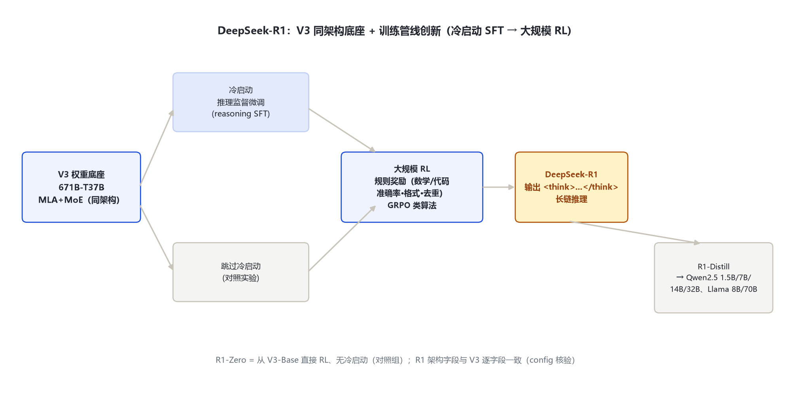
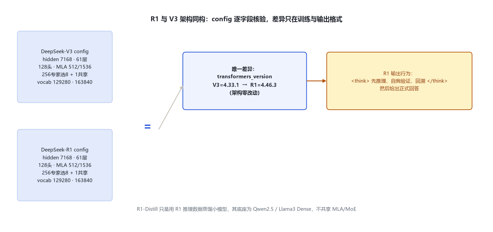

# DeepSeek-R1 家族架构详解 — 671B-T37B 推理模型 · 与 V3 同底座 · R1-Distill 蒸馏系列

- 徽标：入口类 DeepseekV3ForCausalLM（model_type `deepseek_v3`）· 架构与 DeepSeek-V3 逐字段一致
- 徽标：**671B 总参 / ≈37B 激活**（MLA + 256 专家选 8 + 1 共享专家，同 V3）
- 徽标：差异在**训练**：冷启动监督微调 → 大规模强化学习（RL）激发长链推理
- 徽标：输出带 `<think>...</think>` 思维链标记；另有 R1-Distill 系列（Qwen-1.5B/7B/14B/32B、Llama-8B/70B 蒸馏）

本页以 **DeepSeek-R1 官方 `config.json`**（经 hf-mirror 拉取 deepseek-ai/DeepSeek-R1，逐字段核对，存 `_tools\_cfgpull\`）为唯一依据：R1 与 V3 的架构字段**完全一致**（仅 `transformers_version` 不同）。架构数字引用 V3 目录并标注差异；R1 独有的是训练管线与推理行为。

## 1 家族全景：R1 官方 config 逐字段核验

> 下表字段全部来自远端官方 config（2026-10-31 经 hf-mirror 核对）。与 DeepSeek-V3 config 逐项 diff：**架构字段无差异**，唯一顶层差异是 `transformers_version`（R1=4.46.3，V3=4.33.1）。

| 字段 | DeepSeek-R1 取值 | 与 V3 是否一致 |
|---|---|---|
| architectures / model_type | DeepseekV3ForCausalLM / deepseek_v3 | 一致 |
| hidden_size / num_hidden_layers | 7168 / 61 | 一致 |
| num_attention_heads | 128 | 一致 |
| kv_lora_rank / q_lora_rank | 512 / 1536 | 一致（MLA） |
| qk_rope / qk_nope / v_head_dim | 64 / 128 / 128 | 一致 |
| intermediate_size / moe_intermediate_size | 18432 / 2048 | 一致 |
| n_routed_experts / num_experts_per_tok | 256 / 8 | 一致 |
| n_shared_experts | 1 | 一致 |
| first_k_dense_replace | 3 | 一致 |
| vocab_size | 129280 | 一致 |
| max_position_embeddings | 163840（YaRN factor=40） | 一致 |
| num_nextn_predict_layers | 1 | 一致 |
| scoring_func / topk_method / n_group / topk_group | sigmoid / noaux_tc / 8 / 4 | 一致（aux-loss-free） |
| tie_word_embeddings | false | 一致 |
| transformers_version | 4.46.3 | **唯一差异**（V3=4.33.1） |

> 结论：R1 不是新架构，而是 **V3 同权重底座经「推理定向训练」得到的推理模型**。笔记的 MLA / DeepSeekMoE / aux-loss-free / MTP 全部机制与层数、维度、专家数在 V3 目录已逐行展开，此处不重复。

### 1.1 R1-Distill 变体（小尺寸蒸馏，非同一架构）

| 变体 | 底座 | 说明 |
|---|---|---|
| R1-Distill-Qwen-1.5B / 7B / 14B / 32B | Qwen2.5 Dense | 用 R1 输出的思维链做监督微调蒸馏，架构为 Qwen2.5 Dense（非 MoE） |
| R1-Distill-Llama-8B / 70B | Llama-3 Dense | 同上，Llama 底座蒸馏 |

> 蒸馏系列只是「用 R1 的推理数据教小模型」，其架构随各自底座（Qwen2.5 / Llama3），**不共享 V3 的 MLA/MoE**。本目录只记录变体存在与定位，不展开其底座超参。

## 2 端到端数据流总览

> 与 V3 完全相同：文本 token → 词嵌入（129280×7168）→ 61×DecoderLayer（前 3 层 Dense / 后 58 层 MoE，MLA 注意力）→ 最终 RMSNorm → LM Head；MTP 头 ×1。架构图与解码层解剖见 V3 目录，本节只给 R1 的训练/行为差异。

### 2.1 架构图



> R1 = V3 架构底座不变 + 两步训练：先做冷启动监督微调（reasoning SFT），再进大规模 RL（组内相对奖励 GRPO 类算法）激发长链推理。

## 3 解码层解剖

> 与 V3 逐行一致（`DeepseekV3DecoderLayer`，前置 RMSNorm 残差块，FFN 子层前 3 层 Dense、后 58 层 MoE）。源码依据同 V3：`models\deepseek_v3\modeling_deepseek_v3.py:485-529`。



## 4 核心机制：架构同 V3，差异在训练

### 4.1 ① 与 V3 的差异是训练而非架构

```
DeepSeek-V3  : 通用预训练 + 通用对话 SFT/RLHF  → 通用对话模型
DeepSeek-R1  : 同一 V3 权重底座
               ├─ 冷启动阶段：少量推理样本监督微调（reasoning SFT，避免 RL 初期乱输出）
               └─ 大规模 RL：基于规则的奖励（数学/代码准确率、格式、重复惩罚）
                  → 激发长链推理、自我验证能力
```

> R1 论文（arXiv:2501.12948）口径：R1 用类似 GRPO 的强化学习、以规则奖励替代人工标注奖励，训练过程出现「反思、验证、回溯」等推理行为。这些全部发生在训练目标与数据侧，**网络结构一个字段都没动**——config 逐字段核验已证明。

### 4.2 ② 输出思维链标记 `<think>...</think>`

R1 在生成回答前先输出一段隐式思维链，用 `<think>...</think>` 包裹（由 tokenizer_config 定义，config 顶层未单列其 id）。这是输出格式约定，不是新增架构模块。

### 4.3 ③ R1-Zero（对照实验）

R1-Zero 是「从 V3-Base 直接上 RL、不经冷启动 SFT」的对照版本，用于验证 RL 是否能单独激发推理能力——它与 R1 共用同一架构，仅训练流程少一步。

## 5 注意力机制

> 与 V3 一致：MLA 低秩 KV（kv_lora_rank=512）、RoPE 仅作用 64 维段、YaRN factor=40 外推到 163840。详见 V3 目录 §5。

## 6 特殊 Token 与词表

| token | ID | 含义 | 来源 |
|---|---|---|---|
| bos_token_id | 0 | 序列开始 | config 顶层 |
| eos_token_id | 1 | 序列结束 | config 顶层 |
| `<think>...</think>` | 特殊标记（tokenizer_config） | 思维链包裹 | R1 官方 tokenizer_config |
| vocab_size | 129280 | 与 V3 同词表 | config |

## 7 演进视角：V3 → R1

| 维度 | DeepSeek-V3 | DeepSeek-R1 |
|---|---|---|
| 网络架构 | 671B-T37B MLA+MoE | **完全相同**（config 逐字段一致） |
| 训练目标 | 通用预训练 + 对齐 | **冷启动推理 SFT + 大规模 RL**，激发长链推理 |
| 输出行为 | 通用对话 | 先 `<think>` 思维链再作答 |
| 蒸馏外溢 | 无 | **R1-Distill**：把推理能力蒸到 Qwen2.5 / Llama3 小模型 |

> R1 的主线：架构零改动、训练范式创新——证明「同底座 + 推理定向 RL」即可得到强推理模型，并通过蒸馏把推理能力下放给 1.5B–70B 开源小模型。

## 8 来源

1. 远端官方 config（经 hf-mirror 拉取，2026-10-31 逐字段核对，存 `_tools\_cfgpull\`）
   `deepseek-ai/DeepSeek-R1.config.json（与 DeepSeek-V3 逐字段一致：7168/61层/128头/kv_lora512/q_lora1536/256专家选8/共享1/vocab129280/max163840；唯一差异 transformers_version=4.46.3）`
2. DeepSeek-R1 论文（arXiv:2501.12948）
   `https://arxiv.org/abs/2501.12948（冷启动 RL、R1-Zero 对照、R1-Distill 蒸馏系列）`
3. transformers 源码（架构与 V3 同源）
   `models\deepseek_v3\modeling_deepseek_v3.py（DecoderLayer 485-529 / MLA 349-482 / MoE 201-222）`
4. 官方模型仓库
   `https://huggingface.co/deepseek-ai/DeepSeek-R1；R1-Distill 系列同组织下 deepseek-ai/DeepSeek-R1-Distill-Qwen-* 与 Llama-*`

> 标注约定：R1 架构数字均来自其官方 config 与 V3 同源源码；训练差异来自 R1 论文。访问与核验日期：2026-10-31。

---

*页脚：DeepSeek-R1 家族架构详解 · 数据来源：远端官方 config（hf-mirror）+ transformers 源码 + arXiv:2501.12948 · 仅供技术学习与论文研究*
