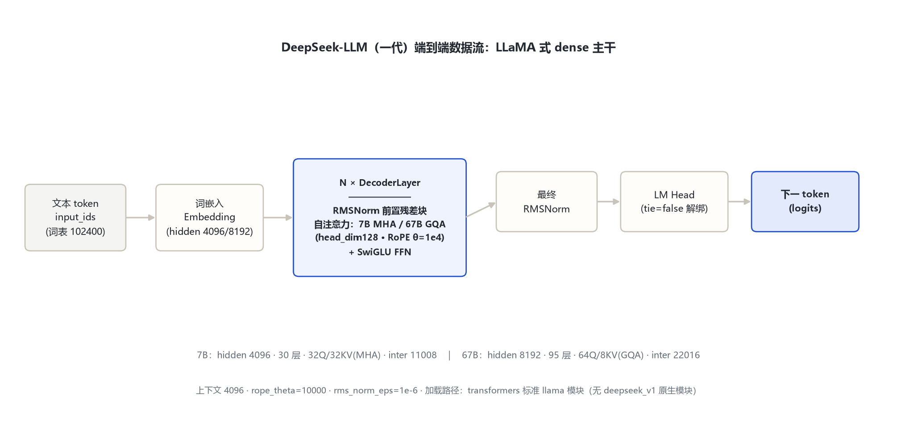
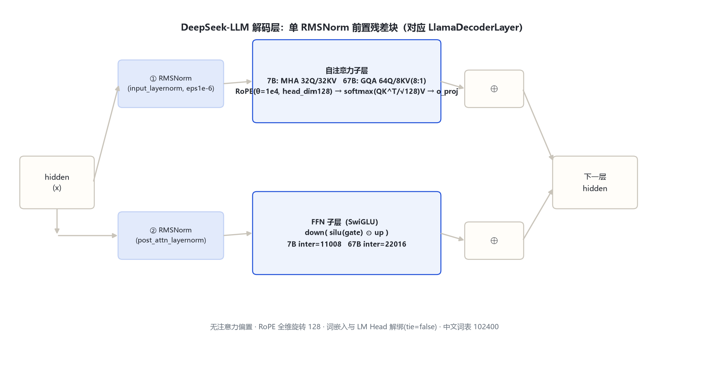

# DeepSeek-LLM（DeepSeek 一代）家族架构详解 — 7B / 67B（Base + Chat，LLaMA 式 dense 解码器）

- 徽标：入口类 LlamaForCausalLM（官方 config `model_type=llama`）——transformers v5 无 deepseek_v1 原生模块，按标准 llama 架构加载
- 徽标：RMSNorm 前置残差块 · SwiGLU FFN · RoPE（θ=10000）· attention_bias 无
- 徽标：7B 为 MHA（32Q/32KV）· 67B 首次引入 GQA（64Q/8KV，8:1 分组）
- 徽标：词表 102400（中英双语 BPE）· 上下文 4096 · tie_word_embeddings=false

本页以 **远端官方 config.json**（2026-10-31 经 hf-mirror 拉取留档于 `deepseek_v1\_tools\_cfgpull\`）与 **官方论文**（DeepSeek LLM: Scaling Open-Source Language Models with Longtermism, arXiv:2401.02954）为唯一依据。DeepSeek-LLM 7B/67B 的官方 config 直接采用 `model_type=llama`、`architectures=["LlamaForCausalLM"]`——即架构上是标准 LLaMA 式 dense Transformer，加载时走 transformers 本地 `models\llama\` 模块，无需 trust_remote_code。所有数字均标注来源（config 字段或论文出处）。

## 1 家族全景：7B / 67B 官方 config 实参对照

> 下表逐字段来自远端官方 config（`deepseek-ai/deepseek-llm-7b-base`、`deepseek-ai/deepseek-llm-67b-base`，hf-mirror 拉取留档，2026-10-31 核验）。两档共用同一主干：RMSNorm 前置残差块、SwiGLU 门控 FFN、RoPE、无注意力偏置；差异集中在层数、维度、KV 头数（MHA→GQA）。

| 字段 | 7B-base | 67B-base | 来源 |
|---|---|---|---|
| architectures | LlamaForCausalLM | LlamaForCausalLM | 远端官方 config |
| model_type | llama | llama | 远端官方 config |
| hidden_size | 4096 | 8192 | 远端官方 config |
| num_hidden_layers | 30 | 95 | 远端官方 config |
| num_attention_heads (Q) | 32 | 64 | 远端官方 config |
| num_key_value_heads (KV) | 32（MHA） | 8（GQA） | 远端官方 config |
| head_dim（hidden/Q 头数） | 128 | 128 | 复算 4096/32、8192/64 |
| intermediate_size（SwiGLU FFN） | 11008 | 22016 | 远端官方 config |
| hidden_act | silu | silu | 远端官方 config |
| vocab_size | 102400 | 102400 | 远端官方 config |
| max_position_embeddings | 4096 | 4096 | 远端官方 config |
| rope_theta | 10000 | 10000 | 远端官方 config |
| tie_word_embeddings | false | false | 远端官方 config |
| rms_norm_eps | 1e-6 | 1e-6 | 远端官方 config |
| bos_token_id / eos_token_id | 1 / 2 | 1 / 2 | 远端官方 config |

> 要点：① **7B 的 `num_key_value_heads=32=num_attention_heads`**——即标准 MHA，未做 KV 压缩；② **67B 的 `num_key_value_heads=8`**——DeepSeek 在 67B 档首次引入 GQA（官方论文 §GQA 节：67B 采用 GQA 以降推理显存，7B 保持 MHA）；③ 两档 `tie_word_embeddings=false`，词嵌入与 LM Head 解绑；④ `rope_scaling=null`，RoPE 基频 10000、上下文 4096，未做长度外推。

### 1.1 变体与部署规格

| 变体 | 架构锚点 | 说明 |
|---|---|---|
| DeepSeek-LLM-7B-base | hidden 4096 · 30 层 · 32Q/32KV · inter 11008 | 远端官方 config 逐字段核对 |
| DeepSeek-LLM-7B-chat | 同 7B-base | 在 base 上做 SFT + DPO（官方论文），架构不变 |
| DeepSeek-LLM-67B-base | hidden 8192 · 95 层 · 64Q/8KV · inter 22016 | 远端官方 config 逐字段核对 |
| DeepSeek-LLM-67B-chat | 同 67B-base | SFT + DPO 对齐版，架构不变 |
| DeepSeek-Coder 系（6.7B/33B） | 基于 DeepSeek-LLM 训练，尺寸不同 | 不在本目录范围；尺寸数字待确认 |

## 2 端到端数据流总览

> 文本 token（词表 102400）→ 词嵌入（hidden 4096/8192）→ **N 个解码层**（7B 30 层 / 67B 95 层；每层 = RMSNorm → 自注意力 → 残差 ⊕ → RMSNorm → SwiGLU FFN → 残差 ⊕）→ 最终 RMSNorm → LM Head（与嵌入解绑）→ 下一 token 分布。

### 2.1 架构图



> 全家族统一主干：Embedding → N×DecoderLayer（RMSNorm 前置 + MHA/GQA + SwiGLU）→ RMSNorm → LM Head；差异集中在层数、hidden、KV 头数（7B MHA / 67B GQA）。

## 3 解码层解剖：RMSNorm 前置残差块

> 加载实现走 transformers 本地 `models\llama\modeling_llama.py`（`LlamaDecoderLayer`），与官方 config 字段一一对应。每个解码层含两组残差子层：注意力子层与 FFN 子层，均为单 RMSNorm 前置（pre-norm）。

### 3.1 架构图



```
DecoderLayer.forward（对应 modeling_llama.py 的 LlamaDecoderLayer）:
  residual = hidden_states
  hidden_states = input_layernorm(hidden_states)          # RMSNorm(hidden, eps=1e-6)
  hidden_states, _ = self_attn(hidden_states, ...)        # MHA(7B) / GQA(67B) + RoPE θ=1e4
  hidden_states = residual + hidden_states                # ⊕1
  residual = hidden_states
  hidden_states = post_attention_layernorm(hidden_states)
  hidden_states = self.mlp(hidden_states)               # SwiGLU: down(silu(gate)·up)
  hidden_states = residual + hidden_states               # ⊕2
  return hidden_states
```

## 4 核心机制：RMSNorm · SwiGLU · RoPE · GQA（仅 67B）

### 4.1 ① RMSNorm（T5LayerNorm 式）

归一化先 fp32 计算方差，再乘可学习 γ，eps=1e-6（config `rms_norm_eps`）。

$$\mathrm{RMS}(x)=\sqrt{\mathrm{mean}(x^2)+\epsilon},\qquad y=\frac{x}{\mathrm{RMS}(x)}\odot\gamma$$

### 4.2 ② SwiGLU 门控 FFN

三投影门控结构：gate/up 两路上投影、down 下投影，激活为 silu（config `hidden_act=silu`）。

$$\mathrm{FFN}(x)=\mathrm{down}\big(\mathrm{silu}(W_{\mathrm{gate}}x)\odot W_{\mathrm{up}}x\big)$$

> intermediate_size：7B=11008，67B=22016（远端官方 config）。

### 4.3 ③ RoPE（θ=10000，全维旋转）

对 Q/K 按 head_dim=128 维做旋转位置编码，基频 `rope_theta=10000`（两档一致），`rope_scaling=null`——无 YaRN/NTK 外推，原生上下文 4096。

$$\mathrm{inv\_freq}_i=\mathrm{base}^{-2i/128},\qquad q,k=\mathrm{RoPE}(q,k;\theta=10000)$$

### 4.4 ④ 67B 首次 GQA：8 个 KV 头

7B 保持 MHA（KV 头 32 = Q 头 32）；67B 压缩为 8 个 KV 头、64 个 Q 头，每组 8 个 Q 头共享一对 K/V，运行时 `repeat_kv` 复制对齐。

$$\mathrm{Attn}(Q,K,V)=\mathrm{softmax}\!\left(\frac{QK^\top}{\sqrt{128}}+\text{mask}\right)V$$

> 注意力缩放固定 `128^(-0.5)`（head_dim=128）。GQA 是 DeepSeek-LLM 留给下一代 V2 MLA 的过渡形态（见演进章）。

## 5 注意力机制：MHA（7B）vs GQA（67B）

### 5.1 KV 头分配对照

| 尺寸 | Q 头数 | KV 头数 | 分组 | head_dim | Q 投影输出维 | 形态 |
|---|---|---|---|---|---|---|
| 7B | 32 | 32 | 1:1 | 128 | 32×128=4096 | MHA |
| 67B | 64 | 8 | 8:1 | 128 | 64×128=8192 | GQA |

> 来源：远端官方 config `num_attention_heads` / `num_key_value_heads` 字段逐字段核对。

## 6 特殊 Token 与词表布局

| token | ID | 含义 | 来源 |
|---|---|---|---|
| bos_token_id | 1 | 序列开始（tokenizer_config：add_bos_token=true） | 远端官方 config |
| eos_token_id | 2 | 序列结束 | 远端官方 config |
| vocab_size | 102400 | 中英双语 BPE 词表 | 远端官方 config |

> 词表 102400 远大于 LLaMA 系的 32000，官方论文口径为面向中英双语预训练构建的 BPE 词表。pad_token 官方 tokenizer_config 未显式设置独立值，标注「待确认」。

## 7 演进视角：LLaMA-2 → DeepSeek-LLM（一代）

| 维度 | LLaMA-2（基线） | DeepSeek-LLM 7B / 67B |
|---|---|---|
| 主干 | RMSNorm + SwiGLU + RoPE | 相同（config 实证 model_type=llama） |
| 注意力 | 全系 MHA（70B 亦 MHA） | 7B MHA · **67B GQA（8 KV 头）** |
| 词表 | 32000 | **102400（中英双语）** |
| 上下文 | 4096 | 4096（RoPE θ=1e4，无外推） |
| 训练量 | 2T（7B/13B/70B） | **2T token 预训练 + SFT/DPO**（官方论文） |
| 定位 | 英语为主 | 中英双语、长主义（Longtermism） scaling 研究 |

> 一代的主线：① 架构完全沿用 LLaMA 式 dense 主干，以 config 字段逐字段可核验；② 67B 档首次 GQA，是后续 V2 MLA 的前置探索；③ 词表扩到 102400 面向双语。**相邻代引用**：下一代 DeepSeek-V2（236B-A21B）引入 MLA + DeepSeekMoE、上下文扩到 163840（数字引自 V2 官方 config，由 deepseek_v2 目录详解）；再下一代 V3/R1（671B-A37B、无辅助损失负载均衡）只引用官方来源，不在本目录展开。

## 8 来源

1. 远端官方 config（hf-mirror 拉取留档，2026-10-31 核验）
   `deepseek_v1\_tools\_cfgpull\deepseek-llm-7b-base.config.json（hidden 4096 / 30 层 / 32Q·32KV / inter 11008 / vocab 102400 / max 4096 / ropeθ1e4 / tie=false）`
2. 远端官方 config（hf-mirror 拉取留档，2026-10-31 核验）
   `deepseek_v1\_tools\_cfgpull\deepseek-llm-67b-base.config.json（hidden 8192 / 95 层 / 64Q·8KV GQA / inter 22016 / vocab 102400 / max 4096 / ropeθ1e4 / tie=false）`
3. DeepSeek LLM 官方论文（arXiv:2401.02954，联网核实；任务原始线索 2312.06585 实为 RFT 论文，已勘误）
   `https://arxiv.org/abs/2401.02954（DeepSeek LLM: Scaling Open-Source Language Models with Longtermism；7B/67B、2T token、SFT+DPO、67B 超 LLaMA-2 70B）`
4. transformers 本地加载模块（无 deepseek_v1 原生模块，按 llama 架构加载）
   `E:\transformers\src\transformers\models\llama\modeling_llama.py（LlamaForCausalLM / LlamaDecoderLayer / LlamaRMSNorm / LlamaMLP SwiGLU）`
5. 官方 HF 仓库
   `https://huggingface.co/deepseek-ai/deepseek-llm-7b-base ；https://huggingface.co/deepseek-ai/deepseek-llm-67b-base`

> 标注约定：一切超参数以上述远端官方 config 字段为准；论文仅用于规模、训练量与 GQA 动机叙述。访问与核验日期：2026-10-31。

---

*页脚：DeepSeek-LLM（一代）家族架构详解 · 数据来源：远端官方 config（hf-mirror 拉取）+ transformers llama 加载模块 + arXiv:2401.02954 · 仅供技术学习与论文研究*
