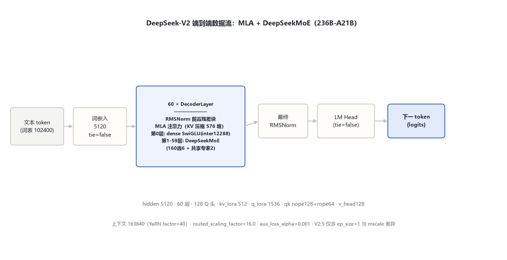
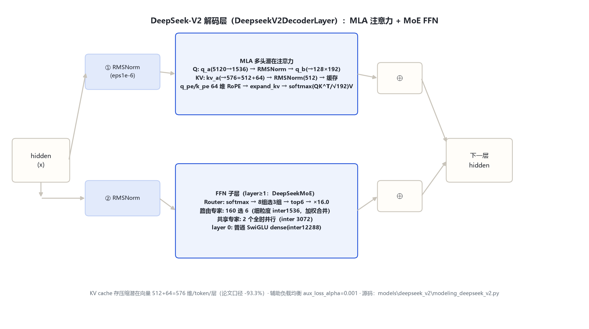

# DeepSeek-V2 家族架构详解 — 236B-A21B（MLA + DeepSeekMoE，含 V2-Chat / V2.5 变体）

- 徽标：入口类 DeepseekV2ForCausalLM（`model_type=deepseek_v2`）——transformers v5 原生模块 `models\deepseek_v2\`
- 徽标：**MLA（多头潜在注意力）**：kv_lora_rank=512 · q_lora_rank=1536 · qk_nope_head_dim=128 · qk_rope_head_dim=64
- 徽标：**DeepSeekMoE**：160 路由专家选 6 · 共享专家 2（细粒度专家无辅助损失之外的共享分支）· 首 1 层 dense
- 徽标：group_limited_greedy 路由（8 组选 3 组再选 6）· routed_scaling_factor=16.0 · 辅助负载均衡损失 aux_loss_alpha=0.001
- 徽标：词表 102400 · YaRN 上下文 163840（factor=40，原始 4096）· tie=false

本页以 **远端官方 config.json**（2026-10-31 经 hf-mirror 拉取留档于 `deepseek_v2\_tools\_cfgpull\`：DeepSeek-V2 / V2-Chat / V2.5）、**transformers 本地源码**（`E:\transformers\src\transformers\models\deepseek_v2\`）与 **官方论文**（DeepSeek-V2, arXiv:2405.04434）为唯一依据。DeepSeek-V2 为 236B 总参、每 token 激活 21B 的 MoE；V2.5 经核验与 V2 同架构（仅多 `ep_size=1`、YaRN mscale 0.707→1.0），并入本目录作变体节。所有数字均标注来源（config 字段或源码文件:行号）。

## 1 家族全景：官方 config 实参对照

> 下表逐字段来自远端官方 config（hf-mirror 拉取留档，2026-10-31 核验）。V2 base、V2-Chat、V2.5 三份 config 架构字段完全一致，仅 V2.5 多 `ep_size=1` 且 YaRN mscale 不同（见 §1.2）。

| 字段 | 取值（V2 / V2-Chat / V2.5 相同） | 来源 |
|---|---|---|
| architectures | DeepseekV2ForCausalLM | 远端官方 config |
| model_type | deepseek_v2 | 远端官方 config |
| hidden_size | 5120 | 远端官方 config |
| num_hidden_layers | 60 | 远端官方 config |
| num_attention_heads (Q) | 128 | 远端官方 config |
| num_key_value_heads | 128（MLA，非 GQA 语义） | 远端官方 config |
| intermediate_size（dense FFN，仅第 0 层） | 12288 | 远端官方 config |
| **kv_lora_rank** | **512**（KV 潜在压缩维） | 远端官方 config |
| **q_lora_rank** | **1536**（Q 低秩投影维） | 远端官方 config |
| qk_nope_head_dim | 128 | 远端官方 config |
| qk_rope_head_dim | 64 | 远端官方 config |
| v_head_dim | 128 | 远端官方 config |
| qk_head_dim（=nope+rope） | 192 | 复算 128+64 |
| **n_routed_experts** | **160** | 远端官方 config |
| **n_shared_experts** | **2**（共享专家 = 2×moe_intermediate） | 远端官方 config |
| **num_experts_per_tok** | **6** | 远端官方 config |
| moe_intermediate_size | 1536 | 远端官方 config |
| first_k_dense_replace | 1（第 0 层 dense，其后 MoE） | 远端官方 config |
| moe_layer_freq | 1（密集间隔，每层都 MoE） | 远端官方 config |
| topk_method | group_limited_greedy | 远端官方 config |
| n_group / topk_group | 8 / 3 | 远端官方 config |
| routed_scaling_factor | 16.0 | 远端官方 config |
| norm_topk_prob | false | 远端官方 config |
| aux_loss_alpha / seq_aux | 0.001 / true | 远端官方 config |
| vocab_size | 102400 | 远端官方 config |
| max_position_embeddings | 163840 | 远端官方 config |
| rope_theta | 10000 | 远端官方 config |
| rope_scaling | YaRN：factor=40 · original_max=4096 · beta_fast=32 · beta_slow=1 | 远端官方 config |
| tie_word_embeddings / attention_bias | false / false | 远端官方 config |

> 要点：① **层布局 = 1 个 dense 层（idx 0）+ 59 个 MoE 层（idx 1–59）**——源码 `modeling_deepseek_v2.py:427`：`self.mlp = DeepseekV2Moe(config) if layer_idx >= config.first_k_dense_replace else DeepseekV2MLP(config)`；② MLA 的 KV 缓存以**压缩潜在向量**形式存储（每 token 每层 512+64=576 维），非标准 KV 头；③ 路由先把 160 专家分 8 组、选 3 组、再在组内选 6 个（group_limited_greedy）。

### 1.1 参数量复算（Total 236B / Active 21B 对账）

> 按 config 字段逐层复算，与官方论文「236B total / 21B activated」对账：

| 分量（每层/全模型） | 计算式（符号/含义/取值） | 规模 |
|---|---|---|
| 词嵌入 + LM Head | 102400 × 5120 × 2（tie=false） | ≈ 1.05B |
| 注意力（每层，MLA） | q_a 5120×1536 + q_b 1536×(128×192) + kv_a 5120×576 + kv_b 512×(128×256) + o 16384×5120 | ≈ 0.149B/层 × 60 ≈ 8.9B |
| 第 0 层 dense FFN | 3 × 5120 × 12288 | ≈ 0.189B |
| 路由专家（每个） | 3 × 5120 × 1536（gate_up 融合 2× + down） | ≈ 0.0236B/专家 × 160 ≈ 3.78B/MoE层 |
| 共享专家（每 MoE 层） | 3 × 5120 × (1536×2)，即 n_shared_experts=2 | ≈ 0.047B/MoE层 |
| Router（每 MoE 层） | 5120 × 160 | ≈ 0.0008B |
| **合计（Total）** | 1.05 + 8.9 + 0.189 + 59×(3.78+0.047+0.0008) | **≈ 236B** ✓ |
| **激活（Active/token）** | 注意力 0.149 + 路由专家 6×0.0236 + 共享 0.047 + 路由 0.0008（×59 层）+ 嵌入/LM Head | **≈ 21B** ✓ |

> 复算与官方论文一致（arXiv:2405.04434：236B total / 21B activated）。MoE 层共享专家中间维 = `moe_intermediate_size × n_shared_experts = 1536×2 = 3072`（源码 `modeling_deepseek_v2.py:125-127`）。

### 1.2 变体节：DeepSeek-V2-Chat 与 DeepSeek-V2.5

| 变体 | architectures / model_type | 架构差异（与 V2 base 比） | 说明 |
|---|---|---|---|
| DeepSeek-V2（base） | DeepseekV2ForCausalLM / deepseek_v2 | —（基准） | 远端官方 config 逐字段核对 |
| DeepSeek-V2-Chat | 同左 | config 字段与 base 完全一致 | SFT+RL 对齐版；generation_config：temp 0.3 / top_p 0.95 |
| DeepSeek-V2.5 | 同左 | 仅多 `ep_size=1`；YaRN mscale/mscale_all_dim 由 0.707→1.0 | 官方口径：合并 V2-Chat 与 Coder-V2-Instruct 的通用+代码版（官方新闻 news0905）；其余架构字段与 V2 逐字段一致 |

> 核验结论：V2.5 官方 repo/config 存在，`model_type=deepseek_v2`、MLA/MoE 全部字段与 V2 相同——按任务约定**并入 V2 变体节，不单独立目录**。

## 2 端到端数据流总览

> 文本 token（词表 102400）→ 词嵌入（5120，tie=false）→ **60 个解码层**：第 0 层 dense（RMSNorm → MLA → ⊕ → RMSNorm → SwiGLU dense FFN → ⊕），第 1–59 层 FFN 子层换 DeepSeekMoE（Router → 160 选 6 路由专家 + 2 共享专家并行）→ 最终 RMSNorm → LM Head。MLA 在 KV 侧只缓存 576 维潜在向量。

### 2.1 架构图



> 全家族统一主干：Embedding → 60×DecoderLayer（RMSNorm 前置 + MLA 注意力）→ RMSNorm → LM Head；差异在 FFN 子层：第 0 层 dense SwiGLU，其后 59 层 DeepSeekMoE。

## 3 解码层解剖：DeepseekV2DecoderLayer

> `DeepseekV2DecoderLayer`（`modeling_deepseek_v2.py:421-461`）含两组残差子层，均为单 RMSNorm 前置；FFN 子层按层索引二选一（源码 427 行）。

### 3.1 架构图



```
DeepseekV2DecoderLayer.forward（modeling_deepseek_v2.py:432-461）:
  residual = hidden_states
  hidden_states = input_layernorm(hidden_states)          # RMSNorm(5120, eps=1e-6)
  hidden_states, _ = self_attn(hidden_states, ...)        # MLA（§4.1）
  hidden_states = residual + hidden_states              # ⊕1
  residual = hidden_states
  hidden_states = post_attention_layernorm(hidden_states)
  hidden_states = self.mlp(hidden_states)               # layer_idx>=1: DeepseekV2Moe；layer 0: dense SwiGLU
  hidden_states = residual + hidden_states              # ⊕2
  return hidden_states
```

## 4 核心机制：MLA · DeepSeekMoE 路由 · 组间限制 top-k

### 4.1 ① MLA 多头潜在注意力

`DeepseekV2Attention`（`modeling_deepseek_v2.py:290-418`）把 KV 压缩成低秩潜在向量再缓存：

```
# Q 低秩分解（q_lora_rank=1536）
q = q_b_proj( q_a_layernorm( q_a_proj(x) ) )            # 316-326, 381
q = view → (128 heads, qk_head_dim=192)
q_nope, q_pe = split(q, [128, 64])                      # 383

# KV 低秩压缩 + 位置分量分离（kv_lora_rank=512）
compressed = kv_a_proj_with_mqa(x)                      # 328-332, 385 → 5120→576
kv_nope, k_pe = split(compressed, [512, 64])            # 386
k_nope = kv_a_layernorm(kv_nope).view(B,1,S,512)        # 333, 388  ← 缓存形态
k_pe   = k_pe.view(B,1,S,64)                            # 389       ← 缓存形态
q_pe, k_pe = apply_rotary_emb(q_pe, k_pe, ...)          # 391（仅 64 维 rope 分量旋转）

# KV cache 在压缩潜在形态下读写（394-395）
k_nope, k_pe = past_key_values.update(k_nope, k_pe, layer_idx)

# 解码时再扩回多头（expand_kv, 348-365）
key_states, value_states = expand_kv(k_nope, k_pe)      # kv_b_proj: 512→128×(128+128)
attn = softmax( (QKᵀ)·scaling ) V → o_proj              # scaling=(192)^-0.5 经 YaRN mscale, 346
```

$$\mathrm{scaling}=(\mathrm{qk\_head\_dim})^{-0.5}=192^{-0.5}\times\mathrm{mscale}$$

> KV 缓存形态（源码 394-395）：每层只存 `kv_lora_rank(512) + qk_rope_head_dim(64) = 576` 维/ token；官方论文口径 KV cache 较标准注意力压缩 93.3%（arXiv:2405.04434）。

### 4.2 ② DeepSeekMoE：160 路由专家 + 2 共享专家

`DeepseekV2Moe`（`modeling_deepseek_v2.py:119-136`）= Router（115 行）+ 路由专家（`DeepseekV2Experts`，46-82）+ 共享专家（125-127）：

```
router_logits, topk_w, topk_idx = self.gate(hidden_states)   # softmax → group_limited_greedy → 6
hidden_states = self.experts(hidden_states, topk_idx, topk_w) # 6 个被选专家 SwiGLU 后加权
hidden_states = hidden_states + self.shared_experts(residuals) # 2 个共享专家全时激活（3.78 行）
```

> 共享专家不是 top-k 路由的一部分，而是与路由专家**并行全时激活**的分支；中间维 3072 = 1536×2（n_shared_experts=2）。每个路由专家是细粒度专家（moe_intermediate_size=1536），门控/上投影融合为 3D 参数（54-55 行）。

### 4.3 ③ group_limited_greedy 路由

`DeepseekV2TopkRouter`（`modeling_deepseek_v2.py:85-116`）：先 softmax 打分（100 行），再把 160 专家分 8 组，按组内最高分选 3 组（103-107 行），组内掩码后 top-6（114 行），最后乘 routed_scaling_factor=16.0（115 行）。

$$\text{topk\_weights}=\mathrm{softmax}(xW)_{\mathrm{top6}}\times 16.0\quad(\mathrm{norm\_topk\_prob=false，不做归一化})$$

> 负载均衡：官方 config 保留 `aux_loss_alpha=0.001`、`seq_aux=true`——V2 时代仍用辅助损失均衡（无辅助损失策略是 V3 的事，见演进章）。

## 5 注意力机制：MLA 缓存形态 vs 标准 MHA/GQA

### 5.1 KV 缓存对照

| 形态 | 每 token 每层 KV 缓存维数 | 来源 |
|---|---|---|
| 标准 MHA（128 头 × (k+v) 128） | 128×128×2 = 32768 | 对照推算 |
| 67B GQA（8 KV 头 × 128×2） | 8×128×2 = 2048 | 对照推算 |
| **DeepSeek-V2 MLA** | **512（kv_lora）+ 64（rope）= 576** | 远端官方 config + 源码 388-389, 394-395 |

> 注意力缩放 `(qk_head_dim)^-0.5 = 192^-0.5`，并乘 YaRN mscale（V2/V2-Chat mscale=0.707；V2.5=1.0，源码 346 + rope_scaling 字段）。RoPE 只施加在 q_pe/k_pe 的 64 维分量上（partial rotary），nope 分量不旋转。

## 6 特殊 Token 与词表布局

| token | ID | 含义 | 来源 |
|---|---|---|---|
| bos_token_id | 100000 | 序列开始（add_bos_token=true） | 远端官方 config |
| eos_token_id | 100001 | 序列结束（generation_config 同） | 远端官方 config |
| vocab_size | 102400 | 与一代同一词表 | 远端官方 config |
| Chat 模板 | User: … / Assistant: … 格式 | tokenizer_config chat_template | 远端官方 tokenizer_config |

> 词表 102400 与 DeepSeek-LLM 一代一致；特殊 token ID 从 100000 起重新编号（一代为 1/2）。

## 7 演进视角：DeepSeek-LLM（一代）→ DeepSeek-V2

| 维度 | DeepSeek-LLM 67B（一代基线） | DeepSeek-V2（236B-A21B） |
|---|---|---|
| 形态 | Dense（95 层） | **MoE：1 dense + 59 MoE 层，160 专家选 6 + 2 共享** |
| 注意力 | GQA（64Q/8KV） | **MLA（KV 潜在压缩 576 维，缓存 -93.3%）** |
| Q 路径 | 直接投影 | **Q 低秩分解（q_lora_rank=1536）+ 逐分量 RMSNorm** |
| 路由 | 无（dense） | **group_limited_greedy：8 组选 3 再选 6；routed_scaling_factor=16.0** |
| 上下文 | 4096（RoPE θ=1e4） | **163840（YaRN factor=40，原始 4096）** |
| 总参 / 激活 | 67B dense | **236B total / 21B activated**（论文） |
| 负载均衡 | 无 | 辅助损失 aux_loss_alpha=0.001（V3 才改无辅助损失） |

> V2 的主线升级：① MLA 把 KV cache 压到 576 维（论文口径 -93.3%）；② DeepSeekMoE 细粒度专家 160 选 6 + 全时共享专家 2；③ 组间限制路由 + 16.0 缩放；④ YaRN 扩到 128K+（163840）；⑤ 训练成本较 67B 基线省 42.5%、最大生成吞吐 5.76×（论文口径）。**相邻代引用**：V3（671B-A37B）沿用 MLA + DeepSeekMoE 并改为无辅助损失负载均衡、引入 MTP——数字引自 V3 官方来源（arXiv:2412.19437），不在本目录展开。

## 8 来源

1. 远端官方 config（hf-mirror 拉取留档，2026-10-31 核验）
   `deepseek_v2\_tools\_cfgpull\DeepSeek-V2.config.json（hidden 5120 / 60 层 / 128Q / kv_lora 512 / q_lora 1536 / nope128+rope64 / 160 专家选 6 / 共享 2 / moe_inter 1536 / first_k_dense 1 / max 163840 / YaRN factor40 / routed_scale 16.0）`
2. 远端官方 config（同目录留档）
   `DeepSeek-V2-Chat.config.json（字段与 base 一致）；DeepSeek-V2.5.config.json（多 ep_size=1；YaRN mscale 0.707→1.0，其余一致）`
3. transformers 源码（本地 E:\transformers）
   `models\deepseek_v2\configuration_deepseek_v2.py：MLA/MoE 字段默认值 76-120；qk_head_dim 派生 124-127`
   `models\deepseek_v2\modeling_deepseek_v2.py：Experts 46-82；TopkRouter 85-116（softmax 100 / group_limited 103-114 / scaling 115）；Moe 119-136（共享专家 125-127）；MLP SwiGLU 139-152；RMSNorm 156-173；RoPE 176-210；Attention 290-418（q_lora 316-326 / kv_a 328-332 / kv_b 334-338 / expand_kv 348-365 / 潜在缓存 394-395）；DecoderLayer 421-461（dense/MoE 分流 427）`
4. DeepSeek-V2 官方论文（arXiv:2405.04434，联网核实）
   `https://arxiv.org/abs/2405.04434（236B total / 21B activated；MLA KV cache -93.3%；训练成本 -42.5%；吞吐 5.76×；8.1T token）`
5. 官方发布说明（V2.5 定位）
   `https://api-docs.deepseek.com/news/news0905（DeepSeek-V2.5 = V2-Chat 与 Coder-V2-Instruct 合并升级）`
6. 官方 HF 仓库
   `https://huggingface.co/deepseek-ai/DeepSeek-V2 ；https://huggingface.co/deepseek-ai/DeepSeek-V2-Chat ；https://huggingface.co/deepseek-ai/DeepSeek-V2.5`
7. 相邻代引用（V3，官方来源，不在本目录展开）
   `https://arxiv.org/abs/2412.19437（DeepSeek-V3 Technical Report：671B-A37B、无辅助损失负载均衡、MTP）`

> 标注约定：[S:n]=modeling_deepseek_v2.py 行号。参数量复算（§1.1）按 config 字段逐层计算并与论文口径对账。访问与核验日期：2026-10-31。

---

*页脚：DeepSeek-V2 家族架构详解 · 数据来源：远端官方 config（hf-mirror 拉取）+ transformers 源码（E:\transformers）+ arXiv:2405.04434 / 官方发布说明 · 仅供技术学习与论文研究*
