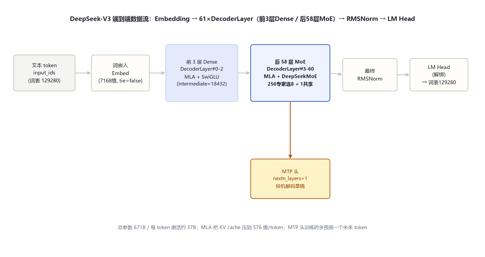
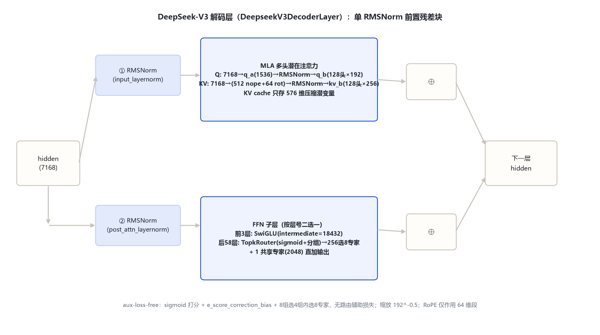

# DeepSeek-V3 家族架构详解 — 671B-T37B MoE · MLA · aux-loss-free 负载均衡 · MTP

- 徽标：入口类 DeepseekV3ForCausalLM（model_type `deepseek_v3`）· 总参数 671B / 每 token 激活约 37B
- 徽标：MLA 多头潜在注意力（kv_lora_rank=512 · q_lora_rank=1536 · qk_rope_head_dim=64 · qk_nope_head_dim=128 · v_head_dim=128）
- 徽标：DeepSeekMoE 细粒度专家（256 路由专家选 8 · 1 共享专家 · moe_intermediate=2048 · 前 3 层 Dense）
- 徽标：aux-loss-free 负载均衡（sigmoid 打分 + bias 修正项 + 分组限选 noaux_tc，路由无辅助损失）
- 徽标：MTP 多 token 预测头（num_nextn_predict_layers=1）· FP8 混合精度训练（权重 e4m3）· YaRN 上下文 4096→163840

本页以 **官方 `config.json`**（经 hf-mirror 拉取 deepseek-ai/DeepSeek-V3 与 DeepSeek-V3-Base，逐字段核对，存 `_tools\_cfgpull\`）与 **transformers 源码**（本地 `E:\transformers`，`models\deepseek_v3\`）为唯一依据。所有数字均标注来源（config 字段或源码文件:行号）。

## 1 家族全景：V3 / V3-Base 配置对照

> V3（对话版）与 V3-Base（基座版）官方 config 逐字段一致，仅 `transformers_version` 与权重重训不同。下表全部字段来自远端官方 config（2026-10-31 经 hf-mirror 逐字段核对）。

| 字段 | DeepSeek-V3 / V3-Base 取值 | 来源 |
|---|---|---|
| 入口类 architectures | DeepseekV3ForCausalLM | config 顶层 |
| model_type | deepseek_v3 | config 顶层 |
| **形态** | **MoE（671B 总参 / ≈37B 激活）** | 官方论文 arXiv:2412.19437 |
| hidden_size | 7168 | config |
| num_hidden_layers | 61（前 3 层 Dense FFN，后 58 层 MoE） | config + `first_k_dense_replace=3` |
| num_attention_heads (Q) | 128 | config |
| num_key_value_heads | 128（MLA 下 KV 实际压缩为 512 维共享潜变量，见 §5） | config 顶层字段 |
| kv_lora_rank（KV 压缩秩） | 512 | config |
| q_lora_rank（Q 压缩秩） | 1536 | config |
| qk_rope_head_dim / qk_nope_head_dim | 64 / 128 | config |
| v_head_dim | 128 | config |
| intermediate_size（Dense FFN） | 18432 | config |
| moe_intermediate_size（每专家） | 2048 | config |
| n_routed_experts（路由专家） | 256 | config |
| num_experts_per_tok | 8（每 token 选 8 个路由专家） | config |
| n_shared_experts（共享专家） | 1（宽度 = moe_intermediate×1 = 2048） | config + 源码 `modeling:211-213` |
| routed_scaling_factor | 2.5 | config |
| first_k_dense_replace | 3 | config |
| moe_layer_freq | 1 | config |
| vocab_size | 129280 | config |
| max_position_embeddings | 163840（YaRN factor=40，原始 4096） | config + rope_scaling |
| rope_theta | 10000 | config |
| tie_word_embeddings | false（嵌入与 LM Head 解绑） | config |
| num_nextn_predict_layers | 1（MTP 头） | config |
| scoring_func / topk_method | sigmoid / noaux_tc（aux-loss-free） | config |
| n_group / topk_group | 8 / 4（专家分组限选） | config |

> 要点：① **671B 总参 ≈ 专家参数主导**——256×58 层细粒度路由专家占绝大多数；每 token 只激活 8/256 专家 + 1 共享专家，故激活量约 37B；② **前 3 层是 Dense FFN**（intermediate=18432），从第 4 层（layer_idx≥3）起全部换 MoE（`modeling_deepseek_v3.py:492-495`）；③ KV cache 存的是 512 维压缩潜变量而非逐头 K/V，这是 MLA 省显存的关键；④ config 带 `quantization_config: fp8 e4m3`，是训练产物权重格式，不改架构计算图（见 §4.5）。

## 2 端到端数据流总览

> 文本 token → 词嵌入（129280×7168，与 LM Head 解绑）→ **61 个 DeepseekV3DecoderLayer**（前置 RMSNorm：MLA 注意力子层 + Dense FFN / DeepSeekMoE 子层，均带残差）→ 最终 RMSNorm → LM Head。另有 1 层 MTP 头在训练时预测下一未来 token。

### 2.1 架构图



> 全家族统一主干：Embedding → 61×DecoderLayer（MLA + Dense前3层/MoE后58层）→ RMSNorm → LM Head；差异点集中在 FFN 子层从第 4 层起换成 256 选 8 的 DeepSeekMoE。

## 3 解码层解剖：DeepseekV3DecoderLayer

> `DeepseekV3DecoderLayer`（`modeling_deepseek_v3.py:485-529`）为单 RMSNorm 前置残差块：注意力子层与 FFN 子层各一个前置 RMSNorm，两个残差相加。FFN 子层按层号二选一（`modeling:492-495`）：layer_idx<3 用 `DeepseekV3MLP`（Dense，intermediate 18432），layer_idx≥3 用 `DeepseekV3MoE`（路由专家 + 共享专家）。

### 3.1 架构图



```
DeepseekV3DecoderLayer.forward（modeling_deepseek_v3.py:500-529）:
  residual = hidden_states
  hidden_states = input_layernorm(hidden_states)          # RMSNorm(7168, eps=1e-6)
  hidden_states, _ = self_attn(hidden_states, ...)        # MLA（Q/KV 低秩压缩）
  hidden_states = residual + hidden_states               # ⊕1
  residual = hidden_states
  hidden_states = post_attention_layernorm(hidden_states)
  hidden_states = self.mlp(hidden_states)                # 前3层 SwiGLU(18432) / 后58层 MoE
  hidden_states = residual + hidden_states               # ⊕2
  return hidden_states
```

## 4 核心机制：MLA · DeepSeekMoE · aux-loss-free · MTP · FP8

### 4.1 ① MLA 多头潜在注意力（Q/KV 双低秩压缩）

`DeepseekV3Attention`（`modeling_deepseek_v3.py:349-482`）不直接投影出逐头 K/V，而是把 KV 压成一个低秩潜变量再扩展：

- **Q 侧**：`hidden → q_a_proj(7168→1536) → q_a_layernorm → q_b_proj(1536→128头×(128+64))`（`modeling:375-385,440`）；Q 再切为 nope 段（128）与 rope 段（64）。
- **KV 侧**：`hidden → kv_a_proj_with_mqa(7168→512+64)`，切出 512 维 `kv_nope` 与 64 维 `k_rot`（带旋转位置）；`kv_nope → kv_a_layernorm → kv_b_proj(512→128头×(128+128))` 还原逐头 K-nope 与 V（`modeling:387-397,444-449,407-424`）。
- **KV cache**：只缓存 512 维 `kv_nope` + 64 维 `k_rot` 这份压缩潜变量（`modeling:457-459`），逐头扩展在 attn 前即时完成——这是 MLA 把 KV cache 降到与 MQA 同量级的关键。

$$z_{kv}=W^{DKV}x,\quad c=RMSNorm(z_{kv}),\quad [K;V]=W^{UKV}c$$

$$q = W^{UQ}\,RMSNorm(W^{AQ}x),\quad K_{rope}=RoPE(k_{rot})$$

$$\mathrm{Attn}=\mathrm{softmax}\!\left(\frac{qk^{\top}}{\sqrt{192}}+\text{mask}\right)v,\qquad \text{scaling}=(qk\_nope+qk\_rope)^{-0.5}=192^{-0.5}$$

> 注意力缩放 = `qk_head_dim**(-0.5) = (128+64)**(-0.5) = 192^-0.5`（`modeling:405`）。`k_rot` 对所有头共享一份（`expand_kv` 里 `k_rot.expand`，`modeling:418`），RoPE 只作用在 64 维旋转段。

### 4.2 ② DeepSeekMoE：256 细粒度路由专家 + 1 共享专家

`DeepseekV3MoE`（`modeling:201-222`）= `DeepseekV3Experts`（256 份门控融合的 gate_up/down 参数，`modeling:162-198`）+ `DeepseekV3TopkRouter`（打分选专家）+ `shared_experts`（一份宽度 `moe_intermediate×n_shared_experts = 2048×1 = 2048` 的普通 SwiGLU MLP，`modeling:211-213`）。前向 = 路由专家加权输出 **直接加上** 共享专家输出（`modeling:220-221`）。

```
DeepseekV3MoE.forward（modeling_deepseek_v3.py:215-222）:
  residuals = hidden_states
  _, topk_weights, topk_indices = gate(hidden_states)     # 选 8 个专家
  hidden_states = experts(hidden_states, topk_indices, topk_indices)  # 按专家桶分 token
  hidden_states = hidden_states + shared_experts(residuals)            # 共享专家直加
```

> 每专家 `moe_intermediate_size=2048`（细粒度切分，比 Dense FFN 的 18432 小得多）；256 个专家里每 token 选 8 个（`num_experts_per_tok=8`）。共享专家不参与路由、对所有 token 常开。

### 4.3 ③ aux-loss-free 负载均衡（noaux_tc / sigmoid）

`DeepseekV3TopkRouter`（`modeling:120-158`）用 **sigmoid 而非 softmax** 打分，并维护一份 `e_score_correction_bias` 修正项缓冲：

```
router_logits = x @ W_gate^T                       # (seq, 256)
scores = sigmoid(router_logits)                     # model:136
scores_for_choice = scores + e_score_correction_bias   # model:137 历史负载修正
# 分组：256 专家分 8 组，组内 top2 求和 → 组级分 → topk_group=4 组被选中
group_scores = scores.view(-1,8,32).topk(2).sum()  # model:138-142
group_idx = topk(group_scores, k=4)                # model:143
# 只在选中的 4 组内再选 top_k=8 个专家，其余置 -inf
topk_indices = topk(scores_for_choice, k=8)        # model:151-152
topk_weights = scores.gather(topk_indices)
topk_weights /= topk_weights.sum()                 # norm_topk_prob=True 归一化
topk_weights *= routed_scaling_factor(2.5)         # model:157
```

> 关键：**路由负载均衡靠 bias 修正项 + 分组限选实现，不引入 aux-load-balance 辅助损失**——config `topk_method=noaux_tc`、`scoring_func=sigmoid`。这使训练时无需为路由额外配损失项（DeepSeek-V2 之后的口径）。

### 4.4 ④ MTP 多 token 预测头

config `num_nextn_predict_layers=1`（代码侧 `num_mtp_layers`，`configuration:36-39,117`）：基座之外再挂一个模块，训练时同时预测未来多个 token，推理时可作投机解码草稿头（`generate(..., use_mtp=True)`）。MTP 头共享基座的词嵌入与最终归一化，结构与一个 decoder 块对齐。

### 4.5 ⑤ FP8 混合精度训练（与架构的关系）

config 顶层 `quantization_config` = `{quant_method: fp8, fmt: e4m3, activation_scheme: dynamic, weight_block_size: [128,128]}`。这是 **权重存储/训练精度**（DeepSeek-V3 在 671B 规模上把大部分算子推到 FP8 e4m3，权重按 128×128 块缩放、激活动态量化），**不改变架构计算图的拓扑**——笔记只在「部署精度」维度记录，不计入超参对照。

## 5 注意力机制：MLA 低秩 KV · YaRN 长上下文 · RoPE 64 维段

### 5.1 MLA 的 KV 显存账

| 项 | 取值 | 说明 |
|---|---|---|
| Q 投影 | hidden 7168 → 潜 1536 → 128 头×192 | 双低秩，`q_a/q_b` |
| KV 潜变量 | hidden 7168 → 512（nope）+ 64（rot） | 单头共享一份 |
| 逐头 K/V 还原 | 512 → 128 头×(128 K-nope + 128 V) | attn 前即时扩展 |
| KV cache 单 token | 512 + 64 = 576 维 | 远小于逐头 MHA 的 128×256 |
| RoPE | 仅作用 64 维 `k_rot`/`q_rot` 段 | `rope_interleave=True` 交织实现 |

### 5.2 YaRN 长上下文

```
rope_theta = 10000
rope_scaling = {type: yarn, factor: 40, original_max_position_embeddings: 4096,
                beta_fast: 32, beta_slow: 1, mscale: 1.0, mscale_all_dim: 1.0}
max_position_embeddings = 163840
```

> 基座按 4096 长度训练，经 YaRN 外推到 163840（128K 级）。注意力缩放会过 `yarn_apply_mscale`（`modeling:268-274`）按 YaRN 因子再修正。

## 6 特殊 Token 与词表布局

| token | ID | 含义 | 来源 |
|---|---|---|---|
| bos_token_id | 0 | 序列开始 | config 顶层 |
| eos_token_id | 1 | 序列结束 | config 顶层 |
| pad_token_id | null（未设） | — | config |
| 词表 | vocab_size=129280 | DeepSeek 自研 tokenizer（BPE） | config |

> DeepSeek-V3 对话模板使用 `<｜begin▁of▁sentence｜>` / `<｜end▁of▁sentence｜>` 等特殊符号（官方 tokenizer_config），config 顶层只暴露 bos=0、eos=1。嵌入与 LM Head **不绑定**（`tie_word_embeddings=false`）。

## 7 演进视角：DeepSeek-V2 → V3

> 相邻代（V1/V2）由另一执行者的 deepseek_v1/v2 目录负责，本节只在官方来源口径下咬合关键数字。

| 维度 | DeepSeek-V2（基线） | DeepSeek-V3（家族） |
|---|---|---|
| 注意力 | **MLA（V2 首次引入，kv_lora_rank=512，Q/KV 双低秩）** | **MLA 延续，维度一致**（kv_lora 512 / q_lora 1536 / qk_rope 64 / qk_nope 128 / v_head 128） |
| MoE 路由 | group_limited_greedy 限选 + aux-load-balance 辅助损失 | **aux-loss-free**（sigmoid + bias 修正 + 分组 noaux_tc，无辅助损失） |
| 专家规模 | **160 路由专家选 6 + 2 共享专家**（V2 主模型 236B-A21B；V2 config） | **256 路由专家选 8 + 1 共享专家**（671B-T37B） |
| 归一化 / 残差 | RMSNorm + 普通残差 | 相同（前置 RMSNorm 残差块） |
| 上下文 | 163840（config max_position=163840，YaRN factor=40、original_max=4096；论文口径 128K，待确认） | 163840（YaRN factor=40） |
| Dense 起始层 | first_k_dense_replace=1 | **first_k_dense_replace=3**（前 3 层 Dense） |
| 投机预测 | 无 | **MTP**（num_nextn_predict_layers=1） |
| 训练精度 | bf16 | **FP8 e4m3 混合精度训练** |
| 词表 | 102400（V2 口径） | **129280**（扩表） |

> 注：16B-A2.4B 是 **DeepSeek-V2-Lite** 档（专家数/激活量以其自身官方 config 为准），不是 V2 主模型行的口径，请勿与 V2 主模型 160 路由专家混淆。

> V3 相对 V2 的主线升级：① **MoE 扩规模**——路由专家 160→256、共享专家 2→1、每 token 选专家数 6→8；② **路由去辅助损失**——从 group_limited_greedy + aux-load-balance 改为 sigmoid 打分 + e_score_correction_bias + 分组限选 noaux_tc，彻底去掉路由辅助损失；③ 引入 **MTP** 投机预测头；④ **FP8 e4m3** 混合精度训练把 671B 训练成本压下来；⑤ 词表扩到 129280、Dense 起始层 1→3。MLA 维度 V2→V3 保持一致（均为 Q/KV 双低秩），并非 V3 新引入。V3-Base 与 V3 仅重训/对话对齐差异，架构字段完全一致。

## 8 来源

1. 远端官方 config（经 hf-mirror 拉取，2026-10-31 逐字段核对，存 `_tools\_cfgpull\`）
   `deepseek-ai/DeepSeek-V3.config.json（hidden 7168 / 61层 / 128头 / kv_lora512 / q_lora1536 / qk_rope64 / qk_nope128 / v_head128 / inter18432 / moe_inter2048 / 256专家选8 / 共享1 / first_k_dense_replace3 / vocab129280 / max163840 / ropeθ1e4+yarn40 / tie=false / nextn=1 / scoring=sigmoid / topk=noaux_tc / n_group8 topk_group4 / fp8 e4m3）`
   `deepseek-ai/DeepSeek-V3-Base.config.json（与 V3 逐字段一致，仅 transformers_version 不同）`
2. transformers 源码（本地 E:\transformers\src\transformers\models\deepseek_v3\）
   `configuration_deepseek_v3.py：字段默认值 82-117（vocab129280/hidden7168/inter18432/moe_inter2048/61层/128头/n_shared1/n_routed256/kv_lora512/q_lora1536/qk_rope64/v_head128/n_group8/topk_group4/top8/first3/mtp=1）`
   `modeling_deepseek_v3.py：RMSNorm 37-56；RotaryEmbedding 57-103；MLP 104-119；TopkRouter 120-158（sigmoid 136 / bias 137 / 分组 138-145 / topk 152 / 归一化 154-156 / scaling 157）；Experts 162-198；MoE 201-222（共享专家 211-213 / 直加 221）；MLA Attention 349-482（q_a/q_b 375-385 / kv_a 387-397 / expand_kv 407-424 / scaling 405 / cache 457-459）；DecoderLayer 485-529（Dense/MoE 分支 492-495）；ForCausalLM 641`
3. DeepSeek-V3 技术报告（arXiv:2412.19437）
   `https://arxiv.org/abs/2412.19437（671B 总参/37B 激活、MLA、aux-loss-free 负载均衡、多 token 预测、FP8 混合精度训练）`
4. 官方模型仓库
   `https://huggingface.co/deepseek-ai/DeepSeek-V3`；`https://huggingface.co/deepseek-ai/DeepSeek-V3-Base`；ModelScope `https://modelscope.cn/models/deepseek-ai/DeepSeek-V3`

> 标注约定：[S:n]=modeling_deepseek_v3.py 行号。访问与核验日期：2026-10-31。

---

*页脚：DeepSeek-V3 家族架构详解 · 数据来源：远端官方 config（hf-mirror）+ transformers 源码 + arXiv:2412.19437 · 仅供技术学习与论文研究*
