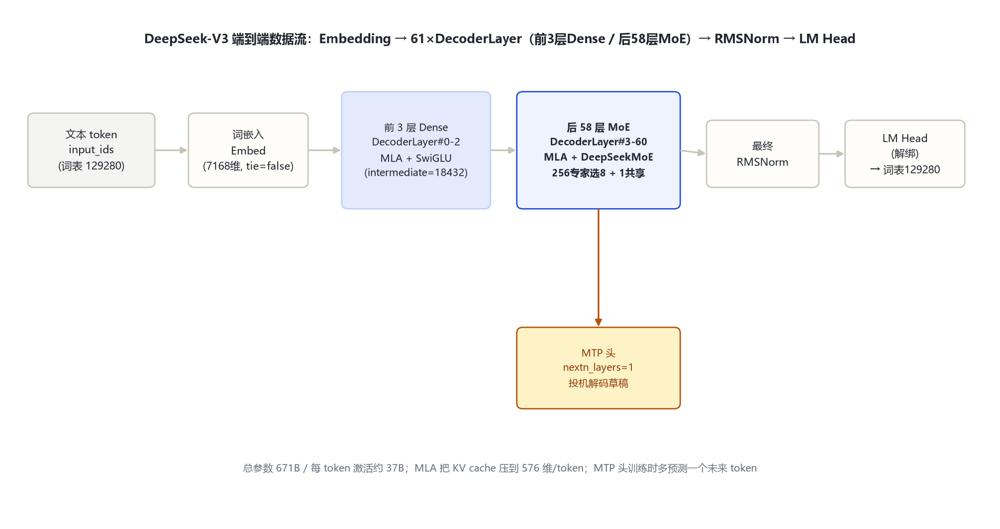
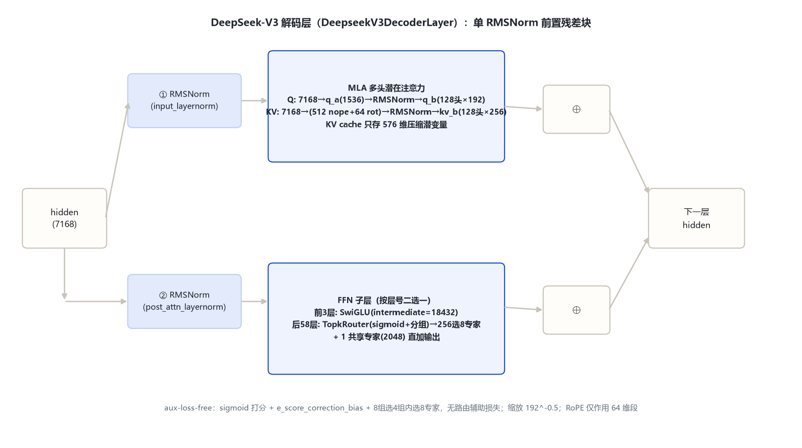

# DeepSeek-V3.1 家族架构详解 — 671B-T37B MoE · 混合推理（思考/非思考）· 840B 长上下文续训

- 徽标：入口类 DeepseekV3ForCausalLM（model_type `deepseek_v3`）· **架构与 V3 逐字段同构**
- 徽标：671B 总参 / 每 token 激活约 37B · MLA · 256 路由专家选 8 + 1 共享专家 · 前 3 层 Dense
- 徽标：**混合推理**——单一权重同时支持思考 / 非思考双模式，由 chat template 切换 `<think>` 开关
- 徽标：Base 在 V3 上两阶段长上下文续训共 **840B tokens**（32K 阶段 630B → 128K 阶段 209B）
- 徽标：训练精度 **UE8M0 FP8 Scale**（权重 + 激活，面向 MXFP8 微缩放硬件兼容）· `e_score_correction_bias` 须 FP32
- 徽标：Tokenizer 与 chat template 较大重构（新增思考标记与结构化工具调用格式）

本页以 **官方 `config.json`**（经 hf-mirror 拉取 deepseek-ai/DeepSeek-V3.1 与 DeepSeek-V3.1-Base，逐字段核对，存 `_tools\_cfgpull\`）、**transformers 源码**（本地 `E:\transformers`，`models\deepseek_v3\`）与 **官方发布公告 / 模型卡**（2025-08-19 开源）为唯一依据。所有数字均标注来源（config 字段或官方文档原文）。

## 1 家族全景：V3.1 / V3.1-Base 配置对照（与 V3 逐字段同构）

> 关键结论：**DeepSeek-V3.1 的 config.json 与 DeepSeek-V3 逐字段一致**（两份远端 config 已逐一比对）。V3.1 不是新架构，而是「V3 架构 + 长上下文续训 + 混合推理后训练 + 精度格式升级」。下表全部字段来自远端官方 config（2026-11-02 经 hf-mirror 逐字段核对，存 `_tools\_cfgpull\`）。

| 字段 | DeepSeek-V3.1 / V3.1-Base 取值 | 与 V3 对比 |
|---|---|---|
| 入口类 architectures | DeepseekV3ForCausalLM | 相同 |
| model_type | deepseek_v3 | 相同 |
| **形态** | **MoE（671B 总参 / ≈37B 激活）** | 相同 |
| hidden_size | 7168 | 相同 |
| num_hidden_layers | 61（前 3 层 Dense，后 58 层 MoE） | 相同 |
| num_attention_heads (Q) / num_key_value_heads | 128 / 128（MLA 压缩，见 §3） | 相同 |
| kv_lora_rank / q_lora_rank | 512 / 1536 | 相同 |
| qk_rope_head_dim / qk_nope_head_dim / v_head_dim | 64 / 128 / 128 | 相同 |
| intermediate_size（Dense FFN） | 18432 | 相同 |
| moe_intermediate_size（每专家） | 2048 | 相同 |
| n_routed_experts / num_experts_per_tok | 256 / 8 | 相同 |
| n_shared_experts / routed_scaling_factor | 1 / 2.5 | 相同 |
| first_k_dense_replace / moe_layer_freq | 3 / 1 | 相同 |
| vocab_size | 129280 | 相同（但 tokenizer 文件本身有调整，见 §4.4） |
| max_position_embeddings | 163840（YaRN factor=40，原始 4096） | 相同（config 值；实际可用上下文以训练口径 128K 计） |
| rope_theta / rope_scaling | 10000 / yarn(40) | 相同 |
| tie_word_embeddings | false | 相同 |
| num_nextn_predict_layers | 1（MTP 头，训练期 ~14B 附加参数） | 相同 |
| scoring_func / topk_method / n_group / topk_group | sigmoid / noaux_tc / 8 / 4 | 相同 |
| quantization_config | **fp8 e4m3 + scale_fmt=ue8m0**（权重 128×128 块缩放、激活动态） | **不同：V3.1 明确以 UE8M0 scale 格式训练**（V3 无 scale_fmt 字段） |

> 要点：① V3.1 的「685B」口径 = 671B 主模型 + ~14B MTP 模块（官方仓库 tag 与部分第三方页面），推理时去掉 MTP 即 671B；② **config 相同不代表权重相同**——V3.1-Base 是在 V3 权重基础上又续训了 840B tokens，且 tokenizer 文件与 chat template 已重构；③ `mlp.gate.e_score_correction_bias` 必须用 **FP32** 加载与计算（官方使用建议原文），路由行为才正确。

## 2 端到端数据流总览

> 文本 token → 词嵌入（129280×7168，与 LM Head 解绑）→ **61 个 DeepseekV3DecoderLayer**（前置 RMSNorm：MLA 注意力子层 + Dense FFN / DeepSeekMoE 子层，均带残差）→ 最终 RMSNorm → LM Head。另有 1 层 MTP 头训练时预测下一未来 token。**该数据流与 V3 完全一致**。

### 2.1 架构图





> 因架构逐字段同构，架构图直接沿用 deepseek_v3 目录的同名版本（仅文件名前缀改为 v3_1）；本节不重复展开 MLA / MoE 细节，完整解剖见 deepseek_v3 详文与下方 §3 速览。

## 3 核心机制速览（与 V3 同构）

| 机制 | 一句话 | 关键实参 |
|---|---|---|
| **MLA 多头潜在注意力** | Q/KV 双低秩压缩，KV cache 只存 512+64 维潜变量 | kv_lora 512 / q_lora 1536 / qk_rope 64 / qk_nope 128 / v_head 128 |
| **DeepSeekMoE** | 细粒度路由专家 + 共享专家常开 | 256 专家选 8（+1 共享），moe_inter 2048，前 3 层 Dense |
| **aux-loss-free 负载均衡** | sigmoid 打分 + e_score_correction_bias + 分组限选 | scoring=sigmoid / topk=noaux_tc / n_group 8 / topk_group 4 |
| **MTP 多 token 预测** | 训练期预测下一未来 token，推理可作投机解码草稿 | num_nextn_predict_layers=1 |
| **YaRN 长上下文** | 4096 → 163840 外推 | factor=40 / original_max=4096 / beta_fast 32 / beta_slow 1 |

## 4 V3.1 核心增量（本文档重点）

> 架构零改动的前提下，V3.1 的「版本升级」全部发生在**训练数据、后训练目标、精度格式与对话模板**四个层面——这正好是「家族架构详解」里区分 V3 与 V3.1 的全部依据。

### 4.1 ① 混合推理：单一权重，思考 / 非思考双模式

官方公告（2025-08-19）：「一个模型同时支持思考模式与非思考模式」。实现完全在 **chat template 层**（`tokenizer_config.json` / `assets/chat_template.jinja`），权重与推理图无任何分支：

```
非思考（Non-Thinking）前缀：
<｜begin▁of▁sentence｜>{system}<｜User｜>{query}<｜Assistant｜></think>
思考（Thinking）前缀：
<｜begin▁of▁sentence｜>{system}<｜User｜>{query}<｜Assistant｜><think>
```

- 非思考模式在 Assistant 后直接加 **`</think>`**（空思考闭合标记），模型直接输出答案；
- 思考模式以 **`<think>`** 开启，模型先产出显式思维链，再输出可见答案；
- 多轮对话中每轮保留 `</think>`，仅最后一轮按模式决定是否追加 `<think>`。

> 意义：把 R1 的「推理模型」能力并入 V3 的同一套权重，**无需再部署独立的 reasoner 模型**；用户侧通过「深度思考」按钮或 API 的 `thinking` 开关自由切换。V3.1-Think 在输出 token 数减少 20%–50% 的情况下平均表现与 R1-0528 持平（官方口径）。

### 4.2 ② 长上下文续训：840B tokens 两阶段（V3.1-Base 的核心投资）

V3.1-Base 在 V3 权重上按 V3 报告的长上下文方法做两阶段续训（官方模型卡 / 公告原文）：

| 阶段 | 目标长度 | 续训数据量 | 相对 V3-0324 同阶段 |
|---|---|---|---|
| Phase 1 | 4096/8192 → **32K** | **630B tokens** | **10 倍**（V3-0324 长上下文阶段仅约 63B） |
| Phase 2 | 32K → **128K** | **209B tokens** | **3.3 倍** |
| 合计 | — | **≈840B tokens** | — |

- 数据来源：额外收集的长文档（long documents），大幅加长两个训练阶段；
- 验证：官方在 128K 全范围做 **Needle in a Haystack（NIAH）** 检索测试核对召回；
- 与 config 的关系：config 的 `max_position_embeddings=163840`（YaRN 外推上限）在 V3 就已如此，**V3.1 的 128K 是「训练到达的长度」而非配置变化**——即 V3 只外推到 128K 可用，V3.1 是在 128K 长度上真正训练过（128K 上下文窗口是 API/模型卡口径，hosting 侧按 163840 提供 padding）。

### 4.3 ③ UE8M0 FP8 Scale 精度格式（与 V3 的精度差异）

- V3 的 `quantization_config`：`{quant_method: fp8, fmt: e4m3, activation_scheme: dynamic, weight_block_size: [128,128]}`；
- **V3.1 在其基础上增加 `scale_fmt: ue8m0`**（已核对远端 config）：**权重与激活的 per-block scale 因子用 UE8M0（8 位指数、0 位尾数的微缩放格式）编码，张量元素本身仍为 E4M3/E5M2 FP8**；
- 目的：使 checkpoint 与 **MXFP8 微缩放（microscaling）硬件** 数值兼容（DeepSeek 官方口径「面向即将发布的国产下一代芯片设计」，DeepGEMM 提供实现）；
- 部署注意（官方使用建议）：`mlp.gate.e_score_correction_bias` 必须 FP32 加载与计算；FP8 权重与激活须按 UE8M0 scale 格式解析（Terminus 版曾公开注明 `self_attn.o_proj` 存在 scale 格式不符问题，后续修正）。

### 4.4 ④ Tokenizer 与 chat template 重构

官方明确「V3.1 对分词器及 chat template 进行了较大调整，与 DeepSeek-V3 存在明显差异」：

- **思考标记**：新增 `<think>` / `</think>`（见 §4.1）；
- **工具调用**：非思考模式支持结构化 tool-call 格式——`<｜tool▁calls▁begin｜><｜tool▁call▁begin｜>tool_name<｜tool▁sep｜>args<｜tool▁call▁end｜>...<｜tool▁calls▁end｜>`，供 Code Agent（如 SWE 框架）与 Search Agent（思考模式内多轮搜索）使用；
- **API 兼容**：新增对 Anthropic API 格式的支持，可接入 Claude Code 框架；API Beta 支持 strict Function Calling（按 schema 校验输出）。

> 注：`vocab_size=129280` 的 config 数值未变，但 tokenizer 词表文件本身（新增特殊标记）随版本重构——词表**大小**相同、**内容**有增改，部署时须用 V3.1 配套 tokenizer。

### 4.5 ⑤ 能力提升（后训练优化的效果，官方评测口径）

| 类别 | 基准 | V3.1（非思考） | V3-0324 | V3.1（思考） | R1-0528 |
|---|---|---|---|---|---|
| 通用 | MMLU-Pro | 83.7 | 81.2 | 84.8 | 85.0 |
| 通用 | GPQA-Diamond | 74.9 | 68.4 | 80.1 | 81.0 |
| 搜索智能体 | BrowseComp | — | — | **30.0** | 8.9 |
| 搜索智能体 | HLE (Python+Search) | — | — | **29.8** | 24.8 |
| 代码智能体 | Aider-Polyglot | 68.4 | 55.1 | 76.3 | 71.6 |
| 数学推理 | AIME 2024 | 66.3 | 59.4 | 93.1 | 91.4 |

> 口径：Search Agent 用官方内部搜索框架（商业搜索 API + 网页过滤 + 128K 上下文）；SWE 用内部代码 agent 框架；HLE 为纯文本子集。V3.1 定位「迈向 Agent 时代的第一步」——相比 V3-0324 与 R1-0528 的主要增益集中在 **Code/Search Agent** 与**思考效率**（CoT 压缩）。

## 5 演进视角：V3 → V3.1 → V3.1-Terminus → V3.2-Exp

| 维度 | DeepSeek-V3（2024-12） | **DeepSeek-V3.1（2025-08）** | V3.1-Terminus（2025-09） | V3.2-Exp（2025-09） |
|---|---|---|---|---|
| 架构 | MLA + MoE + MTP（61 层 / 256 专家选 8 / 7168） | **逐字段同构** | 同构 | 同构 |
| 参数量 | 671B / 37B 激活 | 671B / 37B（+~14B MTP = 685B 口径） | 同左 | 同左 |
| 上下文 | config 163840（YaRN），训练长度较短 | **两阶段续训至 128K（840B tokens）** | 同左 | 同左 |
| 推理模式 | 单一模式 | **混合推理（思考/非思考模板切换）** | 同左 + 语言一致性修复 | 引入 **DSA 稀疏注意力** |
| 精度 | FP8 e4m3 | **UE8M0 FP8 scale**（权重+激活） | 同左（o_proj scale 问题曾注记） | — |
| 定位 | 通用基座 | **Agent 时代第一步**（工具/搜索增强） | 稳定性 + Agent 再优化 | 实验性注意力升级 |

> V3.1 之后：**V3.1-Terminus**（2025-09-22）修复中英文混杂/异常字符，进一步优化 Code/Search Agent；**V3.2-Exp**（2025-09-29）在同一架构上引入 DeepSeek Sparse Attention（DSA），是注意力机制层面的首次改动（详见 deepseek_v3_2 文档）。V3.1 系列是「V3 架构 → V4 新代际（CSA/HCA）」之间的过渡主线。

## 6 来源

1. 远端官方 config（经 hf-mirror 拉取，2026-11-02 逐字段核对，存 `_tools\_cfgpull\`）
   `DeepSeek-V3.1.config.json / DeepSeek-V3.1-Base.config.json（与 V3 逐字段一致：hidden 7168 / 61层 / 128头 / kv_lora512 / q_lora1536 / qk_rope64 / qk_nope128 / v_head128 / inter18432 / moe_inter2048 / 256专家选8 / 共享1 / first3 / vocab129280 / max163840 / yarn40 / nextn1 / sigmoid+noaux_tc / **scale_fmt ue8m0**）`
2. 官方发布公告与模型卡
   `https://api-docs.deepseek.com/zh-cn/news/news250821/（2025-08-19：混合推理、840B 续训、UE8M0、tokenizer/template 重构、Agent 提升）`
   `https://api-docs.deepseek.com/zh-cn/news/news250922/（2025-09-22：V3.1-Terminus 更新）`
   `https://huggingface.co/deepseek-ai/DeepSeek-V3.1`；`https://modelscope.cn/models/deepseek-ai/DeepSeek-V3.1`
3. transformers 源码（本地 E:\transformers\src\transformers\models\deepseek_v3\）——与 V3 同一实现，V3.1 无独立模块
4. 官方评测表（模型卡 Evaluation 节）与 V3 技术报告（arXiv:2412.19437）

> 标注约定：config 字段 / [官方公告日期] / [模型卡章节]。访问与核验日期：2026-11-02。

---

*页脚：DeepSeek-V3.1 家族架构详解 · 数据来源：远端官方 config（hf-mirror）+ 官方公告/模型卡 + transformers 源码（与 V3 同构）· 仅供技术学习与论文研究*
