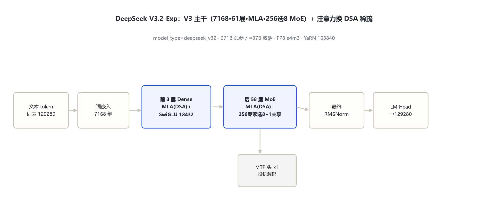
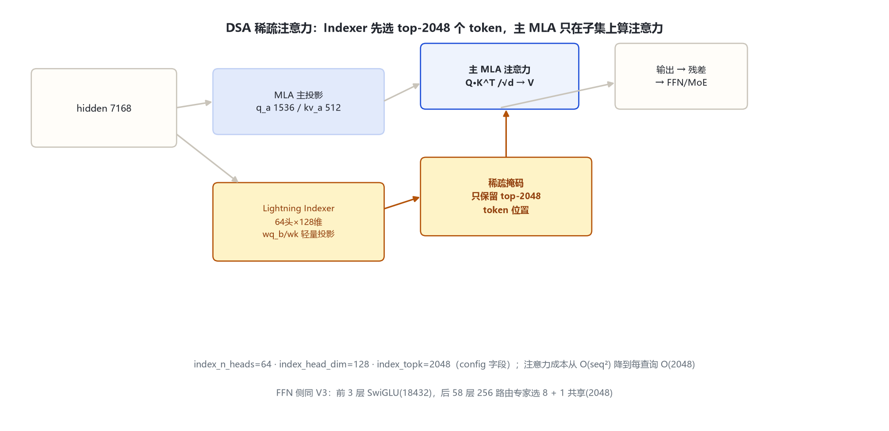

# DeepSeek-V3.2-Exp 家族架构详解 — 671B-T37B · DSA 稀疏注意力（Lightning Indexer）· 同 V3 MoE 底座

- 徽标：入口类 DeepseekV32ForCausalLM（model_type `deepseek_v32`）· 2025-09 官方 Exp 预览
- 徽标：**注意力换 DSA 稀疏注意力**（index_n_heads=64 · index_head_dim=128 · index_topk=2048），FFN 与 V3 一致
- 徽标：主干延续 V3：hidden 7168 · 61 层 · MLA（kv_lora=512/q_lora=1536）· 256 专家选 8 + 1 共享
- 徽标：671B 总参 / ≈37B 激活 · FP8 e4m3 · YaRN 163840

本页以 **DeepSeek-V3.2-Exp 官方 `config.json`**（经 hf-mirror 拉取，逐字段核对，存 `_tools\_cfgpull\`）与 transformers 源码 `models\deepseek_v32\` 为唯一依据。

## 1 家族全景：V3.2-Exp config 对照

> V3.2-Exp 与 V3 的主干字段**完全一致**（hidden/层数/MLA/MoE/词表/上下文），新增的是稀疏注意力相关字段（index_*）。

| 字段 | V3.2-Exp 取值 | 与 V3 差异 |
|---|---|---|
| architectures / model_type | DeepseekV32ForCausalLM / deepseek_v32 | **新模块** |
| hidden_size / num_hidden_layers | 7168 / 61 | 一致 |
| num_attention_heads | 128 | 一致 |
| kv_lora / q_lora / qk_rope / qk_nope / v_head | 512 / 1536 / 64 / 128 / 128 | 一致（MLA） |
| intermediate / moe_intermediate | 18432 / 2048 | 一致 |
| n_routed_experts / per_tok / shared | 256 / 8 / 1 | 一致 |
| first_k_dense_replace | 3 | 一致 |
| vocab / max_position | 129280 / 163840 | 一致 |
| **index_n_heads（索引器头数）** | **64** | **新增** |
| **index_head_dim（索引器头维）** | **128** | **新增** |
| **index_topk（每查询保留 token 数）** | **2048** | **新增** |
| layer_types | 默认全 61 层 `indexed_attention`（config `__post_init__`） | 新增默认 |
| quantization_config | fp8 e4m3 + scale_fmt ue8m0 | 同 V3.1 |

> 要点：V3.2-Exp 的架构改动集中在**注意力**——从全注意力换成「DSA 稀疏注意力」：每个查询不再 attend 全部历史，而是先经一个轻量索引器选出 top-2048 个最相关 token，再在子集上做注意力。FFN 侧的 256 专家 MoE 与 V3 完全一致。

## 2 端到端数据流总览

> 主干同 V3：词嵌入 → 61 层（前 3 层 Dense FFN / 后 58 层 MoE）→ RMSNorm → LM Head。唯一变化：每层注意力换成「MLA + DSA 稀疏掩码」。

### 2.1 架构图



## 3 解码层解剖

> `DeepseekV32DecoderLayer`（`modeling_deepseek_v32.py:601-643`）结构与 V3 相同：前置 RMSNorm → 注意力子层 → 残差 → RMSNorm → FFN/MoE → 残差。FFN 分支同 V3（前 3 层 Dense、后 58 层 MoE，`mlp_layer_types` 默认 3 dense + rest sparse）。

## 4 核心机制：DSA 稀疏注意力（Lightning Indexer）

### 4.1 ① 索引器：先选 2048 个 token 再算注意力



`DeepseekV32Indexer`（`modeling_deepseek_v32.py:147-200`）是与主 MLA 分离的轻量投影（自己的 wq_b / wk 投影，64 个头、每头 128 维），对每个查询从历史里打分选出 top-`index_topk=2048` 个 token：

```
indexer(q_idx, k_idx)  →  每查询 top-2048 个 token 位置
→ 折叠成稀疏注意力掩码（mask 掉未选中 token）
→ 主 MLA 在这个稀疏掩码上算注意力
```

> 效果：注意力从 O(seq²) 降到每查询 O(2048)，长上下文推理显著省算力，同时通过「索引器选哪些 token」保留召回关键上下文的能力。源码 `DeepseekV32Attention`（335-478）把 indexer 的 top-k 稀疏掩码折进 attention mask。

### 4.2 ② FFN 侧与 V3 一致

256 路由专家选 8 + 1 共享专家、aux-loss-free（sigmoid/noaux_tc）、moe_intermediate=2048、前 3 层 Dense——全部继承 V3，不展开。

## 5 注意力机制：MLA + DSA 稀疏掩码

| 项 | V3.2-Exp |
|---|---|
| 主注意力 | MLA（同 V3：kv_lora=512 压缩潜变量） |
| 稀疏化 | DSA：indexer 选 top-2048 token，掩码折进 attention |
| index 头数 / 头维 / top-k | 64 / 128 / 2048 |
| 上下文 | 163840（YaRN factor=40） |
| RoPE | 同 V3：仅 64 维段，rope_interleave |

## 6 特殊 Token 与词表

| token | ID | 来源 |
|---|---|---|
| bos / eos | 0 / 1 | config |
| vocab_size | 129280 | config（同 V3） |

## 7 演进视角：V3 → V3.2-Exp

| 维度 | DeepSeek-V3 | V3.2-Exp |
|---|---|---|
| 主干（hidden/层数/MLA/MoE） | 7168·61层·MLA·256选8 | **完全一致** |
| 注意力 | 全注意力 | **DSA 稀疏注意力**（indexer top-2048） |
| model_type | deepseek_v3 | **deepseek_v32**（新模块） |
| 长上下文成本 | O(seq²) | 每查询 O(2048)，显著降低 |

> 另：DeepSeek-V3.1（2025-08，model_type 仍为 deepseek_v3）config 与 V3 逐字段一致，仅 quantization 加 `scale_fmt=ue8m0` 与 transformers_version 不同——属同架构改版，不单独建目录，在此标注。

## 8 来源

1. 远端官方 config（hf-mirror，2026-10-31 核对，存 `_tools\_cfgpull\`）
   `deepseek-ai/DeepSeek-V3.2-Exp.config.json（hidden7168/61层/128头/MLA512-1536/256选8+共享1/vocab129280/max163840/index_n_heads64/index_head_dim128/index_topk2048）`
2. transformers 源码 `models\deepseek_v32\`
   `configuration_deepseek_v32.py:87-143（index 字段默认值 120-122；layer_types 默认 indexed_attention 138-139）；modeling_deepseek_v32.py：Indexer 147-200；Attention 335-478；MoE 577-600；DecoderLayer 601-643`
3. 官方模型仓库
   `https://huggingface.co/deepseek-ai/DeepSeek-V3.2-Exp`

> 标注约定：DSA/索引器字段来自官方 config 与本地源码；V3.1 同构改版标注待确认项见 §7。访问与核验日期：2026-10-31。

---

*页脚：DeepSeek-V3.2-Exp 家族架构详解 · 数据来源：远端官方 config（hf-mirror）+ transformers 源码 · 仅供技术学习与论文研究*
