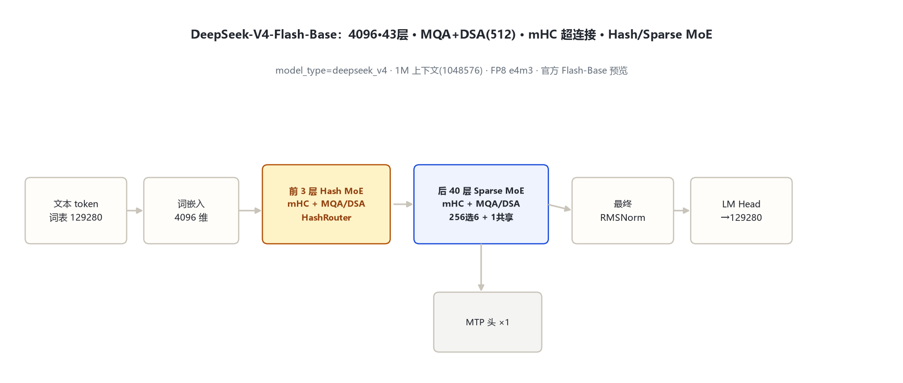
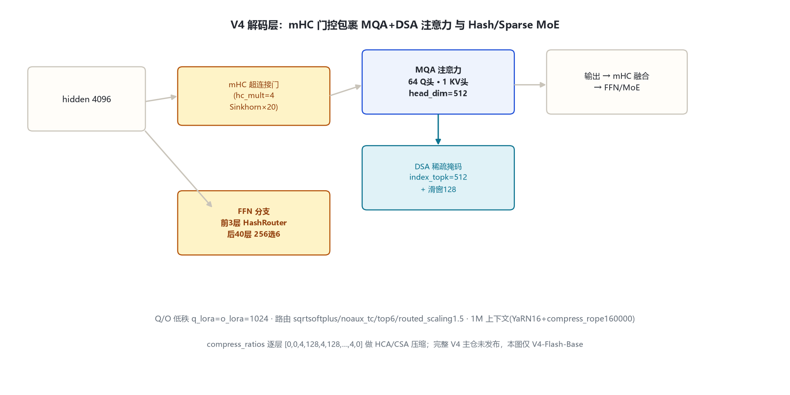

# DeepSeek-V4-Flash-Base 家族架构详解 — 4096·43层 · MQA+DSA · mHC 超连接 · Hash MoE

> 说明：本目录对应官方仓库 **deepseek-ai/DeepSeek-V4-Flash-Base**（model_type `deepseek_v4`，transformers 4.57.1）。完整尺寸「DeepSeek-V4」主仓（deepseek-ai/DeepSeek-V4）官方未公开发布（2026-10-31 拉取 404，**待确认**）；以下数字一律以 V4-Flash-Base 官方 config 与本地 `models\deepseek_v4\` 源码为准。

- 徽标：入口类 DeepseekV4ForCausalLM · hidden **4096** · **43** 层（小尺寸 Flash-Base 预览）
- 徽标：注意力 **MQA**（64 头 · kv_head=1 · head_dim=512）+ **DSA 稀疏**（index_topk=**512**）+ sliding_window=128
- 徽标：**mHC 超连接**（hc_mult=4 · Sinkhorn 20 迭代）替换标准残差
- 徽标：MoE 256 专家选 6 + 1 共享；前 3 层 **Hash MoE**（num_hash_layers=3）
- 徽标：1M 上下文（max_position=1048576）· FP8 e4m3 · MTP ×1

本页以 **V4-Flash-Base 官方 `config.json`**（经 hf-mirror 拉取，逐字段核对，存 `_tools\_cfgpull\`）与 transformers 源码 `models\deepseek_v4\` 为唯一依据。

## 1 家族全景：V4-Flash-Base config

| 字段 | 取值 | 来源 |
|---|---|---|
| architectures / model_type | DeepseekV4ForCausalLM / deepseek_v4 | config 顶层 |
| hidden_size / num_hidden_layers | 4096 / 43 | config |
| num_attention_heads / num_key_value_heads / head_dim | 64 / **1（MQA）** / 512 | config |
| q_lora_rank / o_lora_rank / qk_rope_head_dim | 1024 / 1024 / 64 | config（Q/O 双低秩） |
| index_n_heads / index_head_dim / index_topk | 64 / 128 / **512** | config（DSA 索引器） |
| sliding_window | 128 | config |
| n_routed_experts / num_experts_per_tok / n_shared | 256 / **6** / 1 | config |
| moe_intermediate_size | 2048 | config |
| num_hash_layers | 3（前 3 层 Hash MoE） | config |
| hc_mult / hc_eps / hc_sinkhorn_iters | 4 / 1e-6 / 20 | config（mHC 超连接） |
| scoring_func / topk_method / routed_scaling_factor / norm_topk_prob | sqrtsoftplus / noaux_tc / 1.5 / true | config |
| o_groups | 8 | config |
| swiglu_limit | 10.0 | config |
| max_position_embeddings | 1048576（1M） | config |
| rope_scaling | yarn factor=16 · original_max=65536 · beta_fast=32 / beta_slow=1 · rope_theta=10000 · compress_rope_theta=160000 | config |
| vocab_size / tie_word_embeddings | 129280 / false | config |
| num_nextn_predict_layers | 1（MTP） | config |
| quantization | fp8 e4m3 · scale_fmt ue8m0 · weight_block [128,128] · expert_dtype=fp8 | config |
| compress_ratios | 43 层列表：[0,0,4,128,4,128,…,4,0]（HCA/CSA 逐层压缩比） | config |

## 2 端到端数据流总览

> 词嵌入（129280×4096）→ 43×DecoderLayer（每层 mHC 超连接包裹 MQA+DSA 注意力 与 MoE FFN；前 3 层 Hash MoE，其余 Sparse MoE 256选6+共享1）→ 最终 RMSNorm → LM Head；MTP ×1。

### 2.1 架构图

## 3 解码层解剖

`DeepseekV4DecoderLayer`（`modeling_deepseek_v4.py:1137-1180`）：与 V3「前置 RMSNorm 残差」不同，V4 用 **mHC 超连接（HyperConnection，873-960）** 包裹两个子层——注意力与 FFN 均以超连接门控融合而非简单 `x + sublayer(x)`。FFN 分支：前 3 层走 HashRouter（1086）的 Hash MoE，其余层走 SparseMoeBlock（1117）256 专家选 6 + 1 共享专家。

## 4 核心机制

### 4.1 ① MQA 单 KV 头 + DSA 稀疏 + 滑动窗

`DeepseekV4Attention`（752-870）：64 个 Q 头共享 **1 个 KV 头**（MQA，num_key_value_heads=1），head_dim=512；Q/O 各做 1024 维低秩投影（q_lora/o_lora=1024）。稀疏化靠 DSA：Indexer（459-520）为每查询选 top-**512** token，叠 sliding_window=128 局部窗，进一步压长上下文注意力。

### 4.2 ② mHC 超连接（Hyper-Connection）

用可学习的逐通道门（hc_mult=4 倍通道扩展 + Sinkhorn 20 次迭代做归一化）替代标准残差相加，让层间信息流按通道自适应加权。

### 4.3 ③ Hash MoE + Sparse MoE 混合

前 `num_hash_layers=3` 层用 HashRouter 按哈希确定专家归属（免可学习路由器），之后 40 层用 SparseMoeBlock 可学习路由（sqrtsoftplus 打分、noaux_tc 组内限选、top-6、routed_scaling=1.5、norm_topk_prob=true、o_groups=8 分组）。

### 4.4 ④ 1M 长上下文压缩

`compress_ratios` 逐层指定 HCA/CSA 压缩比（交替 4/128），配合 YaRN（factor=16，original_max=65536）与 compress_rope_theta=160000，把上下文外推到 1,048,576。

## 5 注意力机制一览

| 项 | V4-Flash-Base |
|---|---|
| 形式 | MQA（kv_head=1，head_dim=512） |
| Q/O 低秩 | q_lora=o_lora=1024 |
| 稀疏 | DSA index_topk=512 + sliding_window=128 |
| 上下文 | 1,048,576（YaRN 16） |
| RoPE | qk_rope_head_dim=64，compress_rope_theta=160000 |

## 6 特殊 Token 与词表

| token | ID | 来源 |
|---|---|---|
| bos / eos | 0 / 1 | config |
| vocab_size | 129280 | config（同 V3/R1） |

## 7 演进视角：V3 → V3.2 → V4

| 维度 | V3 | V3.2-Exp | V4-Flash-Base |
|---|---|---|---|
| hidden / 层数 | 7168 / 61 | 7168 / 61 | **4096 / 43（小尺寸预览）** |
| 注意力 | MLA 全 | MLA+DSA(2048) | **MQA + DSA(512) + 滑窗128** |
| 残差 | 标准 RMSNorm 残差 | 同 V3 | **mHC 超连接** |
| MoE | 256选8+共享1 | 同 V3 | **256选6 + 前3层 Hash MoE** |
| 上下文 | 163840 | 163840 | **1,048,576（1M）** |
| 打分 | sigmoid/noaux_tc | 同 V3 | **sqrtsoftplus/noaux_tc** |

> 待确认：完整尺寸 DeepSeek-V4 主仓官方未公开发布（404），本目录数字仅代表 V4-Flash-Base 预览版，主版规模待官方发布后补。产品线现状：V4-Flash 已于 2026-09-10 起退役（API 名暂时路由至 V4.1-Flash），新一代 **V4.1-Flash**（CED 非对称 + CSA2/FP4 + 原生多模态）见 `..\deepseek_v4_1\index.md`（2026-11-03 补录）。

## 8 来源

1. 远端官方 config（hf-mirror，2026-10-31 逐字段核对，存 `_tools\_cfgpull\`）
   `deepseek-ai/DeepSeek-V4-Flash-Base.config.json（hidden4096/43层/64头/kv1/head_dim512/q_lora1024/index_topk512/sw128/256选6/hash3/hc_mult4/1M上下文/fp8 e4m3）`
2. transformers 源码 `models\deepseek_v4\`
   `configuration_deepseek_v4.py；modeling_deepseek_v4.py：RMSNorm 45 / GroupedLinear 300 / HCA Compressor 359 / CSA Compressor 586 / Indexer 459 / Attention 752 / HyperConnection 873 / SparseMoeBlock 1117 / HashRouter 1086 / DecoderLayer 1137 / ForCausalLM 1441`
3. 官方模型仓库
   `https://huggingface.co/deepseek-ai/DeepSeek-V4-Flash-Base`

> 标注约定：全部数字来自 V4-Flash-Base 官方 config 与本地源码；完整 V4 主仓未发布，标「待确认」。访问与核验日期：2026-10-31。

---

*页脚：DeepSeek-V4-Flash-Base 家族架构详解 · 数据来源：远端官方 config（hf-mirror）+ transformers 源码 · 仅供技术学习与论文研究*
