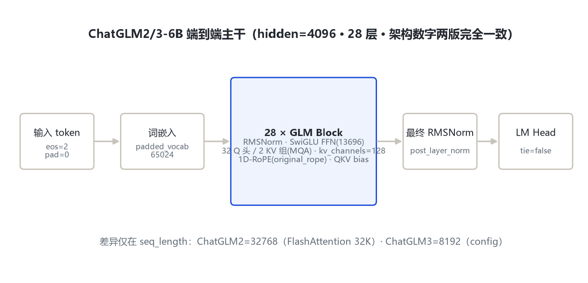
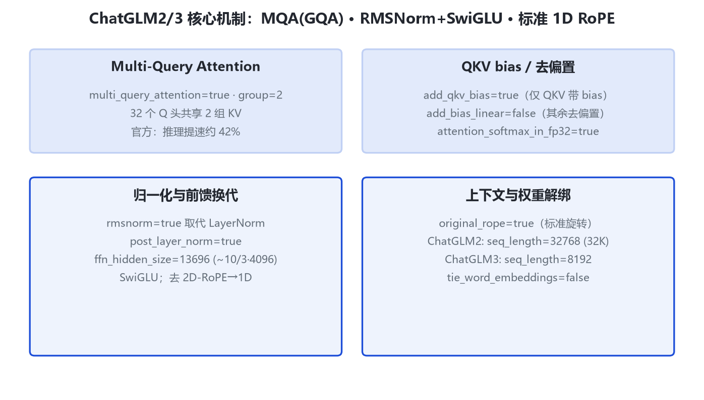

# ChatGLM2 / ChatGLM3 家族架构详解 — 6B 第二、三代（架构同构）

- 徽标：model_type=chatglm · 入口类 ChatGLMModel · trust_remote_code
- 徽标：28 层 · hidden 4096 · 32 Q 头 / 2 KV 组（MQA）· kv_channels=128
- 徽标：RMSNorm（post_layer_norm）· SwiGLU FFN 13696 · 1D-RoPE（original_rope=true）
- 徽标：padded 词表 65024 · ChatGLM2 上下文 32768 / ChatGLM3 config seq_length 8192

本页以 **HF THUDM/chatglm2-6b 与 THUDM/chatglm3-6b 官方 config.json**（经 hf-mirror 拉取，分别留档 `_tools/_cfgpull/chatglm2_6b.config.json` 与 `chatglm3_6b.config.json`）为唯一依据。**逐字段比对后确认：ChatGLM2-6B 与 ChatGLM3-6B 的架构超参数完全一致**（hidden 4096、28 层、32 头、kv_channels 128、MQA group 2、ffn 13696、padded_vocab 65024、rmsnorm、post_layer_norm、original_rope、add_qkv_bias 等全部相同），**唯一差异是 `seq_length` 字段**（ChatGLM2=32768，ChatGLM3=8192）。因此按规格合并为同一目录、内部两节区分。两代均需 trust_remote_code 加载官方 `configuration_chatglm.py / modeling_chatglm.py`（transformers v5 无原生 chatglm 模块）。

## 1 家族全景：两代 config 逐字段对照

> 下表同一行列出两代 config 的取值；「相同」表示两版该字段逐字一致。

| config 字段 | ChatGLM2-6B | ChatGLM3-6B | 说明 |
|---|---|---|---|
| model_type | chatglm | chatglm | 相同 |
| architectures | ChatGLMModel | ChatGLMModel | 相同 |
| hidden_size | 4096 | 4096 | 相同 |
| num_layers | 28 | 28 | 相同 |
| num_attention_heads | 32 | 32 | Q 头数相同 |
| kv_channels | 128 | 128 | 每头维度 |
| multi_query_attention | true | true | 开启 MQA/GQA |
| multi_query_group_num | 2 | 2 | 32 Q 头共享 2 组 KV |
| ffn_hidden_size | 13696 | 13696 | 相同（≈10/3·4096） |
| rmsnorm | true | true | RMSNorm 取代 LayerNorm |
| post_layer_norm | true | true | Post-LN 布局 |
| original_rope | true | true | 标准 1D RoPE（去 2D） |
| add_qkv_bias | true | true | 仅 QKV 带 bias |
| add_bias_linear | false | false | 其余线性层去偏置 |
| attention_softmax_in_fp32 | true | true | softmax fp32 |
| padded_vocab_size | 65024 | 65024 | 相同 |
| tie_word_embeddings | false | false | 相同 |
| layernorm_epsilon | 1e-5 | 1e-5 | 相同 |
| **seq_length** | **32768** | **8192** | **唯一差异字段** |
| eos_token_id | 2 | 2 | 相同 |
| pad_token_id | 0 | 0 | 相同 |
| torch_dtype | float16 | float16 | 相同 |

> 要点：两代架构数字完全同构，区别集中在训练序列长度字段与后训练能力（ChatGLM3 起支持 function call、代码解释器、Agent 任务）。config 字段级证据见两份留档文件。

## 2 端到端数据流总览

> 输入 token（eos=2/pad=0）→ 词嵌入（padded_vocab 65024，解绑 LM Head）→ **28 个 GLM Block**（RMSNorm + MQA 注意力[32Q/2KV] + 1D-RoPE + SwiGLU FFN 13696）→ 最终 post RMSNorm → LM Head。

### 2.1 架构图



> 全主干：词嵌入 → 28×(MQA 注意力 + SwiGLU) → 最终 RMSNorm → softmax。与 ChatGLM-6B 的差别：去 2D-RoPE、换 RMSNorm+SwiGLU、引入 MQA、上下文显著拉长。

## 3 解码层解剖

```
# ChatGLM2/3 Block（依据官方 modeling_chatglm.py 传统，trust_remote_code）
x = RMSNorm(x)
# MQA 注意力：32 个 Q 头共享 2 组 KV，QKV 带 bias
a = SelfAttention(QKV_bias(x), kv_groups=2, rope=1d)
x = x + a                       # post_layer_norm 残差
x = RMSNorm(x)
# SwiGLU 前馈，ffn_hidden_size=13696
f = SwiGLU(x)
x = x + f
```

> rmsnorm=true、post_layer_norm=true：归一化由 ChatGLM-6B 的 LayerNorm 换成 RMSNorm，布局为 Post-LN。ffn_hidden_size=13696 ≈ 10/3 × 4096（与 GLM-4 论文所述「为补偿 GQA 减参而把 FFN 提到 10/3·hidden」的口径一致）。

## 4 核心机制



### 4.1 ① Multi-Query Attention（GQA）

`multi_query_attention=true`、`multi_query_group_num=2`：32 个 Q 头只配 2 组 KV 头。KV cache 大小降为 1/16，官方综述称推理速度提升约 42%。

```
Q: 32 头 × 128 = 4096
K,V: 2 组 × 128 = 256  (repeat_kv 到 32 头后做注意力)
```

### 4.2 ② RMSNorm + SwiGLU + 去偏置

`rmsnorm=true` 取代 LayerNorm；`add_qkv_bias=true` 仅注意力 QKV 投影保留 bias，`add_bias_linear=false` 其余线性层去偏置（官方综述称此举轻微改善长度外推）。`attention_softmax_in_fp32=true` 保证数值稳定。

### 4.3 ③ 1D 标准 RoPE 与上下文长度

`original_rope=true`：移除 ChatGLM-6B 的 2D-RoPE，回到标准一维旋转位置编码。上下文：ChatGLM2 config seq_length=32768（借 FlashAttention 扩到 32K）；ChatGLM3 config seq_length=8192。官方综述称两代上下文均做到 32K 级，config 的 seq_length 为训练序列长度口径。

## 5 注意力机制

| 项 | ChatGLM2/3 取值 |
|---|---|
| Q 头数 | 32 |
| KV 组数 | 2（MQA/GQA，multi_query_group_num=2） |
| kv_channels（head_dim） | 128 |
| 位置编码 | 1D-RoPE（original_rope=true） |
| QKV bias | true（仅 QKV 带 bias） |
| softmax 精度 | fp32 |

$$\mathrm{Attn}(Q,K,V)=\mathrm{softmax}_{fp32}\!\left(\frac{QK^\top}{\sqrt{d_k}}+\mathrm{mask}\right)V,\quad K,V\text{ 仅 2 组}$$

> 与 ChatGLM-6B（32 头全 MHA、2D-RoPE、LayerNorm）相比，ChatGLM2/3 在注意力上的三处变更：MQA 减 KV、去 2D-RoPE、换 RMSNorm。

## 6 特殊 Token 与词表

| 项 | 取值 |
|---|---|
| padded_vocab_size | 65024 |
| eos_token_id | 2 |
| pad_token_id | 0 |
| tie_word_embeddings | false（embedding 与 LM Head 解绑） |

> 词表由 ChatGLM-6B 的 130528 降到 65024（padded），并切换 tokenizer。ChatGLM3 起在对话模板层引入 function call / Agent 相关角色标记（架构字段之外，由 chat template 定义）。

## 7 演进视角：ChatGLM-6B → ChatGLM2 → ChatGLM3

| 维度 | ChatGLM-6B | ChatGLM2-6B | ChatGLM3-6B |
|---|---|---|---|
| 层数 / hidden | 28 / 4096 | 28 / 4096 | 28 / 4096 |
| 注意力 | MHA 32 头 | **MQA 32Q/2KV** | MQA 32Q/2KV |
| 位置编码 | 2D-RoPE | **1D-RoPE(original)** | 1D-RoPE |
| 归一化 | LayerNorm | **RMSNorm** | RMSNorm |
| FFN | inner 16384 | **ffn 13696 (SwiGLU)** | ffn 13696 |
| 上下文(config) | 2048 | **32768** | 8192 |
| 词表 | 130528 | **65024** | 65024 |
| tie embeddings | — | false | false |

> 演进要点：① ChatGLM2 是架构换代——去 2D-RoPE、LayerNorm→RMSNorm、引入 MQA、FFN 换 SwiGLU(13696)、上下文 2K→32K；② ChatGLM3 架构数字与 ChatGLM2 完全同构，升级集中在数据/后训练（42 个基准登顶、function call、代码解释器、Agent）；③ config 唯一字段差异 seq_length（32768 vs 8192）。

## 8 来源

1. 远端官方 config：HF THUDM/chatglm2-6b（hf-mirror，2026-10-31）
   https://hf-mirror.com/THUDM/chatglm2-6b/resolve/main/config.json
   本地留档：E:\transformers\bayon-note\GLM\chatglm2_3\_tools\_cfgpull\chatglm2_6b.config.json
2. 远端官方 config：HF THUDM/chatglm3-6b（hf-mirror，2026-10-31）
   https://hf-mirror.com/THUDM/chatglm3-6b/resolve/main/config.json
   本地留档：E:\transformers\bayon-note\GLM\chatglm2_3\_tools\_cfgpull\chatglm3_6b.config.json
3. 官方仓库 THUDM/ChatGLM2-6B / ChatGLM3（modeling_chatglm.py，trust_remote_code）
   https://github.com/THUDM/ChatGLM2-6B ；https://github.com/THUDM/ChatGLM3
4. ChatGLM 家族综述论文（MQA 提速 42%、FlashAttention 32K、RMSNorm/SwiGLU/GQA 架构叙事，arXiv:2406.12793）
   https://arxiv.org/abs/2406.12793
5. transformers 本地模块核验：E:\transformers\src\transformers\models\glm\configuration_glm.py（model_type=glm 对应 GLM-4-9B，非 chatglm）

> 标注约定：两代 config 逐字段比对，差异仅 seq_length；实现细节以官方 trust_remote_code 文件为准。ChatGLM3 config seq_length=8192 与综述「32K」口径差异已在 §4.3 说明。访问与核验日期：2026-10-31。

---

*页脚：ChatGLM2/3 家族架构详解 · 数据来源：远端官方 config（hf-mirror）+ 官方仓库 + arXiv 2406.12793 · 仅供技术学习与论文研究*
