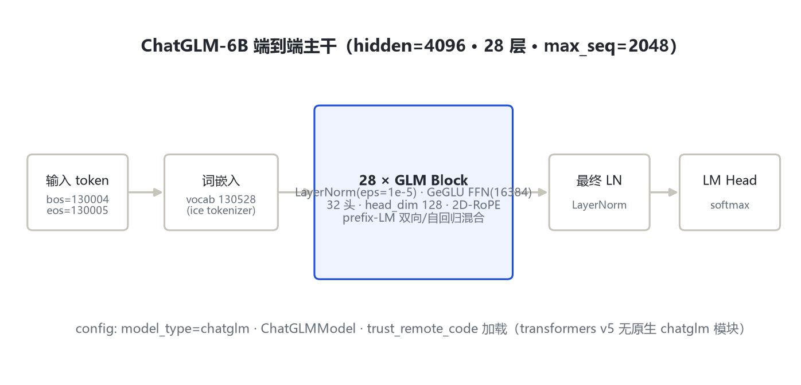
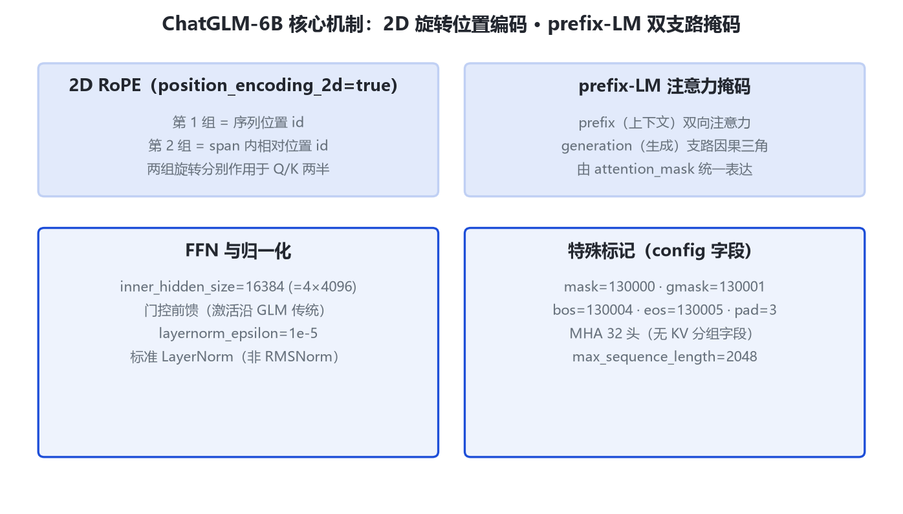

# ChatGLM-6B 家族架构详解 — 开源双语对话模型（6.2B）

- 徽标：model_type=chatglm · 入口类 ChatGLMModel（ChatGLMForConditionalGeneration）
- 徽标：28 层 · hidden 4096 · 32 注意力头（head_dim 128）· FFN inner 16384
- 徽标：prefix-LM 双向/自回归混合注意力 · 2D 旋转位置编码（position_encoding_2d=true）
- 徽标：LayerNorm（eps 1e-5）· 上下文 2048 · 词表 130528

本页以 **HF THUDM/chatglm-6b 官方 config.json**（经 hf-mirror 拉取，留档于 `_tools/_cfgpull/config.json`）与 **ChatGLM 家族综述论文**（arXiv:2406.12793）为唯一依据。ChatGLM-6B 于 2023-03-14 与 ChatGLM-130B 同日开源，设计目标为 62 亿参数、约 1 万亿 token 中英预训练、INT4 量化后可在消费级显卡本地部署。**transformers v5 无原生 chatglm 模块**（本地 `models\glm\` 对应 GLM-4-9B 架构），ChatGLM-6B 需按 config 的 `auto_map` 以 `trust_remote_code=True` 加载官方仓库 `configuration_chatglm.py / modeling_chatglm.py`。

## 1 家族全景：ChatGLM-6B 官方 config 实参表

> 下表逐字段来自远端官方 config（hf-mirror，2026-10-31 拉取）。ChatGLM-6B 为单一尺寸（6.2B）。

| config 字段 | 取值 | 含义 / 复算 |
|---|---|---|
| model_type | chatglm | 官方自定义类型 |
| architectures | ["ChatGLMModel"] | 入口类 |
| auto_map | configuration_chatglm.ChatGLMConfig 等 | 需 trust_remote_code |
| hidden_size | 4096 | 隐层维度 |
| num_layers | 28 | Transformer 层数 |
| num_attention_heads | 32 | Q 头数；head_dim=4096/32=128 |
| inner_hidden_size | 16384 | FFN 中间维度（=4×4096） |
| layernorm_epsilon | 1e-5 | LayerNorm ε |
| max_sequence_length | 2048 | 最大序列长度 |
| position_encoding_2d | true | 开启 2D 旋转位置编码 |
| vocab_size | 130528 | 词表大小 |
| bos_token_id | 130004 | 句首标记 |
| eos_token_id | 130005 | 句末标记 |
| mask_token_id | 130000 | [MASK] 破坏标记 |
| gmask_token_id | 130001 | [gMASK] 破坏标记 |
| pad_token_id | 3 | 填充标记 |
| torch_dtype | float16 | 权重精度 |
| use_cache | true | 支持 KV cache |

> 要点：config 中**没有** `multi_query_attention` / `kv_channels` 等字段——ChatGLM-6B 为标准 MHA（32 头、每头 128 维、hidden 4096 恰好整除）；KV 分组（MQA/GQA）是 ChatGLM2 才引入的。position_encoding_2d=true 是 ChatGLM-6B 区别于后续代的标志性字段。

## 2 端到端数据流总览

> 对话 token（含 bos=130004）→ ice tokenizer 词嵌入（vocab 130528）→ **28 个 GLM Block**（LayerNorm + prefix-LM 注意力 + 2D-RoPE + GeGLU 式 FFN inner 16384）→ 最终 LayerNorm → LM Head（softmax）输出下一个 token。

### 2.1 架构图



> 全主干：词嵌入 → 28×(注意力 + FFN) → 最终 LN → softmax。注意力掩码继承 GLM 范式：prefix 上下文双向、生成支路自回归。

## 3 解码层解剖

> 每个 GLM Block 由注意力子层与 FFN 子层构成，归一化为标准 LayerNorm（eps=1e-5），非后续代的 RMSNorm。

```
# ChatGLM Block 结构（依据官方 modeling_chatglm.py 传统，trust_remote_code）
x = LayerNorm(x)
# 注意力：prefix-LM 掩码 + 2D-RoPE
a = SelfAttention(Q=x·WQ, K=x·WK, V=x·WV, mask=prefix_lm_mask)
x = x + a
x = LayerNorm(x)
# FFN：inner_hidden_size=16384 的门控前馈
f = FFN(x)   # (GeLU/SwiGLU 门控, 中间维 16384)
x = x + f
```

> FFN 激活函数在 config 中未显式列出；按 GLM 家族综述（arXiv:2406.12793），GLM-130B 用 GeGLU、到 GLM-4 才统一切换 SwiGLU。ChatGLM-6B 具体激活函数以官方 modeling_chatglm.py 实现为准，标「待确认」。

## 4 核心机制



### 4.1 ① 2D 旋转位置编码（position_encoding_2d=true）

ChatGLM-6B 把 RoPE 扩展为二维形式：每个 token 带两组旋转位置 id——第 1 组为序列位置、第 2 组为 span 内相对位置，分别对 Q/K 的两半施加旋转，从而同时编码「在序列中的位置」与「在被掩码 span 内的位置」。

$$q_{\mathrm{rot}}=\mathrm{RoPE}_{p_1}(q_{[:d/2]})\oplus\mathrm{RoPE}_{p_2}(q_{[d/2:]})$$

> 这是对 GLM 论文（arXiv:2103.10360）2D 位置编码思想在 6B 对话模型上的落地。ChatGLM2 起 config 改为 `original_rope=true`、移除 2D 字段。

### 4.2 ② prefix-LM 双支路注意力掩码

prefix（上下文）支路双向注意力、generation（生成）支路因果三角注意力，由 attention_mask 统一表达。这使同一模型既能做双向理解（prefix 段）又能自回归生成。

### 4.3 ③ 面向对话的特殊标记

mask=130000、gmask=130001 沿用 GLM 破坏目标；bos=130004、eos=130005、pad=3 为对话控制标记。约 1 万亿 token 中英预训练后接 SFT 对齐。

## 5 注意力机制

| 项 | ChatGLM-6B 取值 |
|---|---|
| 注意力头数 Q | 32 |
| KV 头数 | 32（标准 MHA，无分组字段） |
| head_dim | 4096/32 = 128 |
| 位置编码 | 2D-RoPE（position_encoding_2d=true） |
| 注意力类型 | prefix-LM（双向 prefix + 自回归生成） |
| QKV bias | config 未列（官方实现传统上不带） |

$$\mathrm{Attn}(Q,K,V)=\mathrm{softmax}\!\left(\frac{QK^\top}{\sqrt{d_k}}+\mathrm{mask}_{\mathrm{prefix}}\right)V$$

> 与 ChatGLM2 的关键差别：ChatGLM-6B 是 32 头全 MHA；ChatGLM2 引入 `multi_query_attention=true / multi_query_group_num=2`（32 Q 头共享 2 组 KV）。

## 6 特殊 Token 与词表

| token | ID | 含义 |
|---|---|---|
| mask_token_id | 130000 | [MASK] 破坏标记 |
| gmask_token_id | 130001 | [gMASK] 破坏标记 |
| bos_token_id | 130004 | 句首 |
| eos_token_id | 130005 | 句末 |
| pad_token_id | 3 | 填充 |

> 词表 vocab_size=130528（ice tokenizer）。对话模板（[Round_xx]、[MASK] 等）由官方 tokenizer 定义；本页只到架构字段层级。

## 7 演进视角：GLM-130B → ChatGLM-6B → ChatGLM2

| 维度 | GLM-130B | ChatGLM-6B | ChatGLM2-6B |
|---|---|---|---|
| 层数 / hidden | 70 / 12288 | 28 / 4096 | 28 / 4096 |
| 注意力 | 双向 GLM | prefix-LM 2D-RoPE | MQA（32Q/2KV）1D-RoPE |
| 归一化 | DeepNorm Post-LN | LayerNorm | RMSNorm（post_layer_norm） |
| FFN | GeGLU 32768 | inner 16384 | ffn 13696（SwiGLU） |
| 上下文 | 2048 | 2048 | 32768 |
| 词表 | icetk 150000 | 130528 | padded 65024 |

> ChatGLM-6B 是承上启下的一代：继承 GLM 双向/prefix 思想与 2D-RoPE，但规模压到 6B；它的下一次架构大改在 ChatGLM2——去 2D-RoPE、换 RMSNorm+SwiGLU、引入 MQA、上下文扩到 32K。

## 8 来源

1. 远端官方 config：HF THUDM/chatglm-6b（hf-mirror 拉取，2026-10-31）
   https://hf-mirror.com/THUDM/chatglm-6b/resolve/main/config.json
   本地留档：E:\transformers\bayon-note\GLM\chatglm_6b\_tools\_cfgpull\config.json
2. 官方仓库 THUDM/ChatGLM-6B（modeling_chatglm.py / configuration_chatglm.py，trust_remote_code）
   https://github.com/THUDM/ChatGLM-6B
3. ChatGLM 家族综述论文（arXiv:2406.12793，约 1T token、2K 上下文、6.2B 定位）
   https://arxiv.org/abs/2406.12793
4. GLM 原始论文（2D 位置编码，arXiv:2103.10360）
   https://arxiv.org/abs/2103.10360
5. transformers 本地模块核验：E:\transformers\src\transformers\models\glm\configuration_glm.py（model_type=glm，默认 40 层/head_dim 128/max 131072，对应 GLM-4-9B，非 chatglm）

> 标注约定：config 字段逐字来自远端官方 config；transformers 源码侧无 chatglm 原生模块，实现细节以官方仓库 trust_remote_code 文件为准。FFN 激活函数、QKV bias 未在 config 列出，标「待确认」。访问与核验日期：2026-10-31。

---

*页脚：ChatGLM-6B 家族架构详解 · 数据来源：远端官方 config（hf-mirror）+ 官方仓库 + arXiv 2406.12793/2103.10360 · 仅供技术学习与论文研究*
