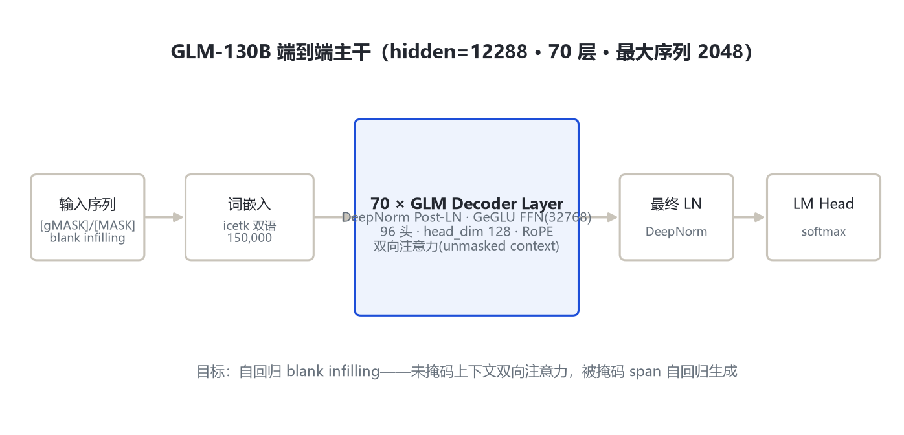
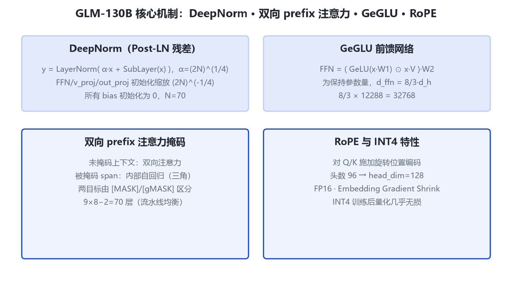

# GLM-130B 家族架构详解 — 1300 亿参数双语双向预训练模型

- 徽标：骨干 GLM（General Language Model）自回归 blank infilling，非 GPT 式单向
- 徽标：70 层 Transformer · hidden 12288 · 96 注意力头（head_dim 128）· FFN 32768
- 徽标：DeepNorm Post-LN（α=(2N)^(1/4)）· GeGLU 门控前馈 · RoPE 旋转位置编码
- 徽标：最大序列 2048 · icetk 双语词表 150000 · FP16 · 无公开可用 HF 权重

本页以 **GLM-130B 官方论文**（arXiv:2210.02414）附录 Table 11「Full configurations」与**官方 GitHub 仓库 THUDM/GLM-130B** 为唯一依据。GLM-130B 是清华 KEG 与智谱 AI 于 2022 年 8 月发布的 1300 亿参数双语（中英）稠密模型，采用 **双向注意力 GLM 骨干**而非 GPT 式单向解码器。**截至本笔记撰写，GLM-130B 无 Hugging Face 公开权重仓库**，transformers 亦无对应原生模块，故一切数字以论文与官方工程配置为准（论文附录逐字段给出）。所有权重点到为止，不做权重下载与加载配置。

## 1 家族全景：GLM-130B 核心配置对照

> GLM-130B 为单一稠密尺寸（130B），下表逐字段给出其工程配置。数字来源：论文 arXiv:2210.02414 §2.3 与附录 Table 11（标注「论文 T11」）、§2.1（标注「论文 §2.1」）。

| 字段 | 取值 | 来源 |
|---|---|---|
| 模型形态 | 稠密双向预训练模型（bilingual EN+CN） | 论文 §2.1 |
| 参数量 | ≈130B | 论文 §1 |
| 层数 num_layers | 70（流水线 9×8−2=70） | 论文 §2.3 |
| hidden_size | 12288（沿用 GPT-3 隐层维度） | 论文 §2.3 / T11 |
| 注意力头数 | 96（head_dim=12288/96=128） | 论文公开口径 |
| FFN hidden size | 32768（= 8/3 × 12288） | 论文 T11 / §B.3 |
| 归一化策略 | DeepNorm（Post-LN） | 论文 §2.1 / T11 |
| DeepNorm α | α=(2N)^(1/4)，N=70 | 论文 §2.1 |
| 前馈激活 | GeGLU（GLU + GeLU） | 论文 §B.3 式(4) |
| 位置编码 | RoPE（Rotary Positional Encoding） | 论文 §B.3 |
| 最大序列长度 | 2048（gMASK 目标） | 论文 §2.3 |
| 分词器 | icetk（sentencepiece），词表 150000 | 论文 §B.1 |
| 精度 | FP16 | 论文 T11 |
| 训练 token | 约 4000 亿（中英各约 2000 亿） | 论文 §2.3 |
| attention 类型 | 未掩码上下文双向注意力 | 论文 §2.1 |

> 要点：GLM-130B 是这一代里**唯一采用双向注意力骨干**的千亿模型（对照 GPT-3/OPT/BLOOM 的单向解码器）。为在 70 层深度下稳定训练，它反直觉地选用 **DeepNorm（一种 Post-LN）**而非当时流行的 Pre-LN，并配合 Embedding Gradient Shrink 抑制 loss spike。

## 2 端到端数据流总览

> 输入文本被采样若干 span 并替换为单个 [MASK]/[gMASK] 标记形成 x_corrupt → 词嵌入（icetk 查表）→ **70 个 GLM Decoder Layer**（DeepNorm 残差 + 双向/自回归混合注意力 + GeGLU FFN）→ 最终 LayerNorm → LM Head 输出被掩码 span 的自回归重建。

### 2.1 架构图



> 全主干统一为：词嵌入 → 70×(注意力 + GeGLU) → 最终 LN → softmax。与 GPT 的关键差别在注意力掩码形态：未掩码上下文双向可见，被掩码 span 内部自回归。

## 3 解码层解剖：DeepNorm 残差块

> GLM-130B 的每个解码层含注意力子层与 GeGLU 前馈子层，均采用 **DeepNorm Post-LN** 残差结构。给定层数 N=70：

$$\mathrm{DeepNorm}(x)=\mathrm{LayerNorm}(\alpha\cdot x+\mathrm{SubLayer}(x)),\quad \alpha=(2N)^{1/4}$$

```
# 每个子层（attn / ffn）的残差连接（论文 §2.1）
residual = x
x = SubLayer(x)
x = LayerNorm( alpha * residual + x )
# FFN / v_proj / out_proj 采用 Xavier 初始化，
# 缩放因子 (2N)^(-1/4)；所有 bias 初始化为 0
```

> N=70 时 α=(140)^(1/4)≈3.44。相比 Pre-LN，Post-LN 在深层主分支 value 尺度易失控，DeepNorm 通过可学习残差缩放 α 把 value 尺度始终约束在有界范围。

## 4 核心机制



### 4.1 ① GLM 自回归 blank infilling 目标

对文本序列 x=[x_1,…,x_n]，采样连续 span {s_1,…,s_m}，每个 span 替换为单个 mask 标记形成 x_corrupt，模型被要求自回归地重建这些 span。不同 span 之间的可见性由一个随机排列（permutation）决定，以允许被破坏 span 之间交互。

- **[MASK] 目标**：单 span 自回归重建（上下文窗 512，4 样本拼接成 2048）。
- **[gMASK] 目标**：多 span、序列并行生成（上下文窗 2048）。
- **MIP（多任务指令预训练）**：约 5% token 在 74 个 NLU/NLG 数据集上多任务微调。

### 4.2 ② DeepNorm 与训练稳定化

论文 §2.1 明确：放大后若用 Pre-LN，深层主分支 value 尺度会极大；GLM-130B 用 DeepNorm Post-LN 使 value 尺度始终有界。此外引入 **Embedding Gradient Shrink（EGS）**：把 embedding 层梯度缩到 0.1，解决了大多数数值不稳定问题。注意力分数会增长到超出 FP16 范围，配合 embedding norm 稳定（论文 Table 1）。

### 4.3 ③ GeGLU 前馈网络

$$\mathrm{FFN}_{\mathrm{GeGLU}}(x;W_1,V,W_2)=(\mathrm{GeLU}(xW_1)\otimes xV)W_2$$

为在引入额外门控矩阵 V 后保持参数量与原始 FFN 相当，前馈维度由 4·d_h 降到 **8/3·d_h**：8/3 × 12288 = 32768（与论文 Table 11 的 ffn_hidden_size=32768 完全一致）。

### 4.4 ④ RoPE 旋转位置编码与 INT4 量化特性

GLM-130B 对 Q/K 施加 RoPE 旋转位置编码。其权重分布（尤其 w2）形状良好、无大量离群值，因此具备独特的 **INT4 训练后量化缩放律**——无需量化训练即可 INT4 推理、几乎无性能损失，可在 4×RTX 3090 或 8×RTX 2080 Ti 上运行（论文 §4）。

## 5 注意力机制：双向 prefix 注意力

GLM-130B 的注意力与 GPT 式因果注意力的根本差别：**对未掩码（未被破坏）上下文使用双向注意力**，对被掩码 span 内部使用自回归（三角）注意力。两种目标由不同 mask 标记区分。

$$\mathrm{Attn}(Q,K,V)=\mathrm{softmax}\!\left(\frac{QK^\top}{\sqrt{d_k}}+\mathrm{mask}_{\mathrm{GLM}}\right)V$$

- 头数 96，head_dim = 12288/96 = 128。
- mask_GLM：prefix 上下文双向、被破坏 span 内自回归、span 间由排列决定可见性。
- RoPE 直接作用于 Q/K；FP16 下通过数值稳定化（embedding norm、softmax fp32 口径见工程实现）控制分数范围。

> 注：GLM-130B 论文未在附录 config 中单独列出 num_attention_heads 字段，96 头为官方公开与第三方工程口径；head_dim 128 由 hidden 12288 与 128 通道复算。该字段标「待确认」以官方仓库 configs 为准。

## 6 特殊 Token 与词表

| 项 | 取值 | 来源 |
|---|---|---|
| 分词器 | icetk（sentencepiece 实现） | 论文 §B.1 |
| 词表规模 | 150000（icetk 图像-文本统一词表，前 20000 为图像 token） | 论文 §B.1 |
| [MASK] / [gMASK] | 两类破坏目标标记 | 论文 §2.1 |
| 训练上下文窗 | gMASK=2048；MASK/MIP=512（4 样本拼接） | 论文 §2.3 |

> 与后续 ChatGLM-6B 不同，GLM-130B 使用 icetk 词表（150000），ChatGLM-6B 起切换到 ice tokenizer 的 130528 词表。

## 7 演进视角：GLM-130B → ChatGLM-6B

| 维度 | GLM-130B（2022-08） | ChatGLM-6B（2023-03） |
|---|---|---|
| 定位 | 130B 双向预训练基座 | 6.2B 对话模型（INT4 可消费级部署） |
| 层数 / hidden | 70 / 12288 | 28 / 4096 |
| 注意力骨干 | 双向 GLM blank infilling | 继承 prefix-LM（2D-RoPE） |
| 归一化 | DeepNorm Post-LN | LayerNorm（eps 1e-5） |
| 位置编码 | RoPE（1D） | 2D-RoPE（position_encoding_2d） |
| FFN | GeGLU，8/3·d_h=32768 | inner 16384（=4·4096） |
| 上下文 | 2048 | 2048 |
| 词表 | icetk 150000 | 130528 |

> GLM-130B 的核心遗产：双向 GLM 骨干、GeGLU、RoPE、DeepNorm 稳定化经验。ChatGLM-6B 在缩小到 6B 后引入 2D-RoPE 与面向对话的 [MASK]/[gMASK] 掩码布局，并把模型压到 INT4 可在消费级显卡运行。

## 8 来源

1. GLM-130B 官方论文：GLM-130B: An Open Bilingual Pre-Trained Model（arXiv:2210.02414）
   https://arxiv.org/abs/2210.02414
2. 论文 HTML 全文（§2 设计选择、§B 附录、Table 11 完整配置）
   https://arxiv.org/html/2210.02414v2
3. 官方 GitHub 仓库 THUDM/GLM-130B
   https://github.com/THUDM/GLM-130B
4. 清华 KEG 官方博客（70 层 / hidden 12288 / 2048 / icetk 150000 口径）
   https://keg.cs.tsinghua.edu.cn/glm-130b/zh/posts/glm-130b/
5. ChatGLM 家族综述论文（GLM-130B→GLM-4 架构演进叙事，arXiv:2406.12793）
   https://arxiv.org/abs/2406.12793
6. transformers 本地模块说明：E:\transformers\src\transformers\models\glm\（注：该 glm 模块默认配置对应 GLM-4-9B，非 GLM-130B，故 GLM-130B 无 transformers 原生模块）

> 标注约定：GLM-130B 无公开 HF 权重仓库，config 以论文附录 Table 11 与官方工程配置为准。访问与核验日期：2026-10-31。num_attention_heads=96 为官方公开口径、附录 config 未逐字段列出，标「待确认」。

---

*页脚：GLM-130B 家族架构详解 · 数据来源：官方论文 arXiv:2210.02414 + 官方 GitHub/KEG 博客 · 仅供技术学习与论文研究*
