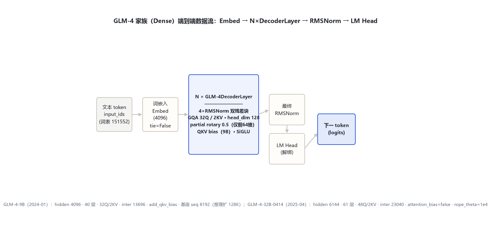
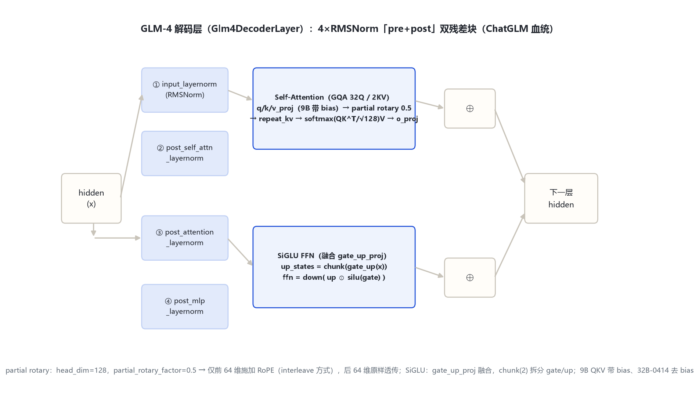

# GLM-4 家族架构详解 — GLM-4-9B（2024-01）+ GLM-4-32B-0414（2025-04，Dense 文本）

- 徽标：入口类 `ChatGLMModel`（9B 原始发布，trust_remote_code）→ 原生 `Glm4ForCausalLM`（transformers 现代移植，`model_type=glm4`）
- 徽标：GQA 32Q / 2KV（9B）· head_dim 128 · **partial rotary 0.5**（仅前 64 维旋转，ChatGLM 血统）
- 徽标：**4×RMSNorm「pre+post」双残差块**（post_layer_norm）· 融合 gate_up 的 SiGLU
- 徽标：词表 151552 · 9B 基座 seq 8192（推理扩 128K）· tie_word_embeddings=False
- 徽标：GLM-4-32B-0414 为 Dense 61 层（hidden 6144），非 MoE；QKV bias 在 9B 为 true、32B-0414 为 false

本页以 **官方 config**（2026-10-31 经 hf-mirror 拉取留档于 `_tools/_cfgpull/`）与 **transformers 源码**（本地 `E:\transformers`，`models\glm4\configuration_glm4.py` / `modeling_glm4.py`）为唯一依据。GLM-4-9B 的 2024 原始发布以 `model_type=chatglm`、`ChatGLMModel` + `auto_map` 远程代码分发；transformers v5 的原生 `glm4` 模块是其官方现代移植，默认配置与 9B 逐项对齐。所有数字均标注来源（config 字段或源码文件:行号）。

## 1 家族全景：GLM-4 两档 Dense 规格对照

> GLM-4 文本代有两档：GLM-4-9B（2024-01 首发，原始 chatglm 远程 config）与 GLM-4-32B-0414（2025-04 升级，原生 glm4 config）。二者主干一致（4×RMSNorm 双残差、GQA、partial rotary、SiGLU），仅维度、层数与个别开关随尺寸变化。

### 1.1 文本塔核心超参数

| 字段 | GLM-4-9B（2024-01） | GLM-4-32B-0414（2025-04） |
|---|---|---|
| 入口类 / model_type | ChatGLMModel（远程代码，chatglm） | Glm4ForCausalLM（glm4） |
| **形态** | **纯文本 Dense** | **纯文本 Dense** |
| hidden_size | 4096 | 6144 |
| num_hidden_layers | 40 | 61 |
| num_attention_heads (Q) | 32 | 48 |
| num_key_value_heads (KV) | 2（multi_query_group_num=2） | 2 |
| head_dim | 128（kv_channels=128） | 128 |
| intermediate_size（SiGLU FFN） | 13696（ffn_hidden_size） | 23040 |
| vocab_size | 151552（padded_vocab_size） | 151552 |
| partial_rotary_factor | 0.5（original_rope） | 0.5 |
| rope_theta | 10000（original_rope 默认） | 10000.0 |
| max_position_embeddings | 131072（原生 port）；远程 config `seq_length=8192` 为基座训练长度，推理扩 128K | 32768 |
| attention_bias（QKV 偏置） | true（add_qkv_bias=true） | false |
| tie_word_embeddings | false | false |
| rms_norm_eps | 1.5625e-6（layernorm_epsilon） | 1e-5 |
| hidden_act | silu（SiGLU） | silu |

> 要点：① 两档均为 **Dense**（config 无 n_routed_experts / moe 字段）；GLM-4-32B-0414 的 `architectures=Glm4ForCausalLM`、`model_type=glm4` 证实其非 MoE——MoE 是 GLM-4.5 才引入（见 `glm_4_5`）。② GQA 分组 9B 为 32/2=16:1、32B 为 48/2=24:1。③ QKV 偏置是两档唯一的注意力开关差异：9B 远程 config `add_qkv_bias=true`（原生 port `attention_bias=True`），32B-0414 改为 `attention_bias=false`。④ `partial_rotary_factor=0.5` 在两档均显式给出。

### 1.2 部署与上下文规格

| 字段 | GLM-4-9B | GLM-4-32B-0414 |
|---|---|---|
| 官方参数量 | ≈9B | ≈32B（Dense） |
| 基座 seq_length | 8192（远程 config）；经 RoPE 外推支持 128K | 32768 |
| pad / eos | pad=151329；eos=[151329,151336,151338] | pad=151329；eos=[151329,151336,151338] |
| torch_dtype | bfloat16 | bfloat16 |

## 2 端到端数据流总览

> 文本 token → 词嵌入（Embedding，不与 LM Head 绑定）→ **N 个 GLM-4DecoderLayer**（4×RMSNorm 双残差块：注意力子层 + SiGLU FFN 子层）→ 最终 RMSNorm → LM Head（解绑）。GLM-4 为纯文本代，无视觉塔（视觉变体 GLM-4V-9B 见 `glm_4v`）。

### 2.1 架构图



> 全家族统一主干：Embedding → N×DecoderLayer → 最终 RMSNorm → LM Head；差异集中在 hidden、层数、Q 头数与 QKV bias 开关。

## 3 解码层解剖：4×RMSNorm「pre+post」双残差块

> `Glm4DecoderLayer`（`modeling_glm4.py:66-109`）含两组残差子层，每个子层用 **前置 + 后置两个 RMSNorm**（`post_layer_norm=true` 的 ChatGLM 传统，区别于 Qwen3 的单 RMSNorm 前置）。两层共享此结构。

### 3.1 架构图



```
Glm4DecoderLayer.forward（modeling_glm4.py:88-109）:
  residual = hidden_states
  hidden_states = input_layernorm(hidden_states)        # ① RMSNorm(hidden)
  hidden_states, _ = self_attn(hidden_states, ...)      # GQA + partial rotary 0.5
  hidden_states = post_self_attn_layernorm(hidden_states)# ② RMSNorm
  hidden_states = residual + hidden_states              # ⊕1
  residual = hidden_states
  hidden_states = post_attention_layernorm(hidden_states)# ③ RMSNorm
  hidden_states = self.mlp(hidden_states)               # SiGLU（融合 gate_up）
  hidden_states = post_mlp_layernorm(hidden_states)      # ④ RMSNorm
  hidden_states = residual + hidden_states              # ⊕2
  return hidden_states
```

> 与 Qwen3 的「单 RMSNorm 前置（pre-norm）」不同，GLM-4 每个子层在残差相加前对**子层输出再归一一次**（post_self_attn_layernorm / post_mlp_layernorm），共 4 个 RMSNorm/层（`modeling_glm4.py:73-76`）。

## 4 核心机制：partial rotary · GQA · 4×RMSNorm · SiGLU

### 4.1 ① 部分旋转位置编码（partial_rotary_factor=0.5）

GLM-4 继承 ChatGLM 的 **partial rotary**：head_dim=128 中只有前一半（64 维）施加 RoPE，后一半（64 维）原样透传。`Glm4RotaryEmbedding.compute_default_rope_parameters` 中旋转维度 `dim = head_dim × partial_rotary_factor = 128 × 0.5 = 64`（`modeling_glm4.py:290-292`）。

$$\mathrm{inv\_freq}_i = \mathrm{base}^{-2i/\mathrm{dim}},\quad i=0,\dots,\mathrm{dim}/2-1,\ \mathrm{dim}=64$$

```
apply_rotary_pos_emb（modeling_glm4.py:178-192）:
  cos/sin 先 repeat_interleave(2, dim=-1)          # interleave 排列
  q_rot, q_pass = q[..., :rotary_dim], q[..., rotary_dim:]   # 前64 / 后64
  q_embed = (q_rot*cos) + (rotate_half(q_rot)*sin)
  q_embed = cat([q_embed, q_pass], dim=-1)         # 后64维不旋转
```

> 与「全维度 RoPE」（Qwen3）不同，GLM-4 只旋转 64/128 维；base（rope_theta）两档均为 10000。原生 port 以 `partial_rotary_factor` 默认值 0.5 保持向后兼容（`configuration_glm4.py:77`）。

### 4.2 ② GQA 与 KV 压缩（16:1 / 24:1）

`Glm4Attention` 中 `num_key_value_groups = num_attention_heads / num_key_value_heads`（`modeling_glm4.py:204`），运行时 `repeat_kv` 把 K/V 从 KV 头复制到 Q 头数（`modeling_glm4.py:112-121, 134-135`）。

### 4.3 ③ 4×RMSNorm（pre+post）

`Glm4RMSNorm`（`modeling_glm4.py:310-328`）先 fp32 归一 `hidden × rsqrt(mean(x²)+eps)`，再乘可学习权重 γ。每子层前置一个、后置一个 RMSNorm（见 §3）。eps：9B=1.5625e-6、32B-0414=1e-5。

### 4.4 ④ 融合 gate_up 的 SiGLU

`Glm4MLP`（`modeling_glm4.py:48-63`）用单个 `gate_up_proj` 一次性投影到 `2×intermediate_size`，再 `chunk(2)` 拆出 gate/up：

$$\mathrm{FFN}(x)=\mathrm{down}\big(\mathrm{up}\odot \mathrm{silu}(\mathrm{gate})\big),\qquad [gate,up]=\mathrm{chunk}_2(\mathrm{gate\_up\_proj}(x))$$

> 9B intermediate=13696、32B=23040；三个投影全部 bias=False（`modeling_glm4.py:53-54`）。

## 5 注意力机制：GQA · partial rotary · QKV bias

### 5.1 GQA KV 头分配（repeat_kv）

| 尺寸 | Q 头数 | KV 头数 | GQA 分组 | head_dim | Q 投影输出维 |
|---|---|---|---|---|---|
| GLM-4-9B | 32 | 2 | 16:1 | 128 | 32×128=4096=hidden |
| GLM-4-32B-0414 | 48 | 2 | 24:1 | 128 | 48×128=6144=hidden |

### 5.2 注意力核心与缩放

$$\mathrm{Attn}(Q,K,V)=\mathrm{softmax}\!\left(\frac{QK^\top}{\sqrt{128}}+\text{mask}\right)V$$

```
Glm4Attention.forward（modeling_glm4.py:209-258）:
  q_proj / k_proj / v_proj  bias=config.attention_bias   # 9B=True，32B-0414=False
  o_proj bias=False
  scaling = head_dim ** -0.5 = 128**-0.5                  # line 205
  query/key 经 apply_rotary_pos_emb（partial rotary 0.5）
  repeat_kv(K,V) → softmax(QK^T*scaling, fp32)V → o_proj
```

> 注意力缩放固定 `head_dim^-0.5`（`modeling_glm4.py:205`）。9B 远程 config 的 `apply_query_key_layer_scaling=true` 是旧版开启 QK 缩放的开关，原生 port 统一为 `head_dim^-0.5`。

## 6 特殊 Token 与词表布局

| token | ID | 含义 | 来源 |
|---|---|---|---|
| pad_token_id | 151329 | 填充 | config 顶层 |
| eos_token_id | [151329, 151336, 151338] | 序列结束（多终止符） | config；`configuration_glm4.py:79` |
| vocab_size | 151552 | 词表大小 | config 顶层（padded_vocab_size） |
| boi / eoi | 151339 / 151340 | 图像块起止（仅 GLM-4V-9B，见 `glm_4v`） | glm4v config |

> 词表 `vocab_size=151552`（GLM 系沿用，与 Qwen 的 151936 不同）。GLM-4 文本代无额外思维标记——长思维链推理是 GLM-Z1（`glm_z1`）才引入的训练目标，架构不变。

## 7 演进视角：ChatGLM-3 → GLM-4 → GLM-4.5

> 早期代（ChatGLM-1/2/3、GLM-130B）由同项目另一执行者负责；本表只列与 GLM-4 相邻、可从官方 config/源码核实的锚点。

| 维度 | ChatGLM-3（基线，远程代码） | GLM-4（本代 Dense） | GLM-4.5（下一大代，见 glm_4_5） |
|---|---|---|---|
| 形态 | Dense | **Dense**（9B / 32B-0414） | **MoE**（355B-A32B，160 专家） |
| GQA | MQA / 小 KV 组 | GQA 32Q/2KV（16:1） | GQA 96Q/8KV |
| 归一化 | RMSNorm + post_layer_norm | 同（4×RMSNorm 双残差） | 简化为 2×RMSNorm 前置 + QK-Norm |
| partial rotary | 有 | 有（0.5） | 有（0.5）+ use_qk_norm |
| FFN | GLU | 融合 gate_up SiGLU | SiGLU + 路由专家 + 共享专家 |
| MTP / 推理 | 无 | 无 | num_nextn_predict_layers=1（MTP） |

> GLM-4 的主线定位：① 把 ChatGLM 系的 4×RMSNorm 双残差、partial rotary、GQA 定型为 Dense 两代（9B 首发、32B-0414 升级）；② 词表固定 151552；③ 为 GLM-4.5 的 MoE 化提供文本主干基础。GLM-4.5 在同主干上换 MoE、加 QK-Norm 与 MTP（详见 `glm_4_5`）。

## 8 来源

1. 官方 config（GLM-4-9B，远程 chatglm 格式，2026-10-31 经 hf-mirror 拉取留档）
   `zai-org/glm-4-9b（model_type=chatglm / ChatGLMModel；hidden 4096 / 40层 / 32头 / multi_query_group_num=2 / kv_channels 128 / ffn 13696 / vocab 151552 / add_qkv_bias / original_rope / post_layer_norm / rmsnorm / seq_length 8192 / tie=false）`
   `zai-org/glm-4-9b-chat（对话版，同构）`
2. 官方 config（GLM-4-32B-0414，原生 glm4 格式，留档于 glm_4/_tools/_cfgpull/）
   `zai-org/GLM-4-32B-0414（Glm4ForCausalLM；hidden 6144 / 61层 / 48Q·2KV / head_dim 128 / inter 23040 / partial rotary 0.5 / rope_theta 1e4 / max 32768 / attention_bias=false / tie=false）`
3. transformers 源码 configuration_glm4.py（本地 E:\transformers）
   `vocab 151552(56) / hidden 4096(57) / inter 13696(58) / layers 40(59) / heads 32(60) / kv_heads 2(61) / head_dim 128(62) / max_position 131072(65) / rms_eps 1.5625e-6(67) / tie=false(69) / pad 151329(71) / attention_bias=true(74) / eos[...](79) / partial_rotary_factor=0.5 默认(77)`
4. transformers 源码 modeling_glm4.py
   `Glm4MLP gate_up 53 / chunk 60 / SiGLU 61；DecoderLayer 66-109（4 RMSNorm 73-76，forward 88-109）；repeat_kv 112-121；apply_rotary 156-193（interleave 178-179，partial 182-184）；Attention 196-258（head_dim 203，groups 204，scaling 205，QKV bias 209-217）；RotaryEmbedding 261-307（dim=head×partial 292）；RMSNorm 310-328；Model 351-421；ForCausalLM lm_head 435`
5. GLM-4 模型卡片与技术报告
   `https://huggingface.co/zai-org/glm-4-9b（GLM-4 系列发布，9B/32B/多模态规格与 128K 上下文口径）；智谱 BigModel 开放平台 GLM-4 发布公告`

> 标注约定：[S:n]=modeling_glm4.py 行号；config 来源标注「远端官方 config：<repo>」+ 拉取日期 2026-10-31。GLM-4-9B 远程 config 字段名（kv_channels / multi_query_group_num / ffn_hidden_size / num_layers / padded_vocab_size）与原生 glm4 字段名（head_dim / num_key_value_heads / intermediate_size / num_hidden_layers / vocab_size）的对应关系已在 §1 表格逐格标注。GLM-4-9B 基座 seq_length=8192、推理外推到 128K 为官方 card 口径。访问与核验日期：2026-10-31。

---

*页脚：GLM-4 家族架构详解 · 数据来源：远端官方 config（hf-mirror）+ transformers 源码（E:\transformers）+ 官方 model card · 仅供技术学习与论文研究*
