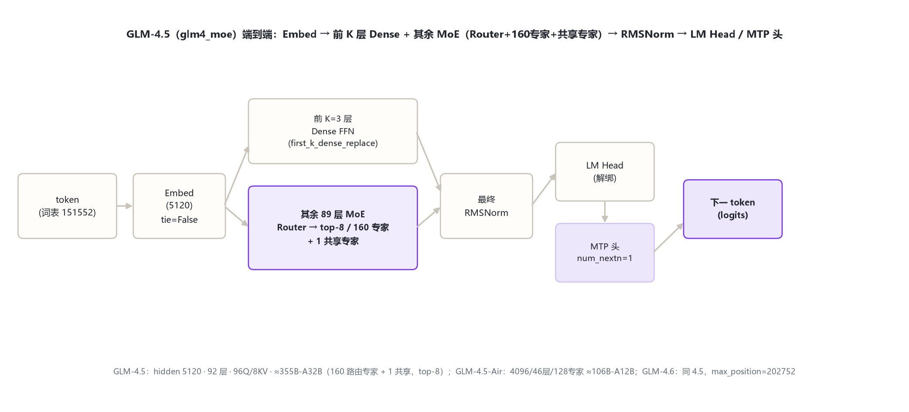
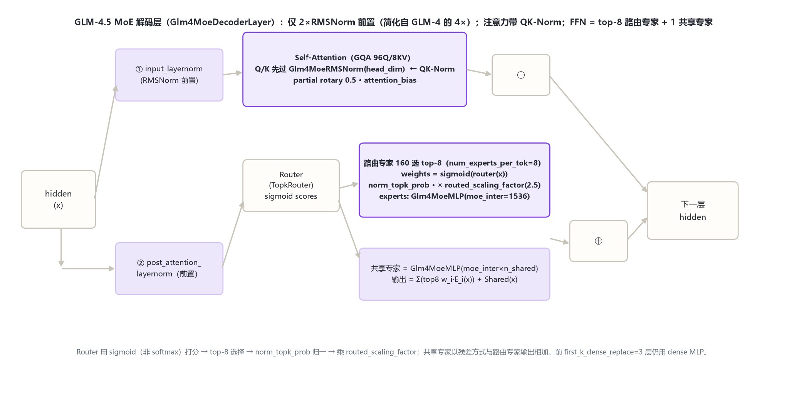

# GLM-4.5 家族架构详解 — GLM-4.5（≈355B-A32B MoE）· 4.5-Air · 4.6

- 徽标：入口类 `Glm4MoeForCausalLM`（`model_type=glm4_moe`，transformers 原生模块 `models\glm4_moe\`）
- 徽标：**MoE**：GLM-4.5 有 160 路由专家 + 1 共享专家，top-8 路由（≈355B-A32B）
- 徽标：**sigmoid 路由**（非 softmax）+ norm_topk_prob + routed_scaling_factor=2.5
- 徽标：**QK-Norm**（Q/K 各过 Glm4MoeRMSNorm(head_dim)）；归一化简化为 2×RMSNorm 前置
- 徽标：**MTP**（num_nextn_predict_layers=1，多 token 预测头）
- 徽标：GLM-4.5-Air ≈106B-A12B（128 专家，46 层）；GLM-4.6 同 4.5 架构，max_position=202752

本页以 **官方 config**（2026-10-31 经 hf-mirror 拉取留档于 `_tools/_cfgpull/`，`zai-org/GLM-4.5`、`GLM-4.5-Air`、`GLM-4.6`）与 **transformers 源码 `models\glm4_moe\`**（本地 E:\transformers）为唯一依据。**关键事实纠正**：GLM-4.5 不是 dense 32B，而是 **glm4_moe 架构的 355B-A32B 稀疏 MoE**；任务背景中的「32B dense」为待核实旧口径，以官方 config 的 `model_type=glm4_moe` 与专家字段为准。

## 1 家族全景：GLM-4.5 三档 MoE 规格对照

> GLM-4.5（2025-07）从 GLM-4 的 Dense 切换到 MoE 主干：GLM-4.5（旗舰 355B-A32B）、GLM-4.5-Air（轻量 106B-A12B）、GLM-4.6（2025 年中，与 4.5 同构、仅扩上下文）。

### 1.1 核心超参数（官方 config 实参）

| 字段 | GLM-4.5 | GLM-4.5-Air | GLM-4.6 |
|---|---|---|---|
| **model_type / 形态** | glm4_moe（MoE） | glm4_moe（MoE） | glm4_moe（MoE） |
| hidden_size | 5120 | 4096 | 5120 |
| num_hidden_layers | 92 | 46 | 92 |
| Q / KV 头 | 96 / 8 | 96 / 8 | 96 / 8 |
| head_dim | 128 | 128 | 128 |
| intermediate_size（dense FFN） | 12288 | 10944 | 12288 |
| moe_intermediate_size（每专家） | 1536 | 1408 | 1536 |
| **n_routed_experts** | **160** | **128** | **160** |
| n_shared_experts | 1 | 1 | 1 |
| num_experts_per_tok（top-k） | 8 | 8 | 8 |
| first_k_dense_replace | 3 | 1 | 3 |
| routed_scaling_factor | 2.5 | 1.0 | 2.5 |
| norm_topk_prob | true | true | true |
| use_qk_norm | true | false | true |
| partial_rotary_factor | 0.5 | 0.5 | 0.5 |
| rope_theta | 1e6 | 1e6 | 1e6 |
| max_position_embeddings | 131072 | 131072 | **202752** |
| num_nextn_predict_layers（MTP） | 1 | 1 | 1 |
| attention_bias / tie | true / false | true / false | true / false |
| vocab_size / rms_eps | 151552 / 1e-5 | 151552 / 1e-5 | 151552 / 1e-5 |
| 官方激活参数（A 侧） | ≈32B/token | ≈12B/token | ≈32B/token |

> 要点：① 三档均为 MoE（config 有 n_routed_experts / num_experts_per_tok / n_shared_experts）。② GLM-4.6 与 GLM-4.5 config 逐项相同，唯一差异是 `max_position_embeddings` 202752 vs 131072（上下文扩展）。③ Air 是 4.5 的窄版（hidden 4096、46 层、128 专家、每专家 moe_inter 1408、use_qk_norm=false、scaling 1.0）。④ 前 `first_k_dense_replace` 层用 dense FFN，之后才换 MoE 层。

## 2 端到端数据流总览

> token → Embedding（不绑定 LM Head）→ **前 K 层 dense FFN 层 + 其余 MoE 层**（每层：GQA 注意力[带 QK-Norm] + Router 路由 top-8 专家并叠加共享专家）→ 最终 RMSNorm → LM Head；另有 MTP 头做下一-下一 token 预测。

### 2.1 架构图



## 3 解码层解剖：MoE 层（2×RMSNorm 前置 + QK-Norm + 路由专家）

> `Glm4MoeDecoderLayer`（`modeling_glm4_moe.py:394-438`）相对 GLM-4 的 4×RMSNorm 双残差**简化为 2×RMSNorm 前置**：注意力子层与 MoE 子层各一个前置 RMSNorm（`first_k_dense_replace` 之前用 dense MLP，之后用 MoE，见 `:401-404`）。

### 3.1 架构图



```
Glm4MoeDecoderLayer.forward（modeling_glm4_moe.py:394-438）:
  residual = hidden_states
  hidden_states = input_layernorm(hidden_states)          # 前置 RMSNorm ①
  hidden_states = self_attn(hidden_states, ...)           # GQA 96Q/8KV + QK-Norm
  hidden_states = residual + hidden_states                 # ⊕
  residual = hidden_states
  hidden_states = post_attention_layernorm(hidden_states) # 前置 RMSNorm ②
  hidden_states = self.mlp(hidden_states)                 # dense MLP 或 MoE
  hidden_states = residual + hidden_states
```

## 4 核心机制：MoE 路由 · QK-Norm · 共享专家 · MTP

### 4.1 ① sigmoid Top-k 路由（非 softmax）

`TopkRouter`（`modeling_glm4_moe.py:268`）先对 token 做线性打分，用 **sigmoid**（非 softmax）得到路由权重（`:284`），再选 top-k（`:300-305`）；`norm_topk_prob=true` 时对选中权重再归一（`:302-304`），最后乘 `routed_scaling_factor`（`:305`）。

$$w_i = \mathrm{sigmoid}(\text{router}(x)_i),\quad i\in \mathrm{top}_k(x),\qquad \tilde w_i = \frac{w_i}{\sum_{j\in top_k} w_j}\times \lambda,\quad \lambda=2.5(\text{GLM-4.5})$$

### 4.2 ② 路由专家 + 共享专家并联

`Glm4MoeMoE`（`:370`）：路由分支输出 top-k 专家加权和；**共享专家** `shared_experts = Glm4MoeMLP(moe_inter × n_shared_experts)`（`:380-381`）作为另一路全 token 激活，与路由分支残差相加（`:384-390`）。

$$\mathrm{FFN}_{MoE}(x) = \underbrace{\sum_{i\in top_8}\tilde w_i\, E_i(x)}_{\text{路由专家}} + \underbrace{\mathrm{Shared}(x)}_{\text{共享专家（每 token 都激活）}}$$

### 4.3 ③ QK-Norm

注意力内部对 Q、K 各加一个 `Glm4MoeRMSNorm(head_dim)`（`use_qk_norm=true` 分支，`:198-201`，应用于 `:218-220`），稳定大模型长上下文训练。GLM-4.5-Air 的 `use_qk_norm=false`，不加 QK-Norm。

### 4.4 ④ MTP（多 token 预测）

`num_nextn_predict_layers=1`：除主 LM Head 外，附一个浅层 MTP 模块预测「下下个 token」，用于提升自回归训练密度与推理 speculation（架构层面挂在模型尾部；具体实现见 `models\glm4_moe\`）。

## 5 注意力机制：GQA 96Q/8KV + partial rotary

与 GLM-4 共享 GQA + partial rotary 血统：96 个 Q 头 / 8 个 KV 头（12:1）、head_dim 128、partial_rotary_factor=0.5、attention_bias=true。差异是新增 QK-Norm 与更大的 rope_theta=1e6（配合 128K+ 上下文）。详见 `glm_4/index.md` §5 的 GQA/partial rotary 原理。

## 6 特殊 Token 与词表布局

| token | ID | 含义 |
|---|---|---|
| pad / eos | 151329 / [151329,151336,151338] | 填充 / 结束 |
| vocab_size | 151552 | 词表（GLM 系沿用） |

> GLM-4.5 文本代不新增特殊 token（视觉变体 GLM-4.5V 才扩展 video/image token，折入 §8 提及）。MTP 头不引入新特殊 token。

## 7 演进视角：GLM-4（Dense）→ GLM-4.5（MoE）→ GLM-4.6 / GLM-4.5V

| 维度 | GLM-4-9B / 32B（Dense） | GLM-4.5（本页 MoE） | GLM-4.6 | GLM-4.5V |
|---|---|---|---|---|
| 形态 | Dense | **MoE 160 专家 top-8** | 同 4.5 | MoE（文本=4.5-Air 塔）+ 视觉 |
| hidden / 层数 | 4096·40 / 6144·61 | 5120 / 92 | 5120 / 92 | 4096 / 46 |
| Q / KV | 32·2 / 48·2 | 96·8 | 96·8 | 96·8 |
| 归一化 | 4×RMSNorm（pre+post） | **2×RMSNorm 前置 + QK-Norm** | 同 4.5 | 同 4.5-Air |
| 路由 | 无 | sigmoid top-8 + 共享专家 | 同 4.5 | 同 4.5-Air |
| MTP | 无 | num_nextn=1 | 1 | 1 |
| max_position | 128K（外推） | 131072 | 202752 | 65536 |

> GLM-4.5 的主线：① Dense → MoE（160 专家、top-8、1 共享专家）；② 归一化从 4×RMSNorm 双残差简化为 2×RMSNorm 前置，并引入 QK-Norm；③ 新增 MTP；④ 词表仍 151552、partial rotary 0.5 沿用。GLM-4.5V（`glm4v_moe`）把文本塔换成 4.5-Air 并接新视觉塔（24 层 / 1536 / 336 / merge 2，支持视频），因近邻重叠不另立目录，在此提及。

## 8 来源

1. 官方 config（GLM-4.5，2026-10-31 hf-mirror 留档）
   `zai-org/GLM-4.5（model_type=glm4_moe / Glm4MoeForCausalLM；hidden 5120/92层/96Q·8KV/head_dim 128/inter 12288/moe_inter 1536/n_routed_experts 160/n_shared 1/top 8/first_k_dense 3/routed_scaling 2.5/norm_topk/use_qk_norm/partial 0.5/rope_theta 1e6/max 131072/num_nextn 1/tie=false）`
2. 官方 config（GLM-4.5-Air）
   `zai-org/GLM-4.5-Air（glm4_moe；hidden 4096/46层/96Q·8KV/inter 10944/moe_inter 1408/128专家/top 8/first_k_dense 1/scaling 1.0/use_qk_norm=false/max 131072/MTP 1）`
3. 官方 config（GLM-4.6）
   `zai-org/GLM-4.6（与 GLM-4.5 完全相同，唯一差异 max_position_embeddings=202752）`
4. transformers 源码 models\glm4_moe\modeling_glm4_moe.py
   `RotaryEmbedding 45/forward 85；Attention 174（use_qk_norm 198-201，q/k RMSNorm 应用 218-220）；Glm4MoeMLP 252；TopkRouter 268（top_k 271，sigmoid 284，topk 选择 300-305，norm 302-304，scaling 305）；RMSNorm 310；Experts 331/forward 343-364；Glm4MoeMoE 370（shared 380-381，forward 384-390）；DecoderLayer 394-438（dense/MoE 切换 401-404）；Model 474；ForCausalLM 550`
5. GLM-4.5 模型卡片与技术报告
   `https://huggingface.co/zai-org/GLM-4.5（355B-A32B MoE 规格、128K 上下文、MTP 与开源公告）`

> 标注约定：[S:n]=modeling_glm4_moe.py 行号；config 来源标注「远端官方 config：<repo>」+ 拉取日期 2026-10-31。「≈32B/≈12B 激活参数」为官方 card 口径。访问与核验日期：2026-10-31。

---

*页脚：GLM-4.5 家族架构详解 · 数据来源：远端官方 config（hf-mirror）+ transformers 源码（E:\transformers）+ 官方论文/model card · 仅供技术学习与论文研究*
