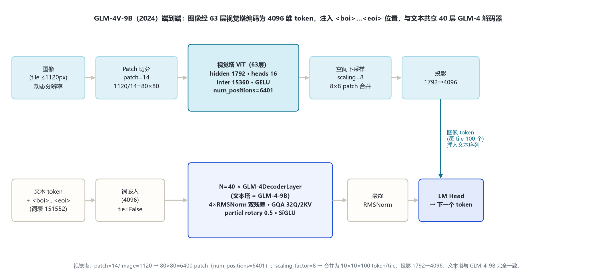
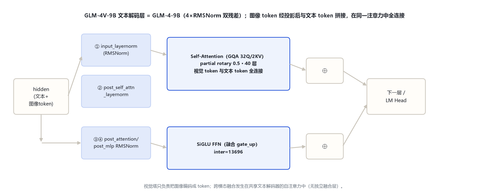
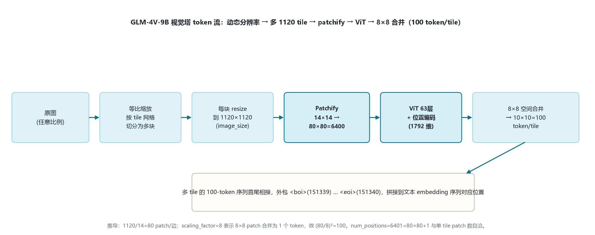

# GLM-4V 家族架构详解 — GLM-4V-9B（2024 视觉-语言模型，远程 chatglm 代码）

- 徽标：入口类 `ChatGLMForConditionalGeneration`（`model_type=chatglm`，`auto_map` 远程代码）
- 徽标：文本塔 = GLM-4-9B（hidden 4096 · 40 层 · GQA 32Q/2KV · partial rotary 0.5 · 4×RMSNorm 双残差）
- 徽标：视觉塔 ViT **63 层** · hidden **1792** · patch 14 · image 1120 · heads 16 · inter 15360 · GELU
- 徽标：**动态分辨率多 tile**，`scaling_factor=8`（8×8 patch 合并）→ 每 1120 tile = 100 个视觉 token
- 徽标：特殊 token `<boi>`=151339 / `<eoi>`=151340，图像 token 包于其中注入文本序列
- 徽标：跨模态融合发生在**共享文本解码器自注意力**中（无独立融合层）

本页以 **官方 config**（2026-10-31 经 hf-mirror 拉取留档于 `_tools/_cfgpull/`，`THUDM/glm-4v-9b` / `zai-org/glm-4v-9b`）为唯一依据。注意：transformers 本地 `models\glm4v\` 原生模块对应 **GLM-4.1V / GLM-4.5V 的新视觉塔**（24 层 / hidden 1536 / image 336 / patch 14 / merge 2），与本页所述 **GLM-4V-9B（2024，63 层 / 1792 / 1120）不是同一视觉塔**，二者不可混淆。

## 1 家族全景：GLM-4V-9B（文本塔 + 视觉塔双 config）

> GLM-4V-9B 是 GLM-4 文本代的视觉-语言扩展：文本塔逐字段复用 GLM-4-9B，另挂一个独立 ViT 视觉塔。下表把文本塔与视觉塔**分开标注**。

### 1.1 文本塔（= GLM-4-9B）

| 字段 | 取值 |
|---|---|
| 入口类 | ChatGLMForConditionalGeneration（远程代码） |
| hidden_size | 4096 |
| num_hidden_layers（num_layers） | 40 |
| num_attention_heads / kv | 32 / multi_query_group_num=2（GQA 2 KV） |
| kv_channels（head_dim） | 128 |
| ffn_hidden_size（SiGLU inter） | 13696 |
| padded_vocab_size | 151552 |
| partial rotary | original_rope=true（partial 0.5） |
| add_qkv_bias | true |
| post_layer_norm / rmsnorm | true / true（4×RMSNorm 双残差） |
| layernorm_epsilon | 1.5625e-6 |
| seq_length / tie | 8192（推理扩 128K）/ false |

> 文本塔与 `glm_4` 页 §1 完全一致；本节不重复展开其解码层机制，引用见 `glm_4/index.md`。

### 1.2 视觉塔（vision_config，GLM-4V-9B 专属）

| 字段 | 取值 | 说明 |
|---|---|---|
| num_hidden_layers | **63** | ViT 层数 |
| hidden_size | **1792** | 视觉特征维 |
| patch_size | **14** | patch 边长（像素） |
| image_size | **1120** | 单 tile 分辨率（边长） |
| num_attention_heads | 16 | 视觉自注意力头 |
| intermediate_size | 15360 | ViT FFN 维 |
| hidden_act | gelu | 视觉塔激活（文本塔为 silu） |
| layer_norm_eps | 1e-6 | |
| in_channels | 3 | RGB |
| num_positions | **6401** | 位置编码槽 = 80×80 patch + 1 |
| scaling_factor | **8** | 8×8 patch 空间合并为 1 token |
| dropout_prob | 0.0 | |

> 视觉塔到文本塔的投影：把 1792 维视觉 token 线性投影到文本 hidden 4096 维，再以 embedding 形式插入文本序列的 `<boi>…<eoi>` 位置（官方远程实现；具体投影层维度 1792→4096，config 未单列中间投影宽度，标注「以官方远程 modeling 实现为准」）。

## 2 端到端数据流总览

> 图像 → 动态分辨率切 tile（每块 ≤1120）→ patchify（14×14）→ 63 层 ViT 编码 → 8×8 空间合并 → 投影到 4096 维 → 包入 `<boi>…<eoi>` → 与文本 token 拼接 → 40 层 GLM-4 文本解码器（全连接自注意力融合）→ LM Head。

### 2.1 架构图

## 3 解码层解剖（文本塔 = GLM-4-9B）

> GLM-4V 的文本解码层与 GLM-4-9B 逐字段相同：4×RMSNorm「pre+post」双残差块、GQA 32Q/2KV、partial rotary 0.5、融合 gate_up 的 SiGLU。区别仅在于进入自注意力的 token 序列里混入了经投影的图像 token。

### 3.1 架构图

> 视觉 token 与文本 token 在同一解码器的自注意力中**全连接融合**（cross 注意力即文本自注意力对图像 token  attending），不另设独立 cross-attention 或融合 MLP。

## 4 核心机制

### 4.1 视觉塔：63 层 ViT（独立于文本塔）

GLM-4V-9B 的视觉塔是一个 63 层、hidden 1792、16 头、intermediate 15360、GELU 激活的 ViT；patch=14、image=1120。它**不是** Qwen-VL 那种轻量 ViT，而是与文本解码器同量级深度的视觉编码器。位置编码槽 `num_positions=6401` 恰好等于 `(1120/14)² + 1 = 6400 + 1`。

### 4.2 动态分辨率与 tile 切分（mm 节核心）

GLM-4V-9B 支持任意宽高比输入：先等比缩放原图，再按 1120×1120 的 tile 网格切分；每个 tile 独立过视觉塔编码为固定长度 token 序列，多 tile 序列首尾相接后统一包入 `<boi>…<eoi>`。

$$\text{单 tile patch 数} = (1120/14)^2 = 80^2 = 6400,\quad \text{合并后 token 数} = (80/8)^2 = 10\times10 = 100$$

> 推导：`scaling_factor=8` 表示在 token 维度做 8×8 的空间邻域合并（spatial merge），故每 1120×1120 tile 产出 100 个视觉 token。单图视觉 token 数 = tile 数 × 100（+2 个 boi/eoi 标记）。该 100/tile 为据 config 字段的推导值；官方 model card 未逐图列出 token 计数，标注「据 config 推导」。

### 4.3 投影与注入

视觉 token（1792 维）经投影矩阵升到文本 hidden 4096 维，按占位 `<image>` 文本标记的位置，把对应数量的视觉 embedding 写进输入 embedding 序列，再送文本解码器。

## 5 注意力机制（文本塔）

与 GLM-4-9B 一致：GQA 32Q/2KV、head_dim 128、partial rotary 0.5、`add_qkv_bias=true`、注意力缩放 `head_dim^-0.5`。详见 `glm_4/index.md` §5。视觉塔内部为标准 ViT 全自注意力（16 头），不做 GQA。

## 6 多模态视觉塔（mm）：视觉编码与 token 流

### 6.1 视觉塔 config 实参（与文本塔分开标注）

| 阶段 | 操作 | 输出形状（单 tile） |
|---|---|---|
| 原图 | 等比缩放 → tile 网格切分 | 若干 1120×1120 tile |
| Patchify | 14×14 patch 切分 | 80×80 = 6400 个 patch，1792 维 |
| 位置编码 | 加 ViT 位置编码（num_positions=6401） | 6400×1792 |
| ViT | 63 层自注意力 + GELU FFN | 6400×1792 |
| 空间合并 | scaling_factor=8（8×8 邻域合并） | 10×10 = 100 个 token，1792 维 |
| 投影 | linear → 文本 hidden | 100×4096 |
| 注入 | 包 `<boi>…<eoi>` 拼到文本序列 | 与文本 token 一起进 40 层解码器 |

### 6.2 token 流架构图

> 多 tile 时，每个 tile 贡献 100 个 token，依次拼接；boi/eoi 各一个标记围起全部视觉 token。

## 7 特殊 Token 与词表布局

| token | ID | 含义 |
|---|---|---|
| pad_token_id | 151329 | 填充 |
| eos_token_id | [151329, 151336, 151338] | 序列结束 |
| **boi_token_id** | **151339** | 图像 token 序列起始 `<boi>` |
| **eoi_token_id** | **151340** | 图像 token 序列结束 `<eoi>` |
| vocab_size | 151552 | 词表（GLM 系沿用） |

> boi/eoi 是 GLM-4V-9B 相对 GLM-4-9B 唯一新增的特殊 token（文本代无此二者，见 `glm_4/index.md` §6）。

## 8 演进视角：GLM-4 → GLM-4V → GLM-4.1V/4.5V

| 维度 | GLM-4-9B（纯文本） | GLM-4V-9B（本页，2024） | GLM-4.1V / 4.5V（后续代） |
|---|---|---|---|
| 视觉塔层数 | — | **63** | **24**（更浅更高效） |
| 视觉 hidden | — | 1792 | 1536 |
| 单 tile image_size | — | 1120 | 336 |
| patch / merge | — | 14 / scaling 8 | 14 / spatial_merge 2 |
| 投影到文本 hidden | — | 1792→4096 | 1536→4096（out_hidden_size） |
| 特殊 token | 无 boi/eoi | boi=151339 / eoi=151340 | 同 + video_start/end、image/video_token |

> GLM-4V-9B 定位：在 GLM-4-9B 文本塔上挂一个**深且高分辨率**（63 层 / 1120 / 100 token/tile）的视觉塔，开创 GLM 视觉-语言线。后续 GLM-4.1V/4.5V 把视觉塔改为更浅、更低单 tile 分辨率、更高合并比的高效设计（对应 transformers 原生 `models\glm4v\` 模块），并扩展到视频。早期代（ChatGLM-3V 等）由同项目另一执行者负责。

## 9 来源

1. 官方 config（GLM-4V-9B，远程 chatglm 格式，2026-10-31 hf-mirror 留档）
   `THUDM/glm-4v-9b / zai-org/glm-4v-9b（model_type=chatglm / ChatGLMForConditionalGeneration / auto_map；文本塔 hidden 4096/40层/32头·2KV/kv 128/ffn 13696/vocab 151552/add_qkv_bias/post_layer_norm/rmsnorm；vision_config：layers 63/hidden 1792/patch 14/image 1120/heads 16/inter 15360/act gelu/eps 1e-6/num_positions 6401/scaling_factor 8；boi=151339/eoi=151340）`
2. transformers 原生模块（注意：对应后续代 GLM-4.1V/4.5V，非本页 GLM-4V-9B）
   `models\glm4v\configuration_glm4v.py（Glm4vVisionConfig：depth 24/hidden 1536/image 336/patch 14/heads 12/inter 13696/out 4096/merge 2/temporal 2；Glm4vConfig 特殊 token image_start 151339/image_end 151340/video_start 151341/video_end 151342）`——用于 §8 对照表，证明两代视觉塔不同。
3. GLM-4V 模型卡片与技术报告
   `https://huggingface.co/zai-org/glm-4v-9b（GLM-4V-9B 视觉-语言规格、动态分辨率与 1120 tile 口径）`

> 标注约定：视觉 token 数 100/tile 为据 `image_size=1120 / patch_size=14 / scaling_factor=8` 的推导值；投影层中间宽度 config 未单列，标注「以官方远程 modeling 实现为准」。访问与核验日期：2026-10-31。

---

*页脚：GLM-4V 家族架构详解 · 数据来源：远端官方 config（hf-mirror）+ transformers 源码（E:\transformers）+ 官方 model card · 仅供技术学习与论文研究*
