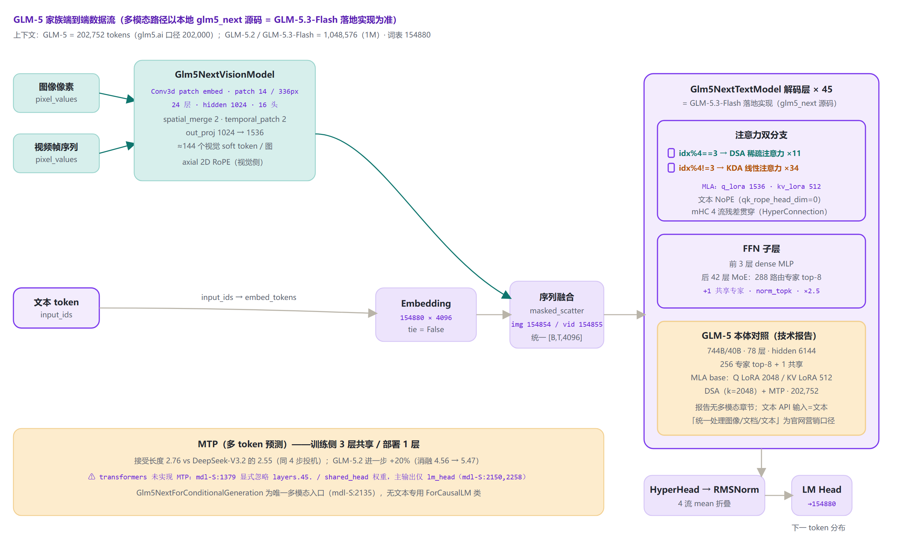
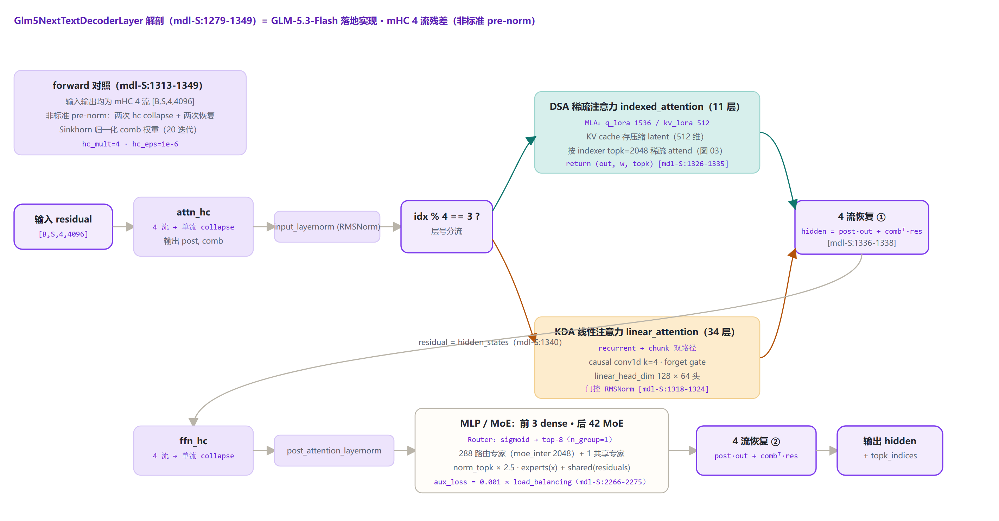
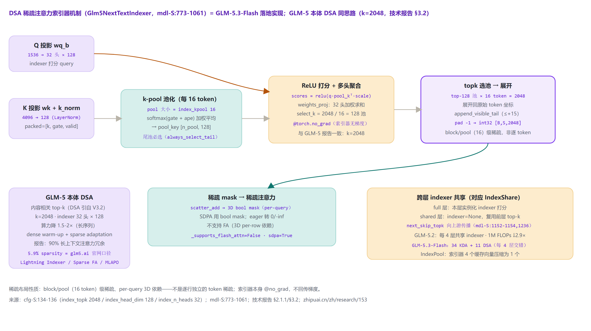

# GLM-5 家族架构详解 — GLM-5（744B-A40B DSA/MTP）· 5.2 · 5.3-Flash（glm5_next）

- 徽标：GLM-5.3-Flash 落地入口类 `Glm5NextForConditionalGeneration`（`model_type=glm5_next`，transformers 原生模块 `models\glm5_next\`）
- 徽标：**GLM-5 本体 = 744B 总参 / 40B 激活** · 256 专家 top-8 · 78 层 · 202,752 · MLA 基座 + **DSA** + **MTP**（技术报告 arXiv:2602.15763）
- 徽标：**官网营销口径 = 745B / 44B / 5.9% sparsity**（glm5.ai）——本文以 744B/40B 为主口径，官网口径仅作「口径差异」引述
- 徽标：**GLM-5.2**：1M 上下文 · IndexShare（每 4 层共享 indexer，FLOPs ↓2.9×）· MTP 接受长度 +20%
- 徽标：**GLM-5.3-Flash**（本地 glm5_next 源码实现）：320B/18B · 45 层 · 288 专家 top-8 · KDA 线性×34 + DSA×11 · mHC 4 流残差 · 1M · 原生多模态

> **口径声明**：本地无 GLM-5 checkpoint/config 留档，GLM-5 本体规格以**技术报告 / 智谱文档 / 官网**为准；**本地 transformers 源码 `models\glm5_next\` = GLM-5.x 家族在 transformers 的落地实现（对应 GLM-5.3-Flash 架构）**，绝非 GLM-5 本体的实现——凡源码级解剖均标注「GLM-5.3-Flash 落地实现」。本地无法核实处均标注「待核实，以官方发布为准」。行号约定：`cfg-S:n` = configuration_glm5_next.py；`mdl-S:n` = modeling_glm5_next.py。

## 1 家族全景：GLM-4.5 / GLM-5 / GLM-5.2 / GLM-5.3-Flash 规格对照

> GLM-5（2026-02-12）相对 GLM-4.5（355B/32B）「doubling the total size」；GLM-5.2（2026-06-16）扩到 1M 上下文；GLM-5.3-Flash（2026-08-25/26）是系列首个原生多模态模型，也是本地 glm5_next 源码对应的架构。

### 1.1 核心规格对照

| 字段 | GLM-4.5 | GLM-5（主口径） | GLM-5.2 | GLM-5.3-Flash（glm5_next 源码） |
|---|---|---|---|---|
| **总参 / 激活** | ≈355B / 32B | **744B / 40B** | 744B / 40B（沿用） | **320B / 18B** |
| hidden_size | 5120 | **6144** | —（未公开） | 4096 [cfg-S:101] |
| num_hidden_layers | 92 | **78**（3 dense+75 MoE，Table 10） | —（未公开） | 45（3 dense+42 MoE）[cfg-S:105,159-162] |
| n_routed_experts | 160 | **256** | —（未公开） | **288** [cfg-S:109] |
| n_shared_experts / top-k | 1 / 8 | 1 / 8 | — / 8 | 1 / 8 [cfg-S:108,119] |
| moe_intermediate_size | 1536 | 2048（Table 10） | —（未公开） | 2048 [cfg-S:103] |
| **注意力** | GQA 96Q/8KV + QK-Norm | **MLA 基座 + DSA 稀疏注意力**（Q LoRA 2048 / KV LoRA 512 / 64 头） | MLA+DSA（**IndexShare**） | **KDA 线性×34 + DSA×11**（idx%4==3），MLA q_lora 1536 / kv_lora 512 [cfg-S:112-116,164-169] |
| 归一化 / 残差 | 2×RMSNorm 前置 | —（未公开逐字段） | —（未公开） | **mHC 4 流残差**（HyperConnection）[cfg-S:147-149] |
| 上下文 | 131072 | **202,752**（glm5.ai 口径 202,000） | **1,048,576（1M）** | 1,048,576（1M）[cfg-S:122] |
| **MTP** | num_nextn=1 | 训练共享 **3 层** / 部署 **1 层**（接受长度 2.76） | 接受长度 **+20%**（消融 4.56→5.47） | 1 层（checkpoint 有；**transformers 未实现**，mdl-S:1379） |
| vocab_size | 151552 | **154880**（Table 10） | —（未公开） | 154880 [cfg-S:100] |
| 多模态 | 纯文本（4.5V 另立） | **文本 / Agentic 主线**（报告无多模态章节） | 纯文本 | **原生多模态**（系列首个，vision encoder 24 层） |
| 开源 | MIT | MIT（zai-org/GLM-5 + FP8） | MIT（zai-org/GLM-5.2 + FP8） | MIT（zai-org/GLM-5.3-Flash + -BF16） |
| 发布 | 2025-07 | 2026-02-12（API） | 2026-06-16 | 2026-08-25（HF）/ 08-26（API） |

### 1.2 口径差异说明（必须随主口径一并阅读）

| 项 | 主口径（本文采用） | 差异口径（仅引述） |
|---|---|---|
| 总参 | **744B**（技术报告 Table 10 / docs.bigmodel.cn / 智谱研究页三方一致） | 745B（glm5.ai 官网）；753.86B（ModelScope 仓库标签，口径不明，**待核实**） |
| 激活参数 | **40B** | 44B（glm5.ai） |
| 层数 | **78**（Table 10：3 dense + 75 MoE；glm5.ai 同） | 80（报告 §2.1 文字「reduces its layer count to 80」+ 智谱研究页文字） |
| 上下文 | **202,752**（报告 SFT 最大序列） | 202,000（glm5.ai）；200K（官方文档约数） |
| 稀疏度 | 报告无此数字（仅 k=2048、长序列算力降 1.5–2×） | **5.9%**（glm5.ai 原文「5.9% sparsity」，营销口径） |
| 多模态 | 报告无多模态章节；GLM-5 文本 API 输入=文本 | 「Process images, documents, and text in a unified pipeline」（glm5.ai 营销表述） |

## 2 端到端数据流总览

> 文本 token + 图像 / 视频输入 → vision encoder（Glm5NextVisionModel：24 层 / hidden 1024 / patch 14·336 / spatial_merge 2 / out 1536，≈144 token/图）→ soft 特征按 image_token（154854）/ video_token（154855）占位位 masked_scatter 进 embedding 序列 → 文本解码栈 → HyperHead 4 流均值 → final RMSNorm → LM Head（→154880）；另有 MTP 头（训练共享 3 层 / 部署 1 层；transformers 未实现，mdl-S:1379）。**多模态路径细节全部来自 glm5_next 源码（= GLM-5.3-Flash 落地实现）**；GLM-5 本体以文本 / Agentic 为主线。

### 2.1 架构图



## 3 解码层解剖：以 glm5_next 源码为准（GLM-5.3-Flash 架构落地实现）

> 本节明确标注：以下解剖对象是 **GLM-5.x 家族在 transformers 的落地实现（对应 GLM-5.3-Flash 架构）**，不是 GLM-5 本体。`Glm5NextTextDecoderLayer`（mdl-S:1279-1349）采用 **mHC（manifold-constrained Hyper-Connection）4 流残差**，不是标准 pre-norm：attn/ffn 两侧各做一次「4 流 collapse → 子层 → post·out + combᵀ·residual 恢复 4 流」。注意力按层号分流：`idx%4==3` → **DSA indexed_attention**（11 层），其余 → **KDA linear_attention**（34 层）；FFN 前 3 层 dense、后 42 层 MoE（288 专家 top-8 + 1 共享）。

### 3.1 架构图



### 3.2 DecoderLayer.forward 伪代码（mdl-S:1313-1349）

```
Glm5NextTextDecoderLayer.forward（mdl-S:1279-1349）:
  residual = hidden_states                     # 输入/输出均为 mHC 4 流 [B,S,4,4096] [S:1313]
  post, comb, hidden_states = attn_hc(...)     # 4 流 collapse 成单流 [S:1314]
  hidden_states = input_layernorm(hidden_states)   # RMSNorm [S:1316]
  if idx % 4 == 3:
      out, w, topk = indexed_attention(...)   # DSA 稀疏注意力 [S:1326-1335]
  else:
      out = linear_attention(...)              # KDA 线性注意力（recurrent+chunk）[S:1318-1324]
  hidden = post*out + combᵀ @ residual         # 扩展回 4 流并混合残差 [S:1336-1338]
  residual = hidden_states                     # [S:1340]
  post, comb, hidden_states = ffn_hc(...)      # 4 流再 collapse [S:1341]
  hidden_states = post_attention_layernorm(hidden_states)  # [S:1343]
  out = mlp(hidden)                            # dense（前 3 层）/ MoE（后 42 层）[S:1344]
  hidden = post*out + combᵀ @ residual         # [S:1345-1347]
  return hidden, topk_indices                  # DSA 层才有 topk [S:1349]
```

## 4 核心机制专节

### 4.1 ① DSA 稀疏注意力（DeepSeek Sparse Attention）

GLM-5 从稠密 base 两阶段 continued pre-training（dense warm-up + sparse adaptation，20B tokens @200K）适配 DSA（§2.1.1）：**内容相关动态 token 子集**——「looks at the content to decide which tokens are important」。Indexer 检索 top-k 相关 KV 条目，**k=2048**（§3.2），indexer 32 头 / head_dim 128（Table 10）；长序列注意力算力降 **1.5–2×**，报告称「90% of attention entries in long contexts are redundant」。

本地 glm5_next 把这套机制落地为 **block（pool=16 token）级稀疏**：每 16 个 KV token 先 softmax(gate+ape) 池化成 pool_key，ReLU 打分后取 top-128 池 = 2048 token，展开成 per-query 3D bool mask 走 SDPA（不支持 FA kernel）；**shared 层 indexer=None、复用上一层 top-k**（mdl-S:1150-1154）——这正是 **GLM-5.2 IndexShare**（每 4 层稀疏注意力共享 indexer，1M 上下文 per-token FLOPs 降 2.9×）思路的代码对应。昇腾侧推理优化：**Lightning Indexer**（分数计算+ReLU+TopK 融合为单算子）/ **Sparse Flash Attention**（KV TopK 检索与稀疏注意力并行）/ **MLAPO**（13 个预处理算子融合为 1 个）。**5.9% sparsity 仅见 glm5.ai 官网，技术报告未给出**。

### 4.2 架构图：DSA 索引器机制



### 4.3 ② MTP（多 token 预测）

GLM-5 训练时**参数共享 3 个 MTP 层**（显存对齐 DeepSeek-V3 单层方案并提高接受率，§2.1），部署口径 Table 10 = 1 层；同 4 步投机下**接受长度 2.76 vs DeepSeek-V3.2 的 2.55**（Table 2）。GLM-5.2 在此基础上再提 **+20%**：消融 base 4.56 → +IndexShare+KV Share 5.10 → +Rejection Sampling 5.29 → +E2E TV Loss 5.47。**旁证：transformers 的 glm5_next 模块未实现 MTP**——`_keys_to_ignore_on_load_unexpected = [r"layers\.45\.", r"layers\.\d+\.shared_head\."]`（mdl-S:1379），checkpoint 的 MTP 层权重被显式忽略，主输出仅 `lm_head`（mdl-S:2150,2258）。

### 4.4 ③ MoE 路由：sigmoid + norm_topk + scaling 2.5

`Glm5NextTextTopkRouter`（mdl-S:144）与 GLM-4.5 血统一致：**sigmoid 打分（非 softmax）** → 组内 top-k → 按行归一 → 乘 `routed_scaling_factor=2.5`。

$$w_i = \mathrm{sigmoid}(\mathrm{router}(x)_i) + b_i,\quad i \in \mathrm{top}_8(x),\qquad \tilde w_i = \frac{w_i}{\sum_{j\in top_8} w_j}\times 2.5$$

MoE 容器（mdl-S:185）= `experts(x)`（288 路由专家 top-8）+ `shared_experts(residuals)`（1 共享专家，inter=2048，全 token 激活）；辅助损失 `loss += 0.001 × aux_loss`（mdl-S:2266-2275）。

### 4.5 ④ MLA 与 mHC

- **MLA（多头潜在注意力压缩）**：GLM-5 以 MLA 为注意力基座（Q LoRA 2048 / KV LoRA 512 / 64 头 / QK dim 192 / V dim 256，Table 10），配 Muon Split 改造与 MLA-256 变体（head dim 192→256、头数减 1/3）；glm5_next 落地版 q_lora_rank 1536 / kv_lora_rank 512，KV cache 写在压缩 latent 层（mdl-S:1127-1199）。
- **mHC（流形约束超连接）**：hc_mult=4 流残差贯穿每层 attn 与 ffn 两侧（cfg-S:147），Sinkhorn 归一化 comb 权重（20 迭代，cfg-S:149），输出端 `Glm5NextTextHyperHead` 4 流 mean 折叠（mdl-S:332-336, 1510）；文本侧 **NoPE**（qk_rope_head_dim=0，cfg-S:223-226）。

## 5 异步 RL 训练（Slime）与 Agentic Engineering

GLM-5 总训练预算 **28.5T tokens**：通用语料 18T + 代码&推理 9T（=27T 预训练）→ 长代码&推理 1T（32K）→ 长上下文&Agent 数据 500B/50B（128K/200K）→ DSA 适配 20B（200K）。Post-training 流水：Overall SFT → Reasoning RL → Agentic RL → General RL + On-Policy Cross-Stage Distillation。

- **异步 RL 框架基于 slime**（§1/§3.6）：全异步解耦 rollout/训练、Multi-Task Rollout Orchestrator 1k+ 并发 rollout、TITO Gateway、Direct Double-sided Importance Sampling、DP-aware routing；FP8 rollout + PD 分离。GLM-5.2 的 slime 并行 OPD 约两天合并十余专家模型。
- **Agentic Engineering（§4）**：**10,000+** 可验证 SWE 环境（9 种语言）；**Harbor** terminal 环境（Docker 准确率 >90%）；搜索任务基于 200 万+ 网页 **Web Knowledge Graph**。
- 其他：INT4 QAT（§2.4.3）；首日适配 7 国产 GPU 平台（昇腾/摩尔线程/海光/寒武纪/昆仑芯/沐曦/燧原）。

## 6 特殊 Token 与词表布局

| token | ID | 含义 | 来源 |
|---|---|---|---|
| vocab_size | **154880** | 词表（GLM-4.5 为 151552） | 报告 Table 10 / cfg-S:100 |
| pad_token_id | 154820 | 填充 | cfg-S:126 |
| image_token_id | **154854** | 图像占位 token（soft 特征 scatter 位） | cfg-S:299-304 |
| video_token_id | **154855** | 视频占位 token | cfg-S:299-304 |
| image/video start-end | 154830–154833 | 图文/视频特殊边界 token | cfg-S:299-304 |

> image_token / video_token 的具体 ID 来自 **glm5_next 源码（GLM-5.3-Flash 落地实现）**；GLM-5 本体技术报告未单列多模态 token。视觉侧 ≈144 soft token/图（(336/14)²/2²）。

## 7 演进对比：GLM-4.5 → GLM-5 → 5.2 → 5.3-Flash

| 维度 | GLM-4.5（glm4_moe） | GLM-5 | GLM-5.2 | GLM-5.3-Flash（glm5_next） |
|---|---|---|---|---|
| 总参/激活 | 355B/32B | 744B/40B（官网 745B/44B） | 744B/40B | 320B/18B |
| hidden / 层数 | 5120 / 92 | 6144 / 78 | 同 5（口径未公开） | 4096 / 45 |
| 专家 | 160 路由 + 1 共享 top-8 | 256 + 1 top-8 | 同 5 | 288 + 1 top-8 |
| 注意力 | GQA + QK-Norm | MLA base + **DSA** | DSA + **IndexShare** | **KDA×34 + DSA×11** 混合 |
| 残差结构 | 2×RMSNorm 前置 | —（未公开） | — | **mHC 4 流** |
| 上下文 | 131072 | 202,752 | **1M** | **1M** |
| MTP | num_nextn=1 | 训练 3 层共享/部署 1 层，2.76 | +20%（4.56→5.47） | 1 层（transformers 未实现） |
| 多模态 | 纯文本（4.5V 另立） | 文本/Agentic（报告无多模态） | 纯文本 | **原生多模态（首个）** |
| 词表 | 151552 | 154880 | 154880 | 154880 |

> 演进主线：① 规模翻倍（355B→744B）但层数从 92 压到 78、专家 160→256；② 注意力从 GQA 升级为 **MLA 基座 + DSA 稀疏**，长序列算力降 1.5–2×；③ GLM-5.2 用 IndexShare 把 1M 上下文 per-token FLOPs 再降 2.9×；④ GLM-5.3-Flash 换赛道：KDA 线性 + DSA 混合、mHC 多流残差、288 专家、首个原生多模态，注意力计算量/KV 缓存较 GLM-5.3 分别降 3.01×/4.44×；⑤ MTP 从有到（部署）1 层并持续提升接受率；⑥ 词表扩到 154880。

## 8 来源

1. GLM-5 技术报告《GLM-5: from Vibe Coding to Agentic Engineering》（Zhipu AI & Tsinghua University，arXiv:2602.15763）
   <https://arxiv.org/pdf/2602.15763>（§2.1 744B/40B、§2.1.1 DSA、§3.2 k=2048、Table 2 MTP 接受长度、Table 10 架构表、§2.4 28.5T、§3.3/§4.1 slime、§4 Harbor/Web KG、§2.6 INT4 QAT/FP8）
2. GLM-5 官网（口径差异来源）
   <https://glm5.ai/>（745B/44B/256专家/5.9% sparsity/78 层/202,000/DSA/MTP/「统一管线」营销表述）
3. GLM-5 模型卡（ModelScope）
   <https://modelscope.cn/models/ZhipuAI/GLM-5>（仓库标签 753.86B，口径不明——待核实）
4. 智谱文档 GLM-5
   <https://docs.bigmodel.cn/cn/guide/models/text/glm-5>（744B/40B 主口径）
5. 智谱版本发布动态
   <https://docs.bigmodel.cn/cn/update/new-releases>（5.2 / 5.3-Flash 时间线与规格）
6. 智谱研究页（昇腾推理优化）
   <https://www.zhipuai.cn/zh/research/153>（Lightning Indexer / Sparse Flash Attention / MLAPO；「减少至 80 层」文字口径）
7. GLM-4.7 HF 模型卡
   <https://huggingface.co/zai-org/GLM-4.7>
8. GLM 开源状态说明
   <https://glm-ai.chat/docs/is-glm-open-source/>（各版本开源许可与时间线）
9. GLM-5.2 博客
   <https://z.ai/blog/glm-5.2>（1M / IndexShare FLOPs ↓2.9× / MTP +20% 消融 4.56→5.47 / slime OPD）
10. GLM-5.3-Flash 智谱文档
    <https://docs.bigmodel.cn/cn/guide/models/vlm/glm-5.3-flash>（320B/18B / 混合注意力 / mHC / IndexPool / 首个原生多模态 / 1M）
11. NVIDIA NIM 文档（GLM-5.3-Flash）
    <https://docs.api.nvidia.com/nim/reference/z-ai-glm-5-3-flash>（45 层：34 KDA + 11 DSA 每 4 层交错 / 288 专家 top-8 / vision encoder / 1 MTP 层 / Glm5NextForConditionalGeneration / 30T 多模态语料）
12. 本地 transformers 源码（GLM-5.3-Flash 落地实现）
    `E:\transformers\src\transformers\models\glm5_next\configuration_glm5_next.py`（cfg-S 行号）/ `modeling_glm5_next.py`（mdl-S 行号）/ `processing_glm5_next.py` / `image_processing_glm5_next.py` / `video_processing_glm5_next.py`
13. GLM-5 开源仓库
    <https://github.com/zai-org/GLM-5>

> 标注约定：[S:n] / cfg-S:n / mdl-S:n = glm5_next 源码行号；「744B/40B」为技术报告 + 智谱文档 + 研究页三方主口径，「745B/44B/5.9%」仅 glm5.ai 营销口径；glm5_next 源码一律表述为「GLM-5.x 家族在 transformers 的落地实现（对应 GLM-5.3-Flash）」。访问与核验日期：2026-11-03。

---

*页脚：GLM-5 家族架构详解 · 数据来源：技术报告 arXiv:2602.15763 + glm5.ai + docs.bigmodel.cn + z.ai/blog/glm-5.2 + NVIDIA NIM + transformers 源码（E:\transformers\src\transformers\models\glm5_next\）· 仅供技术学习与论文研究*
