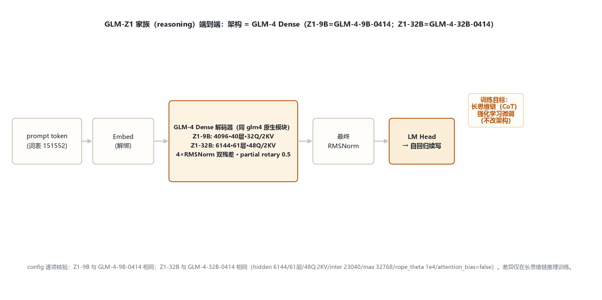
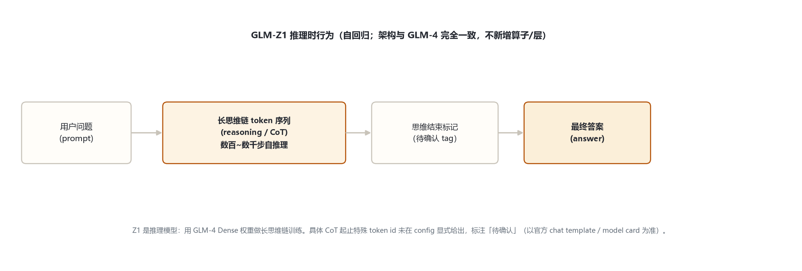

# GLM-Z1 家族架构详解 — GLM-Z1-9B / Z1-32B-0414（长思维链推理模型）

- 徽标：入口类 `Glm4ForCausalLM`（`model_type=glm4`，transformers 原生模块 `models\glm4\`）
- 徽标：**架构 = GLM-4 Dense**：Z1-9B ≡ GLM-4-9B-0414；Z1-32B ≡ GLM-4-32B-0414（config 逐项相同）
- 徽标：4×RMSNorm 双残差 · GQA（9B=32Q/2KV；32B=48Q/2KV）· partial rotary 0.5 · SiGLU
- 徽标：定位为**推理模型**——在 GLM-4 Dense 权重上做长思维链（CoT）强化学习训练，不改架构
- 徽标：词表 151552 · tie=False · max_position 32768 · rope_theta=1e4

本页以 **官方 config**（2026-10-31 经 hf-mirror 拉取留档于 `_tools/_cfgpull/`，`zai-org/GLM-Z1-9B-0414`、`zai-org/GLM-Z1-32B-0414`）为唯一依据。**核心事实**：Z1 的差异在训练目标（长思维链推理），不在网络结构——其 config 与 GLM-4-0414 两个 Dense 版本逐项相同。解码层、注意力、partial rotary、SiGLU 等机制与 `glm_4/index.md` 完全一致，本页只列家族对照与差异点，不重复展开。

## 1 家族全景：GLM-Z1 两档（= GLM-4 Dense 0414）

| 字段 | GLM-Z1-9B-0414 | GLM-Z1-32B-0414 | 等价于 |
|---|---|---|---|
| model_type / 入口 | glm4（Glm4ForCausalLM） | glm4（Glm4ForCausalLM） | 原生 glm4 |
| 形态 | Dense（推理训练） | Dense（推理训练） | — |
| hidden_size | 4096 | 6144 | 9B / 32B-0414 |
| num_hidden_layers | 40 | 61 | 40 / 61 |
| Q / KV 头 | 32 / 2 | 48 / 2 | GQA 2 KV |
| head_dim | 128 | 128 | — |
| intermediate_size | 13696 | 23040 | SiGLU |
| partial_rotary_factor | 0.5 | 0.5 | original_rope |
| rope_theta | 1e4 | 1e4 | — |
| max_position_embeddings | 32768 | 32768 | — |
| attention_bias | true | false | 与 0414 一致 |
| tie / vocab / rms_eps | false / 151552 / 1.5625e-6 | false / 151552 / 1e-5 | 与 0414 一致 |

> 要点：① **Z1-32B config 与 GLM-4-32B-0414 完全相同**（hidden 6144/61层/48Q·2KV/inter 23040/max 32768/rope_theta 1e4/attention_bias=false）；Z1-9B 同理等于 GLM-4-9B-0414。② 推理训练不引入任何架构字段（无专家、无 MTP、无 QK-Norm——那些属于 GLM-4.5 线，见 `glm_4_5`）。

## 2 端到端数据流总览

> 与 GLM-4 Dense 完全一致：prompt token → Embed（解绑）→ N×GLM-4DecoderLayer（4×RMSNorm 双残差）→ 最终 RMSNorm → LM Head。推理模型身份体现在**生成行为**（长思维链），不在结构。

### 2.1 架构图

## 3 解码层解剖

> `Glm4DecoderLayer` 与 GLM-4 相同：4×RMSNorm「pre+post」双残差块（`modeling_glm4.py:66-109`）。引用 `glm_4/index.md` §3，此处不重复贴代码。

## 4 核心机制

- **partial rotary 0.5**（head_dim 128，仅前 64 维旋转）——同 GLM-4。
- **GQA**（9B 32Q/2KV；32B 48Q/2KV，repeat_kv）——同 GLM-4。
- **4×RMSNorm 双残差**——同 GLM-4。
- **融合 gate_up 的 SiGLU**——同 GLM-4。
- **推理训练**：在 GLM-4 Dense 权重上用长思维链数据做强化学习，使模型在给最终答案前先生成长段自推理；**不新增任何网络算子或层**。

## 5 注意力机制

与 GLM-4 一致：GQA、partial rotary 0.5、缩放 `head_dim^-0.5`。详见 `glm_4/index.md` §5。Z1-32B 的 attention_bias=false、Z1-9B=true，均与对应 GLM-4-0414 版本一致。

## 6 特殊 Token 与词表布局

| token | ID | 含义 |
|---|---|---|
| pad / eos | 151329 / [151329,151336,151338] | 填充 / 结束 |
| vocab_size | 151552 | 词表（GLM 系沿用） |
| 思维链起止 tag | **待确认** | config 未显式给出推理特殊 token id |

> GLM-Z1 推理模型在对话模板中会包裹一段「思维过程」。**该 CoT 起止特殊 token 的具体 id 未在 config 中列出**，标注「待确认」，以官方 chat template / model card 为准——不编造 id。

### 6.1 推理时 CoT 生成流

## 7 演进视角：GLM-4（Dense）→ GLM-Z1（推理）→ GLM-4.5

| 维度 | GLM-4 Dense | GLM-Z1（本页） | GLM-4.5（MoE） |
|---|---|---|---|
| 形态 | Dense | **Dense（= GLM-4-0414）** | MoE 160 专家 |
| 训练目标 | 预训练 + 对话 SFT | **长思维链推理 RL** | 预训练 + MoE |
| 架构改动 | — | **无**（同 GLM-4） | QK-Norm / MTP / 共享专家 |
| 解码层 | 4×RMSNorm 双残差 | 同 | 2×RMSNorm 前置 |

> GLM-Z1 的定位：在 GLM-4 Dense 成熟权重上验证「推理时扩展」（test-time compute）路线，架构零改动。它与 GLM-4.5（MoE）是两条并行的能力扩展线：Z1 走「同结构 + 长思维链训练」，4.5 走「MoE 结构升级」。早期代（ChatGLM 系列）由同项目另一执行者负责。

## 8 来源

1. 官方 config（GLM-Z1-9B-0414，2026-10-31 hf-mirror 留档）
   `zai-org/GLM-Z1-9B-0414（glm4 / Glm4ForCausalLM；hidden 4096/40层/32Q·2KV/head_dim 128/inter 13696/max 32768/rope_theta 1e4/attention_bias=true/tie=false/vocab 151552）`
2. 官方 config（GLM-Z1-32B-0414，留档于 glm_z1/_tools/_cfgpull/）
   `zai-org/GLM-Z1-32B-0414（与 GLM-4-32B-0414 完全相同：hidden 6144/61层/48Q·2KV/inter 23040/max 32768/rope_theta 1e4/attention_bias=false/tie=false）`
3. transformers 源码 models\glm4\（与 GLM-4 共用）
   `Glm4DecoderLayer 66-109；Attention 196-258；RotaryEmbedding 261-307；RMSNorm 310-328（详见 glm_4/index.md §来源）`
4. GLM-Z1 模型卡片与技术报告
   `https://huggingface.co/zai-org/GLM-Z1-32B-0414（GLM-Z1 推理模型发布、长思维链与开源公告）`

> 标注约定：Z1 与 GLM-4-0414 config 相同性经逐字段比对确认；CoT 起止特殊 token id config 未给，标「待确认」。访问与核验日期：2026-10-31。

---

*页脚：GLM-Z1 家族架构详解 · 数据来源：远端官方 config（hf-mirror）+ transformers 源码（E:\transformers）+ 官方 model card · 仅供技术学习与论文研究*
