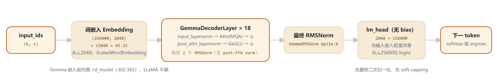
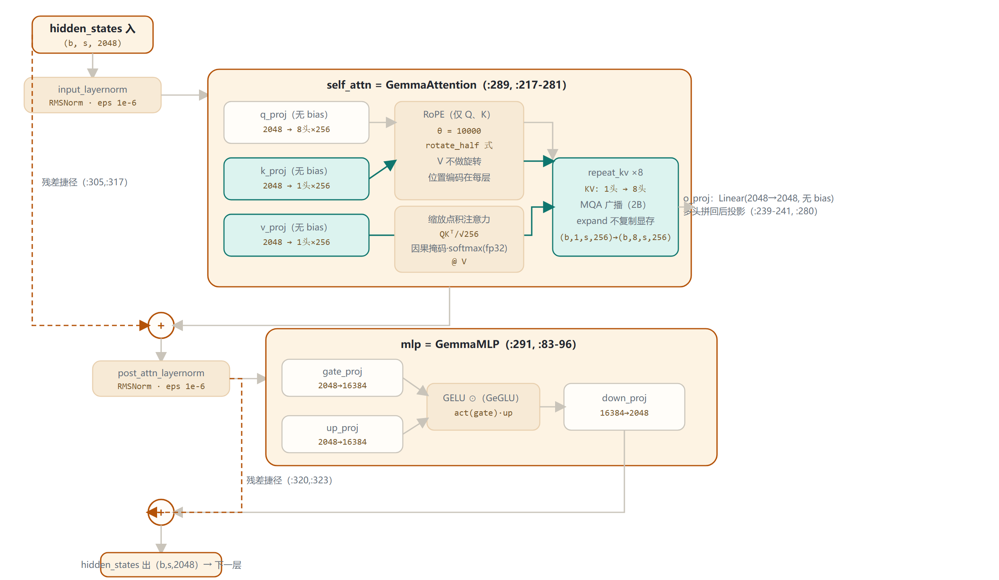

# Gemma 1 家族架构详解 — GemmaForCausalLM（2B / 7B · MQA 与 MHA）

- 2024-02 发布 · 纯解码器 · 稠密
- 入口类 GemmaForCausalLM
- 本地 config：gemma-2b-it（unsloth 转换版）
- 2B：MQA（1 KV 头 → 广播 8 倍）
- 7B：MHA（16 KV 头 = 16 Q 头）

Gemma 1 是 Google 基于 Gemini 研究技术的首个开放权重模型家族，纯解码器 Transformer [P]。本页以本地 **gemma-2b-it** 的 **config.json**、ModelScope 多镜像核验的 **gemma-7b(-it) config.json**，以及本地 transformers 源码 **modeling_gemma.py / configuration_gemma.py**（v5.5.0.dev0）为唯一依据。一个常被忽略的事实：**家族内 2B 用 MQA（1 个 KV 头），7B 用完整 MHA（16 个 KV 头）**——两者的 KV 缓存策略并不相同。所有数字均标注来源（config 字段或源码 文件:行号）。

> [P] Gemma 技术报告 arXiv:2403.08295 §2

## 1 家族全景：2B 与 7B 的 config 对照

> 下表逐字段来自 config.json 原文。2B 取本地 `E:\models\model\gemma-2b-it\config.json`；7B 取 ModelScope 下载的 `gemma-7b-it config.json`（unsloth 转换版），并经 LLM-Research / AI-ModelScope 两个镜像交叉核验一致。

| 字段（config.json） | Gemma 2B | Gemma 7B | 备注 / 源码佐证 |
|---|---|---|---|
| architectures | `GemmaForCausalLM` | `GemmaForCausalLM` | model_type=`gemma` |
| hidden_size | 2048 | 3072 | 残差流维度基准 |
| num_hidden_layers | 18 | 28 | layers ModuleList（modeling_gemma.py:365） |
| num_attention_heads (Q) | 8 | 16 | q_proj 输出头数 |
| num_key_value_heads | **1（MQA）** | **16（MHA）** | 家族内差异核心（k/v_proj 输出头数；:233-238） |
| KV 分组数 = Q//KV | **8** | **1** | num_key_value_groups（:225；repeat_kv :179-188） |
| head_dim | 256 | 256 | scaling=$256^{-0.5}=1/16$（:226） |
| intermediate_size | 16384 | 24576 | GeGLU 单投影维度（:89-91） |
| vocab_size | 256000（config 原文） | 256000（config 原文） | **论文 Table 1 为 256,128**（见 §6，并列标注不统一） |
| hidden_act | `"gelu"` | `"gelu"` | GeGLU 激活；见 §4.3 的 legacy 口径说明 |
| rms_norm_eps | 1e-6 | 1e-6 | GemmaRMSNorm（:64, :292-293, :368） |
| rope_theta | 10000.0 | 10000.0 | RoPE 基频（:127） |
| max_position_embeddings | 8192 | 8192 | 上下文长度 |
| attention_bias | false | false | 全部 Linear 无 bias（:230-241, :89-91） |
| tie_word_embeddings | true | true | lm_head ↔ embed_tokens（:433） |
| sliding_window / logit softcap | **均无**：config 无 sliding_window、无 attn_logit_softcapping 字段 | **均无**：config 无 sliding_window、无 attn_logit_softcapping 字段 | 全局全注意力；两者均为 Gemma 2 新增（§7） |
| 总参数量（官方） | ≈2.6B | ≈8.5B | 本页自核算：2B≈2.51B / 7B≈8.54B（§1.1） |

### 1.1 参数量自核算（按 config 复算，可复算）

| 组成 | 2B | 7B | 计算式 |
|---|---|---|---|
| 嵌入 + LM Head（tied） | 524.3M | 786.4M | $256000\times\text{hidden}$ |
| 注意力 Q/K/V/O（每层） | 9.44M | 50.33M | 2B: q/o=$2048^2$, k/v=$2048\cdot256$；7B: q/k/v/o=$3072\cdot4096$（MHA） |
| 注意力小计 | 169.9M | 1409.3M | × 层数（18 / 28） |
| GeGLU MLP（每层） | 100.66M | 226.49M | $3\times\text{hidden}\times\text{intermediate}$ |
| MLP 小计 | 1811.9M | 6341.8M | × 层数（18 / 28） |
| 合计（不含 RMSNorm 权重） | **≈2.51B** | **≈8.54B** | 与官方 2.6B / 8.5B 同量级 |

> 要点：**2B 走 MQA**（k/v_proj 只产出 1 个头，KV cache 体积为 MHA 的 1/8），**7B 走完整 MHA**（k/v_proj 各 16 个头，与 Q 等宽）。这意味着 7B 的 **num_key_value_groups=1**，源码里 **repeat_kv** 在 n_rep==1 时直接原样返回（:185-186）——广播逻辑对 7B 是空操作。

## 2 端到端数据流总览（以本地 2B 为主尺寸）

> 输入 token id → 缩放词嵌入（$\times\sqrt{d_\text{model}}$，tied）→ **18 个相同的 GemmaDecoderLayer** → 最终 RMSNorm → 无 bias 线性 lm_head（与嵌入共享权重）→ logits。7B 同构，仅把 18 层换成 28 层、维度换成 3072/4096。

### 2.1 架构图



数据流与源码逐项对应：嵌入 `embed_tokens`（:362）→ 逐层 `for decoder_layer in self.layers`（:414-423）→ `self.norm`（:424）→ `lm_head`（:491）。因果掩码由 `create_causal_mask` 统一构造（:402-408）。

## 3 单个 GemmaDecoderLayer 解剖（以 2B 为例）

> 严格按 `GemmaDecoderLayer.forward`（:305-324）与 `GemmaAttention.forward`（:254-281）绘制。橙色虚线 = 残差捷径；青色 = K/V 路径（2B 的 MQA 广播）。所有 Linear 均 `bias=False`。**注意每层只有 2 个 RMSNorm**（input_layernorm + post_attention_layernorm），没有 Gemma 2 的 post-feedforward norm。

### 3.1 架构图



层内执行顺序（`GemmaDecoderLayer.forward` :305-323）：

```
residual = x
x = input_layernorm(x)
x = self_attn(x);  x = residual + x
residual = x
x = post_attention_layernorm(x)
x = mlp(x);        x = residual + x
```

即两个 pre-norm + 两个残差。**与 Gemma 2 的关键差别**：Gemma 1 在 FFN 之后没有第二次归一化（post_feedforward_layernorm），这是 Gemma 2 引入的"双归一化"（§7）。

## 4 核心机制专节（含可复算公式与源码行号）

### 4.1 RMSNorm（pre-norm，Gemma 变体）

对子层输入做 RMSNorm，共 3 处：注意力前（`input_layernorm`）、FFN 前（`post_attention_layernorm`）、全部层后（`model.norm`）。

$$\hat{x}=x\cdot\mathrm{rsqrt}\big(\mathrm{mean}(x^2)+\epsilon\big)\quad(\text{:70})$$

$$y=\mathrm{rms}(x.\mathrm{float}())\cdot(1.0+\gamma)\quad(\text{:73-76})$$

> 注：eps=1e-6；**Gemma 特有**：缩放项是 `(1+weight)` 而非 LLaMA 的 `weight`，weight 初始化为 0（:67）；先 fp32 归一化再乘权重后回落到原 dtype（:73,77）。

### 4.2 MQA（2B：单 KV 头广播）

2B 的 8 个 query 头共享 **1 组** K/V：K、V 投影只产出 $1\times256$，打分前用 `repeat_kv` 复制成 8 份对齐 8 个 Q 头。

```
groups = num_q_heads // num_kv_heads
       = 8 // 1 = 8                # :225
(b,1,s,256) --expand--> (b,8,s,256)  # :187-188
```

> 注：KV cache 体积仅为 8 头 MHA 的 1/8，降低推理带宽与显存。**7B 不做此广播**：groups=1，`repeat_kv` 在 n_rep==1 时直接 return（:185-186），是完整 MHA。

### 4.3 GeGLU 门控前馈

双投影门控结构，激活取门控分支后与另一分支逐元素相乘：

$$y=\mathrm{down\_proj}\big(\mathrm{act}(\mathrm{gate\_proj}(x))\odot\mathrm{up\_proj}(x)\big)\quad(\text{:95})$$

```
2B: 2048→16384 → ⊙ → 16384→2048
7B: 3072→24576 → ⊙ → 24576→3072
```

> 注：**激活口径**：config 原文 `hidden_act="gelu"`，经 `ACT2FN[config.hidden_act]` 映射（:92）。注意新版 `configuration_gemma.py:90-95` 会对 legacy `"gelu"` 告警并改写为 `"gelu_pytorch_tanh"`（注释称旧官方发布值本意指向 tanh 近似）——本页以 config 原文为准并并列标注此口径。

### 4.4 RoPE（旋转位置编码，θ=10000）

每层对 Q、K（不对 V）施加旋转；$\theta=10000$，作用维度 = head_dim = 256。

$$\mathrm{inv\_freq}=\dfrac{1}{\theta^{2i/\mathrm{head\_dim}}}\quad(\text{:132, base}=\theta\ \text{:127})$$

$$q'=q\cos\theta+\mathrm{rotate\_half}(q)\sin\theta\quad(\text{:174})$$

> 注：旋转方式为 **rotate_half（半切式，LLaMA 风格）**：把 head_dim=256 切成前后各 128 维，`cat(-x₂, x₁)`（:146-150）。cos/sin 在 `GemmaModel.forward` 统一算一次后传入各层（:412）。

### 4.5 嵌入缩放与权重绑定

`GemmaTextScaledWordEmbedding.forward` 在查表后乘 `embed_scale`：

$$\mathrm{embed\_scale}=\sqrt{\mathrm{hidden\_size}}$$

2B 为 $\sqrt{2048}\approx45.25$；7B 为 $\sqrt{3072}\approx55.43$（:60, :363）——Gemma 相对 LLaMA 的易忽略细节。同时 `lm_head.weight` 与 `embed_tokens.weight` 绑定共享（:433, :442）。

> 注：缩放补偿 RMSNorm 支路与残差叠加的尺度，使训练更稳；绑定权重把 256k 词表的巨大嵌入参数摊薄。

### 4.6 注意力打分数值细节

缩放系数：

$$\mathrm{scaling}=\mathrm{head\_dim}^{-0.5}=256^{-0.5}=\frac{1}{16}=0.0625\quad(\text{:226})$$

$QK^\top$ 加因果掩码后，**softmax 在 fp32 计算**（:208）再回落 dtype；eval 无 dropout（:274）。全程无 attention / logit soft-capping。

> 注：因果掩码由 `create_causal_mask` 统一构造（:402-408）。

## 5 注意力机制：2B 的 MQA vs 7B 的 MHA

> Gemma 1 家族两个尺寸的注意力结构同构（Q/K/V/O 四投影 + RoPE + 因果掩码 + fp32 softmax），唯一实质差别在 **KV 头数**：小模型 2B 用 MQA 压缩 KV，大模型 7B 保留完整 MHA。

| 维度 | Gemma 2B | Gemma 7B | 源码 / 含义 |
|---|---|---|---|
| Q 头数 | 8 | 16 | num_attention_heads |
| KV 头数 | **1** | **16** | num_key_value_heads（config 原文） |
| 分组 groups = Q//KV | **8** | **1** | :225 |
| k_proj / v_proj 输出 | 2048→256（1×256） | 3072→4096（16×256） | :233-238 |
| repeat_kv 广播 | 启用：1 → 8 头 | 空操作（n_rep=1 直接 return） | :185-188, :201-202 |
| KV cache 相对 MHA | 1/8 | 1（不压缩） | 带宽/显存差异来源 |
| scaling | $\text{head\_dim}^{-0.5}=1/16$（两尺寸相同，head_dim 都是 256） | $\text{head\_dim}^{-0.5}=1/16$（两尺寸相同，head_dim 都是 256） | :226 |
| softmax / dropout / softcap | fp32 softmax（:208）· eval 无 dropout（:274）· 无 soft-capping | fp32 softmax（:208）· eval 无 dropout（:274）· 无 soft-capping | eager_attention :191-213 |

> 这一安排的论文意义：Gemma 1 在**小尺寸上用 MQA 换推理效率**，但 7B 并未沿用 GQA——它就是标准 MHA。真正的"多组 KV（GQA）"是 Gemma 2 才在全家族统一引入的（§7）。本页的 **repeat_kv** 广播逻辑，正是后来 GQA（groups>1 且 >8 的中间态）的雏形。

## 6 特殊 Token 与词表

| token | ID | 含义 / 来源 |
|---|---|---|
| pad_token_id | 0 | 填充 token；embedding 的 padding_idx（:362） |
| eos_token_id | 1 | 序列结束（end of sequence） |
| bos_token_id | 2 | 序列开始（begin of sequence） |

> Gemma 1 是**纯文本**模型，config 中**没有**图像/视频/音频等多模态占位 token（对比 Gemma 4 的 boi/image/eoi 等）。词表口径并列标注：**config 原文 `vocab_size=256000`**（决定嵌入表行数与 lm_head 输出维度），而 **Gemma 技术报告 Table 1 记为 256,128**——差额 128 为词表尾部的特殊/控制 token，两者口径不同，本页不擅自统一。

## 7 演进视角：Gemma 1 → Gemma 2

> Gemma 1 是系列第 1 代基线。Gemma 2（2024-06）在保留 pre-norm + GeGLU + RoPE + RMSNorm 母版的同时，引入若干关键结构增量。下表 Gemma 1 列为本页 config 实测，Gemma 2 列为官方口径（技术报告 arXiv:2408.00118 与模型卡 model_card_2）。

| 维度 | Gemma 1（2B / 7B） | Gemma 2（官方口径） |
|---|---|---|
| 尺寸 | 2B（≈2.6B）/ 7B（≈8.5B） | 2B / 9B（42 层）/ 27B（46 层） |
| 注意力分组 | 2B：MQA（1 KV 头）；7B：MHA（16 KV 头） | **统一 GQA**：2B 8Q/4KV，9B 16Q/8KV，27B 16Q/8KV |
| 滑动窗口 | 无（全局全注意力） | **sliding_window=4096**，与全注意力层交错 |
| 归一化 | 每层 2 个 RMSNorm（input + post-attn） | **双归一化**：新增 post_attention / post_feedforward 旁路 norm |
| soft-capping | 无 | **attention logit soft-capping（50.0）+ 最终 logit soft-capping（30.0）** |
| query 缩放 | scaling = $\text{head\_dim}^{-0.5}$（=1/16） | 引入 `query_pre_attn_scalar`，可与 head_dim 解耦 |
| 上下文 | 8192 | 8192（与 Gemma 1 相同） |
| 训练数据 | 2B≈3T / 7B≈6T（论文 §4.2） | 2B 2T（蒸馏）/ 9B 8T（蒸馏）/ 27B 13T（从零） |
| 激活 / 其他 | GeGLU · 全部无 bias · 权重绑定 | 沿用 GeGLU / 无 bias / tie，主要增量在注意力与归一化 |

> 演进主线：Gemma 1 是 **pre-norm + GeGLU + RoPE($\theta=10^4$) + RMSNorm** 的解码器母版，2B 用 MQA 压缩 KV；**Gemma 2 把 KV 分组收敛为统一 GQA，并叠加 sliding window、双归一化与 soft-capping**，规模扩到 27B。这些增量（GQA / sliding / softcap / 双 norm）正是对比 Gemma 1 页时的主要论点。

## 8 来源

1. 本地权威 config（2B）
   `E:\models\model\gemma-2b-it\config.json（unsloth/gemma-2b-it 转换版，transformers 4.44.2）——hidden_size=2048, num_hidden_layers=18, num_attention_heads=8, num_key_value_heads=1, head_dim=256, intermediate_size=16384, hidden_act="gelu", rms_norm_eps=1e-6, rope_theta=10000, max_position_embeddings=8192, attention_bias=false, vocab_size=256000, bos/eos/pad=2/1/0`
2. 7B config（ModelScope 下载并多镜像核验）
   `gemma-7b-it config.json：hidden_size=3072, num_hidden_layers=28, num_attention_heads=16, num_key_value_heads=16, head_dim=256, intermediate_size=24576, vocab_size=256000, hidden_act="gelu"；经 ModelScope LLM-Research/gemma-7b、AI-ModelScope/gemma-7b 镜像交叉核验一致（2026-10-22）`
3. 本地 transformers 源码 modeling_gemma.py（v5.5.0.dev0）
   `GemmaTextScaledWordEmbedding:49-60（×embed_scale:60）；GemmaRMSNorm:63-80（_norm:69-70, (1+weight):76）；GemmaMLP:83-96（gate/up/down:89-91, act_fn:92, GeGLU:95）；GemmaRotaryEmbedding:99-143（θ base:127, inv_freq:132）；rotate_half:146-150；apply_rotary_pos_emb:154-176；repeat_kv:179-188（n_rep==1 短路:185-186）；eager_attention_forward:191-213（repeat_kv 调用:201-202, scores:204, softmax fp32:208）；GemmaAttention:217-281（groups:225, scaling:226, q/k/v/o_proj:230-241, reshape:254-256, o_proj:280）；GemmaDecoderLayer:284-324（input/post_attn norm:292-293, 残差:305-323）；GemmaModel:356-428（embed_tokens:362-363, layers:365, norm:368, causal_mask:402-408, rotary:412, layer loop:414, norm:424）；GemmaForCausalLM:432-503（tied:433, lm_head:442, logits:491）`
4. 本地 transformers 源码 configuration_gemma.py
   `GemmaConfig 默认（checkpoint=google/gemma-7b）：hidden_size=3072, num_hidden_layers=28, num_attention_heads=16, num_key_value_heads=16, head_dim=256, intermediate_size=24576, hidden_act="gelu_pytorch_tanh"（:67-85）；legacy "gelu" → gelu_pytorch_tanh 改写 :90-95`
5. [P] Gemma 技术报告（官方论文口径）
   `Gemma: Open Models Based on Gemini Research and Technology, arXiv:2403.08295（§2 架构；Table 1 词表 256,128；参数量 2B≈2.6B / 7B≈8.5B；训练数据 6T tokens）— https://arxiv.org/abs/2403.08295`
6. [P] Gemma 1 模型卡与 Gemma 2 对照来源
   `Gemma 1 模型卡 https://ai.google.dev/gemma/docs/core/model_card_1 ；Gemma 2 技术报告 arXiv:2408.00118（GQA / sliding_window=4096 / 双归一化 / soft-capping / query_pre_attn_scalar / 2B·9B·27B 尺寸）— 仅作演进对照，Gemma 1 数字一律以本地 config/源码为准`

> 凡本地 config 与论文口径冲突处（vocab 256000 vs 256,128；hidden_act gelu vs gelu_pytorch_tanh），均已在正文并列标注，未擅自统一。访问与核验日期：2026-10-22。

---

*页脚：Gemma 1 家族架构详解（2B / 7B）· 以本地 config.json 与 transformers modeling_gemma.py 逐字段核对 · 行号为本地源码行号 · 仅用于技术学习与论文配图*
