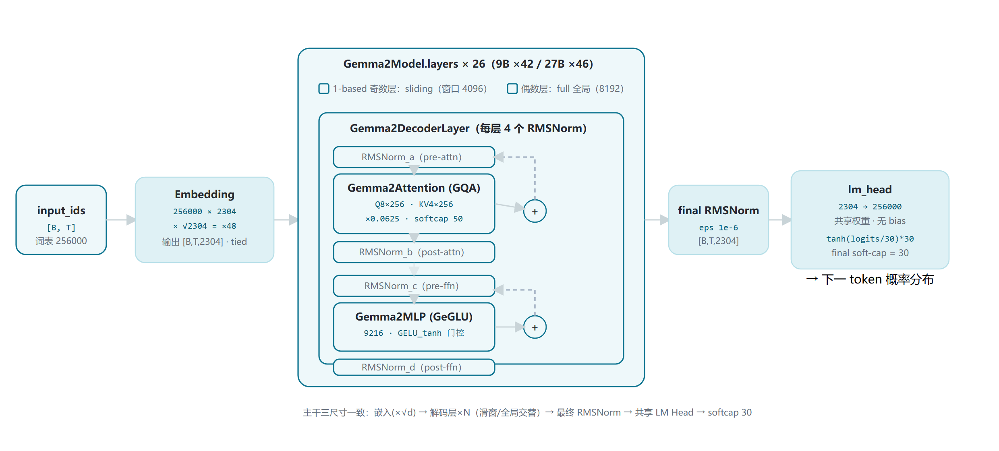
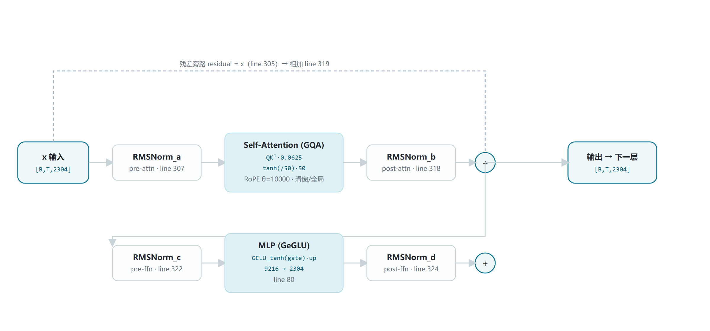

# Gemma 2 家族架构详解 — 2B / 9B / 27B（config + 源码级核对）

- 入口类 Gemma2ForCausalLM（三尺寸统一）
- 3 个稠密尺寸：26 / 42 / 46 层
- GQA：8Q/4KV · 16Q/8KV · 32Q/16KV（groups 均为 2）
- 滑窗 4096 ↔ 全局 8192 隔层交替（1:1）
- 数字逐字段对齐 config.json + transformers 源码行号

本页覆盖 Gemma 2 全部三个开放尺寸：**2B（本地检查点 gemma-2-2b-it 的 config.json）**、**9B 与 27B（ModelScope 镜像 config.json，2026-10-22 下载核验）**，并对照 transformers 源码 `modeling_gemma2.py / configuration_gemma2.py`（本地 v5.5.0.dev0）与 Gemma 2 技术报告（arXiv:2408.00118）。Gemma 2 相对 Gemma 1 的四大新增：**GQA 分组查询注意力**、**滑窗/全局隔层交替**、**pre + post 双 RMSNorm（每层 4 个）**、**注意力与最终 logit 双重 soft-capping**；另有 `query_pre_attn_scalar` 显式 Q 缩放与嵌入 $\times\sqrt{d}$ 两个易被忽略的细节。

## 1 家族全景：2B / 9B / 27B config 逐字段对照

> 左列 config 字段名，三列均为**真实 config.json 原文**（2B：本地 `E:\models\model\gemma-2-2b-it\config.json`；9B/27B：ModelScope `LLM-Research/gemma-2-{9b,27b}-it`，镜像 unsloth 导出、transformers_version 4.44.2）。两列 config 均**无 layer_types 字段**，交替模式由源码默认规则生成（见 §4.1）。论文 Table 1 的"Feedforward dim"列与 config intermediate_size 的关系见表下注。

| 字段 | 2B | 9B | 27B |
|---|---|---|---|
| architectures（入口类） | Gemma2ForCausalLM（三尺寸完全一致）（横跨 2B/9B/27B 三列） |  |  |
| model_type | gemma2（横跨三列） |  |  |
| hidden_size（d_model） | 2304 | 3584 | 4608 |
| num_hidden_layers | 26 | 42 | 46 |
| num_attention_heads（Q 头） | 8 | 16 | 32 |
| num_key_value_heads（KV 头） | 4 | 8 | 16 |
| GQA groups（Q÷KV，推导） | 2 | 2 | 2 |
| head_dim | 256 | 256 | 128 |
| intermediate_size（单投影）（gate/up 各为该维） | 9216 | 14336 | 36864 |
| 论文 Table 1「Feedforward dim」（= 2 × intermediate） | 18432 | 28672 | 73728 |
| hidden_act / hidden_activation | gelu_pytorch_tanh（GeGLU 门控）（横跨三列） |  |  |
| sliding_window（滑窗层窗口） | 4096 | 4096 | 4096 |
| max_position_embeddings（全局层跨度） | 8192 | 8192 | 8192 |
| **attn_logit_softcapping**（高亮行） | **50.0** | **50.0** | **50.0** |
| **final_logit_softcapping**（高亮行） | **30.0** | **30.0** | **30.0** |
| **query_pre_attn_scalar**（高亮行） | **256** | **256** | **144** |
| attention scaling（= $\text{scalar}^{-0.5}$，推导） | 1/16 = 0.0625 | 1/16 = 0.0625 | 1/12 ≈ 0.0833 |
| rope_theta（RoPE 基频） | 10000.0 | 10000.0 | 10000.0 |
| rms_norm_eps | 1e-6 | 1e-6 | 1e-6 |
| vocab_size（config）（论文口径 256128） | 256000 | 256000 | 256000 |
| tie_word_embeddings | true（config 未显式写出，configuration_gemma2.py:83 默认；lm_head 与 embed_tokens 共享）（横跨三列） |  |  |
| attention_bias / attention_dropout | false / 0.0（全部投影无 bias）（横跨三列） |  |  |
| cache_implementation | hybrid | hybrid | hybrid |
| torch_dtype | bfloat16（横跨三列） |  |  |
| **官方参数量（论文 Table 2）**（embedding + 非 embedding，高亮行） | **5.90 亿 + 20.25 亿 ≈ 2.61B** | **9.18 亿 + 83.24 亿 ≈ 9.24B** | **11.80 亿 + 260.47 亿 ≈ 27.23B** |
| **预训练 token（论文 §3）**（高亮行） | **2T（知识蒸馏）** | **8T（知识蒸馏）** | **13T（从零训练）** |

> 口径说明：① 论文 Table 1 的 **Feedforward dim**（18432/28672/73728）= config **intermediate_size × 2**，因为 GeGLU 的 gate 与 up 各占 intermediate 一维；② config **vocab_size=256000** 是 64 的倍数（GPU 友好对齐），论文 Table 2 按实际词表 **256128** 计 embedding 参数（$256128\times2304=590{,}118{,}912$，与论文完全吻合）；③ 27B 的 **query_pre_attn_scalar=144** 而不是 256——配合其 head_dim=128，是 query 缩放与 head_dim 解耦设计的直接证据（见 §4.3）。

## 2 端到端数据流总览（以本地 2B 为基准尺寸）

> 数据流向：token id → 嵌入（$\times\sqrt{d}=\sqrt{2304}=48$，与 lm_head 共享权重）→ **26 个 Gemma2DecoderLayer**（1-based 奇数层滑窗 / 偶数层全局，1:1 交替）→ 最终 RMSNorm → lm_head → **final soft-cap 30** → logits。张量形状按 2B（d=2304）标注；9B（42 层）/27B（46 层）主干结构完全相同。

### 2.1 架构图



> 全家族统一主干，差异只在维度表（§1）与层数（26/42/46）。两类 mask 在 `Gemma2Model.forward` 中预先各建一份（`create_causal_mask` line 431 / `create_sliding_window_causal_mask` line 432），再按 `layer_types[i]` 逐层分发（line 442）。

## 3 解码层解剖：Gemma2DecoderLayer（2B 尺寸为例）

> 严格对照 `Gemma2DecoderLayer.forward`（modeling_gemma2.py:296-327）。与常规 pre-norm Transformer 的差异：**每个子层的输入和输出各归一化一次**——post-norm 在残差相加之前（line 318-319、324-325），每层共 4 个 RMSNorm。三尺寸共享同一层结构，仅维度随 §1 变化。

### 3.1 架构图



> **与 LLaMA 式 pre-norm 的关键差异：**常规结构是 `x + Attn(RMSNorm(x))`，只有 pre-norm；Gemma 2 把残差相加写成 `x + RMSNorm_post(子层输出)`（line 318-319、324-325），post-norm 在 skip 分支内侧。每层 4 个 RMSNorm，用于稳定 26/42/46 层较深网络的训练（论文 §2 "Post-norm and pre-norm with RMSNorm"）。

## 4 核心机制专节：交替注意力 · softcap · query_scalar · 双 RMSNorm

### 4.1 交替 local/global 注意力（config 无 layer_types，由源码默认规则生成）

> 三份 config.json 均**未显式给出 `layer_types`**，于是 `configuration_gemma2.py:95-98` 在 `__post_init__` 中自动构造：

```
layer_types = [
  "sliding_attention" if bool((i + 1) % 2)   # configuration_gemma2.py:96-98
  else "full_attention"
  for i in range(num_hidden_layers) ]
# 1-based 奇数层（1,3,5…）= sliding_attention（窗口 4096）
# 1-based 偶数层（2,4,6…）= full_attention（全局 8192）
# 2B: 13 滑窗 + 13 全局；9B: 21+21；27B: 23+23（严格 1:1）
```

> 运行期链路：注意力层构造时按层号读取类型（`modeling:216`）；仅滑窗层才设置 `self.sliding_window`（`modeling:238`）；模型前向一次性建两类 mask（`create_causal_mask` line 431 / `create_sliding_window_causal_mask` line 432），按 `layer_types[i]` 逐层分发（`modeling:442`）。论文 §2 原文："We alternate between a local sliding window attention and global attention **in every other layer**"，与源码 1:1 默认规则一致。

### 4.2 双重 soft-capping（公式 + 源码行号）

① 注意力 logit softcap = 50.0（eager_attention_forward, modeling:193-198）：

$$s=(Q\cdot K^\top)\cdot \mathrm{scaling},\quad \mathrm{scaling}=256^{-0.5}\quad(\text{:193, :221})$$

$$\mathrm{softcap}(s)=\tanh(s/50.0)\cdot 50.0\quad(\text{:196-198，压进 } \pm50)$$

$$s=s+\mathrm{attention\_mask}\quad(\text{:200})$$

$$p=\mathrm{softmax}(s,\ \dim=-1,\ \mathrm{fp32})\quad(\text{:203})$$

$$\mathrm{Attn}=p@V\quad(\text{:205})$$

② 最终 logit softcap = 30.0（Gemma2ForCausalLM.forward, modeling:519-522）：

$$\mathrm{logits}=\mathrm{lm\_head}(\mathrm{hidden})\quad(\text{:518})$$

$$\mathrm{logits}=\tanh(\mathrm{logits}/30.0)\cdot 30.0\quad(\text{:520-522，压进 } \pm30)$$

$$\mathrm{loss}=\mathrm{CE}(\mathrm{logits},\ \mathrm{labels})\quad(\text{:524-526})$$

> 数值效果：softcap 是软截断——logits 越大，$\tanh(x/c)\cdot c$ 斜率越平，极端值被有界压缩而不硬切。论文 §2：soft_cap=50.0 用于每个注意力层、30.0 用于最终层，防止训练中 logits 发散。

### 4.3 query_pre_attn_scalar：与 head_dim 解耦的显式 Q 缩放

$$\mathrm{scaling}=\mathrm{query\_pre\_attn\_scalar}^{-0.5}\quad(\text{modeling:221})$$

三尺寸实际值（§1 对照表）：2B scalar=256, head_dim=256 → $\mathrm{scaling}=256^{-0.5}=0.0625=1/16$；9B scalar=256, head_dim=256 → $\mathrm{scaling}=0.0625=1/16$；27B scalar=144, head_dim=128 → $\mathrm{scaling}=144^{-0.5}\approx0.0833=1/12$。

> 若沿用经典 $1/\sqrt{\text{head\_dim}}$：2B/9B 恰为 1/16；但 27B head_dim 缩到 128，经典缩放会变成 $1/\sqrt{128}\approx0.0884$。Gemma 2 用独立超参 `query_pre_attn_scalar` 把 Q 缩放与 head_dim 解耦——27B 的 config 里 scalar=144 而非 256，正是这一设计的实证（注意：144 开方=12，与 head_dim=128 无直接数学等式，是按训练 ablation 选定的经验值）。

### 4.4 双 RMSNorm（pre + post，每层 4 个）

Gemma2RMSNorm.forward（modeling:54-61）——Gemma 特化两点：fp32 计算、乘 $(1+\gamma)$：

$$\hat{x}=x/\sqrt{\mathrm{mean}(x^2)+\epsilon}\quad(\text{:55})$$

$$y=\big(x.\mathrm{float}()/\mathrm{rms}\big)\cdot\big(1+\gamma.\mathrm{float}()\big)\quad(\text{:58-61，γ 初始化为 0 → 初始等价乘 1})$$

$$y=y.\mathrm{type\_as}(x)\quad(\text{:62})$$

单层 4 个实例（modeling:290-294 定义；:307 / :318 / :322 / :324 调用）：

- `input_layernorm` → self_attn → residual +
- `post_attention_layernorm`（残差相加前）
- `pre_feedforward_layernorm` → mlp → residual +
- `post_feedforward_layernorm`（残差相加前）

eps = rms_norm_eps = 1e-6（三尺寸 config 一致）。

### 4.5 GQA：分组共享 K/V（groups 恒为 2）

```
# Gemma2Attention.__init__（modeling:219-221）
self.head_dim = getattr(config, "head_dim", hidden_size // num_attention_heads)
self.num_key_value_groups = num_attention_heads // num_key_value_heads   # = 2（三尺寸同）
self.scaling = config.query_pre_attn_scalar ** -0.5

# 2B 投影形状（line 225-236）
q_proj: 2304 → 8×256 = 2048
k_proj: 2304 → 4×256 = 1024
v_proj: 2304 → 4×256 = 1024
o_proj: 2048 → 2304

# 前向：repeat_kv 复制 K/V（line 190-191）
key_states   = repeat_kv(key,   n_rep=2)   # [B,4,T,256] → [B,8,T,256]
value_states = repeat_kv(value, n_rep=2)
```

> 论文 §2 明确 "GQA with num_groups=2, based on ablations showing increased speed at inference time while maintaining downstream performance"（Table 8 对比 MHA/GQA）。KV cache 体积因此相对 MHA 减半；sliding 层滑出窗口的旧 K/V 还可被 HybridCache 回收（config `cache_implementation="hybrid"`）。

## 5 注意力机制：三尺寸 KV 分配 · mask 差异 · softcap 效果

### 5.1 三尺寸投影维度对照（由 §1 config 推导）

| 投影（bias=false） | 2B（d=2304） | 9B（d=3584） | 27B（d=4608） |
|---|---|---|---|
| q_proj | 2304 → 8×256 = 2048 | 3584 → 16×256 = 4096 | 4608 → 32×128 = 4096 |
| k_proj | 2304 → 4×256 = 1024 | 3584 → 8×256 = 2048 | 4608 → 16×128 = 2048 |
| v_proj | 2304 → 4×256 = 1024 | 3584 → 8×256 = 2048 | 4608 → 16×128 = 2048 |
| o_proj | 2048 → 2304 | 4096 → 3584 | 4096 → 4608 |
| KV 头共享比（groups） | 每 2 Q 头共享 1 K/V | 每 2 Q 头共享 1 K/V | 每 2 Q 头共享 1 K/V |
| scaling（$\text{query\_scalar}^{-0.5}$） | 0.0625 | 0.0625 | ≈0.0833（scalar=144） |

> 注意 27B：head_dim 从 256 缩到 128，Q 头从 16 增到 32，q_proj 输出仍是 4096——宽模型用更多窄头。投影定义源码：modeling_gemma2.py:225-236。

### 5.2 sliding mask 与 global mask 的差异

卡片一 · 滑窗层（1-based 奇数层）：
- 每个位置 i 只能回看 `max(0, i-4095) … i` 的 token（因果 + 局域），mask 由 `create_sliding_window_causal_mask` 构造（modeling:31 import，432 调用）。复杂度随窗口线性，KV cache 随窗口增长；滑出窗口的旧 K/V 可被 HybridCache 回收。
- 源码佐证：modeling:238（仅滑窗层设 sliding_window=4096）、430-433（双 mask 预建）、442（按层分发）

卡片二 · 全局层（1-based 偶数层）：
- 普通因果 mask：每个位置可看全部 0…i 的 token（跨度 8192），由 `create_causal_mask` 构造（modeling:431）。全局层保留完整 8192 K/V，负责捕捉长程依赖。两类 mask 在一次前向中同时建好、按层取用。
- 论文佐证：§2 "sliding window size 4096 tokens, global attention span 8192 tokens"；Table 10 显示推理时滑窗可降到 2048/1024 而困惑度几乎不变

## 6 特殊 Token 与词表布局

| token 字段（config 原文） | ID | 含义 / 来源 |
|---|---|---|
| pad_token_id | 0 | padding 占位（三尺寸 config 一致） |
| bos_token_id | 2 | 序列开始（三尺寸 config 一致） |
| eos_token_id | 1（2B 本地 config 为 [1, 107]） | 结束符；本地 2B config 额外含 107（`<end_of_turn>`，对话轮次结束）。9B/27B 下载 config 中 eos 为标量 1 |
| 词表大小 | config 256000 / 论文 256128 | config 按 64 对齐取 256000；论文 Table 2 按实际词表 256128 计 embedding 参数（SentencePiece，split digits / preserved whitespace / byte-level，与 Gemma 1、Gemini 共用） |

> 说明：本页仅核验了 config.json 中的 token 字段；tokenizer_config.json 未在本次下载范围内，`<start_of_turn> / <end_of_turn>` 等对话模板 token 的精确 ID 未在 config 中直接给出（107 来自 2B 本地 config 的 eos_token_id 列表）。Gemma 2 为纯文本模型，无图像/音频类特殊 token。

## 7 演进视角：Gemma 1 → Gemma 2（论文主线对照）

> Gemma 1 一列取自 Gemma 1 技术报告（arXiv:2403.08295）与官方模型卡的公开规格（2B 配置：18 层 / hidden 2048 / 8 Q 头 / 1 KV 头 MQA / head_dim 256 / intermediate 16384 / gelu / 仅 pre-norm / 无滑窗 / 无 softcap）；Gemma 2 一列全部来自本页 §1 config 原文与源码。

| 维度 | Gemma 1（2B 为例） | Gemma 2（2B / 9B / 27B） |
|---|---|---|
| KV 头 / 注意力类型 | 1（MQA，Multi-Query） | **4 / 8 / 16（GQA，groups 恒为 2）** |
| 局部滑窗 | 无（全全局因果） | **窗口 4096，与全局 8192 隔层 1:1 交替** |
| attn logit soft-cap | 无 | **$\tanh(s/50)\cdot50$（config attn_logit_softcapping）** |
| final logit soft-cap | 无 | **$\tanh(s/30)\cdot30$（config final_logit_softcapping）** |
| query_pre_attn_scalar | 无（隐含 $1/\sqrt{\text{head\_dim}}$） | **256（2B/9B）/ 144（27B），$\text{scaling}=\text{scalar}^{-0.5}$** |
| 归一化布局 | pre-norm only（每层 2 个 RMSNorm） | **pre + post（每层 4 个 RMSNorm）** |
| hidden_size | 2048 | 2304 / 3584 / 4608 |
| num_hidden_layers | 18 | **26 / 42 / 46**（"deeper networks"，论文 §2） |
| intermediate_size | 16384 | 9216 / 14336 / 36864（更窄 FFN × 更多层） |
| hidden_act | gelu | gelu_pytorch_tanh（GeGLU 门控） |
| head_dim | 256 | 256 / 256 / **128**（27B 窄头多头） |
| max_position_embeddings | 8192 | 8192（不变） |
| rope_theta / rms_norm_eps | 10000 / 1e-6 | 10000 / 1e-6（不变） |
| attention_bias / 词表 | false / 256k | false / 256000（不变） |
| 训练数据 | 2B 约 3T token；7B 约 6T | **2B 2T（蒸馏）/ 9B 8T（蒸馏）/ 27B 13T（从零）** |
| 蒸馏 | 无 | **2B 与 9B 以大模型为教师做知识蒸馏** |

> 一句话总结演进主线：Gemma 2 把 Gemma 1 的 MQA 换成 GQA、引入滑窗/全局交替与双重 soft-cap、用 pre+post 双 RMSNorm 支撑更深网络，并把 2B/9B 放进大规模蒸馏训练——官方口径 "competitive alternatives to models that are 2-3 times bigger"（arXiv:2408.00118 摘要）。

## 8 来源

1. 本地权威 config（2B，本尺寸逐字段核验）
   `E:\models\model\gemma-2-2b-it\config.json —— hidden_size=2304 / 26 层 / 8Q / 4KV / head_dim=256 / intermediate=9216 / sliding_window=4096 / attn_logit_softcapping=50.0 / final_logit_softcapping=30.0 / query_pre_attn_scalar=256 / vocab=256000 / eos=[1,107] / bos=2 / pad=0 / rope_theta=10000 / cache=hybrid`
2. ModelScope 下载 config（9B / 27B，2026-10-22 下载核验；镜像 unsloth/gemma-2-{9b,27b}-it，transformers_version 4.44.2）
   `https://modelscope.cn/models/LLM-Research/gemma-2-9b-it（hidden=3584 / 42 层 / 16Q / 8KV / head_dim=256 / intermediate=14336 / query_scalar=256）；https://modelscope.cn/models/LLM-Research/gemma-2-27b-it（hidden=4608 / 46 层 / 32Q / 16KV / head_dim=128 / intermediate=36864 / query_scalar=144）；两 config 均无 layer_types 字段`
3. transformers 源码 modeling_gemma2.py（本地 v5.5.0.dev0）
   `E:\transformers\src\transformers\models\gemma2\modeling_gemma2.py —— Gemma2RMSNorm 48-65；Gemma2MLP 68-81（GeGLU line 80）；repeat_kv 164-173；eager_attention_forward 176-207（softcap 195-198）；Gemma2Attention 211-280（layer_type 216 / groups 220 / scaling 221 / 投影 225-236 / sliding_window 238）；Gemma2DecoderLayer 283-327（4 norm 290-294，调用 307/318/322/324）；Gemma2TextScaledWordEmbedding 330-341；Gemma2Model 373-454（嵌入缩放 380 / 双 mask 430-433 / 层分发 442）；Gemma2ForCausalLM 458-534（final softcap 519-522）`
4. transformers 源码 configuration_gemma2.py
   `E:\transformers\src\transformers\models\gemma2\configuration_gemma2.py —— 字段默认值 68-92（hidden 2304 / layers 26 / heads 8 / kv 4 / head_dim 256 / scalar 256 / sliding 4096 / softcap 50 与 30 / tie=true）；layer_types 默认 1:1 交替规则 95-98`
5. Gemma 2 技术报告（论文口径）
   `arXiv:2408.00118《Gemma 2: Improving Open Language Models at a Practical Size》——https://arxiv.org/abs/2408.00118 ；HTML 全文 https://arxiv.org/html/2408.00118v3 （Table 1 架构规格；Table 2 参数量 2.61B/9.24B/27.23B；§2 双 soft-cap、GQA groups=2、隔层交替、pre+post RMSNorm；§3 训练 token 2T/8T/13T 与蒸馏）`
6. Gemma 2 模型卡（官方部署口径）
   `https://ai.google.dev/gemma/docs/core/model_card_2 （上下文 8192、纯文本、安全与许可说明）`
7. Gemma 1 技术报告（演进对比基线）
   `arXiv:2403.08295《Gemma: Gemma Open Models》——https://arxiv.org/abs/2403.08295 （MQA、pre-norm only、2B=18 层 / hidden 2048 / intermediate 16384）`

> 数据口径：所有 config 数字来自上述真实配置文件原文；源码行号为本地 transformers v5.5.0.dev0 实测定位；论文数字来自 arXiv:2408.00118 Table 1/2 与正文。config 与论文口径的两处差异（Feedforward dim = 2×intermediate；vocab 256000 vs 256128）已在 §1 表下注并列标注。访问与核验日期：2026-10-22。

---

*页脚：Gemma 2 家族架构详解 · 数据来源：本地 gemma-2-2b-it/config + ModelScope 9B/27B config + transformers v5.5.0.dev0 源码 + arXiv:2408.00118 · 仅供论文研究与技术学习*
