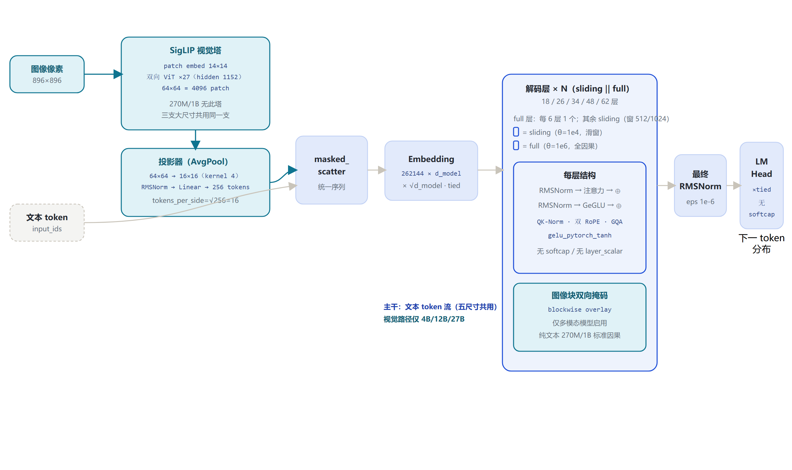
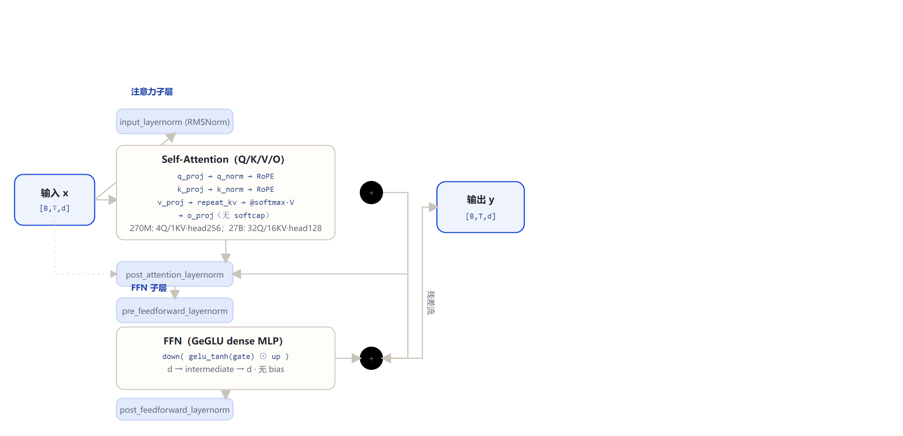

# Gemma 3 家族架构详解 — 270M / 1B / 4B / 12B / 27B（文本 + SigLIP 多模态）

- 徽标：入口类 Gemma3ForCausalLM（270M/1B）/ Gemma3ForConditionalGeneration（4B/12B/27B）
- 徽标（青/多模态）：多模态：4B/12B/27B 配 SigLIP 视觉塔（patch 14 · 896px · 256 soft tokens/图）
- 徽标：双 RoPE（global $\theta=10^6$ / local $\theta=10^4$）· 5:1 滑窗/全局交错 · QK-Norm
- 徽标：无 soft-capping（QK-Norm 取代）· 上下文 32K（小）/ 128K（大）

本页以 **各变体真实 `config.json`**（本地 `gemma-3-270m-it` + ModelScope 拉取的 1B/4B/12B/27B）与 **transformers 源码 `modeling_gemma3.py / configuration_gemma3.py`**（本地 E:\transformers）为唯一依据。Gemma 3 分两支：**纯文本因果 LM**（270M/1B，`Gemma3ForCausalLM`，无视觉塔）与 **多模态条件生成**（4B/12B/27B，`Gemma3ForConditionalGeneration`，含 SigLIP 视觉塔）。所有数字均标注来源（config 字段或源码文件:行号）。

## 1 家族全景：五个尺寸的架构对照

> 270M/1B 为顶层 `gemma3_text` config（字段全在顶层）；4B/12B/27B 为 `gemma3` 组合 config，文本栈字段在 `text_config` 子对象内。4B/12B/27B 的 text_config 只显式列出覆盖默认值的字段，其余（Q/KV 头、head_dim、rope_theta、query_pre_attn_scalar、vocab 等）取 `Gemma3TextConfig` 默认值，下表逐格标注。

### 1.1 文本塔核心超参数

| 字段（text_config） | 270M | 1B | 4B | 12B | 27B |
|---|---|---|---|---|---|
| 入口类 architectures | Gemma3ForCausalLM | Gemma3ForCausalLM | Gemma3ForConditionalGeneration | Gemma3ForConditionalGeneration | Gemma3ForConditionalGeneration |
| **形态** | **纯文本 Dense** | **纯文本 Dense** | **Dense + SigLIP 视觉塔** | **Dense + SigLIP 视觉塔** | **Dense + SigLIP 视觉塔** |
| hidden_size | 640 | 1152 | 2560 | 3840 | 5376 |
| num_hidden_layers | 18 | 26 | 34 | 48 | 62 |
| full_attention 层（1-based，每 6 层 1 full） | 6,12,18（3 full / 15 sliding） | 6,12,18,24（4 full / 22 sliding） | 6,12,18,24,30（5 full / 29 sliding） | 6,12,…,48（8 full / 40 sliding） | 6,12,…,60（10 full / 52 sliding） |
| num_attention_heads (Q) | 4 | 4 | 8（默认值） | 16 | 32 |
| num_key_value_heads (KV) | 1 | 1 | 4（默认值） | 8 | 16 |
| head_dim | 256 | 256 | 256（默认值） | 256（默认值） | 128 |
| query_pre_attn_scalar（注意力缩放 $s^{-0.5}$） | 256 → 1/16 | 256 → 1/16 | 256（默认值） | 256（默认值） | 168 |
| intermediate_size | 2048 | 6912 | 10240 | 15360 | 21504 |
| sliding_window | 512 | 512 | 1024 | 1024 | 1024 |
| rope_theta（global 层基频） | 1,000,000 | 1,000,000 | 1e6（默认值） | 1e6（默认值） | 1e6（默认值） |
| rope_local_base_freq（local 层） | 10,000 | 10,000 | 1e4（默认值） | 1e4（默认值） | 1e4（默认值） |
| rope_scaling | null | null | linear factor 8.0 | linear factor 8.0 | linear factor 8.0 |
| max_position_embeddings | 32,768 | 32,768 | 131,072（默认值） | 131,072（默认值） | 131,072（默认值） |
| attn_logit_softcapping | null | null | null（默认值） | null（默认值） | null（默认值） |
| final_logit_softcapping | null | null | null（默认值） | null（默认值） | null（默认值） |
| vocab_size | 262,144 | 262,144 | 262,144 | 262,144 | 262,144 |
| hidden_activation | gelu_pytorch_tanh（GeGLU）· tie_word_embeddings=true · rms_norm_eps=1e-6 · attention_bias=false（合并 270M–27B 五列） |||||

> 要点：**Gemma 3 全家族均无 soft-capping**——Google 官方明确"Gemma 3 以 QK-Norm 取代了 Gemma 2 的 soft-capping 机制"（本地 config 与 Keras/GG 实现口径一致：attn/final softcap 均为 null）。小尺寸（270M/1B）纯文本、32K 上下文；大尺寸（4B/12B/27B）多模态、经 linear RoPE 缩放 $8\times$ 扩到 128K 上下文。27B 是唯一 head_dim=128、query_pre_attn_scalar=168 的尺寸。

### 1.2 多模态与部署规格

| 字段 | 270M | 1B | 4B | 12B | 27B |
|---|---|---|---|---|---|
| 视觉塔 SigLIP | 无 | 无 | 同一支：hidden 1152 · 27 层 · 16 头 · head_dim 72 · inter 4304 · patch 14 · image 896（合并 4B/12B/27B 三列） |||
| mm_tokens_per_image | — | — | 256 | 256 | 256 |
| 图像 token 布局 | — | — | boi=255999 · image 占位=262144 · eoi=256000（合并 4B/12B/27B 三列） |||
| 官方参数量 | ≈0.27B | ≈1B | ≈4B | ≈12B | ≈27B |
| 上下文长度 | 32K | 32K | 128K | 128K | 128K |
| 训练数据 / 语言 | 官方技术报告：约 14T token、140+ 种语言（家族统一口径，合并 270M–27B 五列） |||||

## 2 端到端数据流总览

> 文本 token 与图像像素两路输入 → 图像经 SigLIP 视觉塔编码、AvgPool + RMSNorm + 线性投影压成 `256 soft tokens/图` → 与文本 embedding 一起 `masked_scatter` 填入图像占位 token 位 → 统一序列 $\times\sqrt{d_{\text{model}}}$ → **$N$ 个解码层**（sliding 与 full 5:1 交错，双 RoPE）→ 最终 RMSNorm → 共享权重 LM Head（无 softcap）。

### 2.1 架构图



> 全家族统一主干：词嵌入缩放 $\sqrt{d_{\text{model}}}$ 后，经 $N$ 个解码层、最终 RMSNorm、共享 LM Head；差异集中在层数、维度、滑窗窗口、KV 头数，以及是否挂 SigLIP 视觉塔。

## 3 解码层解剖：Gemma 2 式双 RMSNorm 残差块

> Gemma 3 的每个解码层（`Gemma3DecoderLayer`）含两组残差子层：注意力子层与 FFN 子层，均为 **pre-norm + post-norm** 并用（Gemma 2 起的传统）。全部五尺寸共享此结构，仅维度随尺寸缩放。

### 3.1 架构图



```
Gemma3DecoderLayer.forward（modeling_gemma3.py:397-418）:
  residual = hidden_states
  hidden_states = input_layernorm(hidden_states)
  hidden_states, _ = self_attn(hidden_states, position_embeddings, attention_mask, ...)
  hidden_states = post_attention_layernorm(hidden_states)
  hidden_states = residual + hidden_states            # ⊕1
  residual = hidden_states
  hidden_states = pre_feedforward_layernorm(hidden_states)
  hidden_states = mlp(hidden_states)
  hidden_states = post_feedforward_layernorm(hidden_states)
  hidden_states = residual + hidden_states            # ⊕2
  return hidden_states
```

## 4 核心机制：双 RoPE · 5:1 交错 · GQA · SigLIP 视觉塔

### 4.1 ① 双频率 RoPE（global $\theta=10^6$ / local $\theta=10^4$）

`Gemma3RotaryEmbedding` 为**每种层类型**各建一份逆频率表：full 层用 `rope_theta=1e6`，sliding 层用 `rope_local_base_freq=1e4`[CFG:99,149-156]。forward 按 `layer_type` 取对应 `{type}_inv_freq`[S:161-175]。

$$\mathrm{inv\_freq}_i = \mathrm{base}^{-2i/\mathrm{head\_dim}},\quad i=0,\dots,\mathrm{head\_dim}/2-1$$

$$\theta_i = \mathrm{pos}\cdot \mathrm{inv\_freq}_i$$

$$q_{\mathrm{rot}} = q\cos\theta + \mathrm{rotate\_half}(q)\sin\theta$$

- full 层 base $=10^6$（长程）；sliding 层 base $=10^4$（局部）。
- 4B/12B/27B 另套 rope_scaling linear factor 8.0（扩到 128K）。

> head_dim：270M/1B/4B/12B=256，27B=128。全维度旋转（无 partial rotary）。

### 4.2 ② 每 6 层一个 full（5:1 交错）

层类型由 `(i+1) % 6` 决定：余数 0 为 `full_attention`，其余 `sliding_attention`[CFG:106-112]。`Gemma3Attention` 据此把 `sliding_window` 设为窗口值（仅 sliding 层），full 层为 `None`[S:324-325]。

```
for i in 0..N-1:
    type = "full" if (i+1)%6==0 else "sliding"
# 270M(N=18): full at 6,12,18
# 1B(N=26):    full at 6,12,18,24
# 4B(N=34):    full at 6,12,18,24,30
# 12B(N=48):   full at 6,12,...,48
# 27B(N=62):   full at 6,12,...,60
```

> 注意勿套 Gemma 2 的 1:1 交替；Gemma 3 是 5 滑窗 + 1 全局。

### 4.3 ③ 滑窗因果掩码 + Hybrid KV cache

文本路建两张掩码：`full → create_causal_mask`、`sliding → create_sliding_window_causal_mask`，层循环按 `layer_types[i]` 取用[S:541-544]。滑窗层只看过去 512（小）/1024（大）个 token，KV cache 对应层只留最近窗口。

$$M[i,j]=\begin{cases}0, & j\leq i\ \text{且}\ i-j<\mathrm{sliding\_window}\\ -\infty, & \text{否则（因果 + 局部）}\end{cases}$$

full 层不受窗口限制，可 attend 到 32K/128K 全长。

### 4.4 ④ QK-Norm（取代 soft-capping）

Q/K 投影后、RoPE 前各过 `Gemma3RMSNorm(dim=head_dim)`[S:327-328]。Gemma 3 全家族 `attn_logit_softcapping=null`、`final_logit_softcapping=null`——这是与 Gemma 2 的关键差异（官方：以 QK-Norm 取代 soft-capping）。

```
q = q_norm(q_proj(x));  k = k_norm(k_proj(x))
q,k = apply_rotary_pos_emb(q,k,cos,sin)   # norm 在 RoPE 前
# 注意力分数不再 tanh 封顶（softcap 分支因 None 跳过）
```

注意力缩放 $\mathrm{scaling}=s^{-0.5}$，其中 $s=\mathrm{query\_pre\_attn\_scalar}$（270M–12B：$s=256$，即 $1/16$；27B：$s=168$，即 $1/\sqrt{168}$）。

### 4.5 ⑤ RMSNorm（零中心 γ）与 GeGLU

RMSNorm 先 fp32 归一，再乘 $(1+\gamma)$，$\gamma$ 初始化为 0[S:139-149]。FFN 为三投影门控 `gelu_pytorch_tanh`。

$$\mathrm{RMS}(x)=\sqrt{\mathrm{mean}(x^2)+\epsilon}$$

$$\hat{x}=\frac{x}{\mathrm{RMS}(x)},\qquad y=(1+\gamma)\,\hat{x}$$

$$\mathrm{FFN}(x)=\mathrm{down}\!\big(\mathrm{GELU}(W_g x)\,\odot\,W_u x\big)$$

### 4.6 ⑥ SigLIP 视觉塔 → soft tokens（仅 4B/12B/27B）

图像经 SigLIP ViT 编码后，由投影器压成 `mm_tokens_per_image=256` 个 soft token，与文本拼接[S:769-770]。

patch 数：$896/14=64$，共 $64\times64=4096$ 个 patches；AvgPool kernel $=64/16=4$（$4\times4$ 平均池化），每边 $\sqrt{256}=16$ 个 token → $16\times16=256$ soft tokens/图 → RMSNorm(1152) → Linear(1152 → text hidden)。

> 视觉塔 config 三支大尺寸完全相同（hidden 1152 / 27 层 / 16 头 / inter 4304 / patch 14 / image 896）。

## 5 注意力机制：GQA · 双 RoPE 旋转维度 · 滑窗 vs 全局

### 5.1 GQA KV 头分配（repeat_kv）

| 尺寸 | Q 头数 | KV 头数 | GQA 分组 | head_dim | Q 投影输出维 |
|---|---|---|---|---|---|
| 270M | 4 | 1 | 4:1（MQA 式） | 256 | $4\times256=1024$ |
| 1B | 4 | 1 | 4:1（MQA 式） | 256 | 1024 |
| 4B | 8 | 4 | 2:1 | 256 | 2048 |
| 12B | 16 | 8 | 2:1 | 256 | 4096 |
| 27B | 32 | 16 | 2:1 | 128 | 4096 |

> 运行时 `repeat_kv` 把 K/V 从 KV 头数复制到 Q 头数再做注意力（`modeling_gemma3.py:250-259, 276-277`）。

### 5.2 双 RoPE 的应用范围

| 层类型 | RoPE 基频 | 掩码 | KV cache | 缩放 |
|---|---|---|---|---|
| sliding_attention | $\theta=10{,}000$（local） | 滑窗因果（窗 512/1024） | 仅最近窗口 | $s^{-0.5}$ |
| **full_attention** | **$\theta=1{,}000{,}000$（global）** | **全因果（可看全长）** | **全历史** | **$s^{-0.5}$** |

注意力核心计算：

$$\mathrm{Attn}(Q,K,V)=\mathrm{softmax}\!\left(\frac{QK^\top}{\sqrt{d_k}}+\text{mask}\right)V$$

```
eager_attention_forward（modeling_gemma3.py:273-291）:
scaling   = query_pre_attn_scalar ** -0.5        # line 307
key/vals  = repeat_kv(key, num_key_value_groups)
attn      = (query · keyᵀ) * scaling
# softcap 分支：config.attn_logit_softcapping is None → 跳过（Gemma 3）
attn      = softmax(attn + mask, fp32)
output    = attn @ value
```

## 6 多模态：SigLIP 视觉塔与文本融合

### 6.1 视觉塔 config（4B / 12B / 27B 共用）

| 字段（vision_config） | 取值 | 字段 | 取值 |
|---|---|---|---|
| model_type | siglip_vision_model | hidden_size | 1152 |
| num_hidden_layers | 27 | num_attention_heads | 16（head_dim 72） |
| intermediate_size | 4304 | patch_size | 14 |
| image_size | 896 | vision_use_head | false |

> 视觉塔由 `AutoModel.from_config(config.vision_config)` 构造（`modeling_gemma3.py:769`）；官方技术报告口径为基于 SigLIP 的视觉编码器、$896\times896$ 输入、ViT-H/14 风格。投影器见 `Gemma3MultiModalProjector`（651-684）。

### 6.2 融合方式（masked_scatter）

```
Gemma3Model.forward（modeling_gemma3.py:864-877）:
inputs_embeds = embed(llm_input_ids)                 # 图像占位 id≥vocab 先替为 pad
image_features = projector( vision_tower(pixel_values) )   # → (B, n_img, 256, d_text)
special_image_mask = (input_ids == image_token_index)
inputs_embeds = inputs_embeds.masked_scatter(mask, image_features)
# 图像特征直接填入占位 token 位，不经过 embedding 查表
# 文本模型收到统一 inputs_embeds 继续前向（898-906）
```

> 图像块掩码：`token_type_ids` 标记图像块，块内图像 token 双向、不看未来图像（`modeling_gemma3.py:687-755, 889-896`）。**270M/1B 无视觉塔**，`input_modalities=("text",)`（`modeling_gemma3.py:476`）。

## 7 特殊 Token 与词表布局

| token | ID | 含义 | 来源 |
|---|---|---|---|
| boi_token_index | 255999 | 图像开始（begin of image） | config 顶层 |
| eoi_token_index | 256000 | 图像结束（end of image） | config 顶层 |
| image_token_index | 262144 | 图像特征占位（=vocab_size，OOV） | config；modeling:857-860 |
| bos / eos / pad | 2 / [1,106] / 0 | 标准文本控制 token | config |

> 词表 `vocab_size=262144`。注意 `image_token_index=262144` 恰好等于词表大小（即超出 0..262143 范围），因此嵌入前先把它替换为 pad=0，再由 `masked_scatter` 写入视觉特征——该位从不经过 embedding 查表（`modeling_gemma3.py:857-860, 877`）。attribute_map 把 `image_token_id/boi_token_id/eoi_token_id` 映射到 `*_index`（`configuration_gemma3.py:196-200`）。

## 8 演进视角：Gemma 2 → Gemma 3

| 维度 | Gemma 2（基线） | Gemma 3（家族） |
|---|---|---|
| 模态 | 纯文本 | 纯文本（270M/1B）+ **多模态 SigLIP 视觉塔**（4B/12B/27B） |
| 上下文 | 8,192 | 32K（270M/1B）/ **128K**（4B/12B/27B，linear RoPE $8\times$） |
| 滑窗/全局交错 | 逐层 1:1（滑/全交替） | **5:1（每 6 层第 6 层全局）**；窗口 4096→512/1024 |
| RoPE 基频 | 统一 $\theta=10{,}000$ | **双频率：global $\theta=10^6$ / local $\theta=10^4$** |
| soft-capping | attn 50.0 / final 30.0（tanh 封顶） | **全部移除（null），以 QK-Norm 取代** |
| QK-Norm | 无 | **逐头 Q/K RMSNorm（RoPE 前）** |
| 词表 | 256,000 | 262,144 |
| 多语言 / 训练量 | 英语为主，约 8T 级 | **140+ 语言、约 14T token**（官方技术报告） |
| 归一化 / 激活 | pre+post RMSNorm · GeGLU | 相同（延续） |
| KV cache | hybrid（滑窗层回收） | hybrid（延续） |

> Gemma 3 的主线升级：① 首次引入 SigLIP 视觉塔成为多模态模型；② 双 RoPE（global $10^6$ / local $10^4$）+ 5:1 交错滑窗；③ 用 QK-Norm 取代 Gemma 2 的 soft-capping；④ 上下文 8K→32K/128K；⑤ 词表 256K→262144、训练扩到 14T / 140+ 语言。Gemma 2 侧数字为官方公开口径；Gemma 3 侧数字均来自本页 config 与源码。

## 9 来源

1. 本地权威 config（270M，逐字段核对）
   `E:\models\model\gemma-3-270m-it\config.json（hidden 640 / 18 层 / 4Q·1KV / head256 / inter 2048 / sliding 512 / ropeθ1e6+local1e4 / vocab 262144 / max 32768 / softcap null）`
2. 其余尺寸 config（ModelScope 拉取，2026-10-22 核验）
   `google/gemma-3-1b-it（纯文本 1152/26层/4Q·1KV/inter6912/32K）；google/gemma-3-4b-it（2560/34层/text_config+vision_config，patch14/896）；google/gemma-3-12b-it（3840/48层/16Q·8KV）；google/gemma-3-27b-it（5376/62层/32Q·16KV/head128/query_scalar168）`
3. transformers 源码 modeling_gemma3.py（本地 E:\transformers）
   `嵌入缩放 105-116,484-486；MLP 119-132；RMSNorm 135-149；双 RoPE 155-214；repeat_kv 250-259；eager attention/softcap 262-293；Gemma3Attention 296-372；DecoderLayer 375-418；TextModel 473-567；ForCausalLM softcap 633-636；MultiModalProjector 651-684；视觉掩码 687-755；Gemma3Model/masked_scatter 763-914`
4. transformers 源码 configuration_gemma3.py
   `default_theta 99；层类型生成 106-112；按层类型填 rope_theta 133-160；组合 config 特殊 token 196-211`
5. Gemma 3 技术报告（arXiv 2503.19786）
   `https://arxiv.org/abs/2503.19786（128K 上下文除 1B 外、RoPE base 10k→1M global/local、SigLIP 视觉、14T/140+ 语言）`
6. Google Developers 博客：Gemma 3 架构说明
   `https://developers.googleblog.com/en/gemma-explained-whats-new-in-gemma-3/（5:1 interleaved attention；QK-norm 取代 soft-capping）`
7. Gemma 3 模型卡片（Google AI for Developers）
   `https://ai.google.dev/gemma/docs/core/model_card_3`

> 标注约定：[S:n]=modeling_gemma3.py 行号；[CFG:n]=configuration_gemma3.py 行号。4B/12B/27B 的 text_config 未显式列出的字段（Q/KV 头、head_dim、rope_theta、vocab、max_position、softcap 等）取 Gemma3TextConfig 类默认值，已在 §1 表格逐格标注。访问与核验日期：2026-10-22。

---

*页脚：Gemma 3 家族架构详解 · 数据来源：本地/ModelScope config + transformers 源码 + arXiv 2503.19786 / Google 官方资料 · 仅供技术学习与论文研究*
