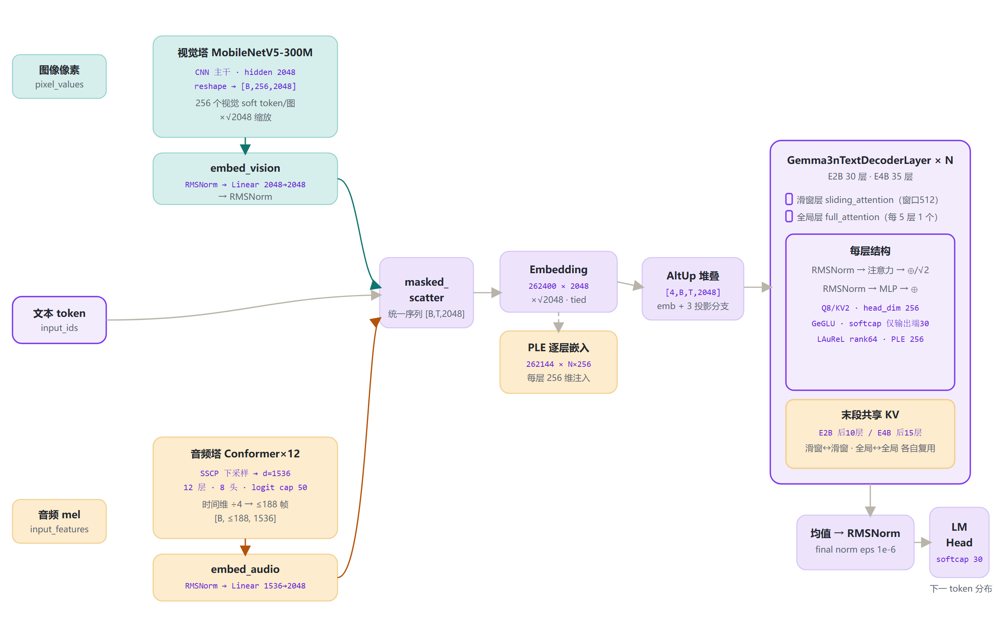
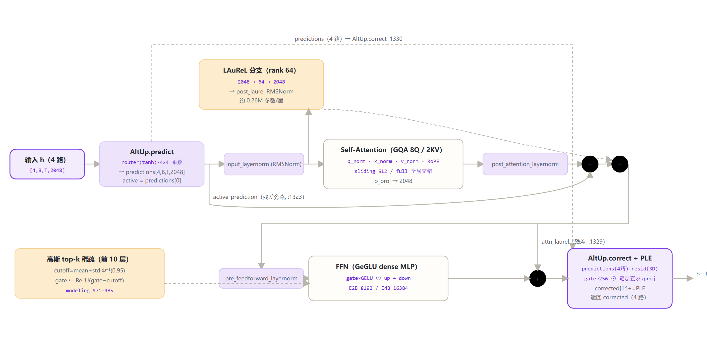

# Gemma 3n 家族架构详解 — E2B / E4B 全尺寸 · MatFormer + 原生音频

- 两个尺寸：E2B（有效≈2B）· E4B（有效≈4B）
- 原生三路：文本 + 图像（MobileNetV5-300M）+ 音频（Conformer×12）
- MatFormer 嵌套 · AltUp · LAuReL(rank64) · PLE · 激活稀疏

本页以**本地检查点 `gemma-3n-E2B-it/config.json`**（权威基准）、ModelScope 下载的 **google/gemma-3n-E4B-it/config.json**，以及本地 **transformers 源码 `modeling_gemma3n.py / configuration_gemma3n.py`** 为唯一依据。Gemma 3n 是 Google 面向端侧（手机/笔记本）的开放权重多模态模型：文本骨干是 **MatFormer 嵌套 Transformer**（AltUp 四输入 + LAuReL 低秩增强残差 + 逐层 PLE 门控 + 前 10 层高斯 top-k 激活稀疏），混合注意力为「4 层滑窗 512 + 1 层全局」交错、末段共享 KV；视觉塔输出 256 个 soft token、音频塔输出至多 188 个 soft token。下文所有数字逐字段标注 config 来源，所有机制标注源码文件:行号。

## 1 家族全景：E2B / E4B 真实 config 对照

> 两尺寸均为 `Gemma3nForConditionalGeneration`。下列全部为 config 原文（`text_config` 子对象）：E2B 来自本地 `E:\models\model\gemma-3n-E2B-it\config.json`，E4B 来自 ModelScope `google/gemma-3n-E4B-it/config.json`（2026-10-22 下载核验）。

### 1.1 文本塔核心超参数（text_config）

| 字段（text_config） | E2B（本地检查点） | E4B（ModelScope config） |
|---|---|---|
| **architectures 入口类** | `Gemma3nForConditionalGeneration` ||
| **hidden_size** | **`2048`** | **`2048`** |
| **num_hidden_layers** | **`30`** | **`35`** |
| num_attention_heads（Q） | `8` | `8` |
| num_key_value_heads（GQA） | `2`（组比 8:2=4） | `2`（组比 8:2=4） |
| head_dim | `256`（8×256=2048） | `256`（8×256=2048） |
| **intermediate_size（逐层数组）** *MatFormer：每层一个 FFN 中间维* | **`[8192]`×30** *逐层数组，本检查点 30 层同值* | **`[16384]`×35** *逐层数组，本检查点 35 层同值* |
| layer_types（full 层位置，1-based） | 第 5,10,15,20,25,30 层 `full_attention`（6 层），余 24 层滑窗 | 第 5,10,15,20,25,30,35 层 `full_attention`（7 层），余 28 层滑窗 |
| sliding_window | `512` | `512` |
| **num_kv_shared_layers** *末段共享 KV 层数* | **`10`** *即第 21–30 层（1-based）共享* | **`15`** *即第 21–35 层（1-based）共享* |
| **activation_sparsity_pattern** | **`[0.95]`×10 + `[0.0]`×20** | **`[0.95]`×10 + `[0.0]`×25** |
| altup_num_inputs（AltUp 路数） | `4` *altup_active_idx=0 · coef_clip=120* | `4` *同上* |
| laurel_rank（LAuReL 瓶颈维） | `64` | `64` |
| hidden_size_per_layer_input（PLE 逐层小维） | `256` *vocab_size_per_layer_input=262144* | `256` *vocab_size_per_layer_input=262144* |
| rope_theta（全局层 base） | `1,000,000` | `1,000,000` |
| rope_local_base_freq（滑窗层 base） | `10,000` | `10,000` |
| max_position_embeddings | `32,768`（32K） | `32,768`（32K） |
| final_logit_softcapping | `30.0` | `30.0` |
| hidden_activation / rms_norm_eps | `gelu_pytorch_tanh`（GeGLU） · `1e-6` ||
| vocab_size | `262,400`（tie_word_embeddings=true，输入/输出共享） ||

> 要点：E2B 与 E4B **文本骨干维度完全相同**（hidden 2048 / 8Q-2KV / head_dim 256 / PLE 256 / laurel 64 / AltUp 4 / 滑窗 512 / 32K）。两尺寸的差异只有三处：**层数 30→35、FFN 中间维 8192→16384、KV 共享 10→15**。「E2B / E4B」是**有效参数**口径（≈2B / ≈4B），原始权重约 5B / 8B（Technical Report）。

### 1.2 视觉塔 / 音频塔（vision_config / audio_config，两尺寸完全一致）

| 字段 | 视觉塔 vision_config | 音频塔 audio_config |
|---|---|---|
| architecture | `mobilenetv5_300m_enc` *timm MobileNetV5-300M 编码器* | `gemma3n_audio` *SSCP 下采样 + Conformer×12* |
| hidden_size | `2048` | `1536` |
| 层数 / 头数 | —（CNN 主干，非 Transformer） | `12 层 / 8 头` |
| 下采样 | do_pooling=false；输出 reshape 16×16 | SSCP 卷积 [128,32] 通道，3×3 stride (2,2)×2；conf_reduction_factor=4 |
| 输入 | pixel_values（归一化图像） | input_features：128 维 mel 频谱 |
| soft token 数 | `256 / 图` *vision_soft_tokens_per_image=256* | `≤188 / 段` *audio_soft_tokens_per_image=188，不足补齐* |
| 内部 attention cap | — | `50.0` *conf_attention_logit_cap（仅 Conformer 内部）* |
| vocab_offset / vocab_size | `262144 / 128` | `262272 / 128` |

## 2 端到端数据流总览（文本 + 图像 + 音频三路）

> 三路输入：文本 `input_ids`、图像 `pixel_values`、音频 `input_features`。视觉/音频特征经各自 embedder（`Gemma3nMultimodalEmbedder`）投影进 2048 维文本空间，再以 `masked_scatter` 填进序列中 `image_token_id=262145 / audio_token_id=262273` 的占位位。主干：嵌入 $\times\sqrt{d}$ → AltUp 四路线堆叠 → N 个解码层 → 四分支求均值 → 最终 RMSNorm → 共享 LM Head → softcap 30。

### 2.1 端到端架构图



> 全家族统一主干：嵌入（$\times\sqrt{d}$）→ AltUp 4 路 → 解码层 $\times N$ → 四分支均值 → RMSNorm → 共享 LM Head → softcap 30；E2B/E4B 差异仅在层数、FFN 中间维、KV 共享层数。

## 3 解码层解剖：Gemma3nTextDecoderLayer

> 源码 `modeling_gemma3n.py:1273-1346`。这是 MatFormer 的核心单元：输入是 `[4,B,T,2048]` 的 AltUp 四路线；残差路径叠加 LAuReL 低秩分支，FFN 门控带高斯 top-k 稀疏，末尾用 PLE（逐层小嵌入）做门控注入。

### 解码层展开架构图



### 3.1 残差与门控前向（源码 :1323-1344 直录）

```
predictions        = altup.predict(h)                 # :1306
active_prediction  = predictions[altup_active_idx]        # :1307
z                  = input_layernorm(active_prediction)    # :1309
laurel_output      = z + post_laurel_norm(W2·W1·z)       # :1310  (LAuReL, W1:2048→64)
attn               = post_attn_norm( self_attn(z, ...) ) # :1312-1321
attn_gated         = active_prediction + attn             # :1323
attn_laurel        = (attn_gated + laurel_output) / √2    # :1324
ffn                = post_ffn_norm( mlp(pre_ffn_norm(attn_laurel)) )  # :1326-1328
resid              = attn_laurel + ffn                   # :1329
corrected          = altup.correct(predictions, resid)    # :1330
first              = corrected[active_idx]·correct_scale# :1332-1334
first              = per_layer_proj( act(gate(first)) ⊙ per_layer_input ) # :1337-1342
corrected[1:]     += post_per_layer_norm(first)          # :1344  PLE 注入
return corrected
```

### 3.2 前向源码逐行解释（做什么 · 张量变化 · 为什么）

> 逐行对照 `modeling_gemma3n.py` `Gemma3nTextDecoderLayer.forward`（:1295-1346）。每一步都给出：操作、每步后张量变化、为什么要有这个处理。

| 行号 | 操作 | 每步后张量 | 为什么 |
|---|---|---|---|
| :1306 | `predictions = altup.predict(h)`：modality_router(tanh) 预测 4×4 系数矩阵，对 4 路线做可学习混合 | `[4,B,T,2048] → [4,B,T,2048]`（值变为 4 路"预测值"） | AltUp 核心：先用轻量可学习映射**猜**本层输出，真正的解码层只需计算"猜错多少"（残差），即稀疏更新 |
| :1307 | `active_prediction = predictions[active_idx]`（active_idx=0） | `[4,B,T,2048] → [B,T,2048]`（只取第 0 路，3D） | 贵算子（注意力/FFN）只跑在 active 这一路上，其余 3 路不重算 → 省算力 |
| :1309 | `z = input_layernorm(active_prediction)`：RMSNorm(2048, eps=1e-6) | `[B,T,2048] → [B,T,2048]`（按 RMS 缩放，无偏置平移） | pre-norm：把激活稳定到单位均方根量级，为注意力/FFN 提供分布稳定的输入 |
| :1310 | `laurel_output = laurel(z)`：`z + post_laurel_norm(W2·W1·z)`，W1 2048→64、W2 64→2048 | `[B,T,2048] → [B,T,2048]`（内部经 64 维瓶颈） | LAuReL 低秩增强残差：每层仅约 0.26M 参数注入新信息，残差流更"宽"，且不改主维度 |
| :1312-1320 | `self_attn(z, ...)`：GQA 8Q/2KV；q/k/v 各自 head-wise RMSNorm + RoPE；滑窗 512 / 全局交错；末段共享 KV 层 | `[B,T,2048] → [B,T,2048]`（Q 2048→2048；K/V 2048→512） | 混合注意力在长上下文下省显存省算；q/k/v 各自归一化后无需 1/√d 缩放（scaling=1.0）；共享 KV 免去末段层重复算 K/V |
| :1321 | `attn = post_attention_layernorm(attn)` | `[B,T,2048] → [B,T,2048]` | post-norm：注意力原始输出先归一化，再与残差相加，训练更稳 |
| :1323 | `attn_gated = active_prediction + attn` | `[B,T,2048] ⊕ [B,T,2048] → [B,T,2048]` | 残差连接。注意加的是**归一化前**的 active_prediction（pre-norm 残差流），信息直通、梯度通畅 |
| :1324 | `attn_laurel = (attn_gated + laurel_output) / √2` | `[B,T,2048] → [B,T,2048]` | 注意力残差与 LAuReL 分支两条同量级残差按 1/√2 合并，保持激活方差稳定（DeepNorm 风格） |
| :1326 | `attn_norm = pre_feedforward_layernorm(attn_laurel)` | `[B,T,2048] → [B,T,2048]` | FFN 输入前 pre-norm，与注意力子层同一模式 |
| :1327 | `attn_ffw = mlp(attn_norm)`：GeGLU（gate×GELU ⊙ up → down）；前 10 层 gate 输出经高斯 top-k 稀疏 | `[B,T,2048] → [B,T,8192/16384] → [B,T,2048]` | GeGLU 门控增强表达力；top-k 用高斯分位数阈值把约 95% 中间维置零（端侧省算），第 11 层起稠密 |
| :1328 | `attn_ffw_norm = post_feedforward_layernorm(attn_ffw)` | `[B,T,2048] → [B,T,2048]` | FFN 输出 post-norm，随后残差相加 |
| :1329 | `resid = attn_laurel + attn_ffw_norm`（变量名 attn_ffw_laurel_gated） | `[B,T,2048] ⊕ → [B,T,2048]` | FFN 子层残差。此值即"本层真实输出"（activated），传给 AltUp.correct 作为修正基准 |
| :1330 | `corrected = altup.correct(predictions, resid)`：ε = resid − predictions[0]；c = W_corr(m′) + 1.0（m′ 为 router 输出，coef_clip=120 仅训练期）；corrected_i = predictions_i + c_i·ε | `[4,B,T,2048] ⊕ [B,T,2048] → [4,B,T,2048]` | 把"预测误差"按每路系数分发回 4 路，让所有路都逼近真实输出；预测越准、修正越稀疏 |
| :1332 | `first = corrected[0].clone()` | `[4,B,T,2048] → [B,T,2048]` | 取 active 路（第 0 路）作为 PLE 注入载体；clone 保证后续 in-place 操作不破坏 corrected 引用 |
| :1333-1334 | `first = first · correct_output_scale`（可学习标量，初始 0，`altup_correct_scale=True`） | `[B,T,2048] → [B,T,2048]` | 训练初始注入强度为 0（等价标准 Transformer），由梯度逐步打开 → 平滑 warmup，避免破坏预训练稳定性 |
| :1337 | `first = per_layer_input_gate(first)`：2048→256 | `[B,T,2048] → [B,T,256]` | 压到 256 维，与逐层查表向量 per_layer_input 对齐维度 |
| :1338 | `first = act_fn(first)`（gelu_pytorch_tanh） | `[B,T,256] → [B,T,256]` | 非线性门控，增强调制表达 |
| :1339 | `first = first ⊙ per_layer_input`（逐层查表，[B,T,256]） | `[B,T,256] ⊙ [B,T,256] → [B,T,256]` | PLE 核心：用该层专属的词汇表嵌入调制激活，把"逐层记忆"注入辅助路 |
| :1342 | `first = per_layer_projection(first)`：256→2048 | `[B,T,256] → [B,T,2048]` | 投影回主维度，才能注入主隐态 |
| :1343 | `first = post_per_layer_input_norm(first)` | `[B,T,2048] → [B,T,2048]` | 注入前 RMSNorm，稳定数值 |
| :1344 | `corrected_predictions[1:] += first`（in-place） | `[4,B,T,2048] → [4,B,T,2048]`（路 1-3 被更新） | PLE 只注入辅助路：第 0 路是 active 主干，不被污染；辅助路携带逐层词汇信息进下一层 |
| :1346 | `return corrected_predictions` | `[4,B,T,2048]`（作为下一层输入） | 层间接口保持 4 路，与 :1705-1721 的 stack 构建闭环 |

**一句话总结**：`predict` 猜 → 仅 active 路跑注意力+FFN → `correct` 用真实残差修正 4 路 → 第 0 路再经 PLE 逐层词汇调制注入辅助路 → 4 路输出进下一层。整个设计把"每层全量重算"换成"预测 + 稀疏修正"。

## 4 核心机制专节（本代独有）

### MatFormer 嵌套：intermediate_size 逐层数组

`config.intermediate_size` 是**逐层数组**：每层 MLP 取 `intermediate_size[layer_idx]`（`modeling:955`）。配置类允许标量（自动广播成 N 层，`configuration:138-139`）或显式 N 元列表（长度校验，`configuration:131-137`）。这是 MatFormer「嵌套子模型」的载体：理论上可对不同层配不同 FFN 中间维以抽取嵌套子网络；但发货的 E2B/E4B 检查点内部各层同值——E2B 全 30 层 `8192`，E4B 全 35 层 `16384`。

```
mlp 中间维 = config.intermediate_size[layer_idx]
E2B: [8192]×30   E4B: [16384]×35
```

*元信息：config text_config.intermediate_size；modeling:955；configuration:131-139*

### AltUp：Alternating Updates（altup_num_inputs=4）

每个解码层同时维护 **4 路隐藏态**（`[4,B,T,2048]`）：第 0 路是词嵌入，第 1–3 路由 3 个 `altup_projections`（2048→2048 Linear）生成并做幅值归一化（对齐第 0 路 RMS）。层内 `predict` 用 modality_router(tanh) 预测 4×4 系数矩阵做可学习混合；`correct` 再用真实残差 innovation=activated−prediction 修正 4 路；层末 4 路经 unembed 投影后**求均值**出主干。论文出处见 `modeling:989-997` 注释（NeurIPS 2023）。

```
stack=[h0, P1h0, P2h0, P3h0]  # 幅值对齐, :1711-1721
predictions = altup.predict(stack)      # :1015-1041
corrected   = altup.correct(predict, resid)  # :1043-1072
out = mean_i( unembed_i(corrected_i) )  # :1747-1759
```

*元信息：config altup_num_inputs=4 / active_idx=0 / coef_clip=120；modeling:988-1084,1631-1637,1711-1759*

#### 计算流程详解（五步，从输入到输出）

> 本节 2026-11-03 补充，逐行核对 modeling_gemma3n.py；config 实测补充 `altup_correct_scale=True`（可学习输出缩放，初始 0）。

**第 0 步 · 构建 4 路 stack（仅输入时一次）** `modeling:1705-1721`

`h0 = inputs_embeds`（ScaledEmbedding 已乘 √2048，:1602-1604）。以第 0 路 RMS 幅值为基准 `target = mean(h0²)^0.5`；对 i=1,2,3 用 3 个 `altup_projections[i]`（2048→2048 Linear，:1631-1633）投影 h0，并做**幅值归一化** `h_i = P_i(h0)·target / max(sqrt(mean(P_i(h0)²)), 1e-5)`，防止投影改变激活尺度。堆叠为 `stack=[h0,h1,h2,h3]`，形状 `[4,B,T,2048]`。此后**每一层输入输出都是这个 4D stack**。

**第 1 步 · predict：可学习混合猜测本层输出** `modeling:1015-1041, :1306`

1. 路由：取第 0 路，`m = tanh(W_router(RMSNorm(h0)/2048))` → `[B,T,4]`（每 token 一个 4 维路由权重，:1010-1013）。
2. 系数：`A = W_pred(m)` → reshape `[B,T,4,4]`（每 token 一张 4×4 混合矩阵）。
3. 预测：`P_j = Σ_i A[j,i]·h_i + h_j`（4 路加权和 + 自身残差），`P` 形状 `[4,B,T,2048]`。
4. 取 active 路 `active = P[0]`（altup_active_idx=0）。训练时 `W_pred` clamp ±120（altup_coef_clip）。

**第 2 步 · 贵算子只跑第 0 路** `modeling:1309-1329`

注意力 / LAuReL / FFN 全部只作用在 `P[0]` 上（其余 3 路旁观不参与）：

```
z   = input_layernorm(active)                          # :1309
lrl = z + post_laurel_norm(W2·W1·z)                    # :1310 LAuReL 2048→64→2048
attn = post_attn_norm(self_attn(z))                    # :1312-1321
attn_laurel = (active + attn + lrl) / √2              # :1323-1324
y   = attn_laurel + post_ffn_norm(mlp(pre_ffn_norm(attn_laurel)))   # :1326-1329
```

`y` 即本层**真实输出**（源码中称 activated）。

**第 3 步 · correct：残差修正分发回 4 路** `modeling:1043-1072, :1330-1344`

1. 预测误差 `ε = y − P[0]`，复制 4 份（:1056-1057）。
2. 修正系数：用真实输出 y 重算路由 `m'`，`c = W_corr(m') + 1.0` → `[B,T,4]`（+1 保证初始≈纯残差传播；训练时 clamp ±120）。
3. `Q_i = P_i + c_i·ε`（每路 = 预测 + 自己系数的修正量）。
4. PLE 注入：`first = Q[0]` 乘可学习 `correct_output_scale`（初始 0，altup_correct_scale=True 时启用，:1332-1334）→ gate 2048→256 ⊙ 逐层查表向量 → 投回 2048 → post norm → **只加到 Q[1:]**（第 0 路不加，:1336-1344）。

返回 `Q`（`[4,B,T,2048]`）作为下一层输入，回到第 1 步循环。

**第 4 步 · 输出合并：四路求均值** `modeling:1747-1759`

以 `Q[0]` RMS 幅值为基准；i=1..3 过 `altup_unembed_projections[i]`（2048→2048，:1635-1637）+ 幅值对齐；`out = mean([Q0,Q1',Q2',Q3'], dim=0)` → `[B,T,2048]` → 最终 RMSNorm → 共享 LM Head → softcap(30)。

#### AltUp 的作用

| 作用 | 机制 | 收益 |
|---|---|---|
| 计算效率（端侧核心动机） | 注意力/FFN/LAuReL 每层只跑第 0 路预测，其余 3 路用便宜 Linear+系数混合同步更新 | 4 路表征 ≈ 1 份贵计算 |
| 可学习稀疏更新（论文核心） | predict 先猜、correct 用真实残差 ε 修正；训练让预测越准 → 修正越稀疏 | 层间更新低秩化/稀疏化（NeurIPS 2023） |
| 多路表征集成 | 4 路独立投影 + per-token 动态路由 + 末层均值 | 轻量集成，输出质量与稳定性提升 |
| 数值稳定 | 两端 RMS 幅值对齐；predict/correct 均带残差；c 初始 +1；correct_output_scale 初始 0 | 初始行为≈标准残差 Transformer，训练平稳 |

> 与激活稀疏的边界：激活稀疏（前 10 层高斯 top-k）作用于 **FFN 门控中间维**；AltUp 稀疏的是**层间更新本身**，二者可叠加。

*元信息：本子节 2026-11-03 补充；config 实测 altup_correct_scale=True（E2B 本地 config.json）*

### PLE：Per-Layer Embeddings（逐层嵌入）

一张大查表 `embed_tokens_per_layer = Embedding(262144, N×256)`（$\times\sqrt{256}$），reshape 成每层一条 256 维向量；另有一条从主嵌入投影而来的分支，二者相加后乘 $1/\sqrt{2}$。层内把主隐态经 gate 压到 256 维、与该层查表向量逐元素相乘，再投回 2048 维注入。可整体预计算并卸载到 CPU。

```
ple_lookup = Emb(262144, N·256) → [B,T,N,256]   # :1616-1621,1767-1772
ple = (proj_norm(proj(h0)) + ple_lookup)·(1/√2)  # :1774-1799
z = proj256→2048( act(gate2048→256 h) ⊙ ple_l )  # :1337-1342
```

*元信息：config hidden_size_per_layer_input=256 / vocab_size_per_layer_input=262144；modeling:1616-1621,1767-1799,1336-1344*

### 激活稀疏：高斯 top-k（前 10 层 cutoff 0.95）

仅作用于 GeGLU 的 `gate_proj` 输出：按正态分布分位点 $\Phi^{-1}(0.95)$ 求阈值，低于阈值的门控值经 $\mathrm{ReLU}(x-\mathrm{cutoff})$ 直接置零——即中间维约 95% 维度在每 token 上被关掉。E2B/E4B 均为**前 10 层 sparsity=0.95、其后稠密（0.0）**（配置默认规则 `configuration:146-150`）。注意 up_proj 不稀疏，稀疏的是门控支路。

$$
\mathrm{cutoff}=\mathrm{mean}(g)+\mathrm{std}(g)\cdot\Phi^{-1}(0.95),\qquad g\leftarrow\mathrm{ReLU}(g-\mathrm{cutoff})
$$

```
cutoff = mean(g) + std(g)·Normal(0,1).icdf(0.95)   # :982-984
g ← ReLU(g − cutoff)                                # :985
# E2B: [0.95]×10+[0.0]×20 ; E4B: [0.95]×10+[0.0]×25
```

*元信息：config activation_sparsity_pattern；modeling:962-985；configuration:146-156*

### LAuReL：Learned Augmented Residual Layer

在注意力子层前，对归一化输入额外走一条低秩瓶颈增强残差：`laurel_rank=64`，即 2048→64→2048，再过 post RMSNorm，最后与主残差按 $1/\sqrt{2}$ 缩放合并。每层仅 $2\times2048\times64\approx0.26\mathrm{M}$ 参数，却显著改变信息流。

```
laurel_output = z + post_norm( W2·W1·z )   # :943-947
attn_laurel = (active+attn + laurel_output)/√2  # :1324
```

*元信息：config laurel_rank=64；modeling:932-947,1310,1324*

### 共享 KV（末段层）

末段层不再拥有 `k_proj/v_proj/k_norm/v_norm`（权重直接不建，`_keys_to_ignore_on_load_unexpected` 跳过加载），而是复用进入共享区前最后一个**同类型**层（滑窗↔滑窗、全局↔全局）算好的 K/V 状态。E2B 共享后 10 层（第 21–30 层），E4B 共享后 15 层（第 21–35 层）。

```
first_shared = num_layers − num_kv_shared_layers  # :1177
E2B: 30−10=20(0-based) → 1-based 21..30
E4B: 35−15=20(0-based) → 1-based 21..35
k,v = shared_kv_states[same_type_last_non_shared]  # :1232-1236
```

*元信息：config num_kv_shared_layers=10/15；modeling:1177-1189,1232-1250,1642-1648*

### 双 RoPE 基频（按层类型）

位置编码按层类型分别缓存逆频率：全局层用 `rope_theta=1e6`，滑窗层用 `rope_local_base_freq=1e4`。`configuration:182-200` 把它们映射进 `rope_parameters[layer_type]["rope_theta"]`。

```
inv_freq(full)     = 1/(1e6^(2i/256))   # θ=1e6
inv_freq(sliding)  = 1/(1e4^(2i/256))   # θ=1e4
# modeling:1529-1588；configuration:193-200
```

*元信息：config rope_theta=1e6 / rope_local_base_freq=1e4*

### 输出端 logit soft-capping（=30）

LM Head 与主词嵌入共享权重（tied）。输出 logits 先除以 30、过 tanh、再乘回 30，压到 $\pm30$ 抑制极端 logit。**注意**：文本注意力内部**没有** softcap（仅音频 Conformer 内部有 logit cap=50）。

$$
\mathrm{softcap}(x)=c\cdot\tanh(x/c),\qquad c=30
$$

```
logits ← 30 · tanh( logits / 30 )   # :2297-2300
```

*元信息：config final_logit_softcapping=30.0；modeling:2296-2300；tied :2195*

## 5 注意力机制：GQA + 每 5 层 1 full + 共享 KV

> Gemma 3n 注意力（`modeling:1162-1270`）：Q/K/V 各经 head-wise RMSNorm（q_norm/k_norm/v_norm），`scaling=1.0`（取代 Gemma 2/3 的显式 query 缩放）；Q 8 头、K/V 2 头（GQA 组比 4:1），head_dim=256。

| 层模式 | E2B（30 层） | E4B（35 层） |
|---|---|---|
| sliding_attention 层 | 24 层，窗口 512，RoPE θ=1e4 | 28 层，窗口 512，RoPE θ=1e4 |
| **full_attention 层（1-based）** | **第 5,10,15,20,25,30（6 层），全局因果，θ=1e6** | **第 5,10,15,20,25,30,35（7 层），全局因果，θ=1e6** |
| KV 共享层 | 第 21–30 层（10 层），无 k/v 权重 | 第 21–35 层（15 层），无 k/v 权重 |
| 投影维度 | q: 2048→8×256=2048；k/v: 2048→2×256=512；o: 2048→2048（共享层仅 q/o 有） ||

> 层类型由 config `layer_types` 显式给出；缺省时配置类规则为「每 5 层第 5 层 full」（`configuration:141-144`）。滑窗层用 `create_sliding_window_causal_mask`、全局层用普通因果掩码（`modeling:1699-1702`）。

## 6 多模态：MobileNetV5 视觉塔 + Conformer 音频塔

### 6.1 视觉塔（两尺寸一致）

> 与 Gemma 3 使用的 ViT 系 SigLIP/SoViT 不同，Gemma 3n 面向端侧改用**轻量 CNN 主干 timm MobileNetV5-300M**（`vision_config.architecture=mobilenetv5_300m_enc`，hidden=2048）。输出特征图 `[B,2048,16,16]` reshape 为 `[B,256,2048]`，乘 $\sqrt{2048}$ 后经 embed_vision（RMSNorm→Linear 2048→2048→RMSNorm）注入 256 个 image_token 占位位（`modeling:1956-1974`）。

| 字段（vision_config） | Gemma 3n（E2B/E4B） | Gemma 3（对照口径） |
|---|---|---|
| 视觉编码器 | MobileNetV5-300M（CNN，约 300M） | SigLIP/SoViT（ViT 系） |
| hidden_size | `2048` | — |
| soft token / 图 | `256` | 每图 256–1024 patch（分辨率相关） |
| do_pooling | `false`（16×16 网格展平） | — |

### 6.2 音频塔（两尺寸一致，端侧原生）

> Gemma 3n 相比 Gemma 3 新增**端侧原生音频**：128 维 mel 频谱先经 2 层 SSCP 卷积（通道 [128,32]，3×3 stride (2,2)）下采样，过 12 个 Conformer 块（hidden=1536，8 头，块内 attention logit cap=50，chunk=12/左上下文 13，残差权重 0.5），时间维再 ÷4（`conf_reduction_factor=4`），得到至多 188 帧 ×1536；经 embed_audio（RMSNorm→Linear 1536→2048→RMSNorm）升维，不足 188 用最后一条硬嵌入补齐（`modeling:1448-1526, 2167`）。

## 7 特殊 Token 与词表布局（vocab 262400）

| token 字段 | ID | 含义 |
|---|---|---|
| boi_token_id | `255999` | 图像开始（begin of image） |
| boa_token_id | `256000` | 音频开始（begin of audio） |
| eoi_token_id | `262144` | 图像结束 = 视觉硬嵌入区间起点（vocab_offset=262144） |
| image_token_id | `262145` | 图像特征占位，每图 256 个，运行时被视觉特征替换 |
| eoa_token_id | `262272` | 音频结束 = 音频硬嵌入区间起点（audio_config.vocab_offset=262272） |
| audio_token_id | `262273` | 音频特征占位，每段最长 188 个 |
| eos_token_id | `[1, 106]` | 结束符列表（106 为 IT 对话结束） |

> 词表区间：普通文本 [0, 262144)；视觉硬嵌入 [262144, 262272)（128 条）；音频硬嵌入 [262272, 262400)（128 条）。视觉/音频软特征经 masked_scatter 直接填入 hidden 序列，不经过主 embedding 查表（`modeling:1976-2012`）。

## 8 演进视角：Gemma 3 → Gemma 3n

| 维度 | Gemma 3（官方口径） | Gemma 3n（E2B/E4B，本页 config 核对） |
|---|---|---|
| 定位 | 云端/通用，1B–27B | 端侧（手机/笔记本），E2B/E4B 有效≈2B/≈4B |
| 模态 | 文本 + 图像（SigLIP/SoViT） | **文本 + 图像(MobileNetV5) + 音频(Conformer)**，原生三路 |
| 上下文 | 128K | 32K（max_position_embeddings=32768） |
| FFN | 标准 dense GeGLU | MatFormer 逐层中间维数组 + 前 10 层高斯 top-k 激活稀疏 |
| 嵌套/残差技巧 | 无 | **AltUp 四路线 · LAuReL(rank64) · PLE 逐层嵌入** |
| KV 共享 | 无 | 末段共享（E2B 后10层 / E4B 后15层） |
| 混合注意力 | 滑窗 512 + 每 6 层 1 full | 滑窗 512 + 每 5 层 1 full；双 RoPE θ=1e6/1e4 |
| 视觉编码器 | ViT 系 SigLIP/SoViT | 轻量 MobileNetV5-300M（CNN），256 soft token/图 |
| vocab | 262144 | 262400（+256 多模态特殊 token） |

> 主线：Gemma 3n 把「端侧高效」做到极致——用 MatFormer 嵌套 + AltUp/LAuReL/PLE + 激活稀疏 + KV 共享，在约 2B/4B 有效参数下获得接近更大模型的质量，并首次原生并入音频；代价是上下文从 128K 回收到 32K。Gemma 3 侧数字为官方口径（128K、文本+图像、SigLIP），Gemma 3n 侧均为本地 config + 源码核对。

## 9 来源

1. 本地检查点 config.json（E2B 权威基准）
   `E:\models\model\gemma-3n-E2B-it\config.json（text_config / vision_config / audio_config 逐字段核对）`
2. E4B config.json（ModelScope 下载核验，2026-10-22）
   `google/gemma-3n-E4B-it/config.json：hidden 2048 / 35 层 / intermediate 16384×35 / kv_shared 15 / 稀疏 [0.95]×10+[0.0]×25`
3. transformers 源码 modeling_gemma3n.py（本地 E:\transformers）
   `RMSNorm:130；ScaledEmbedding:918；LAuReL:932-947；MLP+高斯top-k:950-985；AltUp:988-1084；TextAttention:1162-1270；DecoderLayer:1273-1346；Rotary:1529-1588；TextModel:1592-1799；MultimodalEmbedder:1883-1930；Model/图像特征:1939-1974；ForConditionalGeneration+softcap:2194-2300`
4. transformers 源码 configuration_gemma3n.py
   `intermediate 逐层校验:131-139；默认层型每5层full:141-144；默认稀疏前10层0.95:146-150；双 RoPE 映射:182-200`
5. Gemma 3n Technical Report（arXiv 2505.05146）
   `https://arxiv.org/abs/2505.05146（E2B/E4B 有效参数、MatFormer 嵌套、PLE、端侧效率）`
6. Gemma 3n 模型卡片（Google AI for Developers）
   `https://ai.google.dev/gemma/docs/core/model_card_3n（参数量与部署规格）`

> 数据口径：所有数字来自上述来源并在页内标注；E2B/E4B 核心差异（层数 30→35、FFN 8192→16384、KV 共享 10→15）逐项对到 config 原文。访问与核验日期：2026-10-22。

---

*页脚：Gemma 3n 家族架构详解（E2B / E4B）· 数据来源：本地 config + ModelScope E4B config + transformers 源码 + arXiv 2505.05146*
