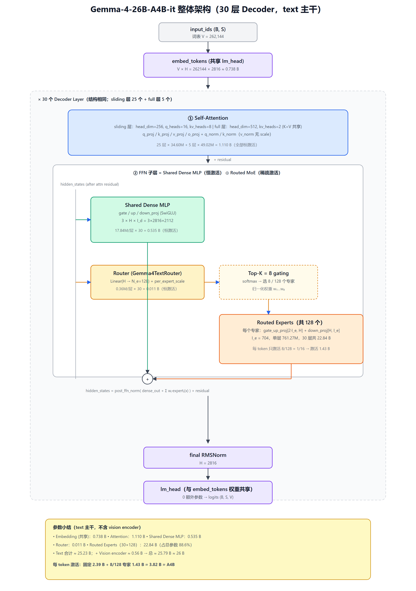
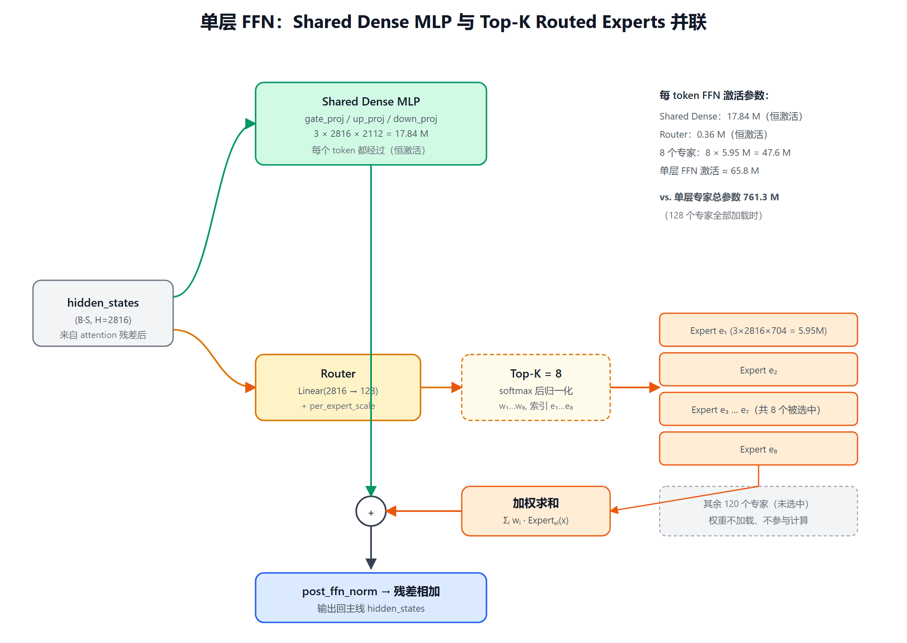

# Gemma-4-26B-A4B-it 参数构成拆解

> 目标：解释为什么命名是 **26B 总参数 / A4B 激活参数**。
> 依据：[HF config.json](https://huggingface.co/google/gemma-4-26B-A4B-it/blob/main/config.json) + `transformers/models/gemma4/modular_gemma4.py`。
> 所有数值均按 config 实际取值与源码 forward 路径逐项复算。

---

## 1. 关键配置速查（text_config）

| 符号 | 含义 | 取值 |
|---|---|---|
| $H$ | hidden_size | 2816 |
| $L$ | num_hidden_layers | 30 |
| $V$ | vocab_size | 262 144 |
| $n_\text{head}$ | num_attention_heads | 16 |
| $n_\text{kv}^\text{sliding}$ | num_key_value_heads（sliding 层） | 8 |
| $n_\text{kv}^\text{full}$ | num_global_key_value_heads（full 层） | 2 |
| $d_\text{head}^\text{sliding}$ | head_dim（sliding 层） | 256 |
| $d_\text{head}^\text{full}$ | global_head_dim（full 层） | 512 |
| $I_d$ | intermediate_size（dense/shared MLP） | 2112 |
| $I_e$ | moe_intermediate_size（每个 routed expert） | 704 |
| $N_e$ | num_experts | 128 |
| $K$ | top_k_experts | 8 |
| $L_s$ | sliding_attention 层数 | 25 |
| $L_f$ | full_attention 层数 | 5 |
| — | tie_word_embeddings | true |
| — | hidden_size_per_layer_input | 0（PLE 关闭） |
| — | num_kv_shared_layers | 0 |
| — | attention_k_eq_v | true（full 层共享 K=V） |

`layer_types` 在 30 层中按 `sliding × 5 + full × 1` 重复，最后一层强制 full，故 $L_s=25,\ L_f=5$。

---

## 2. 整体架构图



**关键设计**：第 1218–1234 行源码显示，每一层的 FFN 子层是 **「Shared Dense MLP（恒激活）」+「Router 路由到 Top-K Experts（稀疏激活）」并联**，二者输出相加后再做残差：

```python
# modular_gemma4.py L1218-L1234
residual = hidden_states
hidden_states = self.pre_feedforward_layernorm(hidden_states)
hidden_states = self.mlp(hidden_states)          # ← dense MLP, 每个 token 都过
if self.enable_moe_block:
    hidden_states_1 = self.post_feedforward_layernorm_1(hidden_states)
    _, top_k_w, top_k_idx = self.router(hidden_states_flat)   # ← 选 8/128
    hidden_states_2 = self.pre_feedforward_layernorm_2(hidden_states_flat)
    hidden_states_2 = self.experts(hidden_states_2, top_k_idx, top_k_w)
    hidden_states_2 = self.post_feedforward_layernorm_2(hidden_states_2)
    hidden_states = hidden_states_1 + hidden_states_2           # ← 并联相加
```

---

## 3. 单层 FFN 内部 MoE 路由示意



$N_e=128$ 个专家，但每 token 只触发 $K=8$ 个，专家部分的激活比例为 $K/N_e=8/128=1/16$。

---

## 4. 逐项参数计算

### 4.1 Token Embedding（与 lm_head 共享）

$$
P_\text{embed} = V \cdot H = 262144 \times 2816 = 738{,}197{,}504 \approx 0.738\,\text{B}
$$

因 `tie_word_embeddings=true`，输出侧 `lm_head` 不重复占用参数。

---

### 4.2 Attention（分两种层）

#### (a) Sliding 层（25 层，$d_h=256,\ n_\text{kv}=8$）

每层矩阵：

| 算子 | 形状 | 参数量 |
|---|---|---|
| q_proj | $H \times (n_\text{head} d_h) = 2816 \times 4096$ | 11 534 336 |
| k_proj | $H \times (n_\text{kv} d_h) = 2816 \times 2048$ | 5 767 168 |
| v_proj | $H \times (n_\text{kv} d_h) = 2816 \times 2048$ | 5 767 168 |
| o_proj | $(n_\text{head} d_h) \times H = 4096 \times 2816$ | 11 534 336 |
| q_norm / k_norm | 各 $d_h=256$ | 512 |
| v_norm | `with_scale=False` | 0 |

$$
P_\text{attn}^{(s)} = 2816(4096+2048+2048+4096) + 512 = 34{,}603{,}520
$$

25 层合计：

$$
25 \times P_\text{attn}^{(s)} = 865{,}088{,}000
$$

#### (b) Full 层（5 层，$d_h=512,\ n_\text{kv}=2$，且 `attention_k_eq_v=true` → $v=k$，v_proj 不存在）

| 算子 | 形状 | 参数量 |
|---|---|---|
| q_proj | $2816 \times (16 \times 512) = 2816 \times 8192$ | 23 068 672 |
| k_proj | $2816 \times (2 \times 512) = 2816 \times 1024$ | 2 883 584 |
| v_proj | 无（v = k） | 0 |
| o_proj | $8192 \times 2816$ | 23 068 672 |
| q_norm / k_norm | 各 512 | 1024 |

$$
P_\text{attn}^{(f)} = 2816(8192+1024+8192) + 1024 = 49{,}021{,}952
$$

5 层合计：

$$
5 \times P_\text{attn}^{(f)} = 245{,}109{,}760
$$

#### Attention 总计

$$
P_\text{attn} = 865{,}088{,}000 + 245{,}109{,}760 = 1{,}110{,}197{,}760 \approx 1.11\,\text{B}
$$

---

### 4.3 Shared Dense MLP（每层恒激活，SwiGLU 三门）

Gemma3MLP 由 `gate_proj / up_proj / down_proj` 组成：

$$
P_\text{dense,layer} = 3 \cdot H \cdot I_d = 3 \times 2816 \times 2112 = 17{,}842{,}176
$$

$$
P_\text{dense} = 30 \times 17{,}842{,}176 = 535{,}265{,}280 \approx 0.535\,\text{B}
$$

---

### 4.4 Router（每层一个）

来自 `Gemma4TextRouter`：

- `norm`：RMSNorm with_scale=False → 0
- `proj`：$H \times N_e = 2816 \times 128 = 360{,}448$
- `scale`：$H = 2816$
- `per_expert_scale`：$N_e = 128$

$$
P_\text{router,layer} = 2816 \times 128 + 2816 + 128 = 363{,}392
$$

$$
P_\text{router} = 30 \times 363{,}392 = 10{,}901{,}760 \approx 0.011\,\text{B}
$$

---

### 4.5 Routed Experts（参数大头）

`MixtralExperts` 把 gate/up 融合成一个参数张量：

$$
\text{gate\_up\_proj}: [N_e,\ 2I_e,\ H],\qquad \text{down\_proj}: [N_e,\ H,\ I_e]
$$

单层专家参数量：

$$
P_\text{exp,layer} = N_e \cdot (2 I_e \cdot H + H \cdot I_e) = N_e \cdot 3 H I_e
$$

代入 $N_e=128,\ H=2816,\ I_e=704$：

$$
P_\text{exp,layer} = 128 \times 3 \times 2816 \times 704 = 761{,}266{,}176 \approx 0.761\,\text{B}
$$

30 层累计：

$$
P_\text{exp,total} = 30 \times 761{,}266{,}176 = 22{,}837{,}985{,}280 \approx 22.84\,\text{B}
$$

这是整个模型的参数主体，也是"总参数 26B"的主要来源。

---

### 4.6 其它 RMSNorm

每层 7 个 RMSNorm（input/post-attn/pre-ffn/post-ffn + MoE 的 3 个），每个维度 $H=2816$：

$$
P_\text{norm} \approx 30 \times 7 \times 2816 + 2816 \approx 0.59\,\text{M}
$$

相对其它项 < 0.01%，可忽略。

---

### 4.7 Vision Encoder（多模态视觉塔）

`vision_config`：hidden=1152, intermediate=4304, 27 层, 16 heads, head_dim=72。

$$
P_\text{vision} \approx 27\big(4 \cdot 1152^2 + 3 \cdot 1152 \cdot 4304\big) + \text{patch\_embed + pos\_embed} \approx 0.558\,\text{B}
$$

与 NVIDIA NGC 卡上写的 "vision encoder ~550M" 一致。纯文本推理时它不参与激活，但计入总参数。

---

## 5. 总参数汇总

| 模块 | 参数量 | 占比 |
|---|---:|---:|
| Token Embedding（共享 lm_head） | 0.738 B | 2.9% |
| Attention（25 sliding + 5 full） | 1.110 B | 4.3% |
| Shared Dense MLP（30 层） | 0.535 B | 2.1% |
| Router（30 层） | 0.011 B | 0.04% |
| **Routed Experts（30 × 128）** | **22.838 B** | **88.6%** |
| 各种 RMSNorm | ~0.001 B | ~0% |
| **Text 小计** | **≈ 25.23 B** | 97.9% |
| Vision Encoder | ≈ 0.56 B | 2.1% |
| **总计** | **≈ 25.79 B ≈ 26 B** | 100% |

这就是名字里 **26B** 的来历：**22.84B 全部分布在 30 层 × 128 个专家的庞大专家池里**，其余所有"通用"参数加起来才 ~2.4B。

---

## 6. 激活参数（为什么是 A4B）

每来一个 token：

1. Embedding 查表：激活 1 行 → 仍按整张表计入（业界惯例）。
2. Attention：所有层、所有参数都参与计算。
3. Shared Dense MLP：每层都跑，全量参数参与。
4. Router：全量参与。
5. **Experts：只走 Top-K=8 个，其余 120 个专家的权重这一步根本不加载。**

所以激活的专家参数为：

$$
P_\text{exp,active} = P_\text{exp,total} \cdot \frac{K}{N_e} = 22.838\,\text{B} \times \frac{8}{128} = 22.838 / 16 = 1.427\,\text{B}
$$

**固定激活部分（与是否稀疏无关）：**

$$
P_\text{fixed} = P_\text{embed} + P_\text{attn} + P_\text{dense} + P_\text{router}
= 0.738 + 1.110 + 0.535 + 0.011 = 2.394\,\text{B}
$$

**总激活参数：**

$$
P_\text{active} = P_\text{fixed} + P_\text{exp,active}
= 2.394 + 1.427 = \mathbf{3.82\,\text{B}} \approx 4\,\text{B}
$$

这就是 **A4B（Active ~4B）** 的来历：

| 项 | 参数量 |
|---|---:|
| Embedding + Attention + Dense MLP + Router（恒激活） | 2.39 B |
| 8/128 个 Experts 被激活 | 1.43 B |
| **每 token 实际激活** | **≈ 3.82 B ≈ 4 B** |

> 注：激活参数口径通常不含 vision encoder（纯文本解码时视觉塔不参与）；即使把 0.56B 视觉塔也算上，也只是 4.4B，命名口径仍取文本侧 ~4B。

---

## 7. 一句话总结

> Gemma-4-26B-A4B-it 的"26B"几乎全部来自 **30 层 × 128 个 routed experts（每个专家 $3 \times 2816 \times 704$）** 这一个矩阵，合计 22.84B；其余的 embedding、attention、shared dense MLP、router 加起来才 ~2.4B。
> 前向时每个 token 由 Router 从 128 个专家里只挑 8 个（即 $1/16$），所以专家部分只激活 $22.84 / 16 \approx 1.43$B，加上恒激活的 2.39B，**每个 token 真正参与矩阵乘法的参数约 3.82B，四舍五入即 A4B**。
