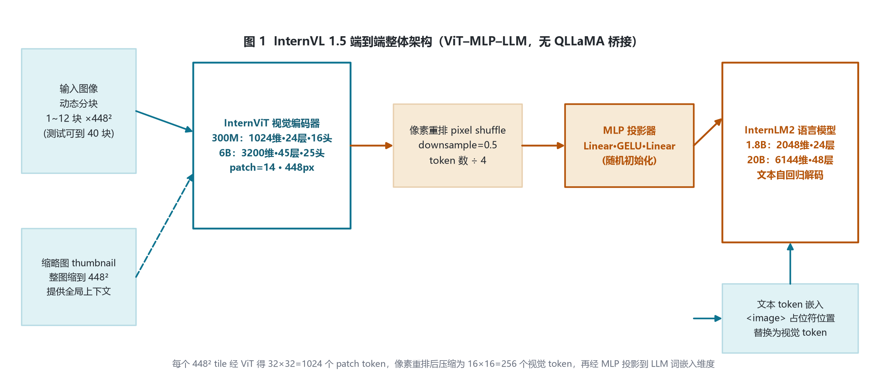
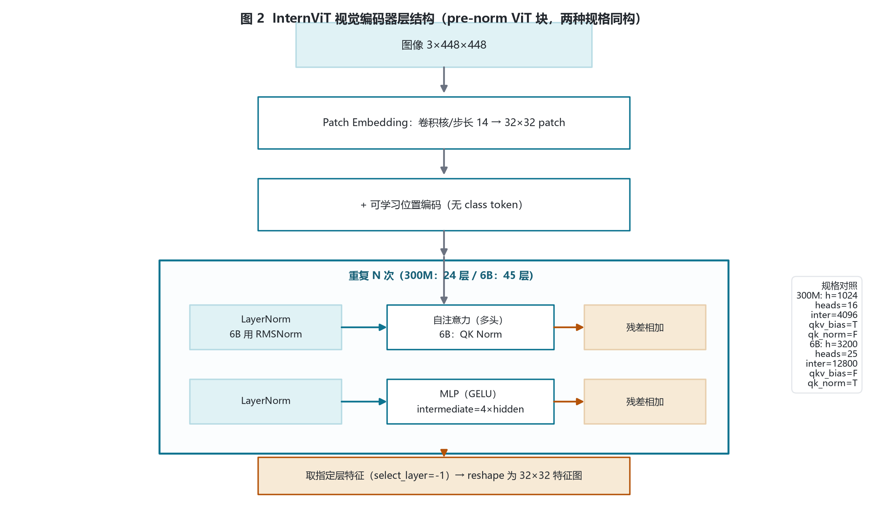
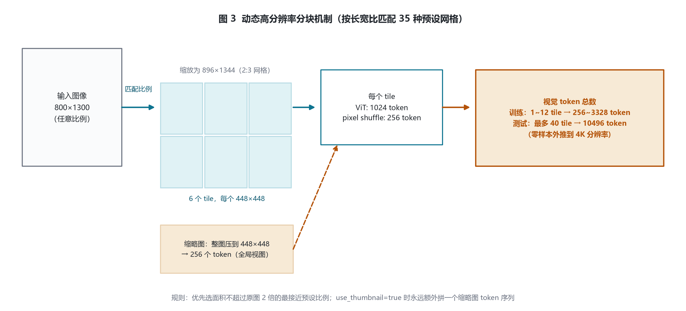
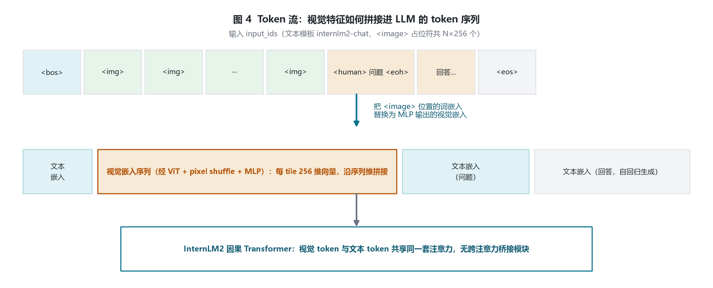
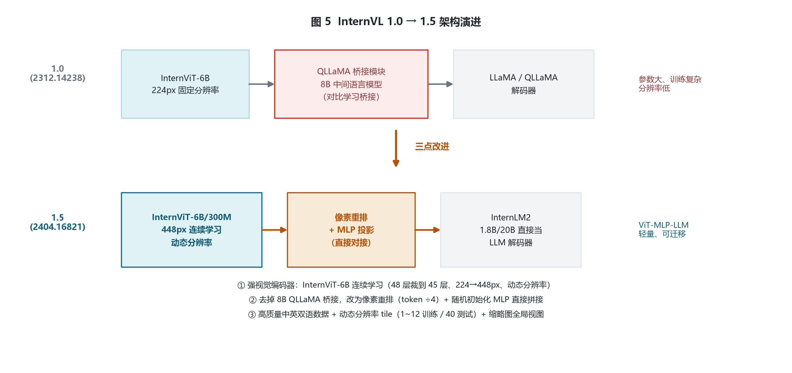

# InternVL 1.5 家族架构详解 — InternVLChatModel · ViT–MLP–LLM

- 2024-04 发布 · ViT–MLP–LLM · 开放权重
- 入口类 InternVLChatModel（legacy）
- 本地 config：Mini-InternVL-Chat-2B-V1-5
- 视觉塔：InternViT 300M / 6B 双规格
- 动态分辨率 1~12 tile 训练 / 40 tile 测试

InternVL 1.5 是上海 AI Lab 推出的开源多模态大模型，采用 **ViT–MLP–LLM** 直连结构，去掉了 1.0 的 8B QLLaMA 桥接模块。本页以本地 **Mini-InternVL-Chat-2B-V1-5** 的 config.json、官方 InternViT-6B-448px-V1.5 配置与论文（arXiv:2404.16821）为依据，逐字段拆解视觉编码器、像素重排投影、InternLM2 语言底座、动态高分辨率机制与两阶段训练管线。

## 1 家族全景与本地 config 对照

经官方仓库 OpenGVLab/InternVL 与 HuggingFace 核实，InternVL 1.5 家族公开发布三个尺寸：

| 模型 | 视觉编码器 | 语言底座 | 总参数 |
|---|---|---|---|
| InternVL-Chat-V1.5 | InternViT-6B-448px-V1.5（3200 维·45 层·25 头） | InternLM2-Chat-20B | 约 26B |
| **Mini-InternVL-Chat-2B-V1-5（本地）** | InternViT-300M-448px-V1.5（1024 维·24 层·16 头） | InternLM2-Chat-1.8B | 约 2B |
| Mini-InternVL-Chat-4B-V1-5 | InternViT-300M-448px-V1.5（同 2B 视觉塔） | Phi-3-mini-128k-instruct | 约 4B |

### 1.1 全尺寸 LLM 底座 config 对照（远程 ModelScope config 实参）

| 模型（总参） | 视觉塔 | 语言底座 | hidden | 层数 | Q/KV 头 | intermediate | vocab / max_pos |
|---|---|---|---|---|---|---|---|
| InternVL-Chat-V1-5（≈26B） | InternViT-6B-448px-V1.5 | internlm2-chat-20b | 6144 | 48 | 48 / 8 | 16384 | 92553 / 32768 |
| **Mini-InternVL-Chat-2B-V1-5（本地，≈2B）** | InternViT-300M-448px-V1.5 | internlm2-chat-1.8b | 2048 | 24 | 16 / 8 | 8192 | 92553 / 32768 |
| Mini-InternVL-Chat-4B-V1-5（≈4B） | InternViT-300M-448px-V1.5 | Phi-3-mini-128k-instruct | 3072 | 32 | 32 / 32 | 8192 | 32020 / 131072 |

### 1.2 本地 Mini-2B 顶层 config 实参

文件：`E:\models\model\Mini-InternVL-Chat-2B-V1-5\config.json`（legacy internvl_chat 格式）

| 字段 | 取值 | 含义 |
|---|---|---|
| architectures | `InternVLChatModel` | legacy 入口类（transformers 不内置 1.5） |
| model_type | `internvl_chat` | legacy 配置类型 |
| template | `internlm2-chat` | 对话模板 |
| dynamic_image_size | `true` | 启用动态分辨率分块 |
| force_image_size | `448` | 基础 tile 边长 |
| downsample_ratio | `0.5` | pixel shuffle 下采样比例 |
| max_dynamic_patch | `12` | 训练最多 tile 数 |
| min_dynamic_patch | `1` | 最少 tile 数 |
| ps_version | `v2` | pixel shuffle 实现版本 |
| select_layer | `-1` | 取视觉塔最后一层特征 |
| use_thumbnail | `true` | 额外拼接整图缩略图 |

### 1.3 视觉塔双规格对照

| 字段 | 300M（本地 2B） | 6B（主模型 V1.5） | 备注 |
|---|---|---|---|
| hidden_size | 1024 | 3200 | 残差流维度 |
| num_hidden_layers | 24 | 45 | 6B 原 48 层裁掉最后 3 层 |
| num_attention_heads | 16 | 25 | head_dim = 64 / 128 |
| intermediate_size | 4096 | 12800 | MLP = 4×hidden |
| patch_size / image_size | 14 / 448 | 14 / 448 | patch 边长 / tile 分辨率 |
| qkv_bias | true | false | QKV 是否加偏置 |
| qk_normalization | false | true | 6B 对 Q/K 归一化 |

> 注意：本地 vision_config 的 `model_type` 字符串仍为 `intern_vit_6b`，但数值实为 300M 规格——这是官方为复用配置结构保留的命名，不代表本地模型真的用了 6B 视觉塔。

家族参数量拆分（视觉塔 / 语言底座 / 投影器，按官方 config 与论文口径估算）：Mini-2B = 0.3B + 1.8B + 0.01B；Mini-4B = 0.3B + 3.8B + 0.01B；V1.5 = 6.0B + 20.0B + 0.03B（总参 2B / 4B / 26B）。

## 2 端到端整体架构

图像动态切块 → InternViT 编码 → pixel shuffle 压缩 token → MLP 投影 → 替换 input_ids 中 `<image>` 占位符 → InternLM2 自回归解码。无任何桥接语言模型。

> 整条链路没有交叉注意力桥接模块：视觉 token 与文本 token 在同一条因果序列里走同一套注意力，这正是 1.5 相对 1.0 最关键的结构简化。

## 3 视觉编码器 InternViT 细节

标准 ViT，无 class token，patch 即序列。每个 448×448 图像切成 $(448/14)^2=32\times32=1024$ 个 patch token。

每 tile patch token 数：

$$\text{patch}= (448/14)^2 = 32^2 = 1024$$

pixel shuffle 后 token 数：

$$\text{token}_{\text{tile}} = 1024 \times 0.5^2 = 256$$

> 连续学习要点：论文 §3.2 记录 InternViT-6B 在 V1.2 阶段发现倒数第四层特征最好，直接丢弃最后 3 层（48→45 层），并把分辨率从 224 提到 448；V1.5 再用动态分辨率图文/OCR 数据继续训练。本地 300M 视觉塔是从 6B-448px-V1.5 蒸馏而来。

## 4 投影层与语言底座

### 4.1 MLP 投影器

pixel shuffle 空间减半、通道 ×4（1024→4096），再经两层 MLP（中间 GELU）映射到 LLM 嵌入维，随机初始化。

$$\text{mlp1}:\ \mathbb{R}^{4096}\to\mathbb{R}^{2048},\quad \text{act}=\text{GELU},\quad \text{mlp2}:\ \mathbb{R}^{2048}\to\mathbb{R}^{2048}$$

主模型 6B 视觉塔对应 Linear(12800 → 6144)。

### 4.2 语言底座 InternLM2-1.8B

hidden 2048、24 层、16 Q 头、8 KV 头（GQA）、intermediate 8192、SwiGLU、vocab 92553、max_pos 32768、rope_theta 1e6、dynamic rope factor=2.0、rms_norm_eps 1e-5。

> 主模型 InternLM2-Chat-20B：hidden 6144、48 层、48 Q 头、8 KV 头、intermediate 16384、dynamic rope factor=3.0，同构放大。

## 5 核心机制：动态分辨率 tile 与缩略图

训练时在 1~12 个 tile 的全部组合中定义 35 种预设长宽比，按输入图长宽比选最接近且面积不超过原图两倍的比例，缩放后切成 448×448 tile，并额外压一张整图缩略图提供全局上下文。

视觉 token 总数：

$$N_{\text{visual}} = (N_{\text{tile}} + \mathbb{1}_{\text{use\_thumbnail}}) \times 256$$

训练：$N_{\text{tile}}=1..12 \rightarrow 256\sim3328$ token；测试：$N_{\text{tile}}$ 最多 40 → 10496 token（零样本外推到 4K）。

> pixel shuffle（官方代码 scale_factor = downsample_ratio = 0.5）把相邻 2×2 空间位置折叠进通道维：空间分辨率减半、通道 ×4、token 数 ÷4，在高分辨率下把序列长度控制在可承受范围。

## 6 训练管线

论文 §4.1：两阶段训练，上下文长度均为 4096，响应格式提示与 LLaVA-1.5 一致。

| 阶段 | 内容 |
|---|---|
| 阶段一 · 模型对接预训练 | 只训练 InternViT 视觉塔 + MLP 投影器，冻结 LLM。数据构成：caption 53.9%、OCR 32.0%、检测/grounding 5.2%、其他 8.9%。目标：把视觉特征对齐到语言模型嵌入空间 |
| 阶段二 · 全参数指令微调 | 在高质量中英双语 SFT 数据（自然场景、图表、文档、多轮对话）上微调全部参数（约 26B 全部放开），强化 OCR 与中文能力。Mini 系列同数据但用 8K 上下文 |
| 推理 · 动态分辨率零样本外推 | 训练只见 1~12 tile，推理可零样本扩到 40 tile（4K）；缩略图始终提供全局上下文，避免高分辨率细节丢失 |

## 7 版本演进：InternVL 1.0 → 1.5

| 维度 | InternVL 1.0（arXiv:2312.14238） | InternVL 1.5（arXiv:2404.16821） |
|---|---|---|
| 桥接结构 | InternViT-6B + 8B QLLaMA 中间语言模型桥接 + LLaMA 解码器 | 去除 QLLaMA，pixel shuffle + MLP 直接对接 LLM |
| 视觉编码器 | InternViT-6B，224px 固定分辨率 | InternViT-6B/300M，448px 连续学习、动态分辨率 |
| 语言底座 | LLaMA 系解码器 | InternLM2（1.8B/20B）直接作为 LLM |
| 分辨率 | 固定低分辨率 | 1~12 tile 训练、40 tile 测试（4K）+ 缩略图 |
| 数据 | 图文对比对齐 | 高质量中英双语 OCR/文档/对话数据 |

> 演进主线：1.5 用「连续学习的强视觉编码器 + 去掉 8B 桥接的直连投影 + 动态高分辨率 + 双语数据」四件套，把开源多模态与 GPT-4V 的差距大幅缩小，并使视觉特征可迁移到不同 LLM。

## 8 参考文献

1. Chen Z, Wang W, Tian H, et al. How Far Are We to GPT-4V? Closing the Gap to Commercial Multimodal Models with Open-Source Suites. arXiv:2404.16821, 2024.
   https://arxiv.org/abs/2404.16821
2. Chen Z, Wu J, Wang W, et al. InternVL: Scaling up Vision Foundation Models and Aligning for Generic Visual-Linguistic Tasks. CVPR 2024. arXiv:2312.14238.
   https://arxiv.org/abs/2312.14238
3. OpenGVLab. InternViT-6B-448px-V1-5 官方配置（hidden 3200, 45 层, 25 头, intermediate 12800, qk_normalization=true）.
   https://huggingface.co/OpenGVLab/InternViT-6B-448px-V1-5
4. OpenGVLab/InternVL 官方仓库，internvl_chat 目录 modeling_internvl_chat.py（InternVLChatModel = vision_model + mlp1 + llm）.
   https://github.com/OpenGVLab/InternVL
5. 本地 config：E:\models\model\Mini-InternVL-Chat-2B-V1-5\config.json（legacy internvl_chat，vision_config 为 intern_vit_6b 型 300M 规格，llm_config 为 InternLM2-1.8B）.
6. 本地 transformers 源码：E:\transformers\src\transformers\models\internvl\modeling_internvl.py（pixel_shuffle，scale_factor=downsample_ratio=0.5；供 2.x/3.x 参考，1.5 legacy 结构不在 transformers 内）.

---

*InternVL 1.5 家族架构详解 · 以本地 config.json、官方配置与 arXiv:2404.16821 逐字段核对 · 仅用于技术学习与论文配图 · 核验日期 2026-10-26*
