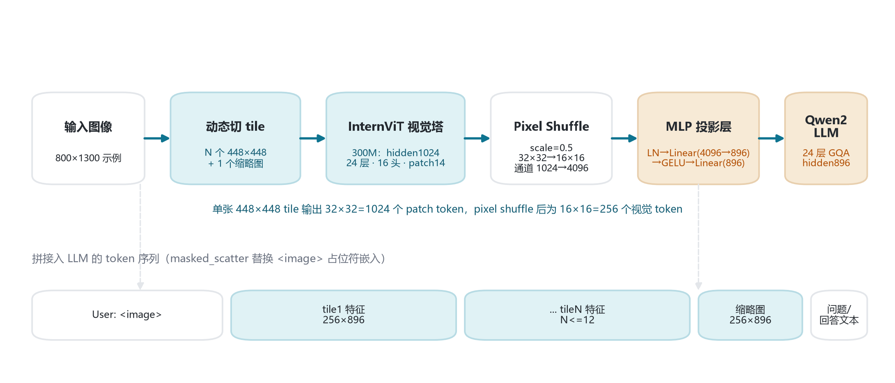
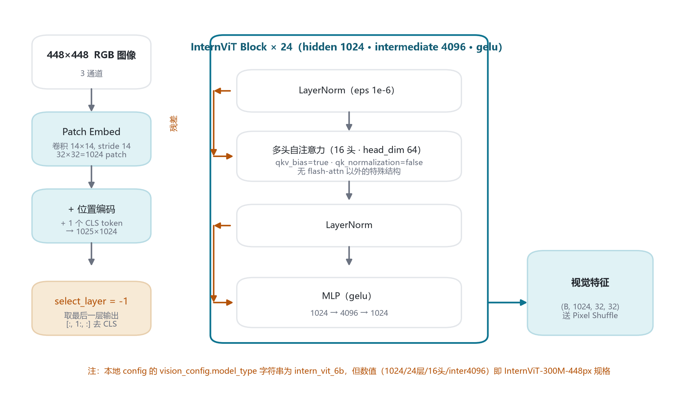
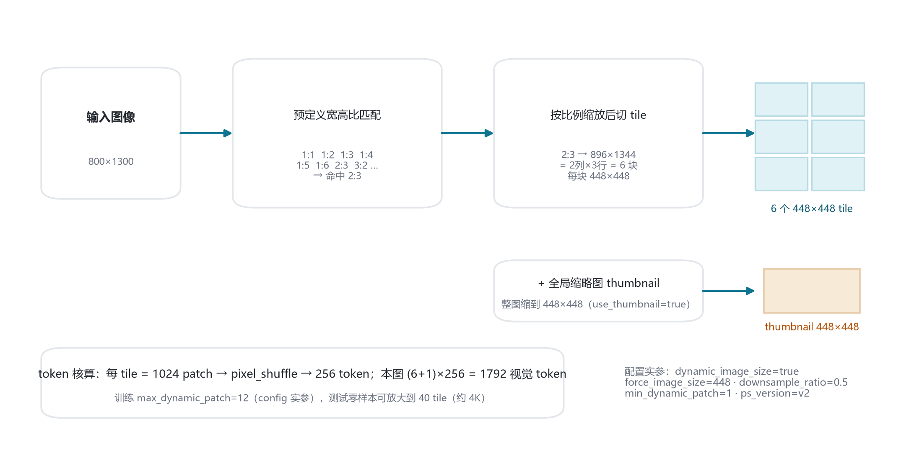
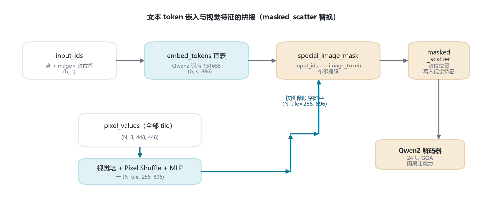
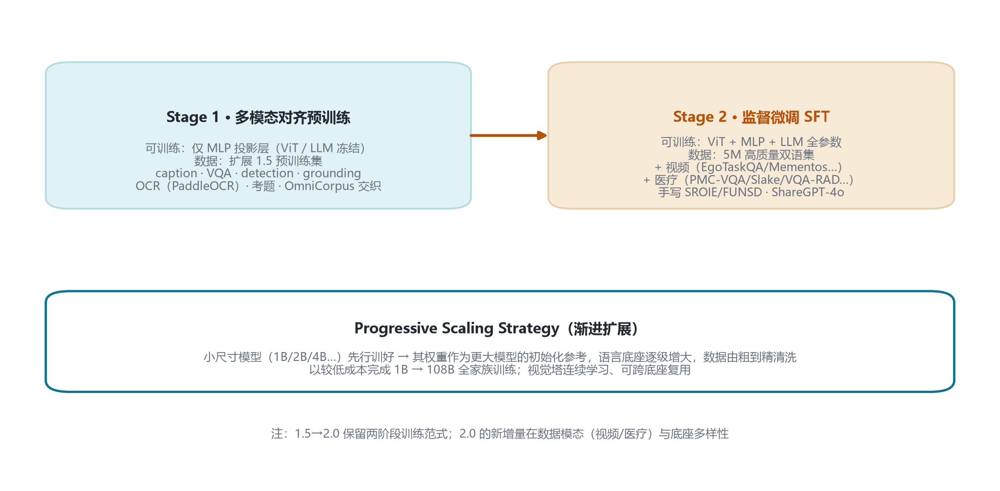
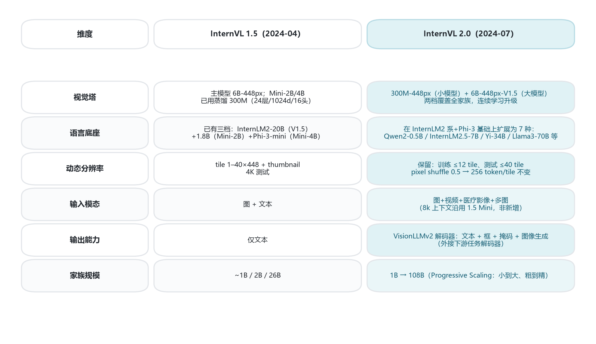

# InternVL 2.0 家族架构详解 — InternVLChatModel · ViT–MLP–LLM · 1B–108B

- 2024-07-02 发布 · 动态高分辨率
- 入口类 InternVLChatModel（legacy）
- 本地 config：InternVL2-1B（Qwen2-0.5B 底座）
- 视觉塔：InternViT-300M-448px / 6B-448px-V1.5 两档
- 语言底座：7 种开源底座渐进扩展（Progressive Scaling Strategy）

InternVL 2.0 延续 1.5 的 ViT–MLP–LLM 范式：视觉塔 → pixel shuffle → MLP 投影层 → 大语言模型。家族从端侧 1B 一直覆盖到 108B，视觉塔只有两档规格，语言底座按尺寸在 7 种底座间选择。本页以本地 **InternVL2-1B** config 实参为主尺寸，对照官方博客与官方文档梳理全家族。

## 1 家族全景与本地 config 对照

### 1.1 家族成员与底座对照（官方博客模型卡）

| 模型 | 视觉塔 | 语言底座 | 总参 |
|---|---|---|---|
| **1B（本地）** | 300M-448px | Qwen2-0.5B-Instruct | ≈1B |
| 2B | 300M-448px | internlm2-chat-1.8b | 2.21B |
| 4B | 300M-448px | Phi-3-mini-128k | 4.15B |
| 8B | 300M-448px | internlm2_5-7b-chat | 8.08B |
| 26B | 6B-448px-V1.5 | internlm2-chat-20b | 25.51B |
| 40B | 6B-448px-V1.5 | Nous-Hermes-2-Yi-34B | 40.07B |
| Llama3-76B | 6B-448px-V1.5 | Hermes-2-Theta-Llama-3-70B | ≈76B |
| 108B | 6B-448px-V1.5 | InternLM2-Chat-102B | 108.70B |

参数量拆分（ViT / MLP / LLM，单位 B）：1B 本地 config；2B = 0.304/0.013/1.893；4B = 0.304/0.022/3.824；8B = 0.304/0.034/7.742；26B = 5.54/0.116/19.854；40B = 5.54/0.143/34.387；108B = 5.54/0.172/102.988。

### 1.2 本地 1B 顶层 config 实参（legacy internvl_chat）

| 字段 | 取值 | 含义 |
|---|---|---|
| architectures / model_type | `InternVLChatModel` / `internvl_chat` | legacy 入口类 |
| dynamic_image_size | `true` | 按宽高比动态切 448 tile |
| force_image_size | `448` | tile 边长 |
| downsample_ratio | `0.5` | pixel shuffle 下采样（token 数 1/4） |
| max_dynamic_patch / min_dynamic_patch | `12` / `1` | tile 数上下限 |
| use_thumbnail | `true` | 额外拼接整图缩略图 |
| ps_version / select_layer | `v2` / `-1` | 投影版本；取 ViT 末层 |
| template | `internvl2` | 对话模板 |

### 1.3 本地 llm_config（Qwen2-0.5B）与 vision_config（300M 规格）

| 维度 | llm_config | vision_config |
|---|---|---|
| hidden_size | 896 | 1024 |
| num_hidden_layers | 24 | 24 |
| num_attention_heads | 14 | 16 |
| num_key_value_heads | 2（GQA，14 Q 共享 2 KV） | — |
| intermediate_size | 4864 | 4096 |
| patch_size / image_size | — | 14 / 448 |
| hidden_act | silu（SwiGLU） | gelu |
| vocab_size | 151655 | — |
| max_position_embeddings | 32768 | — |
| rope_theta / rms_norm_eps | 1e6 / 1e-6 | — / 1e-6 |
| qkv_bias / qk_normalization | — | true / false（300M 无 QK-Norm） |

> 注意：本地 vision_config 的 `model_type` 字符串写 `intern_vit_6b`，但数值全部是 InternViT-300M-448px 规格——按数值事实区分两档，不被类型字符串误导。

## 2 端到端架构总览

输入图像先按宽高比切为若干 448×448 tile 并加一张缩略图；每 tile 过 InternViT 得 1024 维特征图，经 pixel shuffle 空间减半、通道翻两番，再由 MLP 投影到 896 维；所有视觉特征按图像顺序摊平，以 masked_scatter 写入输入序列 `<image>` 占位处，与文本 token 一同送入 Qwen2 解码器。

## 3 视觉编码器 InternViT

家族视觉塔两档：小尺寸（1B/2B/4B/8B）用 InternViT-300M-448px，大尺寸（26B+）用 InternViT-6B-448px-V1.5。本地 1B 为 300M 规格：hidden 1024、24 层、16 头（head_dim 64）、patch 14、intermediate 4096、gelu、qkv_bias、Pre-LN。

每 tile patch token 数（含 CLS）：

$$\text{patch}_{\text{tile}} = (448/14)^2 + 1 = 32^2 + 1 = 1025$$

## 4 投影层与语言底座

### 4.1 Pixel Shuffle 符号（downsample_ratio=0.5）

| 符号 | 含义 | 本地取值 |
|---|---|---|
| $C$ | ViT 输出通道 | 1024 |
| $H, W$ | 特征图边长 | 32, 32 |
| $H', W'$ | ×scale | 16, 16 |
| $C'$ | $C / \text{scale}^2$ | 4096 |
| 每 tile token | $H'\times W'$ | 256 |

### 4.2 本地 token / 维度复算

| 量 | 计算式 | 取值 |
|---|---|---|
| 每边 patch 数 | $448 / 14$ | 32 |
| 每 tile patch（含 CLS） | $32^2 + 1$ | 1025 |
| 每 tile 视觉 token | $(32/2)^2$ | 256 |
| 最大视觉 token（训练） | $(12+1)\times256$ | 3328 |

MLP 投影层结构：

$$y = \text{Linear}_2\big(\text{GELU}\big(\text{Linear}_1(\text{LN}(x))\big)\big),\quad x:(N_{\text{tile}}, 256, 4096) \rightarrow y:(N_{\text{tile}}, 256, 896)$$

### 4.3 语言底座 Qwen2-0.5B-Instruct

hidden 896、24 层、14 个 Q 头配 2 个 KV 头（GQA，分组数 7）、intermediate 4864、SwiGLU、RMSNorm（eps 1e-6）、RoPE（theta=1e6）、词表 151655、最大位置 32768。GQA 使 KV cache 体积为 MHA 的 $1/7$，是端侧 1B 模型的效率关键。

## 5 核心机制：动态分辨率与占位 token 注入

### 5.1 动态分辨率 tile

按输入宽高比在预定义比例集合（1:1、1:2、1:3、1:4、1:5、1:6、2:3、3:2…）中找最接近者，把图缩放到该比例下若干 448×448 tile 的组合，再额外拼一张整图缩略图供全局感知。

token 核算：每 tile = 1024 patch → pixel shuffle → 256 token；如 800×1300 命中 2:3 → 6 tile，则视觉 token = $(6+1)\times256 = 1792$。训练 max_dynamic_patch=12，测试零样本可放大到 40 tile。

### 5.2 视觉 token 流与 masked_scatter

前向时 input_ids 过词嵌入得 $(b, s, 896)$ 文本嵌入；由 `input_ids == image_token` 构造布尔掩码，把视觉支路输出 $(N_{\text{tile}}\times256, 896)$ 用 `masked_scatter` 写进掩码为真的位置，再送入 Qwen2 解码器（本地源码 modeling_internvl.py:613-668）。

## 6 训练管线：两阶段 + 渐进扩展

| 阶段 | 内容 |
|---|---|
| 视觉塔连续学习 | 从 InternViT-300M / 6B 基座出发连续学习，成为 2.0 两档视觉塔（300M-448px、6B-448px-V1.5） |
| Stage-1 · 多模态对齐预训练 | ViT 与 LLM 冻结，只训投影层。数据扩展自 1.5 预训练集：caption / VQA / 检测 / grounding / OCR（PaddleOCR）/ 考题 / OmniCorpus |
| Stage-2 · 监督微调 SFT（全参数） | 放开 ViT + MLP + LLM。在 5M 双语集上新增视频（EgoTaskQA / Mementos / STAR / NTU RGB+D 等）、医疗（PMC-VQA / Slake / VQA-RAD 等）、手写票据（SROIE / FUNSD / POIE），ShareGPT-4o 替换 ShareGPT-4V；训练上下文 8k |
| 渐进扩展 1B → 108B | 小尺寸（1B/2B/4B/8B）先训好，其权重作为更大模型的初始化参考；语言底座逐级增大，视觉塔连续学习、可跨底座复用 |

## 7 版本演进：InternVL 1.5 → 2.0

| 维度 | InternVL 1.5 | InternVL 2.0 |
|---|---|---|
| 视觉塔 | 主模型 V1.5=InternViT-6B-448px；Mini-2B/4B 已用蒸馏 300M 规格（24层/1024d/16头） | 300M-448px（小模型）+ 6B-448px-V1.5（大模型）两档覆盖全家族，连续学习升级 |
| 语言底座 | InternLM2-20B（V1.5）/ InternLM2-1.8B（Mini-2B）/ Phi-3-mini（Mini-4B） | 扩展为 7 种：Qwen2-0.5B / InternLM2-1.8B / Phi-3-mini / InternLM2.5-7B / InternLM2-20B / Yi-34B / Llama-3-70B |
| 动态分辨率 | 1–40 tile × 448 + 缩略图 | 保留；训练 ≤12 tile、测试 ≤40 tile；pixel shuffle 0.5 → 256 token/tile 不变 |
| 输入模态 | 图 + 文本 | 图 + 视频 + 医疗影像 + 多图（8k 上下文沿用 1.5 Mini 系列设定） |
| 输出能力 | 仅文本 | VisionLLMv2 解码器：文本 + 框 + 掩码 + 图像（外接下游任务） |
| 家族规模 | 约 1B / 2B / 26B | 1B → 108B 全家族渐进扩展 |

## 8 参考文献

1. InternVL 2.0 官方博客：InternVL2: Better than the Best—Expanding Performance Boundaries of Open-Source Multimodal Models with the Progressive Scaling Strategy（2024-07-02）。
   https://internvl.github.io/blog/2024-07-02-InternVL-2.0/
2. InternVL 1.5：How Far Are We to GPT-4V? Closing the Gap to Commercial Multimodal Models with Open-Source Suites. arXiv:2404.16821.
   https://arxiv.org/abs/2404.16821
3. InternVL 1.0：InternVL: Scaling up Vision Foundation Models and Aligning for Generic Visual-Linguistic Tasks. arXiv:2312.14238.
   https://arxiv.org/abs/2312.14238
4. VisionLLM v2: An End-to-End Generalist Multimodal Large Language Model for Hundreds of Vision-Language Tasks. arXiv:2406.08394.
   https://arxiv.org/abs/2406.08394
5. InternVL 官方文档：Introduction of InternVL2 Series.
   https://internvl.readthedocs.io/en/latest/internvl2.0/introduction.html
6. 本地 transformers 源码：E:\transformers\src\transformers\models\internvl\modeling_internvl.py
7. 本地 config：E:\models\model\InternVL2-1B\config.json

---

*InternVL 2.0 家族架构详解 · 以本地 config.json 与官方博客逐字段核对 · 仅用于技术学习与论文配图 · 核验日期 2026-10-26*
