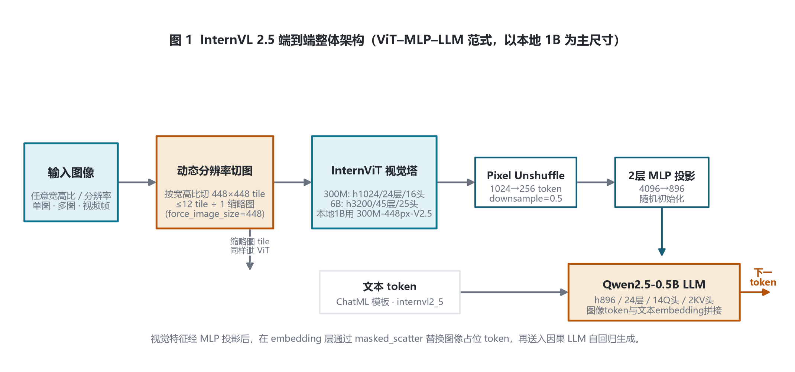
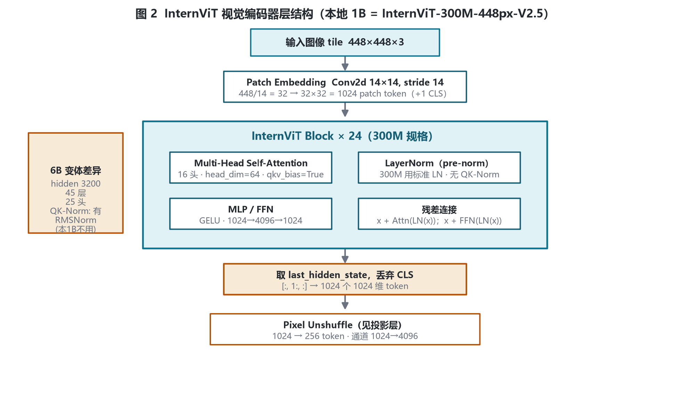
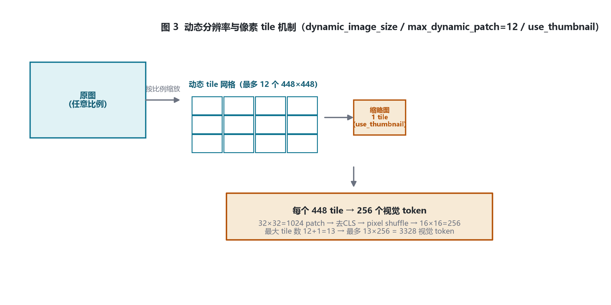
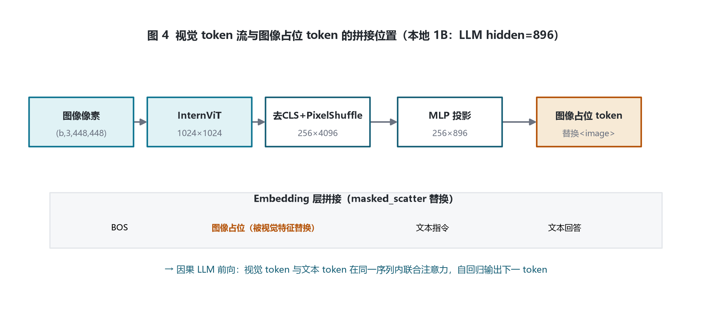
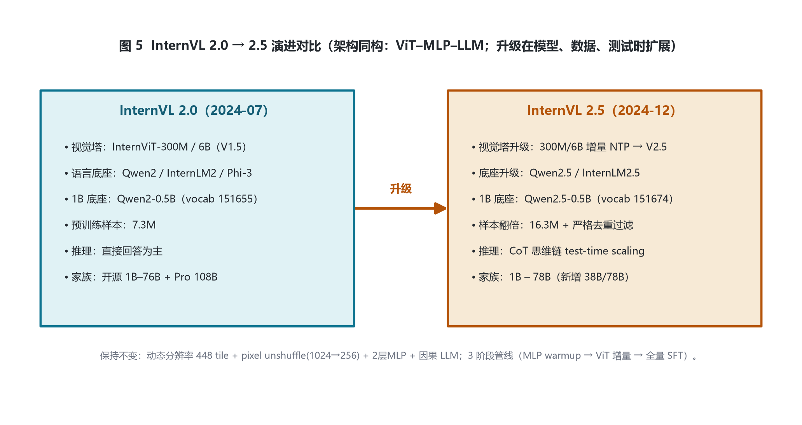

# InternVL 2.5 家族架构详解 — InternVLChatModel · ViT–MLP–LLM · 1B–78B

- 2024-12 发布 · 模型 / 数据 / 测试时扩展三线升级
- 入口类 InternVLChatModel（legacy internvl_chat）
- 本地 config：InternVL2_5-1B（Qwen2.5-0.5B 底座）
- 视觉塔：InternViT-300M / 6B（V2.5 增量训练）
- 三阶段训练 + 渐进式扩展

InternVL 2.5 在 2.0 的 ViT–MLP–LLM 架构上，同时做 **模型（model）、数据（data）、测试时扩展（test-time scaling）** 三方面升级。本页以本地 **InternVL2_5-1B** 的 legacy config.json 为实参锚点：视觉塔 InternViT-300M-448px-V2.5，语言底座 Qwen2.5-0.5B-Instruct。

## 1 家族全景与本地 config 对照

### 1.1 本地 config 顶层与多模态超参（legacy internvl_chat）

| 字段 | 取值 | 含义 |
|---|---|---|
| architectures / model_type | `InternVLChatModel` / `internvl_chat` | legacy 入口类 |
| dynamic_image_size | `true` | 按宽高比动态切 448 tile |
| force_image_size | `448` | 每个 tile 边长 |
| downsample_ratio | `0.5` | pixel unshuffle 下采样（token 数 1/4） |
| max_dynamic_patch / min_dynamic_patch | `12` / `1` | 动态 tile 数量上下限 |
| use_thumbnail | `true` | 额外拼接 1 个整图缩略图 tile |
| ps_version / select_layer | `v2` / `-1` | pixel shuffle 版本；取 ViT 最后一层 |
| template | `internvl2_5` | 对话模板 |

### 1.2 语言底座 llm_config（Qwen2.5-0.5B）与视觉塔 vision_config（300M 规格）

| 维度 | llm_config | vision_config |
|---|---|---|
| hidden_size | 896 | 1024 |
| num_hidden_layers | 24 | 24 |
| num_attention_heads | 14 | 16 |
| num_key_value_heads | 2（GQA：14 Q 头共享 2 KV 头） | — |
| intermediate_size | 4864 | 4096 |
| patch_size / image_size | — | 14 / 448 |
| hidden_act | silu | gelu |
| vocab_size | 151674（比 2.0 的 151655 更大） | — |
| max_position_embeddings | 32768 | — |
| rope_theta / rms_norm_eps | 1e6 / 1e-6 | — / 1e-6 |
| qkv_bias / qk_normalization | — | true / false（300M 无 QK-Norm，6B 才有） |

### 1.3 家族模型表（论文 Table 2）

| 模型 | 参数量 | 视觉编码器 | 语言模型 | OpenCompass |
|---|---|---|---|---|
| **InternVL2.5-1B（本地）** | 0.9B | InternViT-300M-448px-V2.5 | Qwen2.5-0.5B-Instruct | 54.5 |
| InternVL2.5-2B | 2.2B | InternViT-300M-448px-V2.5 | internlm2_5-1_8b-chat | 59.8 |
| InternVL2.5-4B | 3.7B | InternViT-300M-448px-V2.5 | Qwen2.5-3B-Instruct | 65.1 |
| InternVL2.5-8B | 8.1B | InternViT-300M-448px-V2.5 | internlm2_5-7b-chat | 68.1 |
| InternVL2.5-26B | 25.5B | InternViT-6B-448px-V2.5 | internlm2_5-20b-chat | 71.3 |
| InternVL2.5-38B | 38.4B | InternViT-6B-448px-V2.5 | Qwen2.5-32B-Instruct | 73.3 |
| InternVL2.5-78B | 78.4B | InternViT-6B-448px-V2.5 | Qwen2.5-72B-Instruct | 75.5 |

> 1B–8B 用 300M 视觉塔，26B–78B 换用 6B 视觉塔；语言底座全面升级到 Qwen2.5 / InternLM2.5。

## 2 端到端架构总览

图像按宽高比动态切成若干 448 tile（+1 缩略图）→ InternViT 编码 → pixel unshuffle 降采样 → 2 层 MLP 投影到 LLM 隐空间 → 与文本 embedding 拼接 → 因果 LLM 自回归生成。

## 3 视觉编码器 InternViT

本地 1B 用 InternViT-300M-448px-V2.5：由 6B 教师模型余弦蒸馏得到的 0.3B 变体（24 层、hidden 1024、16 头、patch 14、标准 LayerNorm、无 QK-Norm），再用 NTP 损失在更丰富数据上增量预训练。6B 规格为 45 层、hidden 3200、25 头、带 QK-Norm 与 RMSNorm。

InternViT 各代规格（论文 Table 1）：

| 版本 | 分辨率 | hidden | 层数 | 中间维 | 头数 | 归一化/损失 | 参数 |
|---|---|---|---|---|---|---|---|
| 6B-448px-V1.5 | 动态448 | 3200 | 45 | 12800 | 25 | RMS / NTP | 5.5B |
| 6B-448px-V2.5 | 动态448 | 3200 | 45 | 12800 | 25 | RMS / NTP | 5.5B |
| 300M-448px | 动态448 | 1024 | 24 | 4096 | 16 | LN / NTP | 0.3B |
| **300M-448px-V2.5（本地1B）** | 动态448 | 1024 | 24 | 4096 | 16 | LN / NTP | 0.3B |

## 4 投影层与语言底座

### 4.1 Pixel Unshuffle 与视觉 token 复算

$$\text{patch\_grid} = \text{image\_size} / \text{patch\_size} = 448 / 14 = 32$$

$$\text{tokens\_raw} = 32 \times 32 = 1024 \quad (\text{去 CLS}:\ [:, 1:, :])$$

$$\text{feat} = (b, 32, 32, 1024) \xrightarrow{\text{pixel\_shuffle}(0.5)} (b, 16, 16, 4096)$$

$$\text{tokens\_tile} = 16 \times 16 = 256 \quad (\text{每 tile 256 token，维度 4096})$$

$$\text{MLP projector}:\ 4096 \rightarrow 896 \quad (\text{对齐 LLM hidden\_size})$$

$$\text{max\_visual\_tokens} = (12 + 1\ \text{thumbnail}) \times 256 = 3328$$

| 符号 | 含义 | 取值（本地 1B） |
|---|---|---|
| tokens_raw | 单 tile patch token 数 | $32\times32=1024$ |
| downsample_ratio | pixel shuffle 下采样比 | 0.5 |
| tokens_tile | 单 tile 投影后 token 数 | $16\times16=256$ |
| dim_tile | 单 token 维度（shuffle 后） | $1024/0.5^2=4096$ |
| max_dynamic_patch + thumbnail | 最大 tile 数 | 12+1=13 |
| **max visual tokens** | 单图视觉 token 上限 | $13\times256=3328$ |

### 4.2 OpenCompass：2.0 vs 2.5（论文 Table 2）

| 尺寸 | 1B | 2B | 4B | 8B | 26B | 38B | 78B |
|---|---|---|---|---|---|---|---|
| InternVL 2.0 | 48.3 | 54.0 | 60.6 | 64.1 | 66.4 | — | — |
| InternVL 2.5 | 54.5 | 59.8 | 65.1 | 68.1 | 71.3 | 73.3 | 75.5 |

> 2.5 在每个共享尺寸上都超过 2.0；38B/78B 为 2.5 新增（2.0 无对应尺寸），78B 达 75.5。

## 5 核心机制

### 5.1 动态分辨率与像素 tile

图像先按原始宽高比缩放到最近的 448 tile 整数倍网格；高分辨率图切成多个 tile，低分辨率图 tile 数少于上限；额外拼接一张整图缩略图保留全局视野。

### 5.2 token 流与图像占位 token 注入

embedding 阶段用 masked_scatter 把视觉特征替换序列中的图像占位 token；占位 token 数必须与视觉特征 token 数严格相等（源码 get_placeholder_mask 校验）。

## 6 训练管线（三阶段）

| 阶段 | 可训练参数 | 内容 |
|---|---|---|
| Stage 1 · MLP Warmup | 仅 MLP | 冻结 ViT 与 LLM，先用动态高分辨率、对话格式预训练数据打通跨模态对齐；较高学习率 |
| Stage 1.5 · ViT 增量学习（可选） | ViT + MLP | 较低学习率增强视觉特征（多语言 OCR、数学图表）；训练一次后可复用于不同 LLM |
| Stage 2 · 全量指令微调 | ViT + MLP + LLM 全量 | 高质量多模态指令数据，统一学习率；严格数据质量控制，抑制重复输出 |

> 数据规模：1.5 为 5.1M → 2.0 为 7.3M → 2.5 翻倍到 **16.3M**（严格过滤异常重复样本）。InternVL2.5-78B 仅用约 **120B token** 训练（对比 Qwen2-VL 累计 1.4T）；测试时引入 CoT 思维链实现 test-time scaling，78B 在 MMMU 验证集成为首个超 70 分的开源模型。

## 7 版本演进对比：InternVL 2.0 → 2.5

| 维度 | InternVL 2.0 | InternVL 2.5 |
|---|---|---|
| 视觉塔 | InternViT-300M / 6B（V1.5） | 300M/6B 增量 NTP 训练 → V2.5（视觉塔全参数训练，不冻结） |
| 语言底座 | Qwen2 / InternLM2 / Phi-3 / Yi / Llama3 | 升级 Qwen2.5 / InternLM2.5 |
| 1B 底座 | Qwen2-0.5B（vocab 151655） | Qwen2.5-0.5B（vocab 151674） |
| 预训练样本 | 7.3M | 16.3M（翻倍 + 严格去重过滤异常样本） |
| 推理 | 直接回答为主 | CoT 思维链 test-time scaling，MMMU 超 70 |
| 家族规模 | 开源 1B–76B + InternVL2-Pro 108B | 开源 1B–78B（新增 38B / 78B） |

> 说明：2.5 已采用原生对话格式多模态指令数据并对视觉塔全参数增量训练；更彻底的原生多模态预训练（语言预训练与多模态对齐合并为单阶段）在后续 InternVL 3.0（arXiv:2504.10479）正式提出。

## 8 参考文献

1. InternVL 2.5: Expanding Performance Boundaries of Open-Source Multimodal Models with Model, Data, and Test-Time Scaling. arXiv:2412.05271.
   https://arxiv.org/abs/2412.05271
2. InternVL 1.5: How Far Are We to GPT-4V? arXiv:2404.16821.
   https://arxiv.org/abs/2404.16821
3. InternVL2: Better than the Best（官方博客，2024-07-02）.
   https://internvl.github.io/blog/2024-07-02-InternVL-2.0/
4. InternVL 1.0. arXiv:2312.14238.
   https://arxiv.org/abs/2312.14238
5. InternVL3（原生多模态预训练范式出处）. arXiv:2504.10479.
   https://arxiv.org/abs/2504.10479
6. 本地 transformers 源码 modeling_internvl.py：get_image_features、pixel_shuffle、masked_scatter 占位替换。
   E:\transformers\src\transformers\models\internvl\
7. 本地 config：E:\models\model\InternVL2_5-1B\config.json（legacy internvl_chat 格式）

---

*InternVL 2.5 家族架构详解 · 以本地 config.json 与论文 arXiv:2412.05271 逐项核对 · 仅用于技术学习与论文配图 · 核验日期 2026-10-26*
