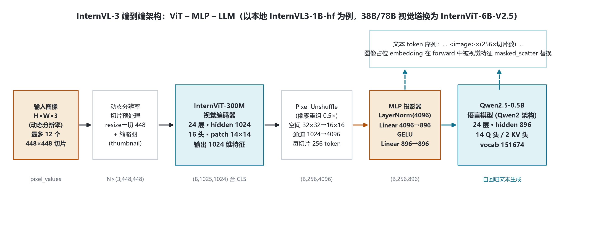
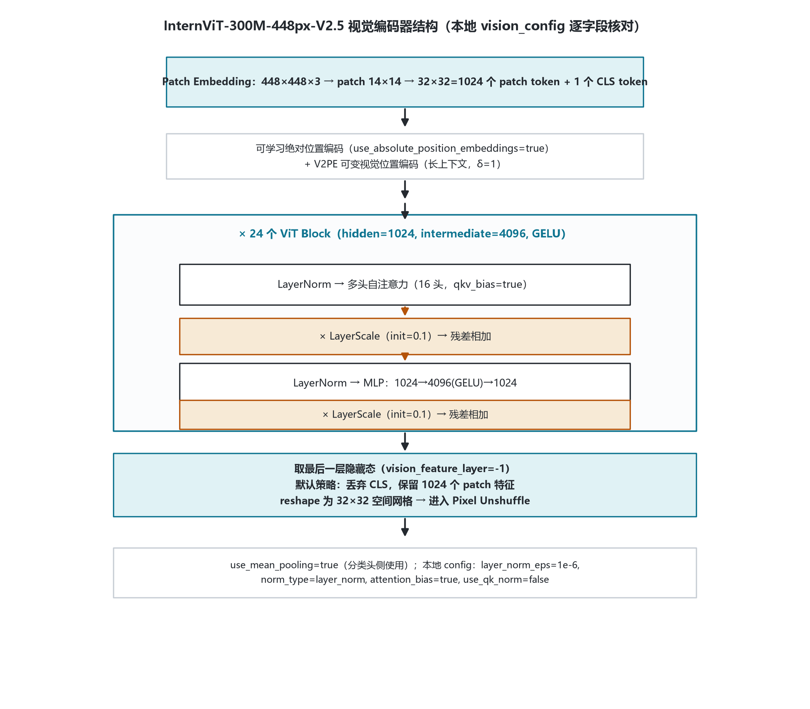
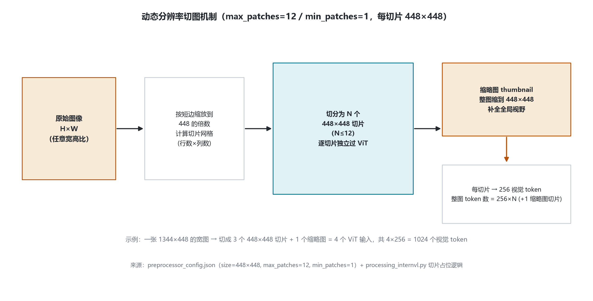
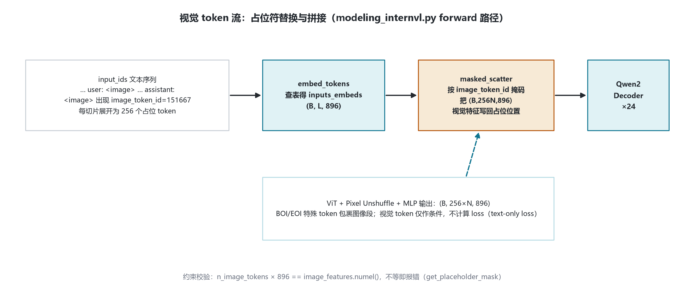
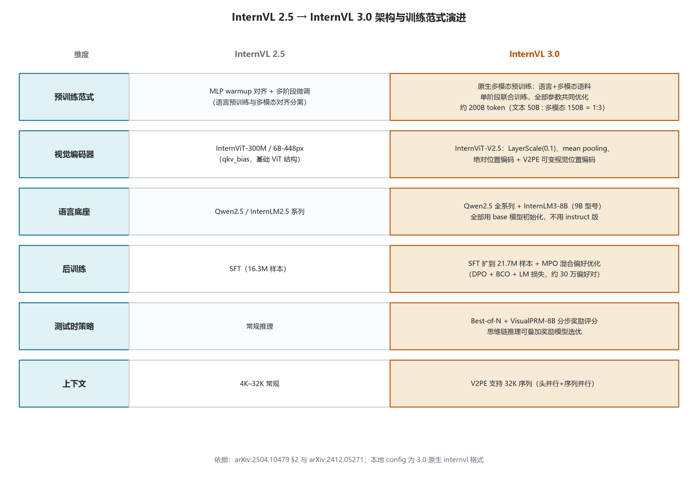

# InternVL-3 家族架构详解 — InternVLForConditionalGeneration · 1B–78B · 原生多模态预训练

- 2025-04 发布 · ViT–MLP–LLM 范式
- 入口类 InternVLForConditionalGeneration（transformers 原生 internvl 格式）
- 本地 config：InternVL3-1B-hf（Qwen2.5-0.5B 底座）
- 视觉塔：InternViT-300M / 6B（448px-V2.5）
- 核心增量：原生多模态预训练 · V2PE · 测试时扩展

InternVL3 是上海 AI Lab InternVL 系列第三代开放多模态大模型，家族共 **7 个尺寸（1B–78B）**，统一遵循 ViT–MLP–LLM 三段式架构。本页以本地 **InternVL3-1B-hf** 的 config.json、本地 transformers 源码 modeling_internvl.py 与论文 arXiv:2504.10479 为唯一依据。

## 1 家族全景：InternVL3 七尺寸与本地 config 对照

家族规格：≤14B 用 InternViT-300M-448px-V2.5，38B/78B 用 InternViT-6B-448px-V2.5；LLM 一律用预训练 base 模型（不用 instruction-tuned 版）。

| 模型 | 总参数 | 视觉编码器 | 语言模型 | OpenCompass |
|---|---|---|---|---|
| **InternVL3-1B（本地）** | 0.9B | InternViT-300M-448px-V2.5 | Qwen2.5-0.5B | 57.4 |
| InternVL3-2B | 1.9B | InternViT-300M-448px-V2.5 | Qwen2.5-1.5B | 63.9 |
| InternVL3-8B | 8.1B | InternViT-300M-448px-V2.5 | Qwen2.5-7B | 73.3 |
| InternVL3-9B | 9.2B | InternViT-300M-448px-V2.5 | InternLM3-8B | 72.4 |
| InternVL3-14B | 15.1B | InternViT-300M-448px-V2.5 | Qwen2.5-14B | 75.5 |
| InternVL3-38B | 38.4B | InternViT-6B-448px-V2.5 | Qwen2.5-32B | 77.3 |
| InternVL3-78B | 78.4B | InternViT-6B-448px-V2.5 | Qwen2.5-72B | 79.5 |

| InternVL3-78B | 78.4B | InternViT-6B-448px-V2.5 | Qwen2.5-72B | 79.5 |

### 1.1 全尺寸 LLM 底座 config 对照（远程 ModelScope config 实参）

| 模型（总参） | 视觉塔 | 语言底座 | hidden | 层数 | Q/KV 头 | intermediate | vocab / max_pos |
|---|---|---|---|---|---|---|---|
| **InternVL3-1B（本地，0.9B）** | InternViT-300M-448px-V2.5 | Qwen2.5-0.5B | 896 | 24 | 14 / 2 | 4864 | 151674 / 32768 |
| InternVL3-2B（1.9B） | InternViT-300M-448px-V2.5 | Qwen2.5-1.5B | 1536 | 28 | 12 / 2 | 8960 | 151674 / 32768 |
| InternVL3-8B（8.1B） | InternViT-300M-448px-V2.5 | Qwen2.5-7B | 3584 | 28 | 28 / 4 | 18944 | 151674 / 32768 |
| InternVL3-9B（9.2B） | InternViT-300M-448px-V2.5 | InternLM3-8B | 4096 | 48 | 32 / 2 | 10240 | 128142 / 32768 |
| InternVL3-14B（15.1B） | InternViT-300M-448px-V2.5 | Qwen2.5-14B | 5120 | 48 | 40 / 8 | 13824 | 151674 / 32768 |
| InternVL3-38B（38.4B） | InternViT-6B-448px-V2.5 | Qwen2.5-32B | 5120 | 64 | 40 / 8 | 27648 | 151674 / 32768 |
| InternVL3-78B（78.4B） | InternViT-6B-448px-V2.5 | Qwen2.5-72B | 8192 | 80 | 64 / 8 | 29568 | 151674 / 32768 |

> 视觉塔两档（V2.5）：1B–14B 用 InternViT-300M-448px-V2.5（hidden 1024/24 层/16 头/4096/448px，含 LayerScale 0.1 + mean pooling），38B/78B 用 InternViT-6B-448px-V2.5（hidden 3200/45 层/25 头/12800/448px）。9B 的 InternLM3-8B 底座词表 128142，与其他尺寸的 Qwen2.5 底座（151674）不同。

### 1.2 本地 1B config 关键实参（transformers 原生 internvl 格式）

| 字段 | 取值 | 含义 / 源码佐证 |
|---|---|---|
| architectures / model_type | `InternVLForConditionalGeneration` / `internvl` | 顶层模型类（modeling_internvl.py:741） |
| image_seq_length | 256 | 每个 448×448 切片的视觉 token 数 = $(448/14)^2 \times 0.5^2$ |
| image_token_id | 151667 | 图像占位 token id，forward 中 masked_scatter 的掩码依据 |
| downsample_ratio | 0.5 | Pixel Unshuffle 缩放因子 |
| vision_feature_layer / strategy | -1 / `default` | 取最后一层隐藏态；default = 丢弃 CLS |
| text_config（Qwen2.5-0.5B） | hidden 896 · 24 层 | 14 Q 头 / 2 KV 头（GQA 分组 7）· intermediate 4864 · vocab 151674 · RoPE dynamic×2 · max_pos 32768 |
| vision_config（InternViT-300M-V2.5） | hidden 1024 · 24 层 | 16 头 · patch 14×14 · 448×448 · attention_bias=true · layer_scale_init_value=0.1 · use_mean_pooling=true · 绝对位置编码=true |

> 要点：3.0 是 **transformers 原生 internvl 格式**——顶层直接嵌套 text_config 与 vision_config，不再是 1.5/2.x 的 legacy internvl_chat 格式；本地自核算总参数 ≈0.80–0.9B，与论文 0.9B 同量级。

## 2 端到端架构总览（以本地 1B 为主尺寸）

输入图像经动态分辨率切片 → 逐切片过 InternViT-300M → Pixel Unshuffle 压缩 token → 两层 MLP 投影进 LLM 残差流 → 在 embedding 层用视觉特征替换图像占位 token → Qwen2.5-0.5B 自回归解码。38B/78B 仅把视觉塔换成 InternViT-6B-V2.5。

> 源码路径：InternVLModel.__init__ 组装 vision_tower / projector / language_model（:530-536）；get_image_features（:543-587）；forward 中 embed_tokens 查表后 masked_scatter 替换（:634-652）。

## 3 视觉编码器 InternViT-300M-448px-V2.5

448×448 切片 = $(448/14)^2 = 32\times32 = 1024$ 个 patch token + 1 个 CLS。V2.5 相对 1.5/2.x 时代的 InternViT 有三个 config 可证的新特性：**LayerScale（init 0.1）**、**mean pooling**、**可学习绝对位置编码 + V2PE**。

每个 ViT Block（hidden 1024 · intermediate 4096 · GELU）：

$$\text{LayerNorm} \rightarrow \text{MHSA}(16\ \text{头}, \text{qkv\_bias}=\text{true}) \rightarrow \times \text{LayerScale}(0.1) \rightarrow + \text{残差}$$

$$\text{LayerNorm} \rightarrow \text{MLP}: 1024 \rightarrow 4096(\text{GELU}) \rightarrow 1024 \rightarrow \times \text{LayerScale}(0.1) \rightarrow + \text{残差}$$

> 本地 config 佐证：attention_bias=true（qkv 带 bias）、layer_scale_init_value=0.1、use_mean_pooling=true（分类侧）、use_qk_norm=false、layer_norm_eps=1e-6。

## 4 投影层与语言底座

### 4.1 Pixel Unshuffle：视觉 token 压到 1/4

沿用 InternVL2.5 的像素重组：32×32 空间网格按 r=0.5 重组，空间减半、通道 ×4，每切片 **1024 patch → 256 个视觉 token**，与 image_seq_length=256 严格相等。

$$S = H / p = 448 / 14 = 32$$

$$n_{\text{tok}} = (S \cdot r)^2 = (32 \times 0.5)^2 = 256$$

$$d_{\text{out}} = d_v / r^2 = 1024 / 0.25 = 4096$$

### 4.2 两层 MLP 投影器（随机初始化）

$$\text{hidden} = \text{LayerNorm}(4096)$$

$$\text{out} = \text{Linear}_2\big(\text{GELU}\big(\text{Linear}_1(\text{hidden})\big)\big)$$

$$\text{Linear}_1:\ 4096 \rightarrow 896,\quad \text{Linear}_2:\ 896 \rightarrow 896$$

### 4.3 语言底座 Qwen2.5-0.5B

HF 架构类 Qwen2ForCausalLM：hidden 896、24 层、14 个 Q 头 / 2 个 KV 头（GQA 分组数 7）、head_dim=64、SwiGLU（silu）intermediate 4864。vocab 151674（嵌入与 lm_head 绑定）；RoPE θ=1e6 + dynamic 缩放 ×2；rms_norm_eps=1e-6。论文强调：LLM 一律用 base 模型初始化，不用 instruction-tuned 版本。

### 4.4 本地 1B 参数量自核算

视觉塔 ≈302M（每层 qkv 1024×3072 + out 1024² + MLP 2×1024×4096 ≈12.6M ×24）；LLM ≈494M（嵌入 151674×896≈135.9M + 每层注意力 ≈1.84M + MLP 每层 ≈13.06M ×24）；投影器 ≈4.5M。合计 ≈0.80–0.9B，与论文 0.9B 同量级。

## 5 核心机制专节

### 5.1 动态分辨率切片（tile）与缩略图

图像不强制 resize 到固定尺寸：按宽高比动态切为若干 448×448 切片，另加整图缩略图补全全局视野。本地 preprocessor_config：max_patches=12、min_patches=1、size 448×448。processing_internvl.py:148-150 把每个 `<image>` 占位展开为 256×切片数 个图像 token，并用 BOI/EOI 特殊 token 包裹。

### 5.2 视觉 token 流与 masked_scatter

文本侧写入 BOI、重复 N 次的图像占位 token（id=151667）与 EOI；forward 时 embed_tokens 查表后用占位 id 构造掩码，把 ViT 输出的 $(B, 256N, 896)$ 特征写回占位位置（:646-652）。源码同时校验：占位 token 总数 ×896 == 视觉特征元素数，不等即报错（:607-610）。视觉 token 只作条件上下文，不参与 loss。

### 5.3 原生多模态预训练目标

语言预训练与多模态对齐合并进**同一预训练阶段**：纯文本语料与多模态语料交错混合、全部参数联合优化；loss 只在文本 token 上计算。

$$L_{\text{text-only}}(\theta) = -\sum_{x_i \in \text{Text}} w_i \cdot \log p_\theta(x_i \mid x_1 \dots x_{i-1})$$

$$w_i = 1 / l^{0.5} \quad (\text{square averaging})$$

语料配比 文本:多模态 = 1:3；总 token 约 200B（文本 50B + 多模态 150B）。

### 5.4 V2PE 可变视觉位置编码

为支持更长多模态上下文引入 Variable Visual Position Encoding：视觉 token 位置增量 δ 可调，全文实验默认 δ=1；训练侧配合头并行与序列并行支持最长 **32K token** 序列。本地 config 中 use_absolute_position_embeddings=true，V2PE 是在绝对位置编码之上叠加的机制。

## 6 训练管线：原生预训练 → SFT → MPO → 测试时扩展

| 阶段 | 内容 |
|---|---|
| 阶段一 · 原生多模态预训练 | 约 200B token：文本 50B + 多模态 150B（配比 1:3）。文本与多模态语料单阶段交错联合训练，全部参数不冻结；loss 仅在文本 token 上，square averaging 加权。多模态语料在 2.5 语料（caption、QA、数学、图表、OCR、文档、多轮对话、医疗）基础上新增 GUI、工具调用、3D 场景、视频理解 |
| 阶段二 · 监督微调 SFT | 样本量从 2.5 的 16.3M 扩到 **21.7M**。沿用 2.5 的随机 JPEG 压缩、square loss 重加权、多模态数据打包；新增工具调用、GUI、3D、长上下文、视频、科学图表、创意写作与多模态推理样本 |
| 阶段三 · 混合偏好优化 MPO | 约 **30 万偏好对**（基于 MMPR v1.2），用 InternVL3-8B/38B/78B 的 SFT 版产出 rollout。损失 = DPO 偏好损失 + BCO 质量损失 + LM 生成损失，缓解训练-推理分布偏移，增强思维链推理（78B 推理均分 +4.1） |
| 推理期 · 测试时扩展 | **Best-of-N** 采样 + **VisualPRM-8B** 评审模型：对思维链每一步预测 +/− 并取概率作为步质量分，平均后选最优回答；小尺寸模型也能获得可观推理增益。基础设施：扩展 InternEVO 框架，同规模训练吞吐较 2.5 提升 50%–200% |

## 7 版本演进对比：InternVL 2.5 → InternVL 3.0

| 维度 | InternVL 2.5 | InternVL 3.0 |
|---|---|---|
| 预训练范式 | MLP warmup 对齐 + 多阶段微调，语言与多模态训练分离 | **语言+多模态语料单阶段原生联合训练**，全部参数共同优化，约 200B token |
| 视觉编码器 | InternViT-300M / 6B-448px（基础 ViT 结构） | **InternViT-V2.5**：LayerScale(0.1)、mean pooling、绝对位置编码 + V2PE |
| 语言底座 | Qwen2.5 / InternLM2.5 系列 | Qwen2.5 全系列 + InternLM3-8B（9B 型号），统一用 base 模型初始化 |
| 后训练 | SFT（16.3M 样本） | SFT 扩到 21.7M + **MPO 混合偏好优化**（DPO+BCO+LM，约 30 万偏好对） |
| 测试时策略 | 常规推理 | **Best-of-N + VisualPRM-8B** 分步奖励评分，思维链可叠加选优 |
| 上下文长度 | 4K–32K 常规 | V2PE + 头/序列并行支持 **32K 序列** |

> 演进主线：原生多模态预训练从可选实验收敛为标准范式——语言与视觉能力在同一阶段联合塑形；后训练用 MPO 补上思维链推理；推理期用 VisualPRM 做测试时扩展。家族从 1B 连续扩到 78B。

## 8 参考文献

1. InternVL3: Exploring Advanced Training and Test-Time Recipes for Open-Source Multimodal Models. arXiv:2504.10479.
   https://arxiv.org/abs/2504.10479
2. InternVL2.5 论文（演进对照）：Expanding Performance Boundaries of Open-Source Multimodal Models with Model, Data, and Test-Time Scaling. arXiv:2412.05271.
   https://arxiv.org/abs/2412.05271
3. InternVL3 官方博客（2025-04-11）.
   https://internvl.github.io/blog/2025-04-11-InternVL-3.0/
4. InternVL 开源仓库.
   https://github.com/OpenGVLab/InternVL
5. 本地 config：E:\models\model\InternVL3-1B-hf\config.json（model_type=internvl；text_config=Qwen2ForCausalLM hidden 896/24 层/14Q/2KV；vision_config=internvl_vision hidden 1024/24 层/layer_scale_init_value=0.1/use_mean_pooling=true）
6. 本地预处理配置：E:\models\model\InternVL3-1B-hf\preprocessor_config.json（size=448×448，max_patches=12，min_patches=1）
7. 本地 transformers 源码：E:\transformers\src\transformers\models\internvl\modeling_internvl.py（InternVLForConditionalGeneration:741；get_image_features:543；pixel_shuffle:670；InternVLMultiModalProjector:485；masked_scatter:646-652）

---

*InternVL-3 家族架构详解（1B–78B）· 以本地 config.json 与 transformers modeling_internvl.py 逐字段核对 · 行号为本地源码行号 · 仅用于技术学习与论文配图 · 核验日期 2026-10-26*
