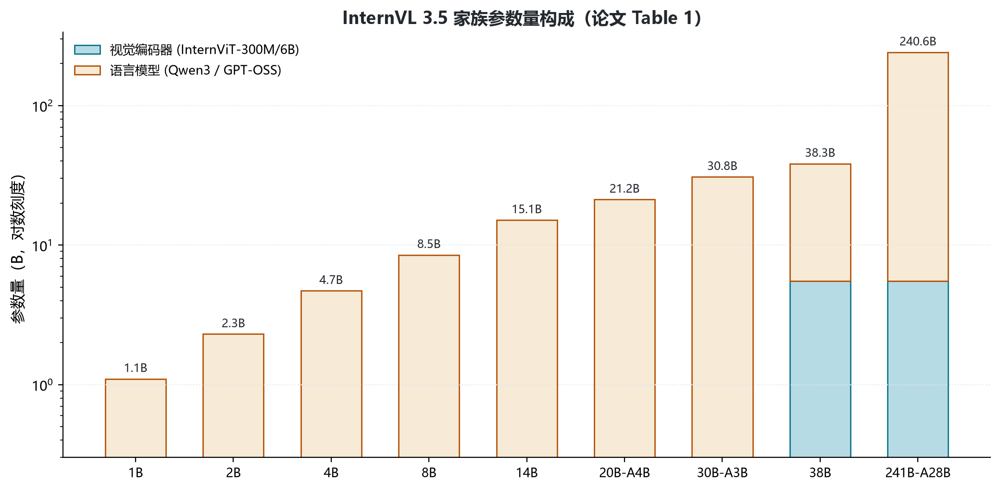
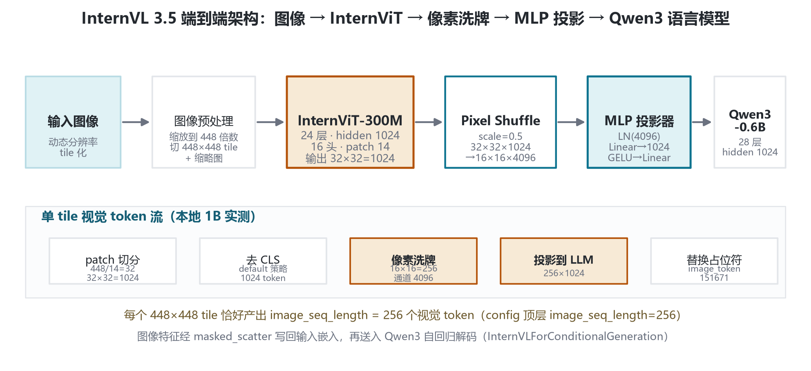
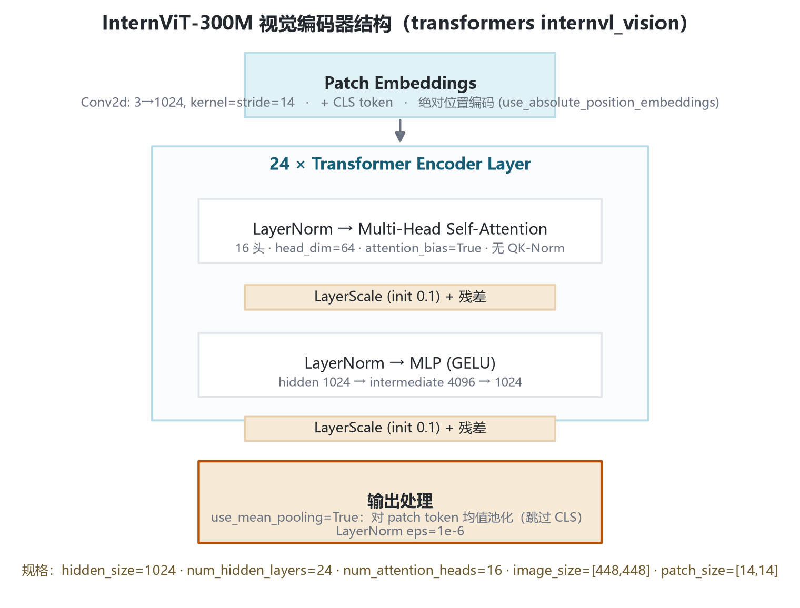
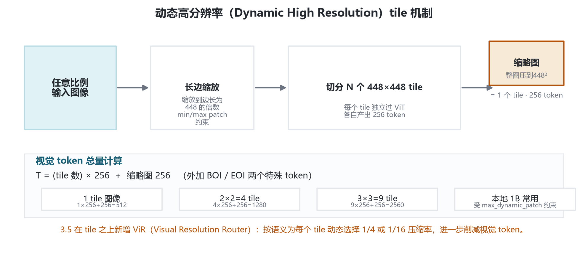
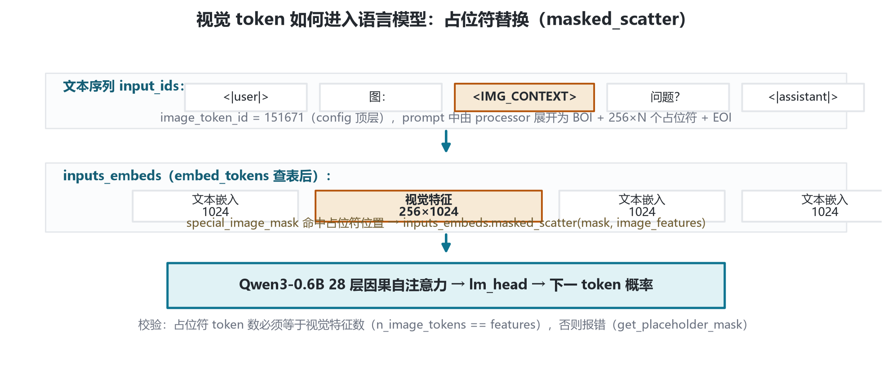
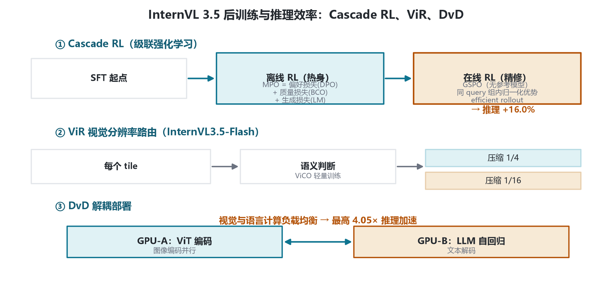

# InternVL 3.5 家族架构详解 — ViT–MLP–LLM · Cascade RL

- ViT–MLP–LLM 范式 · 稠密 + MoE 全家族
- 本地 InternVL3_5-1B-HF（Qwen3-0.6B + InternViT-300M）
- 核心增量：Cascade RL 级联强化学习 · ViR 视觉分辨率路由 · DvD 解耦部署
- arXiv:2508.18265

InternVL 3.5 沿用「图像 → InternViT → 像素洗牌 → MLP 投影 → 语言模型」的端到端结构，相对 3.0 的核心增量是 **Cascade RL** 级联强化学习、**ViR** 视觉分辨率路由与 **DvD** 解耦部署。本页以本地 1B 配置（transformers 原生 internvl 格式）为实参依据，配合论文家族表给出架构全貌。

## 1 家族全景与本地配置对照

3.5 家族覆盖 1B 到 241B 的稠密与 MoE 模型。中小尺寸共用 InternViT-300M，38B/241B 用 InternViT-6B；语言底座主体为 Qwen3 系列，20B-A4B 变体采用 GPT-OSS-20B。

| 模型 | 视觉编码器 | 语言底座 | 总参 |
|---|---|---|---|
| **InternVL3.5-1B（本地）** | InternViT-300M | Qwen3-0.6B | 1.1B |
| InternVL3.5-2B | InternViT-300M | Qwen3-1.7B | 2.3B |
| InternVL3.5-4B | InternViT-300M | Qwen3-4B | 4.7B |
| InternVL3.5-8B | InternViT-300M | Qwen3-8B | 8.5B |
| InternVL3.5-14B | InternViT-300M | Qwen3-14B | 15.1B |
| InternVL3.5-20B-A4B | InternViT-300M | GPT-OSS-20B | 21.2B (A4B) |
| InternVL3.5-30B-A3B | InternViT-300M | Qwen3-30B-A3B | 30.8B (A3B) |
| InternVL3.5-38B | InternViT-6B | Qwen3-32B | 38.4B |
| InternVL3.5-241B-A28B | InternViT-6B | Qwen3-235B-A22B | 240.7B (A28B) |

> 本地 InternVL3_5-1B-HF 即家族最小档：视觉塔 InternViT-300M、语言底座 Qwen3-0.6B，总参约 1.1B。config.json 为 transformers 原生格式，顶层含 text_config、vision_config、image_seq_length=256、image_token_id=151671。

## 2 端到端架构总览

任意比例图像先做动态分辨率 tile 切分，每个 448×448 tile 独立过 InternViT-300M，经像素洗牌压缩空间、升维通道，再由 MLP 投影到语言模型维度，最终替换输入中的图像占位符。

尺寸换算：

$$n_{\text{patch}} = (448/14)^2 = 32^2 = 1024$$

$$T = 1024 \times 0.5^2 = 256 \quad (\text{image\_seq\_length})$$

$$d = 1024 / 0.5^2 = 4096 \quad (\text{shuffle 后通道})$$

## 3 视觉编码器 InternViT

本地 vision_config 为 300M 规格：hidden 1024、24 层、16 头、intermediate 4096、patch [14,14]、image_size [448,448]、attention_bias=True、layer_scale_init_value=0.1、use_mean_pooling=True、use_absolute_position_embeddings=True、use_qk_norm=False。

每个 Transformer Encoder Layer：

$$\text{LayerNorm} \rightarrow \text{MHSA}(16\ \text{头}, \text{head\_dim}=64, \text{attention\_bias}=\text{True}) \rightarrow \times \text{LayerScale}(0.1) \rightarrow + \text{残差}$$

$$\text{LayerNorm} \rightarrow \text{MLP}(\text{GELU}):\ 1024 \rightarrow 4096 \rightarrow 1024 \rightarrow \times \text{LayerScale}(0.1) \rightarrow + \text{残差}$$

输出侧：均值池化（use_mean_pooling=True），跳过 CLS（select_strategy=default），LayerNorm eps=1e-6。

## 4 投影层与语言底座

### 4.1 MLP 投影器

InternVLMultiModalProjector：

$$\text{out} = \text{Linear}_2\big(\text{GELU}\big(\text{Linear}_1(\text{LayerNorm}(x))\big)\big)$$

$$\text{Linear}_1:\ 4096 \rightarrow 1024,\quad \text{Linear}_2:\ 1024 \rightarrow 1024 \quad (\text{projector\_hidden\_act}=\text{gelu})$$

输出维度严格等于语言模型 hidden_size（本地 1024），使视觉特征可直接替换词嵌入。

### 4.2 语言底座 Qwen3-0.6B

本地 text_config 为 Qwen3ForCausalLM，全层 full_attention、无滑动窗口、无 rope_scaling，rope_theta=1e6。相比 3.0 本地 1B 的 Qwen2.5-0.5B（896/24 层/2 KV 头），3.5 升级为 hidden 1024、28 层、16 头、8 KV 头（GQA）。

| text_config 字段 | 取值 | 说明 |
|---|---|---|
| architectures | Qwen3ForCausalLM | 因果语言模型 |
| hidden_size | 1024 | 与投影输出一致 |
| num_hidden_layers | 28 | 全部 full_attention |
| num_attention_heads / num_key_value_heads | 16 / 8 | GQA |
| head_dim / intermediate_size | 128 / 3072 | silu 激活 |
| vocab_size / max_position_embeddings | 151936 / 40960 | 词表 / 最大位置 |
| rope_theta / rope_scaling / sliding_window | 1e6 / null / null | 无缩放 |
| rms_norm_eps / attention_bias | 1e-6 / false | RMSNorm |

## 5 核心机制：tile、像素洗牌与 token 流

### 5.1 动态高分辨率 tile

任意比例图像缩放至边长 448 的倍数，切分若干 448×448 tile，再加一张整图缩略图 tile；每个 tile 独立过同一管线各产 256 token，由 min/max dynamic patch 约束总数。3.5 在此之上引入 **ViR**：按语义为每个 tile 动态选 1/4 或 1/16 压缩率。

视觉 token 总数：

$$T_{\text{total}} = N_{\text{tile}} \times 256 + 256\ (\text{缩略图}) + \text{BOI/EOI}$$

### 5.2 占位符替换（masked_scatter）

处理侧把占位符展开为 BOI + 256×N 个 image_token_id=151671 + EOI；前向时 get_placeholder_mask 命中占位符位置，用 masked_scatter 把投影后的视觉特征写回 inputs_embeds，并校验占位符数等于视觉特征数。

## 6 训练管线

3.5 延续原生多模态预训练 → SFT，后训练阶段采用 **Cascade RL** 两阶段。

| 阶段 | 内容 |
|---|---|
| 预训练 | 原生多模态预训练：视觉塔与语言底座联合训练（沿用 2.5/3.0 范式） |
| SFT | 监督微调：多任务指令跟随，作为强化学习起点 |
| 离线 RL · MPO 混合偏好优化（热身） | $L_{\text{MPO}} = w_p \cdot L_p(\text{DPO}) + w_q \cdot L_q(\text{BCO}) + w_g \cdot L_g(\text{LM})$；高效产出高质量 rollout |
| 在线 RL · GSPO 在线精修（无参考模型） | 同 query 组内归一化优势，与 GRPO 同族；稠密与 MoE 均有效。整体推理最高 +16.0% |
| 部署 · ViR + DvD 推理优化 | ViR 按语义动态压缩视觉 token（1/4 或 1/16）；DvD 将 ViT 与 LLM 分置不同 GPU。最高约 4.05× 推理加速 |

> Cascade RL 是 3.5 相对 3.0 的核心后训练改动：先用离线 RL 高效热身，再用在线 RL 精修分布，以可控 GPU 成本推高推理上限。

## 7 版本演进对比（InternVL 3.0 → 3.5）

| 维度 | InternVL 3.0 | InternVL 3.5 |
|---|---|---|
| 后训练 | 常规离线/在线 RL | Cascade RL：MPO 离线热身 + GSPO 在线精修 |
| 推理效率 | 基线 | ViR 动态压缩 + DvD 解耦部署，最高约 4.05× |
| 推理能力 | 基线 | 整体推理最高 +16.0% |
| 1B 语言底座 | Qwen2.5-0.5B（896/24层/2KV头） | Qwen3-0.6B（1024/28层/8KV头） |
| 能力边界 | 通用图文、OCR、grounding | 新增 GUI 交互、具身智能、SVG 理解与生成 |
| 最大模型 | — | 241B-A28B（InternViT-6B + Qwen3-235B-A22B） |

## 8 参考文献

1. InternVL3.5: Advancing Open-Source Multimodal Models in Versatility, Reasoning, and Efficiency. arXiv:2508.18265.
   https://arxiv.org/abs/2508.18265
2. InternVL3: Exploring Advanced Training and Test-Time Recipes for Open-Source Multimodal Models. arXiv:2504.10479.
   https://arxiv.org/abs/2504.10479
3. Qwen3 Technical Report. arXiv:2505.09388.
   https://arxiv.org/abs/2505.09388
4. InternVL 1.5: How Far Are We to GPT-4V? arXiv:2404.16821.
   https://arxiv.org/abs/2404.16821
5. transformers 源码：InternVLForConditionalGeneration / get_image_features / pixel_shuffle / InternVLMultiModalProjector（本地 E:\transformers\src\transformers\models\internvl\）
6. 本地配置：E:\models\model\InternVL3_5-1B-HF\config.json

---

*InternVL 3.5 家族架构详解 · 数值以本地 config.json 与 arXiv:2508.18265 为准 · 仅用于技术学习与论文配图 · 核验日期 2026-10-26*
