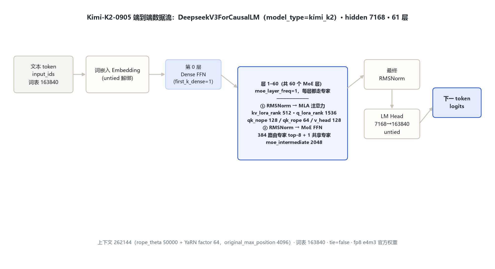
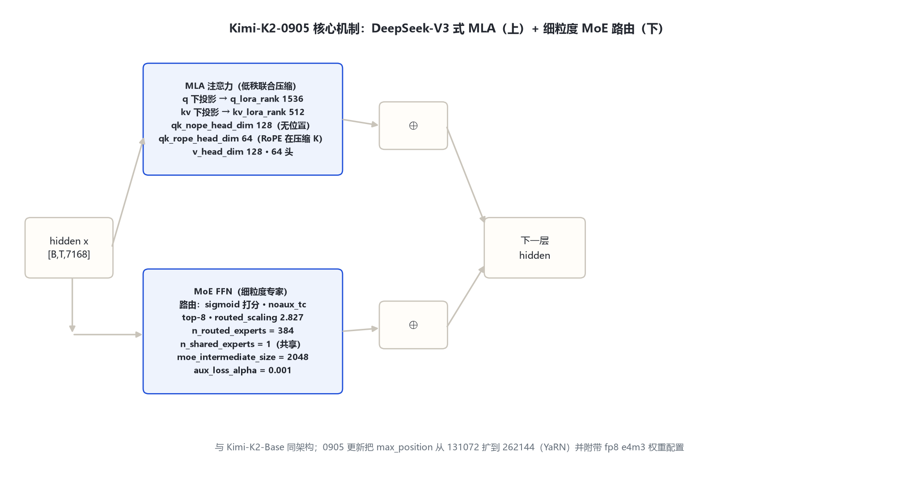

# Kimi-K2-0905 架构详解 — 1T-A32B 级 MoE（DeepSeek-V3 式 MLA + 384 路由专家）

- 徽标：入口类 DeepseekV3ForCausalLM（config.architectures）· model_type = kimi_k2 · auto_map 指向官方仓库 configuration_deepseek / modeling_deepseek
- 徽标：复用 DeepSeek-V3 实现代码——本地 transformers 无原生 kimi_k2 模块，按官方 repo 远端代码加载（本地 models\deepseek_v3 为同架构等价实现）
- 徽标：MLA 低秩联合压缩（kv_lora_rank 512 · q_lora_rank 1536 · qk_nope 128 · qk_rope 64 · v_head 128）
- 徽标：384 路由专家 + 1 共享专家 · 每 token top-8 · sigmoid 打分 · routed_scaling_factor 2.827
- 徽标：hidden 7168 · 61 层（第 0 层 dense，1–60 层 MoE）· 词表 163840 · 上下文 262144（YaRN）

本页以 **Kimi-K2-Instruct-0905 官方 config.json**（2026-10-31 经 hf-mirror 拉取，留档 `_tools\_cfgpull\config.json`）与 **transformers 源码**（本地 `E:\transformers`，`models\deepseek_v3\` 同架构等价实现）为唯一依据。K2 系列技术事实以官方论文 **arXiv:2507.20534《Kimi K2: Open Agentic Intelligence》** 为准。所有数字均标注来源（config 字段或源码文件:行号）。

## 1 家族全景：K2-0905 config 实参对照

> 下表字段全部来自官方 config（逐字段核对，2026-10-31）。0905 与 Kimi-K2-Base / Kimi-K2-Instruct 共享同一文本塔架构，主要差异在上下文长度与权重量化格式。

| 字段（config） | Kimi-K2-0905 取值 | 来源 |
|---|---|---|
| architectures | DeepseekV3ForCausalLM | config.architectures |
| model_type | kimi_k2 | config.model_type |
| auto_map | AutoConfig→configuration_deepseek / AutoModelForCausalLM→modeling_deepseek（官方 repo 远端代码） | config.auto_map |
| **形态** | **MoE（第 0 层 dense，其余 60 层 MoE）** | first_k_dense_replace=1 |
| hidden_size | 7168 | config |
| num_hidden_layers | 61 | config |
| num_attention_heads (Q) | 64 | config |
| num_key_value_heads (KV) | 64 | config（MLA 下为压缩后低秩，非 GQA） |
| intermediate_size（dense FFN，第 0 层） | 18432 | config |
| moe_intermediate_size | 2048 | config |
| first_k_dense_replace | 1（仅第 0 层 dense） | config |
| moe_layer_freq | 1（之后每层都走 MoE） | config |
| n_routed_experts（路由专家） | 384 | config |
| n_shared_experts（共享专家） | 1 | config |
| num_experts_per_tok | 8 | config |
| kv_lora_rank（KV 低秩压缩维） | 512 | config |
| q_lora_rank（Q 低秩压缩维） | 1536 | config |
| qk_nope_head_dim | 128（无位置编码部分） | config |
| qk_rope_head_dim | 64（RoPE 部分） | config |
| v_head_dim | 128 | config |
| vocab_size | 163840 | config |
| max_position_embeddings | 262144 | config |
| rope_theta | 50000.0 | config |
| rope_scaling | yarn，factor 64.0，original_max_position_embeddings 4096，beta_fast/slow 1.0，mscale 1.0 | config |
| attention_bias / attention_dropout | false / 0.0 | config |
| hidden_act | silu | config |
| rms_norm_eps | 1e-5 | config |
| tie_word_embeddings | false | config |
| scoring_func / topk_method | sigmoid / noaux_tc | config |
| routed_scaling_factor | 2.827 | config |
| norm_topk_prob | true | config |
| aux_loss_alpha | 0.001 | config |
| bos / eos / pad token id | 163584 / 163585 / 163839 | config |
| quantization_config | fp8，fmt e4m3，weight_block_size [128,128]，activation_scheme dynamic | config |

> 要点：① **入口类是 DeepseekV3ForCausalLM 而非某个 kimi 专属类**——K2-0905 直接复用 DeepSeek-V3 的模型结构与远端实现代码，model_type 虽为 kimi_k2，但 config.architectures 与 auto_map 均指向 deepseek 实现；② **注意力是 MLA（Multi-head Latent Attention）而非普通 GQA**：Q/KV 先各自低秩压缩（q_lora_rank 1536、kv_lora_rank 512），再拆分出「无位置」与「RoPE」两段；③ **MoE 为 384 路由专家 + 1 共享专家，每 token 选 8**，第 0 层是 dense FFN；④ 官方论文口径：总参数约 1.04T、每 token 激活约 32B（即「1T-A32B」）。

### 1.1 与 Kimi-K2-Base / Instruct 的差异

| 字段 | Kimi-K2-Base | Kimi-K2-0905 | 说明 |
|---|---|---|---|
| hidden_size | 7168 | 7168 | 相同 |
| num_hidden_layers | 61 | 61 | 相同 |
| 专家配置 | 384 路由 + 1 共享 / top-8 | 同左 | 相同 |
| MLA 维度 | kv 512 · q 1536 · nope 128 · rope 64 · v 128 | 同左 | 相同 |
| max_position_embeddings | 131072 | **262144** | 0905 翻倍扩长 |
| rope_scaling | 无显式 | yarn factor 64（original 4096） | 0905 用 YaRN 扩到 256K |
| quantization_config | 无（bf16 裸权重） | fp8 e4m3（block 128） | 0905 附带 fp8 官方权重 |
| vocab_size | 163840 | 163840 | 相同 |

> 对照来源：`moonshotai/Kimi-K2-Base` config（留档 `kimi_k2_0905\_tools\_cfgpull\Kimi-K2-Base.config.json`）。0905 是 2025-09 放出的更新版 Instruct 检查点，文本塔与 Base 同架构，主要工程变化是上下文翻倍到 262144 并以 fp8 e4m3 格式发布。

## 2 端到端数据流总览

> 文本 token → 词嵌入（untied）→ **第 0 层 dense 解码层**（MLA 注意力 + 18432 维 SwiGLU FFN）→ **层 1–60 MoE 解码层**（MLA 注意力 + 384 路由专家选 8 / 1 共享专家）→ 最终 RMSNorm → LM Head（7168→163840，untied）。

### 2.1 架构图



> 全模型统一主干：Embedding → 61 层解码块（第 0 层 dense，后 60 层 MoE）→ RMSNorm → LM Head；差异集中在 FFN 子层：第 0 层是 dense SwiGLU，其余 60 层是 top-8 细粒度 MoE。

## 3 解码层解剖：DeepSeek-V3 式前置 RMSNorm 残差块

> K2-0905 的解码层与 DeepSeek-V3 同构（本地等价实现 `DeepseekV3DecoderLayer`，`models\deepseek_v3\modeling_deepseek_v3.py:485`）：每组含注意力与 FFN 两个残差子层，均为单 RMSNorm 前置。第 0 层 FFN 是 dense SwiGLU（18432 维），其余层 FFN 是 MoE。

```
DecoderLayer.forward（DeepSeek-V3 式，等价实现 modeling_deepseek_v3.py:485 起）:
  residual = hidden_states
  hidden_states = input_layernorm(hidden_states)        # RMSNorm(7168, eps 1e-5)
  hidden_states, _ = self_attn(hidden_states)          # MLA：低秩压缩 + RoPE
  hidden_states = residual + hidden_states            # ⊕1
  residual = hidden_states
  hidden_states = post_attention_layernorm(hidden_states)
  # 第 0 层：dense MLP(18432)；其余层：MoE(384 路由选8 + 1 共享, moe_inter 2048)
  hidden_states = self.mlp(hidden_states)
  hidden_states = residual + hidden_states            # ⊕2
  return hidden_states
```

### 3.1 架构图



## 4 核心机制：MLA 低秩压缩 · 384 专家路由 · YaRN 扩长

### 4.1 ① MLA：Q/KV 低秩联合压缩

注意力不再直接投影出全部 Q/KV 头，而是先把 hidden 压到低秩隐向量，再上投影回多头（等价实现 `DeepseekV3Attention`，`modeling_deepseek_v3.py:349-394`）：

$$q = W^{qB} x \in \mathbb{R}^{q\_lora\_rank=1536},\qquad c^{KV} = W^{KV} x \in \mathbb{R}^{kv\_lora\_rank=512}$$

$$c^{KV} \rightarrow \mathrm{RMSNorm}(c^{KV});\quad \mathrm{split}(c^{KV},\, kv\_lora\_rank,\, qk\_rope\_head\_dim=64)$$

$$q' = \mathrm{RMSNorm}(q)\, W^{qA};\qquad k = k_{\mathrm{nope}} + k_{\mathrm{rope}};\quad v = v_{\mathrm{nope}}$$

> 关键：**KV cache 只缓存低秩的 512 维隐向量**（而非 64 头 × 128 维），大幅压缩 KV 占用；RoPE 只作用在拆分出的 64 维 `qk_rope_head_dim` 段，其余 128 维 `qk_nope_head_dim` 不带位置编码（`modeling_deepseek_v3.py:389,445`）。

### 4.2 ② MoE 路由：384 路由专家选 8 + 1 共享专家

MoE 块（等价实现 `DeepseekV3MoE`，`modeling_deepseek_v3.py:201`；专家 MLP `:104-157`）：

```
router_logits = x @ W_gate^T                     # (seq, 384)
scores = sigmoid(router_logits)                  # scoring_func=sigmoid（非 softmax）
topk_weights, topk_idx = noaux_tc_topk(scores, k=8)   # topk_method=noaux_tc
topk_weights = topk_weights * routed_scaling_factor(2.827)  # :157
topk_weights = topk_weights / topk_weights.sum(-1)            # norm_topk_prob=true
# 384 个路由专家按 topk_idx 分桶计算（moe_intermediate=2048）
# 另有 1 个共享专家（n_shared_experts=1）对所有 token 始终计算
```

> 配置口径：`n_routed_experts=384`、`n_shared_experts=1`、`num_experts_per_tok=8`、`moe_intermediate_size=2048`、`routed_scaling_factor=2.827`、`aux_loss_alpha=0.001`、`seq_aux=true`。官方论文（arXiv:2507.20534）说明：在固定激活参数量下扩大路由专家总数（稀疏度 384/8=48）可降低 loss，故采用 384 路由专家。

### 4.3 ③ YaRN 扩长到 262144

```
rope_theta = 50000
rope_scaling = { type: "yarn", factor: 64.0,
                 original_max_position_embeddings: 4096,
                 beta_fast: 1.0, beta_slow: 1.0, mscale: 1.0 }
max_position_embeddings = 262144
```

> Kimi-K2-Base 原生 max 为 131072；0905 通过 YaRN（factor 64，基准 4096）把有效上下文扩到 262144。RoPE 基频 `rope_theta=50000`。

## 5 注意力机制：MLA（非 GQA）· 64 头 · 无注意力偏置

### 5.1 头与低秩维度

| 维度 | 取值 | 含义 |
|---|---|---|
| num_attention_heads (Q) | 64 | Q 头数 |
| num_key_value_heads | 64 | 名义 KV 头（MLA 下共享低秩 KV 隐向量） |
| q_lora_rank | 1536 | Q 低秩压缩维 |
| kv_lora_rank | 512 | KV 低秩压缩维（KV cache 实际缓存量） |
| qk_nope_head_dim | 128 | 每头 QK 无位置段维度 |
| qk_rope_head_dim | 64 | 每头 QK RoPE 段维度 |
| v_head_dim | 128 | 每头 value 维度 |
| attention_bias | false | Q/K/V/O 投影均无偏置 |

### 5.2 注意力核心

$$\mathrm{Attn}(Q,K,V)=\mathrm{softmax}\!\left(\frac{QK^\top}{\sqrt{d_{hk}}}+\text{mask}\right)V$$

```
# MLA 下 Q 经 q_a_layernorm 后上投影为 64 头；
# KV 隐向量 512 维与 rope 段 64 维拼接后再扩为多头；
# 因果掩码，无滑窗（全注意力）。
```

> 与普通 GQA 的区别：GQA 是 Q 多头、KV 分组共享；MLA 是 Q/KV 都先压到低秩瓶颈再解多头，KV cache 体积由 kv_lora_rank=512 决定，而非头数×head_dim。

## 6 特殊 Token 与词表布局

| token | ID | 含义 | 来源 |
|---|---|---|---|
| bos_token_id | 163584 | 序列开始 | config |
| eos_token_id | 163585 | 序列结束 | config |
| pad_token_id | 163839 | 填充 | config |
| vocab_size | 163840 | 词表大小（2^17 对齐） | config |

> 词表 `vocab_size=163840`。tokenizer_class 字段为 null（随官方 repo 代码提供）。无多模态特殊 token——K2-0905 为纯文本稠密/稀疏文本模型（视觉能力由 Kimi-VL 系列承担，本笔记不展开）。

## 7 演进视角：Moonlight → Kimi-K2-Base → Kimi-K2-0905

| 维度 | Moonlight-16B-A3B（2025-02，早期开源） | Kimi-K2-Base（2025-07） | Kimi-K2-0905（2025-09） |
|---|---|---|---|
| 形态 | MoE 16B 总 / 3B 激活 | MoE 1T 总 / 32B 激活 | 同 K2-Base |
| hidden / 层数 | 2048 / 27 | 7168 / 61 | 7168 / 61 |
| 注意力 | MLA（kv 512，无 q_lora_rank） | MLA（kv 512 · q 1536） | MLA（同 Base） |
| 路由专家 | 64 路由 + 2 共享，top-6 | 384 路由 + 1 共享，top-8 | 384 路由 + 1 共享，top-8 |
| max_position | 8192 | 131072 | **262144（YaRN）** |
| rope_theta | 50000 | 50000 | 50000 + yarn factor64 |
| 权重格式 | bf16 | bf16 | **fp8 e4m3** |
| vocab | 163840 | 163840 | 163840 |

> 演进主线：① 文本塔从 Moonlight 的 2048/27 层扩到 K2 的 7168/61 层；② MLA 引入 q 侧低秩压缩（q_lora_rank 1536），KV 低秩维保持 512；③ 路由专家从 64（top-6，2 共享）扩到 384（top-8，1 共享），稀疏度大幅提升；④ 上下文 8192 → 131072 → 262144（YaRN）；⑤ 0905 附带 fp8 e4m3 官方权重。Moonlight 数据来自 `moonshotai/Moonlight-16B-A3B` 官方 config（留档 `moonshot_32b_a32b\_tools\_cfgpull\`）。
>
> 系列内其他官方模型（本次未单独立目录）：Kimi-K2-Instruct、Kimi-K2-Thinking（K2 的 thinking 变体）、Kimi-K2.5 / K2.6 / K2.7-Code（后续代际）、Kimi-K3（2026-07，2.8T，KDA 混合线性注意力）、Kimi-Linear-48B-A3B（线性注意力）、Kimi-VL-A3B 系列（视觉）、Kimi-Audio-7B（语音）、MoonViT-SO-400M（视觉编码器）。

## 8 来源

1. Kimi-K2-Instruct-0905 官方 config（2026-10-31 经 hf-mirror 拉取，逐字段核对）
   `E:\transformers\bayon-note\Kimi\kimi_k2_0905\_tools\_cfgpull\config.json（architectures=DeepseekV3ForCausalLM / model_type=kimi_k2 / hidden 7168 / 61层 / 64Q·64KV / inter 18432 / moe_inter 2048 / 384路由+1共享 / top-8 / kv_lora 512 / q_lora 1536 / nope128·rope64·v128 / vocab 163840 / max 262144 / ropeθ50000+yarn64 / tie=false / fp8 e4m3）`
2. Kimi-K2-Base 官方 config（对照 0905 差异）
   `E:\transformers\bayon-note\Kimi\kimi_k2_0905\_tools\_cfgpull\Kimi-K2-Base.config.json（同架构，max 131072，无 rope_scaling，无 fp8 quant_config）`
3. transformers 源码（本地 E:\transformers，同架构等价实现）
   `models\deepseek_v3\modeling_deepseek_v3.py：MLP 104-157（routed_scaling 127,157）；MoE 201；Attention 349-394（q/kv lora 360-392）；compressed_kv split 445；DecoderLayer 485`
4. Kimi K2 技术报告（arXiv:2507.20534）
   `https://arxiv.org/abs/2507.20534（Kimi K2: Open Agentic Intelligence；1.04T 总参 / 32B 激活；384 专家稀疏度 48；MuonClip 优化器；15.5T tokens）`
5. Kimi K2 官方 HF 仓库
   `https://huggingface.co/moonshotai/Kimi-K2-Instruct-0905（hf-mirror 镜像：https://hf-mirror.com/moonshotai/Kimi-K2-Instruct-0905）`
6. moonshotai HF 组织仓库列表（2026-10-31 核验）
   `https://hf-mirror.com/api/models?author=moonshotai（共 19 个仓库；K2-0905 复用 deepseek 实现代码）`

> 标注约定：config 字段名即来源；[S:n]=本地等价实现 modeling_deepseek_v3.py 行号。K2-0905 官方 repo 以 auto_map 指向其自带 modeling_deepseek.py，本地 transformers v5 无原生 kimi_k2 模块，故以「官方 config + 本地 deepseek_v3 同架构等价实现 + arXiv 论文」三来源交叉核对。访问与核验日期：2026-10-31。

---

*页脚：Kimi-K2-0905 架构详解 · 数据来源：官方 config（hf-mirror）+ transformers 源码（E:\transformers）+ arXiv:2507.20534 · 仅供技术学习与论文研究*
