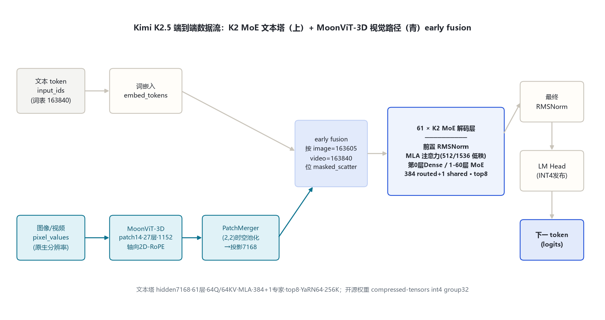
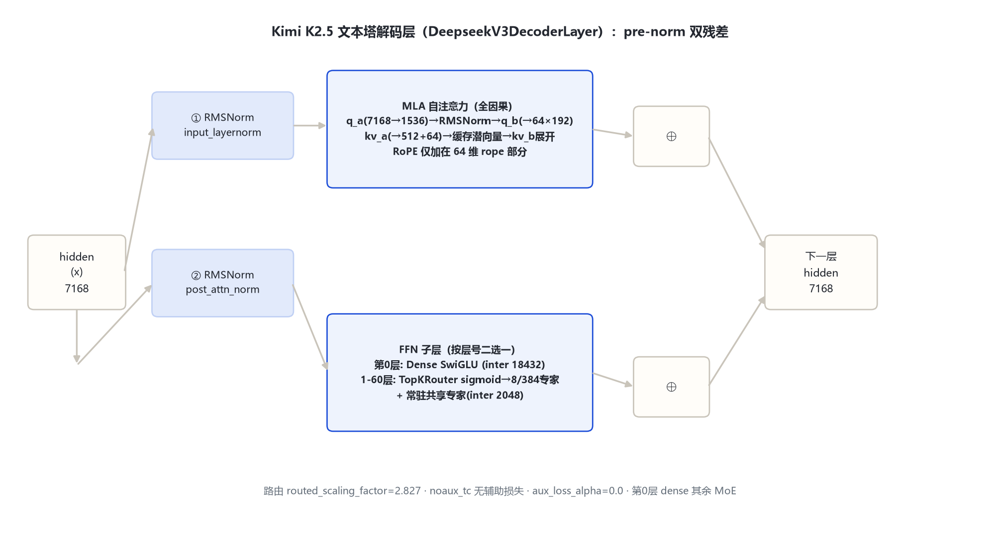

# Kimi K2.5 家族架构详解

> 官方 HF 仓库：moonshotai/Kimi-K2.5（远端官方 config：hf-mirror.com 镜像拉取，2026-10-31）；技术报告：arXiv:2602.02276《Kimi K2.5: Visual Agentic Intelligence》；文本塔实现：transformers `src/transformers/models/deepseek_v3/`（K2.5 config 的 text_config.model_type 被本仓库重写为 `deepseek_v3`）；多模态包装：transformers `src/transformers/models/kimi_k25/`。本机 E:\models 无该模型权重，全部 config 数值以远端官方 config.json 为准。

## 1. 家族全景

Kimi K2.5 是 Moonshot AI 于 2026 年发布的**原生多模态智能体模型**，在 Kimi K2（1.04T 总参 / 32B 激活的 MoE 文本底座）之上加入自研视觉编码器 MoonViT-3D，构形为「视觉塔 + MLP 投影器 + K2 MoE 文本塔」三段式，与上一代 Kimi-VL 的设计原则一脉相承（论文 §4.2）。开源权重为 **INT4 量化发布版**（config 内 `quantization_config: compressed-tensors, bits=4, group_size=32, dynamic, act-order, weight-only`；注意力/共享专家/dense lm_head/视觉塔免量化），BF16 全精度官方未释出。

一句话：**文本塔沿用 K2-0905 的 DeepSeek-V3 系 MLA + 384 专家 MoE（7168 hidden / 61 层），新增 MoonViT-3D 视觉塔（patch14 / 27 层 / 1152 hidden）与 PatchMerger 投影器**；transformers 入口类 `KimiK25ForConditionalGeneration`（model_type `kimi_k25`）。

### 1.1 官方 config 关键实参（来源：远端官方 config：moonshotai/Kimi-K2.5/config.json，2026-10-31 拉取）

| 字段 | 取值 | 来源 |
|---|---|---|
| architectures | `KimiK25ForConditionalGeneration` | 官方 config |
| model_type | `kimi_k25` | 官方 config |
| text_config.model_type | `kimi_k2` → 运行时重写为 `deepseek_v3` | 官方 config + 源码：models\kimi_k25\configuration_kimi_k25.py:53-63 |
| num_hidden_layers | 61 | 官方 config text_config |
| hidden_size | 7168 | 官方 config text_config |
| num_attention_heads (Q) | 64 | 官方 config text_config |
| num_key_value_heads (KV) | 64 | 官方 config text_config |
| kv_lora_rank / q_lora_rank | 512 / 1536 | 官方 config text_config |
| qk_nope_head_dim / qk_rope_head_dim / v_head_dim | 128 / 64 / 128 | 官方 config text_config |
| n_routed_experts / n_shared_experts | 384 / 1 | 官方 config text_config |
| num_experts_per_tok | 8 | 官方 config text_config |
| moe_intermediate_size | 2048 | 官方 config text_config |
| first_k_dense_replace | 1（第 0 层为 dense FFN） | 官方 config text_config |
| intermediate_size（dense） | 18432 | 官方 config text_config |
| routed_scaling_factor | 2.827 | 官方 config text_config |
| scoring_func / topk_method | sigmoid / noaux_tc（无辅助路由损失） | 官方 config text_config |
| rope_theta | 50000 | 官方 config text_config |
| rope_scaling | YaRN factor=64, original_max_position=4096, beta_fast=32, beta_slow=1 | 官方 config text_config |
| max_position_embeddings | 262144（256K） | 官方 config text_config |
| vocab_size | 163840 | 官方 config text_config |
| tie_word_embeddings（text_config） | false | 官方 config text_config |
| bos / eos / pad token id | 163584 / 163585 / 163839 | 官方 config text_config |
| vision_config（是否存在） | 有（见 §6 多模态） | 官方 config 顶层 |
| quantization | compressed-tensors int4 group32 dynamic act-order weight-only | 官方 config quantization_config |
| image / video / vision_start / vision_end token id | 163605 / 163840 / 163602 / 163604 | 官方 config 顶层字段 + 源码：configuration_kimi_k25.py:25-29 |

### 1.2 端到端总览

文本 token 与图像/视频像素两路并行进入：文本走 embed_tokens，视觉走 MoonViT-3D 编码后经 PatchMerger 投影到 7168 维，在 embedding 层按 `image_token_id=163605` / `video_token_id=163840` 占位位 masked_scatter 填入文本序列，随后由 61 层 K2 MoE 文本塔自回归解码（源码：models\kimi_k25\modeling_kimi_k25.py:686-720）。

## 2. 总体设计

K2.5 的架构由三段组成，全部可在官方 config 与源码中逐字段锚定：

1. **MoonViT-3D 视觉塔**（`Kimi_K25VisionModel`）：patch 14×14、27 层、hidden 1152、16 头、FFN 4304、gelu_pytorch_tanh，双向（非因果）注意力，轴向 2D-RoPE，初始化自 SigLIP-SO-400M（论文 §4.2）；
2. **PatchMerger 投影器**（`Kimi_K25MultimodalProjection`）：先 LayerNorm，再把 merge_kernel (2,2) 展开的 4×1152=4608 维经 in_proj→GELU→out_proj 投到文本 hidden 7168（源码：modeling_kimi_k25.py:554-572）；
3. **K2 MoE 文本塔**（`AutoModel` 按 text_config 实例化为 DeepseekV3 系 CausalLM）：MLA 压缩注意力 + 384 routed 专家 MoE，第 0 层 dense，1–60 层 MoE。

关键设计取舍（论文 §2/§4.3）：视觉塔与文本塔**从预训练早期就按固定比例混合共训**（early fusion、低视觉比例），而非传统「文本训完再后期加视觉」；视觉塔先用 caption loss 对齐到 Moonlight-16B-A3B（约 1T token），再短训投影器桥接到 1T 文本塔，最后联合预训练约 15T 视觉-文本 token，长文本段用 YaRN 从 32K 扩到 262144。

## 3. 解码层解剖

文本塔解码层即 DeepseekV3DecoderLayer（源码：models\deepseek_v3\modeling_deepseek_v3.py:485-529），pre-norm 双残差块：

- `input_layernorm`（RMSNorm）→ MLA 自注意力 → 残差相加；
- `post_attention_layernorm`（RMSNorm）→ FFN（第 0 层 SwiGLU dense；1–60 层为 MoE）→ 残差相加。

MoE 判定条件为 `layer_idx >= first_k_dense_replace(=1)`（modeling_deepseek_v3.py:492）。FFN 子层：

- **Dense（第 0 层）**：SwiGLU，gate/up/down 三矩阵，intermediate 18432（7168×18432×3）；
- **MoE（1–60 层）**：TopKRouter 选出 8 个 routed 专家（每专家 SwiGLU，intermediate 2048），输出加权求和后**再加一路共享专家**（shared_experts，intermediate = 2048×1 = 2048）（源码：modeling_deepseek_v3.py:201-222）。

## 4. 核心机制

### 4.1 无辅助损失的 sigmoid 路由 + NoauxTC 分组选专家

路由打分不用 softmax 而用 **sigmoid**（源码：modeling_deepseek_v3.py:136），并带 e_score_correction_bias 修正项（:137）；选专家流程为：先按「组内 top-2 分数之和」选 group（n_group=1，本 config 退化为单组），再在掩码后的分数上 top-8（:138-152），随后对选中权重做 softmax 归一化（:154-156），最后乘 `routed_scaling_factor=2.827`（:157）。config 显式 `scoring_func=sigmoid`、`topk_method=noaux_tc`、` routed_score_correction_bias=true`、`aux_loss_alpha=0.0`——**路由辅助损失关闭**，负载均衡靠 bias 修正项完成。

### 4.2 共享专家（shared expert）常驻全 token

与 routed 专家的「8/384 稀疏激活」不同，共享专家（`n_shared_experts=1`，intermediate 2048）对每个 token 都前向一次，输出直接与 routed 专家加权和相加（modeling_deepseek_v3.py:220-221）。它承载跨专家共享的通用知识，是 DeepSeek-V3 系的标志性结构。

### 4.3 投影器：PatchMerger（SD2 tpool）

视觉塔输出先按 merge_kernel_size (2,2) 做时空均值池化（空间 2×2 + 时间 2×2，token 数压到 1/4；源码：modeling_kimi_k25.py:545-546, 145-157），再过 `pre_norm(LN 1152) → in_proj Linear(4608→4608) → GELU → out_proj Linear(4608→7168)`（modeling_kimi_k25.py:560-564）。config 字段 `mm_projector_type=patchmerger`、`merge_type=sd2_tpool`、`temporal_pool_type=average`。

## 5. 注意力

文本塔注意力为 **MLA（Multi-head Latent Attention）**，无滑窗、全因果注意力，无 GQA 头数缩减（Q/KV 均 64 头），但通过低秩潜向量大幅压缩 KV cache：

- Query 侧：`q_a_proj`（7168→1536）→ RMSNorm → `q_b_proj`（1536→64×(128+64)），即 q_lora_rank=1536（源码：modeling_deepseek_v3.py:375-385, 440）；
- KV 侧：`kv_a_proj_with_mqa`（7168→512+64）拆出 512 维潜向量（RMSNorm）与 64 维 RoPE 部分；缓存只存压缩后的 512+64 维潜向量，解码时再由 `kv_b_proj`（512→64×(128+128)）展开（modeling_deepseek_v3.py:387-397, 407-424, 444-463）；
- RoPE 只加在 q/k 的 64 维 rope 部分（qk_rope_head_dim=64），nope 部分（128）不加位置编码；
- 缩放因子经 YaRN mscale 修正（`yarn_apply_mscale`，:405）。

K2 文本塔**不是**线性注意力/混合线性注意力——线性注意力（Kimi Delta Attention, KDA）属于另一独立家族 Kimi-Linear-48B-A3B（transformers `models/kimi_linear/`），K2.5 未引入。注意力类型以 config 字段核验：标准 MLA 因果全注意力。

## 6. 多模态：MoonViT-3D 视觉塔与 token 流

> 官方无独立「Kimi-K2-VL」HF 仓库；K2 代多模态能力即由本模型（KimiK25ForConditionalGeneration，config 内嵌完整 vision_config）承载，同架构亦用于 Kimi-K2.6。本章按 vision_config 逐字段标注。

### 6.1 视觉塔实参（来源：远端官方 config：moonshotai/Kimi-K2.5/config.json 的 vision_config）

| 字段 | 取值 | 说明 |
|---|---|---|
| model_type | `kimi_k25_vision` | 官方 config vision_config |
| patch_size | 14 | 官方 config |
| vt_hidden_size | 1152 | 官方 config |
| vt_num_layers | 27 | 官方 config |
| vt_num_attention_heads | 16 | 官方 config |
| vt_intermediate_size | 4304 | 官方 config |
| vt_hidden_act | gelu_pytorch_tanh | 官方 config |
| init_pos_embedding | [64, 64, 4]（h×w×time） | 官方 config |
| rope_parameters.rope_type | axial（2D 轴向 RoPE） | 官方 config + 源码：configuration_kimi_k25.py:173-190 |
| mm_vision_select_layer_idx | -1（取视觉塔最后一层） | 官方 config |
| merge_kernel_size | (2, 2) | 官方 config |
| spatial_merge_size / temporal_merge_size | 2 / 2 | 官方 config |
| merge_type / temporal_pool_type | sd2_tpool / average | 官方 config |
| mm_projector_type / projector_hidden_act / projector_ln_eps | patchmerger / gelu / 1e-5 | 官方 config |
| text_hidden_size / mm_hidden_size | 7168 / 1152 | 官方 config |

### 6.2 原生分辨率与 NaViT patch packing

视觉塔**不做固定分辨率 resize、不切 tile 拼接**（论文 §4.2：native-resolution，免去复杂子图切拼）。预处理按总 patch 预算 `max_patches=16384` 与单边预算等比缩放到 patch 整数倍（源码：models\kimi_k25\image_processing_kimi_k25.py:50-97，`navit_resize`），随后 patchify 打平成 1D 序列、多图按序列拼接（NaViT packing），注意力用 cu_seqlens 变长掩码在批内区分不同图（modeling_kimi_k25.py:362-390）。位置编码为 64×64 可学习 2D 网格，超过网格时双三次插值扩网格（modeling_kimi_k25.py:117-159）。

### 6.3 图像/视频 token 流

- **图像**：H×W×3 → patch14 → grid_h×grid_w 个 patch → 27 层双向视觉 Transformer → 2×2 空间池化 → (grid_h/2)(grid_w/2) 个视觉 token → 投影到 7168 维 → 在 `<|image_pad|>`(id=163605) 占位位 masked_scatter 填入文本序列（modeling_kimi_k25.py:705-720）。
- **视频**：最多 4 帧为一组时空体积，与图像共享同一套权重（MoonViT-3D，论文 §4.2）；投影前做时间均值池化实现 **4× 时间压缩**，同上下文可处理 4× 长视频；多帧时叠加正弦时间位置表（modeling_kimi_k25.py:131-137）。
- 特殊 token：vision_start=163602、vision_end=163604、image=163605、video=163840（源码：configuration_kimi_k25.py:25-29）。

## 7. Token 与词表

词表 163840（官方 config）。特殊 token：bos=163584、eos=163585（K2.5；K2-Thinking 为 163586）、pad=163839；视觉四元组 vision_start=163602 / image=163605 / video=163840 / vision_end=163604。上下文 262144（YaRN factor 64 从 4096 原始长度外推，长文本中训练阶段 32K→262144 渐进激活）。

## 8. 演进

- **Kimi K2 / K2-0905（2025-07/09）**：1.04T-A32B 纯文本 MoE，DeepSeek-V3 系 MLA + 384 专家 top-8，本目录的文本塔即其直接继承（规格已由同项目另一执行者核验：model_type=kimi_k2、DeepseekV3ForCausalLM、7168/61 层、MLA 同维、rope θ5e4 + YaRN64、max_position 262144、vocab 163840、tie=false、fp8 e4m3；K2 论文 arXiv:2507.20534）。
- **Kimi K2.5（2026，本目录）**：在 K2 文本底座上 early-fusion 联合预训练 MoonViT-3D，变为原生多模态智能体模型；新增视觉塔 + PatchMerger，开源权重改 INT4 发布；路由 routed_scaling_factor 2.827、YaRN beta_fast=32。
- **同代兄弟**：Kimi-K2.6（同 kimi_k25 架构，config 与 K2.5 基本一致，eos=163586）、Kimi-K2-Thinking（见独立目录）、Kimi-K2.7-Code / Kimi-K3（官方仓库已实证存在，本次未单独立目录）。
- **系列内其他官方模型（本次未单独立目录）**：Kimi-K2-Base/Instruct(-0905)、Kimi-K2.6、Kimi-K2.7-Code、Kimi-K3、Kimi-Linear-48B-A3B（KDA 混合线性注意力，独立模块 models\kimi_linear\）、Kimi-VL-A3B-Instruct/Thinking(-2506)（上代小尺寸 VL，文本塔 hidden 2048/64 专家）、Moonlight-16B-A3B（K2.5 视觉塔首阶段对齐底座）。

## 9. 参考文献

1. 远端官方 config：https://hf-mirror.com/moonshotai/Kimi-K2.5/raw/main/config.json（留档：本目录 _tools/_cfgpull/config.Kimi-K2.5.json，拉取 2026-10-31）
2. 官方模型卡/仓库：https://huggingface.co/moonshotai/Kimi-K2.5
3. Kimi K2.5 技术报告：arXiv:2602.02276《Kimi K2.5: Visual Agentic Intelligence》
4. Kimi K2 技术报告：arXiv:2507.20534
5. transformers 源码（本机 E:\transformers 可编辑安装）：
   - models\kimi_k25\configuration_kimi_k25.py、modeling_kimi_k25.py、image_processing_kimi_k25.py
   - models\deepseek_v3\configuration_deepseek_v3.py、modeling_deepseek_v3.py
6. MoonViT / Kimi-VL 视觉塔设计参考：https://huggingface.co/moonshotai/Kimi-VL-A3B-Instruct
