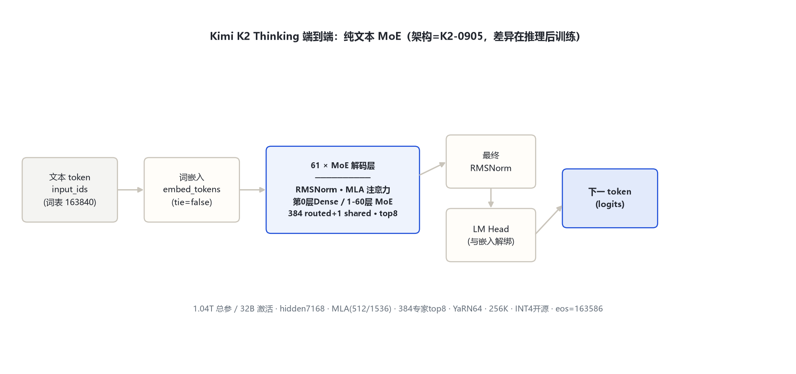
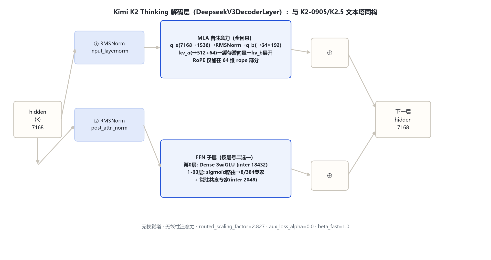

# Kimi K2 Thinking 家族架构详解

> 官方 HF 仓库：moonshotai/Kimi-K2-Thinking（远端官方 config：hf-mirror.com 镜像拉取，2026-10-31）；文本塔实现：transformers `src/transformers/models/deepseek_v3/`（config.model_type=kimi_k2，architectures=DeepseekV3ForCausalLM，复用 DeepSeek-V3 实现代码）。本机 E:\models 无该模型权重，全部 config 数值以远端官方 config.json 为准。

## 1. 家族全景

Kimi K2 Thinking 是 Kimi K2（2025-09-05 发布的 K2-Instruct 同底座）的**推理（reasoning）变体**：架构与 K2-0905 文本底座**逐字段一致**，差异在后训练阶段——通过长思维链（long CoT）SFT + 强化学习激发出「先思考再回答」的推理行为。它是纯文本模型，**不带视觉塔**（config 无 vision_config）。

一句话：**DeepSeek-V3 系 MLA + 384 专家 MoE（7168 hidden / 61 层 / top-8）的 1.04T-A32B 文本塔，INT4 量化开源，专为长链推理训练**；transformers 直接用 `DeepseekV3ForCausalLM` 加载。

### 1.1 官方 config 关键实参（来源：远端官方 config：moonshotai/Kimi-K2-Thinking/config.json，2026-10-31 拉取）

| 字段 | 取值 | 来源 |
|---|---|---|
| architectures | `DeepseekV3ForCausalLM` | 官方 config |
| model_type | `kimi_k2` | 官方 config |
| num_hidden_layers | 61（第 0 层 dense） | 官方 config |
| hidden_size | 7168 | 官方 config |
| num_attention_heads (Q) / num_key_value_heads (KV) | 64 / 64 | 官方 config |
| kv_lora_rank / q_lora_rank | 512 / 1536 | 官方 config |
| qk_nope_head_dim / qk_rope_head_dim / v_head_dim | 128 / 64 / 128 | 官方 config |
| n_routed_experts / n_shared_experts | 384 / 1 | 官方 config |
| num_experts_per_tok | 8 | 官方 config |
| moe_intermediate_size | 2048 | 官方 config |
| first_k_dense_replace | 1 | 官方 config |
| intermediate_size（dense） | 18432 | 官方 config |
| routed_scaling_factor | 2.827 | 官方 config |
| scoring_func / topk_method | sigmoid / noaux_tc（无辅助路由损失） | 官方 config |
| n_group / norm_topk_prob | 1 / true | 官方 config |
| rope_theta | 50000 | 官方 config |
| rope_scaling | YaRN factor=64, original_max_position=4096, beta_fast=1.0, beta_slow=1.0 | 官方 config |
| max_position_embeddings | 262144（256K） | 官方 config |
| vocab_size | 163840 | 官方 config |
| tie_word_embeddings | false | 官方 config |
| bos / eos / pad token id | 163584 / **163586** / 163839 | 官方 config |
| quantization | compressed-tensors int4 group32 dynamic act-order weight-only | 官方 config quantization_config |
| num_nextn_predict_layers | 0（无 EAGN 扩展预训练层） | 官方 config |

> 与 Kimi K2.5 文本塔的差异：① 无 vision_config（纯文本）；② eos_token_id=163586（K2.5 为 163585）；③ YaRN beta_fast=1.0（K2.5 为 32）；④ 顶层无视觉四元组 token。其余 MLA/MoE/层数/hidden/词表完全一致。

### 1.2 端到端总览

纯文本自回归：input_ids → embed_tokens → 61 层 DeepseekV3 系解码层（第 0 层 dense SwiGLU，1–60 层 384 选 8 + 1 共享专家 MoE）→ 最终 RMSNorm → lm_head（与 embedding 解绑）→ 下一 token logits。

## 2. 总体设计

Thinking 变体的架构本体即 K2-0905 文本底座，三段式为：词嵌入 → 61 层 MoE 解码塔 → 解码头。它不引入新结构，所有架构字段与 K2-0905 一致（K2-0905 已核验规格：model_type=kimi_k2、DeepseekV3ForCausalLM、7168/61 层、64Q/64KV、MLA 512/1536/128/64/128、384+1 专家 top-8、first_k_dense_replace=1、moe_intermediate 2048、rope θ5e4 + YaRN factor64、max_position 262144、vocab 163840、tie=false、fp8 e4m3；K2 论文 arXiv:2507.20534）。**与 K2.5 的关系：Thinking 是 K2 底座的纯文本推理版，K2.5 是同一底座的多模态智能体版**——二者共享文本塔，差异只在视觉塔有无与后训练目标。

## 3. 解码层解剖

文本塔解码层即 DeepseekV3DecoderLayer（源码：models\deepseek_v3\modeling_deepseek_v3.py:485-529），pre-norm 双残差块：

- `input_layernorm`（RMSNorm）→ MLA 自注意力 → 残差相加；
- `post_attention_layernorm`（RMSNorm）→ FFN → 残差相加。

FFN 子层按层号二选一：第 0 层 dense SwiGLU（intermediate 18432）；1–60 层 MoE——TopKRouter 选 8 个 routed 专家（每专家 SwiGLU，intermediate 2048）加权求和，再叠加一路常驻共享专家（intermediate 2048）（modeling_deepseek_v3.py:201-222, 492-495）。

## 4. 核心机制

### 4.1 sigmoid 无辅助损失路由 + NoauxTC

路由用 sigmoid 打分（modeling_deepseek_v3.py:136）带 e_score_correction_bias 修正（:137）；n_group=1 时退化为直接在全部 384 专家上 top-8（:152），选中权重归一化后乘 routed_scaling_factor=2.827（:157）。config `aux_loss_alpha=0.0`——关闭路由辅助损失，靠 bias 项做负载均衡。

### 4.2 共享专家常驻

`n_shared_experts=1` 的共享专家对每 token 都前向一次，与 routed 专家加权和相加（modeling_deepseek_v3.py:220-221），承载通用知识。

### 4.3 推理训练差异（架构外、后训练内）

Thinking 变体的「差异」不在 config 字段，而在后训练：以长思维链数据做 SFT，再用 RL 激发出先思考后回答的行为；推理时输出更长的内部推理 token。config 层面无 reasoning 专用开关字段（无 nextn 预测层、无特殊 thinking token 配置），思维链由对话模板与训练数据决定。

## 5. 注意力

MLA（Multi-head Latent Attention），全因果、无滑窗、Q/KV 均 64 头（不做 GQA 头数缩减），靠低秩潜向量压缩 KV cache：

- Query：q_a_proj(7168→1536) → RMSNorm → q_b_proj(1536→64×192)（modeling_deepseek_v3.py:375-385, 440）；
- KV：kv_a_proj_with_mqa(7168→512+64)，512 维潜向量过 RMSNorm，64 维走 RoPE；缓存只存压缩潜向量，解码时 kv_b_proj(512→64×256) 展开（:387-397, 407-424, 444-463）；
- RoPE 仅加在 64 维 rope 部分，缩放经 YaRN mscale 修正（:405）。

注意力类型以 config 字段核验：标准 MLA 因果全注意力，**非**线性注意力/混合线性注意力（线性注意力 KDA 属 Kimi-Linear 家族）。

## 6. Token 与词表

词表 163840（官方 config）。特殊 token：bos=163584、eos=163586、pad=163839。上下文 262144（YaRN factor 64，original_max_position 4096，beta_fast/beta_slow 均为 1.0）。无视觉 token（无 image/video/vision_start/vision_end）。

## 7. 演进

- **Kimi K2 / K2-0905（2025-07/09）**：1.04T-A32B 纯文本 MoE，DeepSeek-V3 系 MLA + 384 专家 top-8（规格见 §1.1 与 K2 论文 arXiv:2507.20534）。
- **Kimi K2 Thinking（本目录）**：同架构底座的推理后训练变体，开源 INT4 权重；eos 改为 163586，YaRN beta_fast=1.0。
- **Kimi K2.5（2026）**：同一文本塔加 MoonViT-3D 视觉塔，变原生多模态智能体模型（见 kimi_k2_5 目录）。
- **系列内其他官方模型（本次未单独立目录）**：Kimi-K2-Base/Instruct(-0905)、Kimi-K2.5、Kimi-K2.6、Kimi-K2.7-Code、Kimi-K3、Kimi-Linear-48B-A3B（KDA 混合线性注意力）、Kimi-VL-A3B-Instruct/Thinking(-2506)、Moonlight-16B-A3B。

## 8. 参考文献

1. 远端官方 config：https://hf-mirror.com/moonshotai/Kimi-K2-Thinking/raw/main/config.json（留档：本目录 _tools/_cfgpull/config.Kimi-K2-Thinking.json，拉取 2026-10-31）
2. 官方模型卡/仓库：https://huggingface.co/moonshotai/Kimi-K2-Thinking
3. Kimi K2 技术报告：arXiv:2507.20534
4. transformers 源码（本机 E:\transformers 可编辑安装）：models\deepseek_v3\configuration_deepseek_v3.py、modeling_deepseek_v3.py
