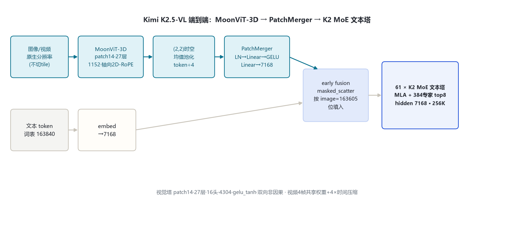
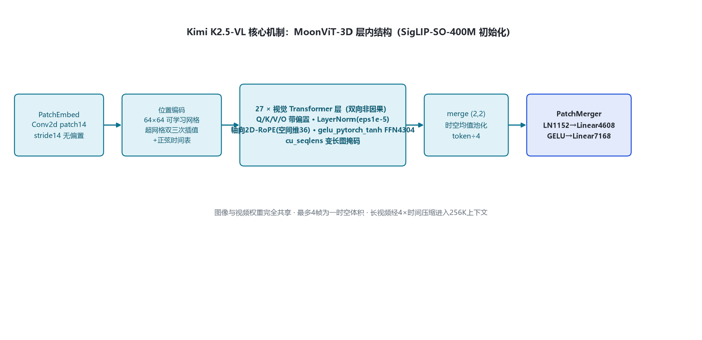
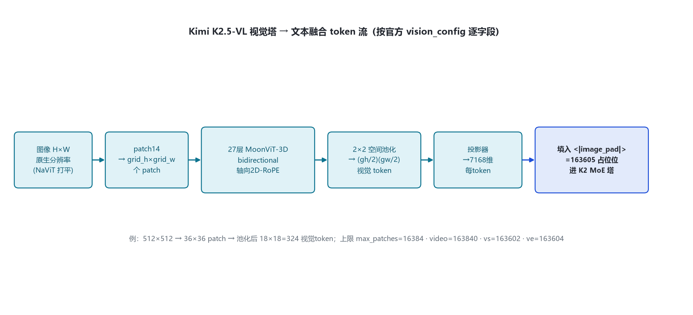

# Kimi K2.5-VL 多模态架构详解

> 命名核验说明：官方 HF 组织 2026-10-31 实测**无独立「Kimi-K2-VL」仓库**；K2 代多模态（VL）能力即由 `moonshotai/Kimi-K2.5`（`KimiK25ForConditionalGeneration`，config 内嵌完整 vision_config）承载，NVIDIA 文档称之为 "Kimi-K25-VL"。本目录聚焦其视觉塔与多模态 token 流，文本塔与 kimi_k2_5 目录同源。远端官方 config：hf-mirror.com 拉取（2026-10-31）；技术报告：arXiv:2602.02276 §4.2；视觉实现：transformers `models\kimi_k25\`。

## 1. 家族全景

K2.5-VL 采用「**MoonViT-3D 视觉编码器 + PatchMerger MLP 投影器 + K2 MoE 文本塔**」三段式，沿袭 Kimi-VL 的设计原则（论文 §4.2）。视觉塔初始化自 SigLIP-SO-400M，原生分辨率输入、NaViT patch packing，图像/视频权重完全共享，视频经 4× 时间压缩在同上下文处理 4× 长视频。

### 1.1 视觉塔 + 文本塔实参对照（来源：远端官方 config：moonshotai/Kimi-K2.5/config.json，2026-10-31 拉取）

| 部件 | 字段 | 取值 | 来源 |
|---|---|---|---|
| 视觉塔 | model_type | `kimi_k25_vision` | 官方 config vision_config |
| 视觉塔 | patch_size | 14 | 官方 config |
| 视觉塔 | vt_hidden_size | 1152 | 官方 config |
| 视觉塔 | vt_num_layers | 27 | 官方 config |
| 视觉塔 | vt_num_attention_heads | 16 | 官方 config |
| 视觉塔 | vt_intermediate_size | 4304 | 官方 config |
| 视觉塔 | vt_hidden_act | gelu_pytorch_tanh | 官方 config |
| 视觉塔 | init_pos_embedding | [64,64,4]（h×w×time） | 官方 config |
| 视觉塔 | rope_type | axial（2D 轴向 RoPE） | 官方 config + 源码：configuration_kimi_k25.py:173-190 |
| 视觉塔 | mm_vision_select_layer_idx | -1（取最后一层） | 官方 config |
| 投影器 | mm_projector_type | patchmerger（SD2 tpool） | 官方 config |
| 投影器 | merge_kernel_size | (2,2)（空间 2×2 + 时间 2×2） | 官方 config |
| 投影器 | spatial/temporal_merge_size | 2 / 2 | 官方 config |
| 投影器 | temporal_pool_type | average（时间均值池化） | 官方 config |
| 投影器 | projector_hidden_act / projector_ln_eps | gelu / 1e-5 | 官方 config |
| 投影器 | text_hidden_size / mm_hidden_size | 7168 / 1152 | 官方 config |
| 文本塔 | architectures | `KimiK25ForConditionalGeneration`（内含 DeepSeek-V3 系 CausalLM） | 官方 config 顶层 |
| 文本塔 | layers / hidden / heads | 61 / 7168 / 64Q-64KV | 官方 config text_config |
| 文本塔 | MLA | kv_lora 512 / q_lora 1536 / nope128 / rope64 / v128 | 官方 config text_config |
| 文本塔 | MoE | 384 routed + 1 shared，top-8，moe_inter 2048，first_k_dense 1 | 官方 config text_config |
| 文本塔 | max_position / vocab | 262144 / 163840 | 官方 config text_config |
| 特殊 token | image / video / vision_start / vision_end | 163605 / 163840 / 163602 / 163604 | 官方 config 顶层 + 源码：configuration_kimi_k25.py:25-29 |

### 1.2 端到端总览

图像/视频像素 → MoonViT-3D（patch14 → 27 层双向 Transformer → 轴向 2D-RoPE）→ (2,2) 时空均值池化 → PatchMerger 投影到 7168 → 在 image/video 占位位 masked_scatter 填入文本 embedding → 61 层 K2 MoE 文本塔自回归解码。

## 2. 总体设计

三段式的分工（论文 §4.2）：

1. **MoonViT-3D**：原生分辨率视觉编码器，NaViT patch packing，图像与视频共享全部权重；初始化自 SigLIP-SO-400M；
2. **PatchMerger**：视觉 token 压缩并对齐到文本 hidden；
3. **K2 MoE 文本塔**：与 K2.5/K2-Thinking 同构（MLA + 384 专家）。

训练流水线（论文 §4.3）：① 先单训视觉塔——用 caption loss 对齐到 Moonlight-16B-A3B（约 1T token，只更视觉塔）；② 短训投影器桥接到 1T 文本塔；③ 联合预训练约 15T 视觉-文本 token（4K 长度，early fusion 固定低视觉比例）；④ 长文本中训练用 YaRN 32K→262144。

## 3. 视觉塔/解码层解剖

视觉塔 `Kimi_K25VisionModel`（源码：modeling_kimi_k25.py:469-551）逐层结构：

- PatchEmbed：Conv2d patch14×14， stride 14，无偏置（:162-174）；
- 位置编码：可学习 64×64×1152 网格，超网格双三次插值（:117-159）；视频加正弦时间位置表（:131-137）；
- 27 层 `VisionEncoderLayer`：双向（非因果）自注意力（Q/K/V/O 均带偏置）+ LayerNorm（非 RMSNorm，eps 1e-5）+ gelu_pytorch_tanh FFN（:394-416）；
- 注意力内用轴向 2D-RoPE：head_dim=1152/16=72，空间维 spatial_dim=36（:177-235, 345-352）；
- 输出端 final LayerNorm，再过 merge_kernel (2,2) 时空均值池化（:545-546）。

文本塔解码层与 K2.5/K2-Thinking 完全一致（pre-norm 双残差，第 0 层 dense SwiGLU，1–60 层 MoE），此处不重复，详见 kimi_k2_5 目录 §3。

## 4. 核心机制

### 4.1 原生分辨率 + NaViT packing（不切 tile）

视觉塔不做固定分辨率 resize、不切子图拼接（论文 §4.2）。预处理按总 patch 预算 max_patches=16384 与单边预算等比缩放到 patch 整数倍（源码：image_processing_kimi_k25.py:50-97 navit_resize），patchify 打平成 1D 序列后多图 concat，注意力用 cu_seqlens 变长掩码在批内区分不同图（modeling_kimi_k25.py:362-390）——这是与「切 tile + 缩略图」路线（如 InternVL）的本质区别。

### 4.2 PatchMerger：时空 4× token 压缩

投影前按 merge_kernel_size (2,2) 做空间 2×2 + 时间 2×2 均值池化，token 数压到 1/4（modeling_kimi_k25.py:545-546, 145-157）；再过 pre_norm(LN 1152) → in_proj Linear(4608→4608) → GELU → out_proj Linear(4608→7168)（:560-564）。自核算投影器约 54M 参数（4608×4608 + 4608×7168 ≈ 54M）。

### 4.3 masked_scatter 融合

语言模型 forward 内：把投影后视觉特征按 image_token_id=163605 / video_token_id=163840 的占位位置，用 masked_scatter 替换进 embedding（:686-720）；单帧视频的时间位置表用零行填充（:131-137）。

## 5. 注意力

- **视觉塔**：双向非因果全注意力，Q/K/V/O 带偏置，轴向 2D-RoPE（空间维 36），变长序列 cu_seqlens 掩码（:307-391）；
- **文本塔**：MLA 全因果注意力（kv_lora 512/q_lora 1536，64 维 rope 部分），与 K2.5/K2-Thinking 同（见 kimi_k2_5 §5）。

## 6. 多模态 token 流

### 6.1 图像 token 数估算

图像 H×W → patch14 → grid_h=H/14, grid_w=W/14；经 2×2 空间池化后视觉 token 数 = (grid_h/2)×(grid_w/2)。例：512×512 图 → 36×36=1296 patch → 池化后 18×18=324 个视觉 token，每个 7168 维。实际输入受 max_patches=16384（池化前 patch 数预算）约束。

### 6.2 视频 token 流（MoonViT-3D）

最多 4 帧为一组时空体积，与图像共享同一权重、同一注意力跨时空；投影前时间均值池化实现 4× 时间压缩，使同上下文可处理 4× 长视频（论文 §4.2）。多帧叠加正弦时间位置表。

### 6.3 特殊 token 与融合

vision_start=163602 起、vision_end=163604 收，中间 image=163605 / video=163840 占位；视觉特征在 embedding 层 masked_scatter 填入，之后与文本 token 一起进入 MoE 塔（early fusion）。

## 7. Token 与词表

文本词表 163840；视觉四元组 163602/163605/163840/163604；bos=163584、eos=163585、pad=163839。上下文 262144（YaRN factor 64）。视觉 token 与文本 token 共享 262144 上下文预算。

## 8. 演进

- **Kimi-VL-A3B（上代，2025）**：小尺寸 VL，文本塔 hidden 2048/27 层/64 专家 top-6，同系 MoonViT（patch14/27 层/1152/4304）；本目录视觉塔即在其设计原则上扩展出 MoonViT-3D。
- **Kimi K2.5（2026，本目录对应模型）**：视觉塔换到 K2 的 7168/61 层 MoE 大文本塔，early-fusion 联合预训练；同架构亦用于 K2.6。
- **系列内其他官方模型（本次未单独立目录）**：Kimi-K2-Base/Instruct(-0905)、Kimi-K2.5、Kimi-K2.6、Kimi-K2.7-Code、Kimi-K3、Kimi-Linear-48B-A3B、Kimi-VL-A3B-Instruct/Thinking(-2506)、Moonlight-16B-A3B。

## 9. 参考文献

1. 远端官方 config：https://hf-mirror.com/moonshotai/Kimi-K2.5/raw/main/config.json（留档：本目录 _tools/_cfgpull/config.Kimi-K2.5.json，拉取 2026-10-31）
2. 官方模型卡/仓库：https://huggingface.co/moonshotai/Kimi-K2.5
3. Kimi K2.5 技术报告：arXiv:2602.02276《Kimi K2.5: Visual Agentic Intelligence》（§4.2 MoonViT-3D）
4. K2 文本塔论文：arXiv:2507.20534
5. transformers 源码（本机 E:\transformers 可编辑安装）：models\kimi_k25\configuration_kimi_k25.py、modeling_kimi_k25.py、image_processing_kimi_k25.py、video_processing_kimi_k25.py
6. 上代 VL 对照：https://huggingface.co/moonshotai/Kimi-VL-A3B-Instruct
