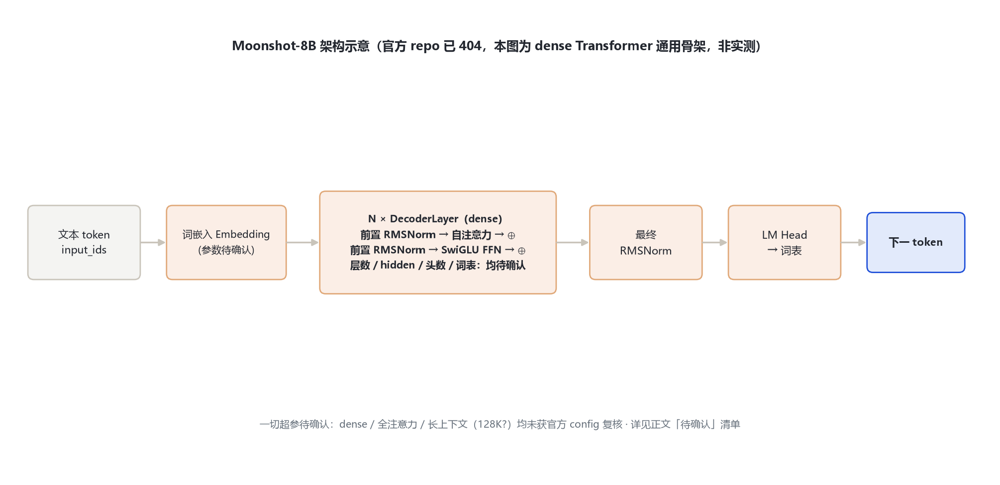

# Moonshot-8B 架构详解 — 官方 repo 已下架（404）· dense 规格待确认

- 徽标：目标仓库 MoonshotAI/Moonshot-8B —— **2026-10-31 经 hf-mirror / ModelScope 核验为 404（不存在或已下架）**
- 徽标：hf-mirror 组织列表共 19 个仓库，无 Moonshot-8B；全文搜索 / ModelScope / 社区镜像均无 config 留痕
- 徽标：Wayback Machine 在本网络不可达；论文候选号已勘误（见下）
- 徽标：以下任何架构数字均**未经官方 config 复核**，统一标「待确认」，不做编造

> **重要说明**：本笔记对应任务书指定的 `MoonshotAI/Moonshot-8B`。经多通道核验，该仓库在 HuggingFace（hf-mirror 镜像）与 ModelScope 均返回 404；moonshotai 组织当前公开的 19 个仓库中没有该模型。因此无法取得官方 `config.json`，本页只记录核验过程、可旁证的背景，以及「待确认」清单，**不臆造任何层数 / hidden / 词表 / RoPE 数值**。

## 1 家族全景：核验记录与「待确认」config 表

> 下表字段全部标注「待确认」。任务书最初提示「dense、全注意力、长上下文（128K？）、层数、hidden、词表、RoPE base、MLA 与否」，但这些均未获得官方 config 或 model card 复核。

| 字段 | 任务书提示 | 本笔记结论 | 来源状态 |
|---|---|---|---|
| 形态 | dense | 待确认 | 无 config / card 复核 |
| 注意力 | 全注意力 | 待确认（是否 MLA 未知） | 无 config 复核 |
| 上下文 | 128K？ | 待确认 | 无 card 复核 |
| num_hidden_layers | — | 待确认 | 无 config |
| hidden_size | — | 待确认 | 无 config |
| num_attention_heads / KV | — | 待确认 | 无 config |
| intermediate_size | — | 待确认 | 无 config |
| vocab_size | — | 待确认 | 无 config |
| max_position_embeddings | — | 待确认 | 无 config |
| rope_theta | — | 待确认 | 无 config |
| MoE / 专家配置 | 应为 dense（无 MoE） | 待确认 | 无 config |

### 1.1 已执行的核验通道与结果

| 通道 | 查询 | 结果 |
|---|---|---|
| hf-mirror 仓库直连 | `moonshotai/Moonshot-8B/resolve/main/config.json` | 404 |
| hf-mirror 变体 | `-Base` / `-Instruct` 后缀 | 均 404 |
| ModelScope | `moonshotai/Moonshot-8B` repo API | 404 |
| hf-mirror 组织列表 | `api/models?author=moonshotai` | 19 个仓库，无 Moonshot-8B |
| hf-mirror 全文搜索 | search=Moonshot-8B / Moonshot 8B | 0 命中 |
| Wayback Machine | web.archive.org 快照 | 本网络不可达（连接超时） |

## 2 端到端数据流总览（通用骨架，非该模型实测）

> 在无 config 的前提下，下图只画一个「dense Transformer」通用骨架（Embedding → N×DecoderLayer → RMSNorm → LM Head），用于占位；**图中所有超参均为待确认**。

### 2.1 架构图

## 3 解码层与核心机制（待确认）

> 因无官方实现代码或 config，无法给出该模型真实的归一化、激活、MoE 路由细节。参考同系列同期真实开源模型 Moonlight-16B-A3B（见 §6）的 DeepSeek-V3 式 MLA-MoE 结构，**不能直接套用到 Moonshot-8B**。

## 4 注意力机制（待确认）

> 任务书提示「全注意力」，但「是否 MLA、Q/KV 头数、head_dim」均无官方字段佐证。统一标待确认。

## 5 特殊 Token 与词表（待确认）

> vocab_size、bos/eos/pad id 均无官方字段。统一标待确认。

## 6 演进视角：Moonshot 早期真实开源模型对照

> moonshotai 组织在 2025 年初真实开源的文本/稀疏模型是 **Moonlight-16B-A3B**（2025-02/03，Muon 优化器首次大规模训练实践配套发布），并非名为「Moonshot-8B」的 dense 模型。其官方 config 实测值（留档 `_tools\_cfgpull\Moonlight-16B-A3B.config.json`）：

| 字段 | Moonlight-16B-A3B（真实存在） |
|---|---|
| model_type / architectures | deepseek_v3 / DeepseekV3ForCausalLM |
| hidden_size | 2048 |
| num_hidden_layers | 27 |
| num_attention_heads / KV | 16 / 16 |
| intermediate_size（dense） | 11264 |
| moe_intermediate_size | 1408 |
| n_routed_experts / n_shared_experts / top | 64 / 2 / 6 |
| MLA | kv_lora_rank 512 · q_lora_rank 无 · qk_nope 128 · qk_rope 64 · v_head 128 |
| vocab_size / max_position / rope_theta | 163840 / 8192 / 50000 |

> 说明：若任务书的「Moonshot-8B」实为对早期开源模型的误记，最接近的真实对象是 Moonlight-16B-A3B（16B 总 / 3B 激活 MoE，非 8B dense）。本页不做替换，仅作对照。系列内其他官方模型（Kimi-K2 系列、Kimi-Linear、Kimi-VL、Kimi-Audio、MoonViT 等）见 Kimi-K2-0905 笔记演进章。

## 7 来源

1. hf-mirror 组织仓库列表（2026-10-31 核验，19 个仓库无 Moonshot-8B）
   `https://hf-mirror.com/api/models?author=moonshotai`
2. hf-mirror / ModelScope 仓库直连（均 404）
   `https://hf-mirror.com/moonshotai/Moonshot-8B/resolve/main/config.json`；`https://modelscope.cn/api/v1/models/moonshotai/Moonshot-8B`
3. Moonlight-16B-A3B 官方 config（真实早期开源模型对照）
   `E:\transformers\bayon-note\Kimi\moonshot_32b_a32b\_tools\_cfgpull\Moonlight-16B-A3B.config.json`
4. Moonshot 官方技术博客：Muon 优化器首次大规模训练实践（Moonlight 模型）
   `https://platform.moonshot.cn/blog/posts/moonlight`
5. Kimi k1.5 技术报告（arXiv:2501.12599，未开放权重）
   `https://arxiv.org/abs/2501.12599`

> 勘误：任务书最初给出的候选论文号 arXiv:2501.08504 经核实为《SuperSAM: Crafting a SAM Supernetwork…》（医学图像分割），与 Moonshot 无关，不予引用。访问与核验日期：2026-10-31。

---

*页脚：Moonshot-8B 架构详解（官方 repo 已 404）· 数据来源：hf-mirror/ModelScope 核验记录 + Moonlight 官方 config 对照 · 未复核数字一律标待确认 · 仅供技术学习与论文研究*
