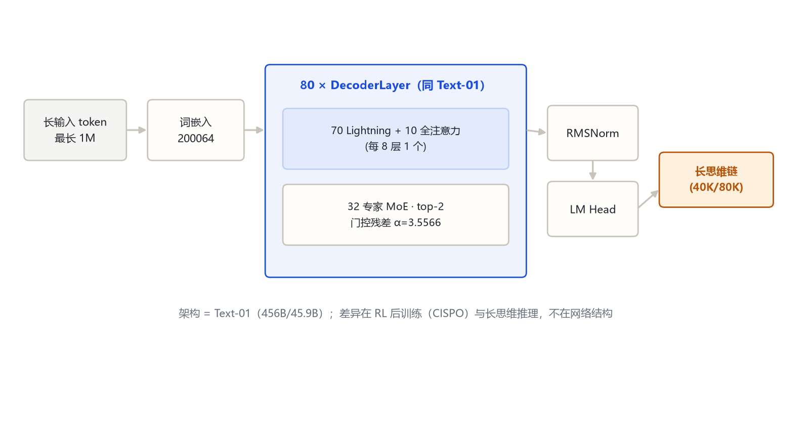
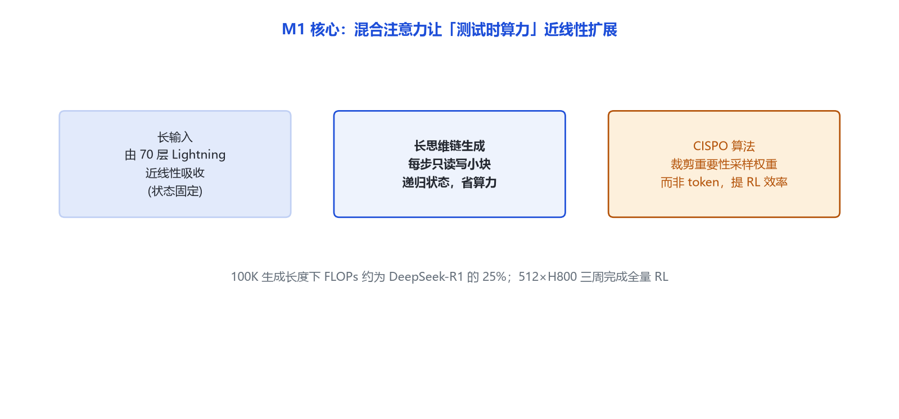

# MiniMax-M1 家族架构详解

> **一句话**：与 MiniMax-Text-01 **完全同构**的 456B-A45.9B MoE 权重——网络结构一个字段都没改，差异全在「用大规模 RL 把它练成世界首个开源大规模混合注意力长链推理模型」，原生支持 1M 上下文、40K/80K 思维预算。

## 一、家族全景

| 维度 | 官方取值 | 来源 |
|---|---|---|
| 总参 / 激活 | 456B 总参 / 约 45.9B 每 token | 论文 arXiv:2506.13585 |
| 架构类别 | decoder-only · MoE · 混合注意力（Lightning + Softmax） | 远端官方 config |
| 层数 / hidden | 80 层 / 6144 | 远端 config MiniMaxAI/MiniMax-M1 |
| 注意力头 / KV 头 | 64 / 8（GQA） | 远端 config |
| 头维 / RoPE 旋转维 | 128 / 64（部分旋转） | 远端 config |
| 路由专家 / top-k | 32 / 2 | 远端 config |
| 全注意力层位置 | 每 8 层 1 个（共 10 个），与 Text-01 完全一致 | 远端 config `attn_type_list` 逐条对齐 |
| RoPE 基频 | 1e7 | 远端 config |
| 门控残差 α | 3.5565588200778455 | 远端 config |
| 原生上下文 | 1,000,000（1M） | 论文摘要 |
| 思维预算 | 两个版本 40K / 80K thinking | 论文摘要 |
| 词表 | 200064 | 远端 config |

> **M1 vs Text-01 的 config 对比结论**：逐项 diff 后，`hidden_size / num_hidden_layers / num_attention_heads / num_key_value_heads / head_dim / intermediate_size / num_local_experts / num_experts_per_tok / rope_theta / rotary_dim / postnorm_alpha_factor / attn_type_list` 全部相同。**M1 不是改架构，是改训练目标**——在 Text-01 权重上做大规模强化学习（含沙箱软件工程环境）。
>
> 仓库 `MiniMaxAI/MiniMax-M1-80k` 与 `MiniMaxAI/MiniMax-M1` 的 config.json 字段一致；「80k」指 RL 阶段把生成长度扩到 80K 思维 token（见论文），不是网络/上下文配置差异。

代码入口：`MiniMaxM1ForCausalLM`（`model_type=minimax_m1`，远端 auto_map）。本地无独立 `models/minimax_m1` 模块，按「官方仓库实现 + 官方 config」双来源；其文本塔结构与本地 `models/minimax/` 模块一一对应。

## 二、端到端结构

输入最长 1M token，走与 Text-01 相同的 80 层堆叠，输出长思维链（最长 40K/80K）。

## 三、一层解码器

与 Text-01 完全相同：RMSNorm → Lightning/全注意力 → 门控残差 → RMSNorm → 32 专家 top-2 MoE → 门控残差。详见 `minimax_text_01` 第三节。

## 四、核心机制

M1 的「新机制」不在前向网络，而在**让混合注意力适配测试时算力（test-time compute）的扩展**：

- 长输入（1M）被 70 层 Lightning 压进固定大小的块递归状态，近线性吸收。
- 长思维链生成时，每步只对小块读写递归状态，开销不随已生成长度平方增长。论文口径：**100K 生成长度下 FLOPs 约为 DeepSeek-R1 的 25%**。
- RL 算法用 **CISPO**：裁剪重要性采样权重而非 token 更新，提升 RL 效率。全量 RL 在 512×H800 上三周完成。

## 五、注意力机制

与 Text-01 相同：70 层 Lightning 线性 + 10 层全 Softmax（每 8 层 1 个），部分 RoPE 64/128。

## 六、Token 与上下文

- 原生上下文 1M（论文：8 倍于 DeepSeek-R1 的上下文）。
- 思维预算两版：40K（M1，80K 训练的中间阶段）与 80K（M1-80k）。

## 七、演进坐标

- **Text-01（2025-01）**：基座。
- **M1（2025-06 论文 / 2025-09 开源）**：同构权重 + RL 推理训练，首个开源大规模混合注意力推理模型。
- **M2（2025-10）**：架构路线分叉——放弃 Lightning、改全 Softmax + 256 专家（见 `minimax_m2`）。

## 八、参考文献与依据

- 论文：*MiniMax-M1: Scaling Test-Time Compute Efficiently with Lightning Attention*，arXiv:2506.13585，https://arxiv.org/abs/2506.13585
- 官方公告：https://www.minimaxi.com/news/minimaxm1
- 远端官方 config：https://huggingface.co/MiniMaxAI/MiniMax-M1 （config.json，拉取日期 2026-10-31）
- 依据口径：远端官方 config（hf-mirror）+ transformers 源码（models/minimax 对应）+ 官方论文
