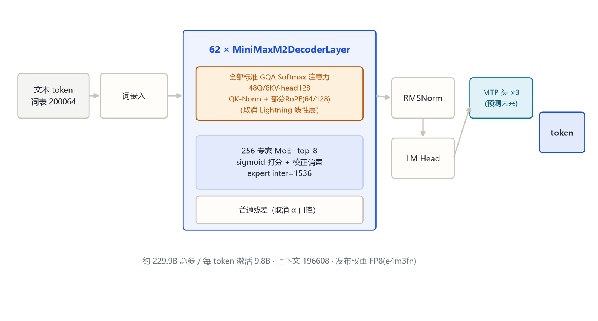
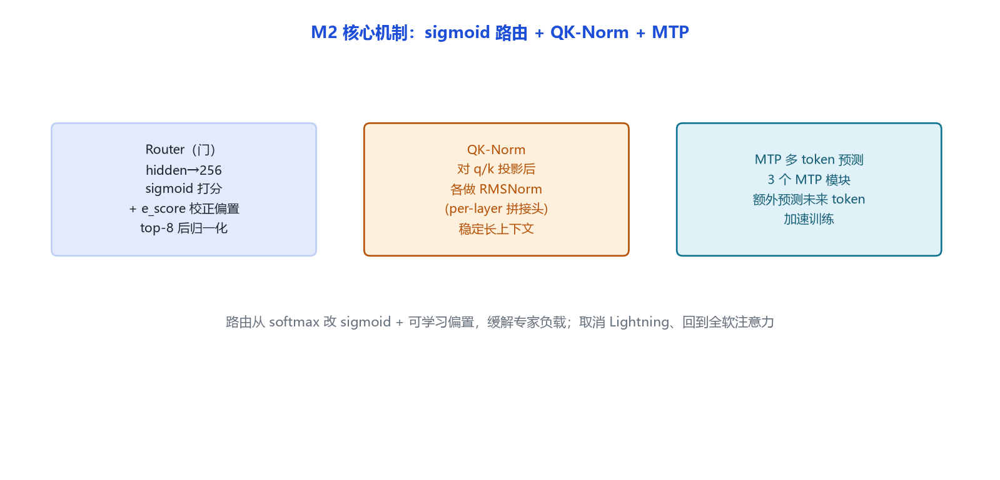

# MiniMax-M2 家族架构详解

> **一句话**：2025 年 10 月开源的约 229.9B 总参 / 9.8B 激活 MoE——与 M1 的路线**彻底反转**：放弃 Lightning 线性注意力、62 层全改标准 GQA Softmax，专家从 32 暴增到 256、top-8，引入 sigmoid 路由偏置、QK-Norm、MTP 与 FP8 发布，主打智能体与代码。

## 一、家族全景

| 维度 | 官方取值 | 来源 |
|---|---|---|
| 总参 / 激活 | **约 229.9B 总参 / 约 9.8B 每 token**（≈230B-A10B） | 技术报告（minimax-ai.chat 引述）+ config 推算 |
| 架构类别 | decoder-only · MoE · **全 Softmax 注意力（无 Lightning）** | 远端 config + 源码 modeling_minimax_m2.py |
| 层数 `num_hidden_layers` | 62 | 远端 config |
| 隐藏 `hidden_size` | 3072 | 远端 config |
| 注意力头 / KV 头 | 48 / 8（GQA） | 远端 config |
| 头维 `head_dim` | 128 | 远端 config |
| 专家中间维 `intermediate_size` | 1536（每个路由专家） | 远端 config + 源码 MiniMaxM2BlockSparseTop2MLP |
| 专家数 `num_local_experts` | **256** | 远端 config |
| 每 token 选专家 `num_experts_per_tok` | **8**（top-8） | 远端 config |
| 路由打分 `scoring_func` | sigmoid（+ 可学习 `e_score_correction_bias`） | 远端 config + 源码 router |
| QK-Norm `use_qk_norm` | true（`q_norm`/`k_norm`，per-layer） | 远端 config + 源码 MiniMaxM2Attention |
| RoPE 旋转维 `rotary_dim` | 64（head_dim 128 的一半） | 远端 config |
| RoPE 基频 `rope_theta` | 5,000,000（5e6） | 远端 config |
| MTP `use_mtp` / `num_mtp_modules` | true / 3（`mtp_transformer_layers=1`） | 远端 config |
| 最大位置 `max_position_embeddings` | 196608（192K；公开口径 204K） | 远端 config |
| 词表 | 200064；bos=200034，eos=200020 | 远端 config |
| 发布权重 | FP8（`quantization_config: float8_e4m3fn`） | 远端 config |

代码入口：`MiniMaxM2ForCausalLM`（`model_type=minimax_m2`），本地原生模块 `src/transformers/models/minimax_m2/`（`configuration_minimax_m2.py` / `modeling_minimax_m2.py`）。

## 二、端到端结构



词嵌入 → 62 层「GQA 全注意力 + 256 专家 MoE」堆叠 → RMSNorm → LM Head；旁挂 3 个 MTP 头额外预测未来 token。

## 三、一层解码器在做什么

源码 `MiniMaxM2DecoderLayer.forward`：

```text
# 1) 标准 GQA 自注意力（不是 Lightning）
residual = hidden
hidden = input_layernorm(hidden)
hidden = self_attn(hidden)        # q/k/v/o_proj，q/k 后接 RMSNorm
hidden = residual + hidden        # 普通残差（取消了 α 门控）
# 2) MoE FFN
residual = hidden
hidden = post_attention_layernorm(hidden)
hidden = block_sparse_moe(hidden) # 256 专家 sigmoid top-8
hidden = residual + hidden         # 普通残差
```

要点（与 Text-01/M1 的差异）：
- **回到朴素残差**：`hidden = residual + sublayer`，Text-01 的门控残差 `residual·α + sublayer·β`（α=3.5566）被取消，config 里只剩 `*_beta_factor=1.0`、无 `*_alpha_factor`。
- **全部层都是标准 Softmax GQA**：config `attn_type_list` 在 62 层上全为 1，原生模块不区分线性/全注意力，没有 Lightning 分支。
- **QK-Norm**：q_proj、k_proj 之后各接一个 RMSNorm（`q_norm`/`k_norm`），稳定长上下文注意力。

## 四、核心机制



### 4.1 sigmoid 路由 + 校正偏置

源码 `MiniMaxM2SparseMoeBlock`：门是一个 Linear 把 hidden 投到 256 维，过 **sigmoid**（不是 Text-01 的 softmax），加上可学习的 `e_score_correction_bias`，再选 top-8 并归一化。sigmoid + 偏置让每个专家的选择近似独立、缓解专家负载不均（类似 DeepSeek-V3 的 routed 评分风格）。

- 专家中间维 1536（比 Text-01 专家的 9216 小很多），靠 256 个小专家换总容量。
- config 里另有 `mlp_intermediate_size=8192` 字段，但 transformers 原生模块每层都走 256 专家 MoE、不消费该字段（远端代码字段，原生转换未启用，**细节待确认**）。

### 4.2 QK-Norm 与部分 RoPE

q/k 投影后各做 RMSNorm；RoPE 仍只旋转前 `rotary_dim=64` 维（head_dim 128 的一半），基频 5e6。

### 4.3 MTP（多 token 预测）

`use_mtp=true`、`num_mtp_modules=3`：堆叠 3 个额外的预测模块，训练时一次预测多个未来 token，加速收敛（类似 DeepSeek-V3 的 ntp）。发布权重为 FP8（e4m3fn）。

## 五、注意力机制

| 层类型 | 层数 | 实现 |
|---|---|---|
| 全 Softmax GQA | 62（全部） | 48 Q 头 / 8 KV 头，head_dim 128，q/k 后 RMSNorm，部分 RoPE 64/128 |

**与 Text-01 的最大反差**：Text-01/M1 用 70 层 Lightning 线性注意力换长上下文成本；M2 全部回到二次 Softmax 注意力，靠 256 专家压激活量、靠 QK-Norm 与 192K 上下文撑长文本。这是一次明确的架构路线再选择。

## 六、Token 与上下文

- 词表 200064，bos=200034、eos=200020。
- `max_position_embeddings=196608`（公开口径 204K），无 Lightning 状态、纯 KV cache。

## 七、演进坐标

- **Text-01 / M1**：456B-A46B，7:1 Lightning+Softmax，32 专家 top-2。
- **M2（本模型，2025-10-27）**：230B-A10B，全 Softmax，256 专家 top-8，QK-Norm + MTP + FP8，主打智能体/代码。
- **M3（2026-05）**：在 M2 思路上再叠加 MSA 块稀疏注意力与原生多模态（见 `minimax_m3_vl`）。

## 八、参考文献与依据

- 远端官方 config：https://huggingface.co/MiniMaxAI/MiniMax-M2 （config.json，拉取日期 2026-10-31）
- transformers 源码：`src/transformers/models/minimax_m2/configuration_minimax_m2.py`、`modeling_minimax_m2.py`
- 发布信息：MiniMax 2025-10-27 开源发布（第三方报道口径 229.9B/9.8B、62 层、256 专家）
- 依据口径：远端官方 config（hf-mirror）+ transformers 源码（E:\transformers）+ 官方公告
