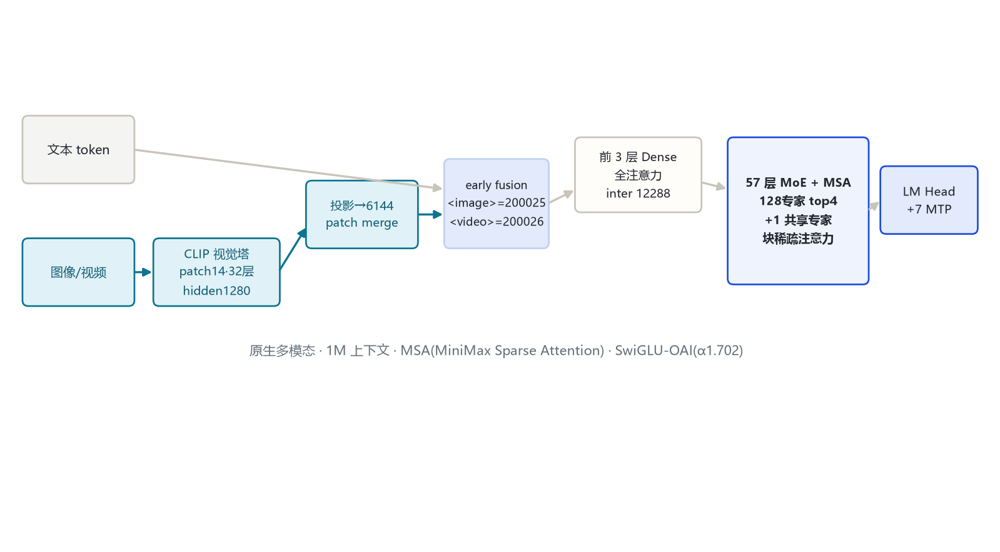
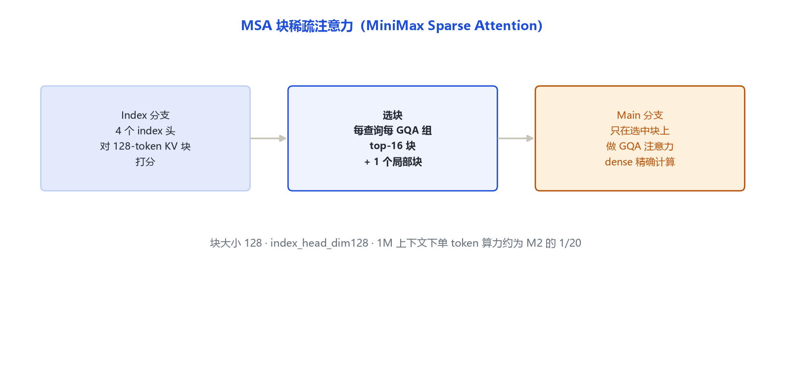
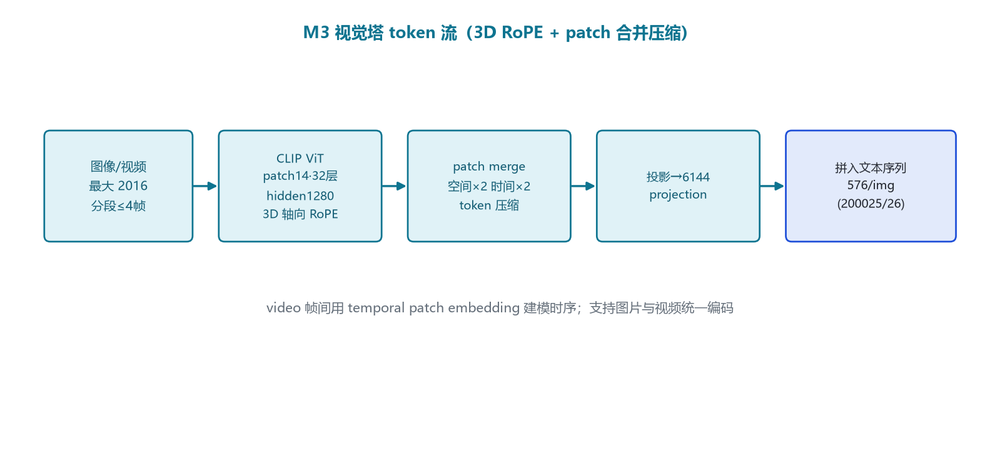

# MiniMax-M3（M3-VL）家族架构详解

> **一句话**：2026 年 5 月发布的原生多模态旗舰，文本塔 60 层、前 3 层 Dense + 后 57 层 MoE，注意力换成全新的 **MSA（MiniMax Sparse Attention）块稀疏索引**，128 专家 + 1 共享专家，原生吃图像/视频，1M 上下文。

> 命名说明：官方开源仓为 **`MiniMaxAI/MiniMax-M3`**，`model_type=minimax_m3_vl`、架构 `MiniMaxM3SparseForConditionalGeneration`，即任务清单中的「M3-VL」。本地原生模块 `src/transformers/models/minimax_m3_vl/`。

## 一、家族全景

| 维度 | 官方取值 | 来源 |
|---|---|---|
| 文本塔层数 / hidden | 60 层 / 6144 | 远端 config `text_config` |
| 注意力头 / KV 头 | 64 / 4（GQA 16:1） | 远端 config |
| 头维 / RoPE 旋转维 | 128 / 64（部分旋转，partial 0.5） | 远端 config |
| Dense 层中间维 `dense_intermediate_size` | 12288（前 3 层） | 远端 config |
| 路由专家中间维 `intermediate_size` | 3072 | 远端 config |
| 共享专家中间维 `shared_intermediate_size` | 3072（**1 个常驻共享专家**） | 远端 config |
| 路由专家数 / top-k | 128 / 4 | 远端 config |
| 路由缩放 `routed_scaling_factor` | 2.0 | 远端 config |
| 层类型 `mlp_layer_types` | 前 3 层 `dense`，后 57 层 `sparse` | 远端 config |
| 注意力 `layer_types` | 前 3 层 `full_attention`，后 57 层 `minimax_m3_sparse` | 远端 config（sparse_attention_freq=3） |
| 稀疏块大小 / top-k 块 | block 128 / topk_blocks 16 / local 1 | 远端 config `sparse_attention_config` |
| 索引头 `index_n_heads` | 4（index_head_dim 128） | 远端 config |
| 激活 | SwiGLU-OAI（α=1.702，limit=7.0） | 远端 config |
| Norm | GemmaNorm + per_head QK-Norm | 远端 config |
| MTP 模块数 | 7（`num_nextn_predict_layers=1`） | 远端 config |
| 最大位置 | 1,048,576（1M） | 远端 config |
| 视觉塔 | CLIP：hidden 1280 / 32 层 / patch14 / image 2016 / 投影 6144 | 远端 config `vision_config` |
| 视觉 token 压缩 | patch_merge：空间×2、时间×2，3D 轴向 RoPE | 远端 config |
| 图像/视频 token id | 200025 / 200026 | 远端 config |

## 二、端到端结构

文本与图像/视频 token 经各自编码后 early-fusion 进堆叠：前 3 层是 Dense + 全注意力（先把多模态 token 融合好），后 57 层是 MoE + MSA 块稀疏注意力，最后 LM Head + 7 个 MTP 头。

## 三、一层解码器

- **前 3 层（dense）**：标准 RMSNorm → 全注意力 → SwiGLU（intermediate 12288）FFN。
- **后 57 层（sparse）**：RMSNorm → MSA 块稀疏注意力 → 128 专家 top-4 MoE（+1 个常驻共享专家）。
- 激活统一为 SwiGLU-OAI：`silu(x·α)` 截断到 ±7（`swiglu_alpha=1.702`，`swiglu_limit=7.0`）。

## 四、核心机制

### 4.1 MSA：MiniMax Sparse Attention

MSA 是 M3 的招牌，用「索引分支先选块、主分支再精确算」的两阶段稀疏注意力替代二次 Softmax：

- **Index 分支**：4 个专用 index 头，把 KV 切成 128-token 的块并打分。
- **选块**：每个 query、每个 GQA 组选 top-16 个最相关块，外加 1 个局部块。
- **Main 分支**：只在选中块上做标准 GQA 注意力。

官方口径：1M 上下文下单 token 算力约为 M2 的 1/20，预填充提速约 9 倍。

### 4.2 MoE：128 路由专家 + 1 共享专家

与 M2 的 256 专家不同，M3 用 128 路由专家 top-4，并**带回 1 个常驻共享专家**（`shared_intermediate_size=3072`），sigmoid 路由 + 校正偏置，路由输出乘 `routed_scaling_factor=2.0`。

## 五、注意力机制

| 层 | 注意力 |
|---|---|
| 前 3 层 | 全 Softmax GQA |
| 后 57 层 | MSA 块稀疏（block 128，top-16 块 + 1 局部） |

取代了 Text-01 的「Lightning 线性注意力」路线，改为可解释的块稀疏选择。

## 六、多模态结构

视觉塔为 CLIP ViT：patch 14、最大分辨率 2016、32 层、hidden 1280；用 **3D 轴向 RoPE** 编码图像与视频帧位置，patch_merge 在空间×2、时间×2 上压缩 token，投影到 6144。视频按段（≤4 帧）编码，图像/视频共用同一套 token 流，`<image>=200025`、`<video>=200026`，每图 576 token。

## 七、Token 与上下文

- 上下文 1,048,576（1M）。
- 词表继承 200064 体系，新增视觉/视频占位位。

## 八、演进坐标

- **Text-01/M1**：Lightning 线性注意力路线。
- **M2**：回到全 Softmax、256 专家、QK-Norm、MTP。
- **M3（本模型，2026-05）**：MSA 块稀疏注意力 + 原生多模态 + 128 专家带共享专家 + SwiGLU-OAI，1M 上下文。
- 「MiniMax-Text-04」：截至 2026-10-31 在 HuggingFace 未检索到官方开源仓，规格**待确认**，本笔记不单独建目录。

## 九、参考文献与依据

- 官方博客：*MiniMax M3：前沿 Coding 能力，1M 上下文，原生多模态*，https://www.minimaxi.com/blog/minimax-m3
- vLLM Day-0 技术解析：https://vllm-project.github.io/2026/06/12/minimax-m3-vllm.html
- 远端官方 config：https://huggingface.co/MiniMaxAI/MiniMax-M3 （config.json，拉取日期 2026-10-31）
- transformers 源码：`src/transformers/models/minimax_m3_vl/configuration_minimax_m3_vl.py`
- 依据口径：远端官方 config（hf-mirror）+ transformers 源码（E:\transformers）+ 官方公告
