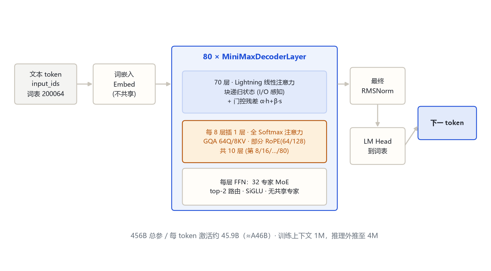
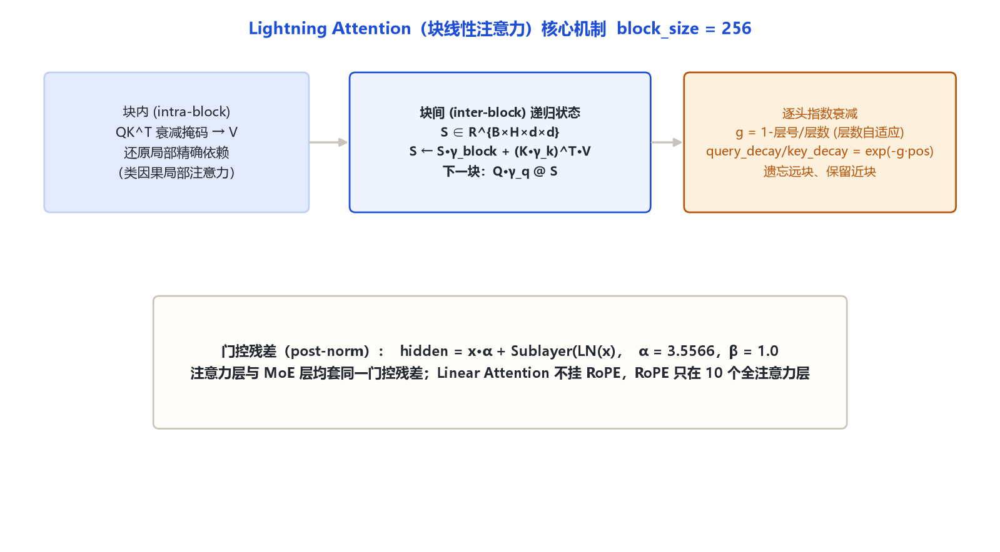

# MiniMax-Text-01 家族架构详解

> **一句话**：MiniMax 在 2025 年 1 月开源的 456B 总参 MoE 基座模型，核心是「Lightning Attention 线性注意力 : 全 Softmax 注意力 = 7 : 1」的混合架构——用块递归线性注意力把百万级上下文的训练/推理成本压到近线性，每 token 只激活约 45.9B（≈A46B）参数。

## 一、家族全景

MiniMax-01 系列由两个同源权重组成：**MiniMax-Text-01**（纯文本基座）与 **MiniMax-VL-01**（视觉-语言模型，见本系列 `minimax_visual_01`）。二者共享同一套 456B/45.9B 的文本塔设计，本笔记聚焦 Text-01。

| 维度 | 官方取值 | 来源 |
|---|---|---|
| 总参数量 | **456B**（456,000,000,000 量级） | 论文 arXiv:2501.08313 摘要 |
| 每 token 激活参数 | **约 45.9B**（任务口径常写作 A46B） | 论文摘要；config 为 MoE top-2 路由推算 |
| 架构类别 | decoder-only · MoE · 混合注意力 | 远端官方 config + transformers 源码 |
| 层数 `num_hidden_layers` | 80 | 远端官方 config：MiniMaxAI/MiniMax-Text-01 |
| 隐藏维 `hidden_size` | 6144 | 远端官方 config |
| 注意力头 `num_attention_heads` | 64 | 远端官方 config |
| KV 头 `num_key_value_heads` | 8（GQA，64:8 = 8:1） | 远端官方 config |
| 头维 `head_dim` | 128 | 远端官方 config |
| FFN/专家中间维 `intermediate_size` | 9216（每个路由专家） | 远端官方 config + 源码 MiniMaxExperts |
| 路由专家数 `num_local_experts` | 32 | 远端官方 config |
| 每 token 选专家 `num_experts_per_tok` | 2（top-2） | 远端官方 config |
| 共享专家 `shared_intermediate_size` | 0（**无共享专家**） | 远端官方 config |
| 词表 `vocab_size` | 200064 | 远端官方 config |
| RoPE 基频 `rope_theta` | 10,000,000（1e7） | 远端官方 config |
| RoPE 旋转维 `rotary_dim` | 64（head_dim=128 的一半，部分旋转） | 远端官方 config |
| 门控残差 α `postnorm_alpha_factor` | 3.5565588200778455 | 远端官方 config |
| β 因子 `postnorm_beta_factor` | 1.0（注意力/MoE 两处均为 1.0） | 远端官方 config |
| 最大位置 `max_position_embeddings` | 10,240,000（训练 1M，推理外推 4M） | 远端官方 config + 论文 |
| 线性注意力块 `block_size` | 256 | 源码默认 configuration_minimax.py |
| 注意力层类型 `layer_types` | 每 8 层 1 层 `full_attention`，其余 `linear_attention` | 远端 config `attn_type_list` 逐条对齐 |
| 权重解耦 `tie_word_embeddings` | false | 远端官方 config |

> 「456B-A46B」读法：**456B 是全部参数（含 32 个专家全部权重），45.9B/≈46B 是单个 token 前向时真正参与计算的激活参数**。MoE 把专家分散到 32 路，每 token 只激活其中 2 个，加上全部层都要跑的注意力与嵌入，故激活量远小于总量。

**代码入口**：远端原始仓 `MiniMaxAI/MiniMax-Text-01` 的 `auto_map` 指向 `configuration_minimax_text_01.py`；transformers 原生转换仓 `MiniMaxAI/MiniMax-Text-01-hf` 对应 `MiniMaxForCausalLM`，即本地源码 `src/transformers/models/minimax/`（`configuration_minimax.py` / `modeling_minimax.py`）。本笔记结构以原生模块为准。

## 二、端到端结构



输入 `input_ids`（词表 200064）经词嵌入后进入 80 层解码器堆叠，最后接最终 RMSNorm 与 LM Head 输出下一个 token。堆叠内部按「每 8 层一组」交错：70 层 Lightning 线性注意力 + 10 层全 Softmax 注意力（落在第 8/16/…/80 层，1-based）。

## 三、一层解码器在做什么

源码 `modeling_minimax.py` 的 `MiniMaxDecoderLayer.forward`：

```text
x = hidden
# 1) 注意力（按 layer_types 二选一）
residual = x
x = input_layernorm(x)
x = self_attn(x)            # 70 层 Lightning / 10 层 full softmax
x = residual * attn_alpha_factor + x * attn_beta_factor   # 门控残差，α≈3.5566
# 2) MoE FFN
residual = x
x = post_attention_layernorm(x)
x = block_sparse_moe(x)     # 32 专家 top-2
x = residual * mlp_alpha_factor + x * mlp_beta_factor     # 门控残差，α≈3.5566
```

要点：
- **两次门控残差**（注意力后、MoE 后各一次），不是朴素 `x + sublayer`。源码实现：`hidden = residual * self.attn_alpha_factor + hidden * self.attn_beta_factor`。
- **PostNorm**：`postnorm: true`，先算子层再把残差按 α 放大、子层按 β 合并。α≈3.5566 是一个固定的缩放常数（≈√12.65），作用是在深层稳定残差流。
- 每个子层前都有独立 RMSNorm（`input_layernorm` / `post_attention_layernorm`）。

## 四、核心机制（重点）

### 4.1 Lightning Attention：块递归线性注意力

Lightning Attention 是 MiniMax-01 的招牌机制。它把长序列切成固定大小的块（`block_size=256`），在块内做精确因果注意力、在块间用一个固定大小的递归状态做线性压缩，从而把全序列的 KV 从「随长度增长」变成「固定状态」。



源码 `MiniMaxLightningAttention.forward` 的三段：

1. **块内（intra-block）**：把 Q/K/V reshape 成 `[B, H, num_blocks, block_size, d]`，在每个 block_size=256 的小块内做带对角衰减掩码的因果注意力 `Q K^T · diag_decay → V`，负责还原局部精确依赖。
2. **块间递归状态（inter-block）**：维护一个与序列长度无关的状态 `S ∈ R^{B×H×d×d}`，跨块递推：

```text
S ← S · γ_block  +  (K · key_decay)^T · V
本块输出（历史部分）= (Q · query_decay) @ S
```

其中 `γ_block = exp(-slope_rate · block_size)` 是整块衰减因子。

3. **逐头指数衰减**：衰减斜率随头号与层号自适应——

```text
base_rate  = 2^{-8 / num_heads}
slope_rate_h = base_rate ^ h          # h = 1..num_heads
factor      = 1 - layer_idx / num_layers + 1e-5   # 越靠后的层衰减越慢
query_decay = exp(-slope_rate · block_pos)
key_decay   = exp(-slope_rate · (block_size - block_pos))
```

物理含义：离当前位置越远的历史块，状态被乘上越小的衰减权重「遗忘」，近块保留。不同头、不同层用不同衰减率，形成多尺度记忆。

**公式三列表（文本可读）**：

| 量 | 公式 | 说明 |
|---|---|---|
| 整块衰减 | γ_block = exp(-slope_rate · block_size) | 每跨过一块就衰减一次 |
| 查询衰减 | query_decay = exp(-slope_rate · block_pos) | 当前块内 query 对历史的衰减 |
| 键衰减 | key_decay = exp(-slope_rate · (block_size - block_pos)) | 当前块内 key 对本块位置的衰减 |
| 递归更新 | S ← S·γ_block + (K·key_decay)^T·V | 块间状态累加，固定大小 B×H×d×d |
| 状态读取 | out_inter = (Q·query_decay) @ S | 用衰减后的 query 读历史摘要 |

工程细节（源码）：
- `qkv_proj` 把 Q/K/V 一次融合投影，输出再过 **SiLU** 激活（不是纯线性投影）。
- 输出再过一个 **sigmoid 输出门** `output_gate`，以及一层 `MiniMaxRMSNorm`（作用在 `head_dim × num_heads` 上）。
- **Lightning 层不挂 RoPE**：`position_embeddings` 传入但线性注意力分支不使用；RoPE 只作用在 10 个全注意力层。
- 推理时状态缓存在 `MiniMaxCache.linear_cache`，按层保存 `[B, H, d, d]`。

### 4.2 MoE：32 路由专家、top-2、无共享专家

源码 `MiniMaxSparseMoeBlock`：门 `MiniMaxTopKRouter`（一个 Linear + softmax + top-k + 重归一化）选出 2 个专家；专家权重打包在 `MiniMaxExperts` 的 `gate_up_proj [E, 2I, H]` 与 `down_proj [E, H, I]` 里，激活是 SiGLU：`act(gate) * up → down`。

- 专家数 `num_local_experts=32`，每 token 选 `num_experts_per_tok=2`。
- `shared_intermediate_size=0`：**没有共享专家**（与后续 M3 的「1 个常驻共享专家」不同）。
- 评分模式 `shared_moe_mode="sigmoid"` 字段保留，但本模型无共享专家。

## 五、注意力机制：7:1 混合

| 层类型 | 层数 | 注意力实现 | 是否 RoPE |
|---|---|---|---|
| `linear_attention`（Lightning） | 70 | 块递归线性注意力，block 256，固定状态 | 否 |
| `full_attention`（Softmax） | 10 | 标准 GQA：64 Q 头 / 8 KV 头，head_dim 128 | 是（rotary_dim 64） |

`layer_types` 在 80 层里的分布（0-based 索引）：`full_attention` 落在索引 7、15、23、31、39、47、55、63、71、79，即每 8 层的最后一层。论文给出的经验配比是 **7 层线性 + 1 层全注意力**——全 Softmax 层负责恢复精确的局部/长距离稀疏依赖，Lightning 层负责把绝大部分上下文压进线性状态，两者互补。

全注意力层细节：GQA（8 个 KV 头被 64 个 Q 头共享，`repeat_kv`），部分 RoPE——只旋转 `rotary_dim=64` 维（head_dim 128 的一半），基频 `rope_theta=1e7`。

## 六、Token 与上下文

- 词表 200064，`<image>` 占位位 200025（VL-01 用）。
- `max_position_embeddings=10,240,000` 是模型外推上限；论文口径为**训练上下文 1M，推理可外推到 4M**。
- 无滑动窗口（`sliding_window: null`），超长上下文靠 Lightning 的固定状态 + 部分 RoPE 的长程外推支撑。

## 七、演进坐标

- **Text-01（本模型，2025-01）**：456B-A45.9B 的首个开源 Lightning+MoE 基座，7:1 混合注意力。
- **VL-01（2025-01）**：同一文本塔 + CLIP 视觉塔续训（见 `minimax_visual_01`）。
- **M1（2025-06/09）**：架构不变，换 RL 后训练做长链推理（见 `minimax_m1`）。
- 后续 M2 转为全 Softmax + 256 专家（见 `minimax_m2`）。

## 八、参考文献与依据

- 论文：*MiniMax-01: Scaling Foundation Models with Lightning Attention*，arXiv:2501.08313（2025-01-14），https://arxiv.org/abs/2501.08313
- 远端官方 config：https://huggingface.co/MiniMaxAI/MiniMax-Text-01 （config.json，拉取日期 2026-10-31）
- transformers 原生转换仓：https://huggingface.co/MiniMaxAI/MiniMax-Text-01-hf （model_type=minimax）
- transformers 源码：`src/transformers/models/minimax/configuration_minimax.py`、`modeling_minimax.py`
- 依据口径：远端官方 config（hf-mirror）+ transformers 源码（E:\transformers）+ 官方论文/model card
