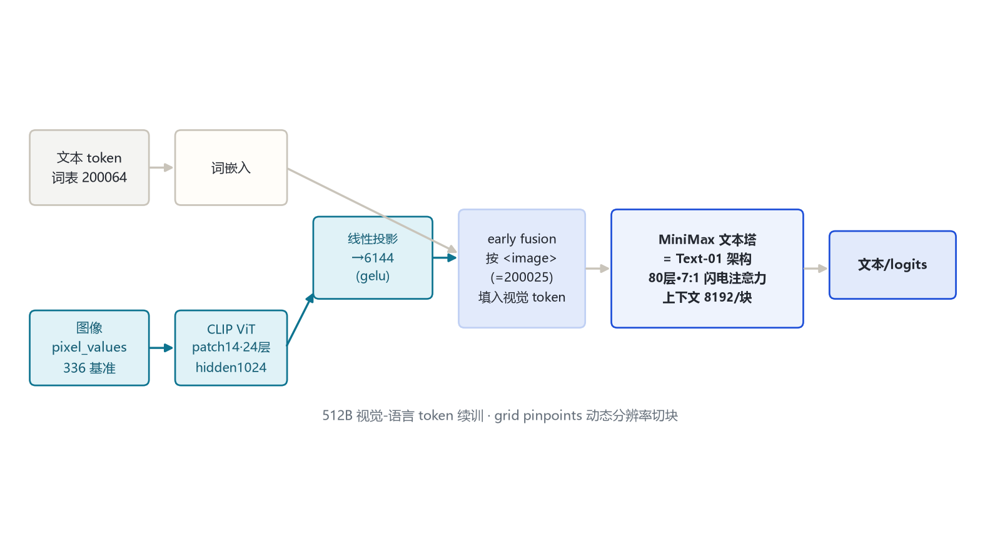
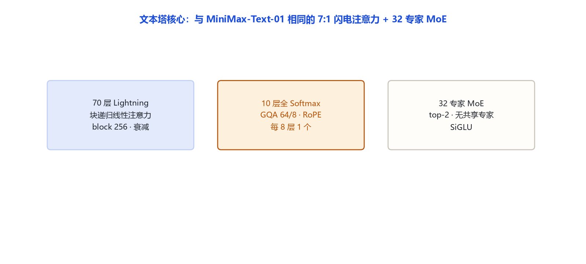
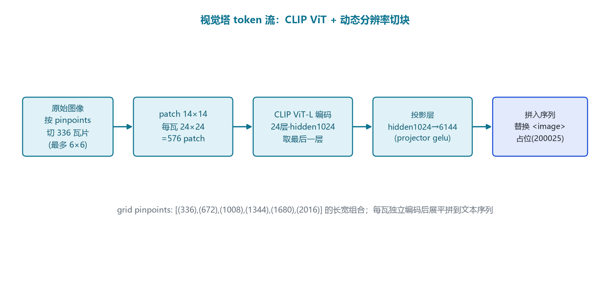

# MiniMax-Visual-01（MiniMax-VL-01）家族架构详解

> **一句话**：在 MiniMax-Text-01 文本塔上接一个 CLIP ViT 视觉塔、做 512B 视觉-语言 token 续训得到的原生多模态模型；文本侧架构与 Text-01 完全同源，差别在每块上下文压到 8192、并新增图像编码与动态分辨率切块。

> 命名说明：任务清单中的「MiniMax-Visual-01」对应官方开源仓 **`MiniMaxAI/MiniMax-VL-01`**（model_type=`minimax_vl_01`），是 MiniMax-01 系列的视觉-语言分支，二者为同一模型。

## 一、家族全景

| 维度 | 官方取值 | 来源 |
|---|---|---|
| 整体定位 | 视觉-语言模型（VLM） | 论文 arXiv:2501.08313 摘要 |
| 文本塔架构 | 与 MiniMax-Text-01 相同（80 层 · 7:1 闪电注意力 · 32 专家 top-2） | 远端 config `text_config` |
| 文本塔隐藏/层数 | hidden 6144 · 80 层 | 远端 config `text_config` |
| 文本塔上下文 | **8192**（`text_config.max_position_embeddings=8192`，按图像块切分） | 远端 config `text_config` |
| 视觉编码器 | CLIP ViT（`auto_map` 指向 `modeling_clip.CLIPVisionModel`） | 远端 config `vision_config` |
| 视觉塔隐藏/层数 | hidden 1024 · 24 层 · 16 头 | 远端 config `vision_config` |
| 视觉塔中间维 | 4096 | 远端 config `vision_config` |
| patch 大小 | 14（`patch_size=14`） | 远端 config `vision_config` |
| 视觉输入分辨率 | 336（`image_size=336`） | 远端 config `vision_config` |
| 投影维 `projection_dim` | 6144（对齐文本塔 hidden） | 远端 config `vision_config` |
| 投影激活 `projector_hidden_act` | gelu | 远端 config |
| 取特征层 `vision_feature_layer` | -1（最后一层） | 远端 config |
| `<image>` token id | 200025 | 远端 config |
| 续训数据 | 512B 视觉-语言 token | 论文摘要 |

代码入口：`MiniMaxVL01ForConditionalGeneration`（远端 `auto_map`），`model_type=minimax_vl_01`。本地 transformers 暂无独立 `minimax_vl_01` 模块，属「官方仓库实现 + 官方 config」双来源。

## 二、端到端结构



两条路汇入同一文本塔：文本 token 走词嵌入；图像经 CLIP ViT 编码后线性投影到 6144 维，按 `<image>`（=200025）占位位置插进序列，再喂进与 Text-01 相同的 80 层混合注意力堆叠。

## 三、一层解码器

文本塔的每一层与 Text-01 完全一致：RMSNorm →（70 层 Lightning / 10 层全 Softmax）→ 门控残差 α·h+β·s → RMSNorm → 32 专家 top-2 MoE → 门控残差。详见 `minimax_text_01` 笔记第三/四节，此处不重复。

## 四、核心机制



文本侧核心机制（块递归 Lightning、门控残差、32 专家 top-2）继承自 Text-01，本节只强调多模态新增部分。

## 五、注意力机制

与 Text-01 相同：70 层 Lightning 线性注意力 + 10 层全 Softmax（每 8 层 1 个），RoPE 只在全注意力层、`rotary_dim=64`、`rope_theta=1e7`。

## 六、多模态结构（重点）



**视觉塔细节（以 config 为准）**：
- 编码器是标准 CLIP ViT：`patch_size=14`、`image_size=336`、`hidden_size=1024`、`num_hidden_layers=24`、`num_attention_heads=16`、`intermediate_size=4096`、激活 gelu。
- 一张 336×336 图切成 24×24 = **576 个 patch**，每个 patch 编码为 1024 维特征。
- 经投影层（`projection_dim=6144`，gelu 激活）映到文本塔隐藏维。

**动态分辨率切块（grid pinpoints）**：config 给出 `image_grid_pinpoints` 一组长宽组合，基准是 336，向上取到 672/1008/1344/1680/2016。推理时把任意长宽的原图按最接近的 pinpoint 切成若干 336×336 瓦片，每块独立过 CLIP，再把所有瓦片的视觉 token 展平、按原网格顺序拼回序列。这与 Qwen2-VL 的动态分辨率思路同源——固定一个「瓦片 token 预算」，大分辨率图多切几瓦。

**token 流**：

```text
原图 → 按 grid pinpoints 选网格 → 每瓦 336×336
     → patch14 → 24×24=576 patch/瓦
     → CLIP ViT-L（24 层，取末层）
     → 线性投影 1024→6144（gelu）
     → 展平，替换序列里的 <image>=200025 占位
     → 与文本 token 一起进 80 层文本塔
```

文本塔一次处理的序列上下文被压到 **8192**（`text_config.max_position_embeddings=8192`）：长图被切成多个 ≤8192-token 的块分别送进文本塔，视觉 token 不与超长文本混排。

## 七、Token 与上下文

- 文本词表 200064，新增 `<image>` = 200025。
- 视觉塔每瓦 576 token；具体每图 token 数随切块数变化。
- 文本塔块上下文 8192（区别于 Text-01 的百万级外推上限）。

## 八、演进坐标

- **Text-01（2025-01）**：纯文本 456B-A45.9B 基座。
- **VL-01（本模型，2025-01）**：加 CLIP 视觉塔，512B 视觉-语言 token 续训，首开 MiniMax 开源 VLM。
- 后续 M1/M2/M3 的多模态/纯文本路线由此分化。

## 九、参考文献与依据

- 论文：*MiniMax-01: Scaling Foundation Models with Lightning Attention*，arXiv:2501.08313，https://arxiv.org/abs/2501.08313
- 远端官方 config：https://huggingface.co/MiniMaxAI/MiniMax-VL-01 （config.json，拉取日期 2026-10-31）
- 说明：本地无 `models/minimax_vl_01` 模块，依据为「官方仓库实现 + 官方 config」双来源
- 依据口径：远端官方 config（hf-mirror）+ 官方论文/model card
