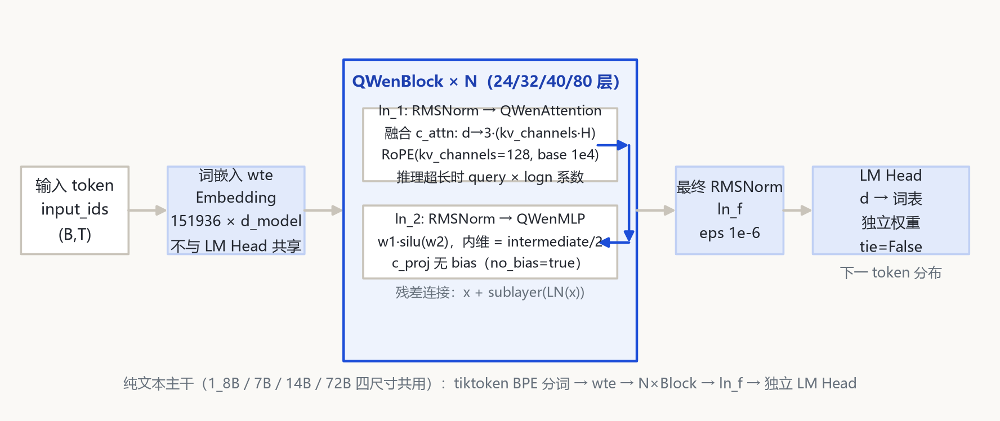
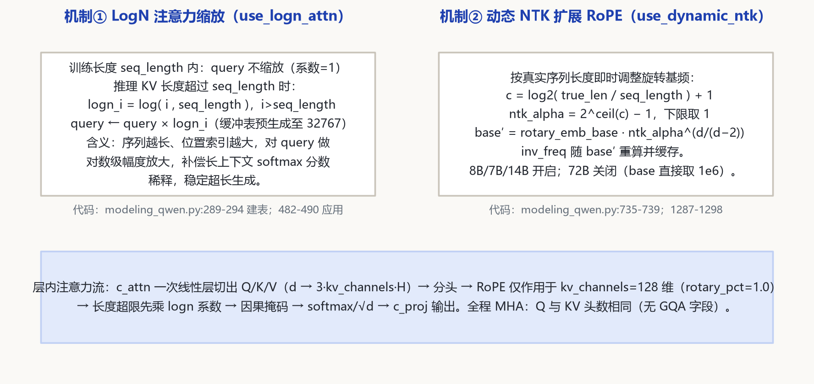

# Qwen 1 家族架构详解 — Qwen-1_8B / 7B / 14B / 72B（纯文本）

入口类：QWenLMHeadModel（model_type=qwen，需 trust_remote_code 加载官方仓库自带 modeling）；分词：QWenTokenizer（tiktoken BPE，词表 151936 / 152064）；特色：融合 QKV 投影（c_attn）、use_logn_attn、use_dynamic_ntk、kv_channels=128、RoPE 全维旋转；上下文：训练 2048/8192，推理经动态 NTK 扩到 32K（7B/72B config 标称 max_position 32768）。

本页以 **本地 `E:\models\qwen\Qwen-1_8B\config.json` + 仓库自带 `configuration_qwen.py / modeling_qwen.py`** 为第一手依据，其余三尺寸（7B / 14B / 72B）config 经 ModelScope 逐字段拉取核对。transformers v5（E:\transformers，可编辑安装）中**没有原生 qwen 模块**，本代模型一律以官方仓库实现 + 本地 config 双来源描述，所有数字标注出处。

## 1 家族全景：四个尺寸的架构对照

> 四尺寸均为纯文本 Dense 因果 LM，主干结构完全一致：词嵌入 wte → N 个 QWenBlock → 最终 RMSNorm → 独立 LM Head。差异集中在维度、层数、词表与长上下文开关。参数量为按 config 逐模块复算（embedding 因 tie=False 双向计）。

### 1.1 核心超参数

| 字段 | Qwen-1_8B | Qwen-7B | Qwen-14B | Qwen-72B |
|---|---|---|---|---|
| architectures / model_type | QWenLMHeadModel / qwen | QWenLMHeadModel / qwen | QWenLMHeadModel / qwen | QWenLMHeadModel / qwen |
| hidden_size | 2048 | 4096 | 5120 | 8192 |
| num_hidden_layers | 24 | 32 | 40 | 80 |
| num_attention_heads (Q) | 16 | 32 | 40 | 64 |
| kv_channels（=head_dim） | 128 | 128 | 128 | 128 |
| KV 头数 | 无字段（MHA，Q=KV） | 无字段（MHA） | 无字段（MHA） | 无字段（MHA） |
| intermediate_size | 11008 | 22016 | 27392 | 49152 |
| MLP 内维（intermediate/2） | 5504 | 11008 | 13696 | 24576 |
| vocab_size | 151936 | 151936 | 152064 | 152064 |
| max_position_embeddings | 8192 | 32768 | 8192 | 32768 |
| seq_length（训练/logn 基准） | 8192 | 8192 | 2048 | 32768 |
| rotary_emb_base | 10000 | 10000 | 10000 | 1000000 |
| use_dynamic_ntk | true | true | true | false |
| use_logn_attn | true | true | true | false |
| tie_word_embeddings | false | false | false | false |
| no_bias（线性层去 bias） | true | true | true | true |
| 参数量（按 config 复算） | ≈1.84B | ≈7.72B | ≈14.2B | ≈72.3B |

> 要点：① 14B/72B 词表为 152064，比 1_8B/7B 的 151936 多 128 个（后两尺寸训练词表扩容）；② 72B 直接把旋转基频抬到 1e6 并关闭动态 NTK 与 LogN，其余三尺寸保持 base=1e4 + 运行时动态 NTK + LogN 缩放；③ 全家族无 GQA 字段，Q/KV 头数恒等（纯 MHA）。

### 1.2 加载与分词规格

| 项 | 取值 | 来源 |
|---|---|---|
| trust_remote_code | 必须 true | config auto_map（AutoConfig→configuration_qwen.QWenConfig；AutoModelForCausalLM→modeling_qwen.QWenLMHeadModel） |
| transformers v5 原生模块 | 无（models/qwen 不存在） | E:\transformers\src\transformers\models\ 目录核对 |
| tokenizer_class | QWenTokenizer | config 顶层；分词文件 qwen.tiktoken |
| tiktoken 依赖 | 加载 tokenizer 需 tiktoken 包 | tokenization_qwen.py；官方 model card 说明 |
| eos / pad token id | 151643（endoftext 特殊 token） | generation_config.json（本地） |
| Chat 对话格式 | 仓库内 qwen_generation_utils.py 的 chat() | 本地目录文件 |

## 2 端到端数据流总览

> tiktoken BPE 分词后的 token id → wte 查表 → Dropout(emb_dropout=0) → N 个 QWenBlock（每个 = RMSNorm→融合 QKV 注意力→残差；RMSNorm→SwiGLU MLP→残差）→ 最终 RMSNorm ln_f → 独立 LM Head 投影回词表。

### 2.1 架构图



> 全家族统一主干：`wte → N×QWenBlock → ln_f → LM Head`；差异在层数（24/32/40/80）、维度（2048→8192）与长上下文开关。LM Head 与 wte 权重不共享（tie_word_embeddings=false）。

## 3 解码层解剖：QWenBlock（预 RMSNorm 双残差块）

> 每个 QWenBlock（modeling_qwen.py:578-637）含两组残差子层，均为 pre-norm：先 RMSNorm 再进子层，残差在子层输出之后相加。注意与后来 Qwen2 的差别：Qwen1 在注意力残差**相加之后**再做第二个 RMSNorm（ln_2 作用于 h+x），FFN 残差同样作用于相加后的结果。

```
QWenBlock.forward（modeling_qwen.py:608-630）:
  layernorm_output = ln_1(hidden_states)            # RMSNorm, eps 1e-6
  attn_output, present = self.attn(layernorm_output, rotary_pos_emb_list, ...)
  layernorm_input = attn_output + hidden_states     # ⊕1（先加残差）
  layernorm_output = ln_2(layernorm_input)         # 归一作用于 (h + attn(h))
  mlp_output = self.mlp(layernorm_output)
  hidden_states = layernorm_input + mlp_output      # ⊕2
```

## 4 核心机制：融合 QKV 投影 · LogN 注意力 · 动态 NTK · SwiGLU

### 4.1 ① 融合 QKV 线性层（c_attn）

Q/K/V 不拆三个投影，而是一个 `nn.Linear(hidden, 3·kv_channels·num_heads)`，输出后沿特征维三等分（modeling_qwen.py:269, 416-418）。kv_channels·H 在本家族恰好等于 hidden_size（16×128=2048 … 64×128=8192），故 c_attn 输出维恰为 3d。输出投影 c_proj 无 bias（no_bias=true）。

```
projection_size = kv_channels × num_attention_heads = d_model
mixed = c_attn(x)                      # (B, T, 3d)
q, k, v = mixed.split(d, dim=2)        # 各 (B, T, d)
q = q.view(B, T, H, kv_channels)       # 分头
```

### 4.2 ② LogN 注意力缩放（use_logn_attn）

推理阶段当 KV 长度超过训练长度 seq_length 时，对 query 乘一个对数级放大系数（modeling_qwen.py:289-294 预生成缓冲表；482-490 应用）：

$$logn_i = log( i , seq\_length ) , \qquad i > seq\_length\ 时\ \ query \leftarrow query \times logn_i$$

序列越长、位置索引越大，query 被放大越多，补偿长上下文 softmax 分数被稀释的问题。72B 关闭此开关（use_logn_attn=false）。

### 4.3 ③ 动态 NTK 旋转基频（use_dynamic_ntk）

按真实 batch 序列长度即时重算 RoPE 基频（modeling_qwen.py:735-739；1287-1298）：

$$c = \log2( true\_len\ /\ seq\_length ) + 1 , \qquad ntk\_alpha = 2^{ceil(c)} - 1$$

$$base' = rotary\_emb\_base \times ntk\_alpha^{ d/(d-2) } , \qquad inv\_freq = 1\ /\ base'^{ 2i/d }$$

base 被拉大后高频压缩，使模型在未训练长度上仍可外推。72B 直接把 rotary_emb_base 设为 1e6 并关闭动态调整。

### 4.4 ④ RMSNorm 与 SwiGLU MLP

RMSNorm 为零均值缩放归一（modeling_qwen.py:1349-1363）；MLP 是门控结构（558-575），内维只有 intermediate/2：

$$RMS(x) = √( mean(x^2) + ε ) , \qquad y = ( x\ /\ RMS(x) ) \times γ$$

$$MLP(x) = c\_proj( w1(x) ⊙ silu(w2(x)) ) , \qquad 内维 = intermediate\_size\ /\ 2$$

### 4.5 架构图



## 5 注意力机制：纯 MHA · kv_channels=128 · 全维 RoPE

### 5.1 头与维度

| 尺寸 | Q 头数 | KV 头数 | kv_channels | head_dim | c_attn 输出维 |
|---|---|---|---|---|---|
| 1_8B | 16 | 16（同源 K/V） | 128 | 128 | 3×2048=6144 |
| 7B | 32 | 32 | 128 | 128 | 3×4096=12288 |
| 14B | 40 | 40 | 128 | 128 | 3×5120=15360 |
| 72B | 64 | 64 | 128 | 128 | 3×8192=24576 |

> config 中没有 num_key_value_heads 字段，Q/K/V 同头数——本代是标准 MHA，GQA 要等到 Qwen1.5-32B 才出现。

### 5.2 RoPE 与缩放

RoPE 作用全部 kv_channels=128 维（rotary_pct=1.0，modeling_qwen.py:697-709），采用 rotate_half 配对旋转（1316-1346）。注意力缩放为标准 `1/√head_dim`（343-348）。

```
attn = softmax( Q·Kᵀ / √head_dim + causal_mask )·V
# Q/K 先过 RoPE（base 1e4，72B 为 1e6；8B/7B/14B 运行时按 NTK 调 base）
# 推理超长时 Q 先乘 logn 系数
# 支持 FlashAttention（use_flash_attn="auto"）与 SDPA 两条路径
```

## 6 特殊 Token 与词表布局

| token | ID | 含义 | 来源 |
|---|---|---|---|
| eos_token_id / pad_token_id | 151643 | endoftext 特殊 token，兼作 pad | generation_config.json（本地） |
| vocab_size | 151936（8B/7B）/ 152064（14B/72B） | BPE 词表 | config.json |
| tokenizer 类 | QWenTokenizer | tiktoken BPE，词表文件 qwen.tiktoken | config；tokenization_qwen.py |
| chat 模板 | 无内置 chat_template | 对话格式化在 qwen_generation_utils.py | tokenizer_config.json（本地仅 3 行） |

> Qwen1 的 tokenizer_config.json 非常薄（仅 model_max_length=8192 与 tokenizer_class），对话样例由仓库内 `chat()` 方法拼装；这与 Qwen1.5 起把 ChatML 模板写进 tokenizer_config.json 的做法不同。

## 7 演进视角：前史与走向 Qwen1.5

| 维度 | Qwen 1（本代） | Qwen 1.5（下代，qwen2 架构） |
|---|---|---|
| 代码形态 | 官方仓库 remote code（trust_remote_code） | 合并进 transformers≥4.37，Qwen2ForCausalLM，免 remote code |
| model_type | qwen（QWenLMHeadModel） | qwen2（无独立 1.5 模块） |
| QKV 投影 | 融合 c_attn：d→3d，无 bias | 分立 q/k/v_proj（q/k/v 带 bias）+ o_proj（无 bias） |
| 头结构 | 纯 MHA（Q=KV） | 小尺寸仍 MHA；32B 首次 GQA（40Q/8KV） |
| RoPE 基频 | 1e4 + 运行时动态 NTK（72B 直接 1e6） | 全系静态 rope_theta=1e6，无 NTK/logn 字段 |
| 长上下文技巧 | use_logn_attn（query 对数放大） | 取消，配置预留 sliding_window=32768（本代实际关闭） |
| MLP | w1·silu(w2)，内维=inter/2 | 标准 SwiGLU：down(silu(gate)·up)，inter 即全门控维 |
| 归一化 | RMSNorm 1e-6 | RMSNorm 1e-6（延续） |
| LM Head | 全系列 tie=False | 0.5B tie=True，其余 False |
| 词表 / 分词 | 151936/152064，QWenTokenizer(tiktoken) | 151936 统一，Qwen2Tokenizer；新增 im_start/im_end + ChatML 模板 |
| 原生上下文 | 训练 2048/8192，扩 32K | 全系原生 32768 |

> Qwen1 的定位：Qwen 技术报告（arXiv:2309.16609）发布的首代开源底座，以 MHA + 融合 QKV + LogN/动态 NTK 把 8K 训练长度外推到 32K；Qwen1.5 则整体换血到 Qwen2 架构（SwiGLU/RMSNorm/θ=1e6/tie），把"免 remote code、全系 32K、32B 引入 GQA"作为主线。

## 8 来源

1. 本地权威 config（Qwen-1_8B，逐字段核对）
   `E:\models\qwen\Qwen-1_8B\config.json（hidden 2048 / 24 层 / 16 头 / kv_channels 128 / inter 11008 / vocab 151936 / max_pos 8192 / tie=False / use_logn_attn=True / use_dynamic_ntk=True）`
2. 官方仓库 remote code（本地目录随权重落盘）
   `E:\models\qwen\Qwen-1_8B\configuration_qwen.py（QWenConfig 默认值）；modeling_qwen.py（QWenAttention 247-555、QWenMLP 558-575、QWenBlock 578-637、QWenModel/get_ntk_alpha 679-739、RotaryEmbedding 1272-1313、RMSNorm 1349-1363）`
3. 其余尺寸 config（ModelScope 拉取，2026-10-26 核对）
   `Qwen/Qwen-7B（4096/32层/32头/inter 22016/vocab 151936/max_pos 32768/seq_length 8192）；Qwen/Qwen-14B（5120/40层/40头/inter 27392/vocab 152064/max_pos 8192/seq_length 2048）；Qwen/Qwen-72B（8192/80层/64头/inter 49152/vocab 152064/max_pos 32768/rotary_emb_base 1e6/ntk=false/logn=false）`
4. Qwen Technical Report（arXiv:2309.16609，2023-09-28 提交）
   `https://arxiv.org/abs/2309.16609`
5. Qwen 官方仓库与模型卡片
   `https://github.com/QwenLM/Qwen ；https://huggingface.co/Qwen ；https://modelscope.cn/organization/qwen`

> 标注约定：行号均指本地 `E:\models\qwen\Qwen-1_8B\modeling_qwen.py`。7B/14B/72B 未在本地落盘，其 config 数字来自 ModelScope 对应仓库 config.json 原文。参数量为按 config 逐模块复算（未含 RMSNorm/LayerNorm 缩放项）。核验日期：2026-10-26。

页脚：Qwen 1 家族架构详解 · 数据来源：本地 config + 官方仓库 remote code + ModelScope config + arXiv 2309.16609 · 仅供技术学习与论文研究。
