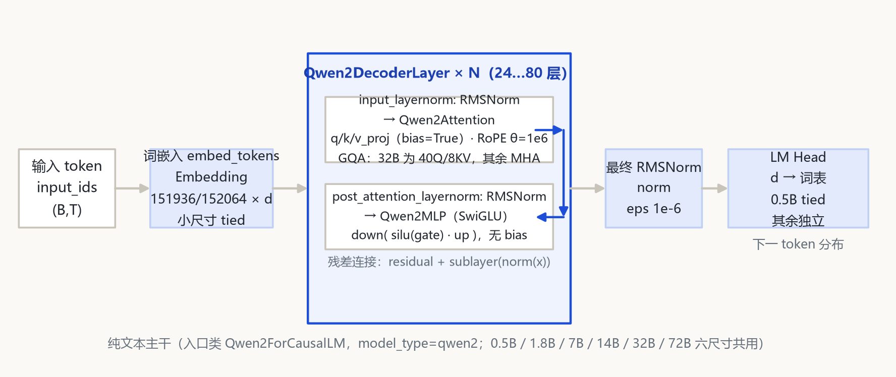
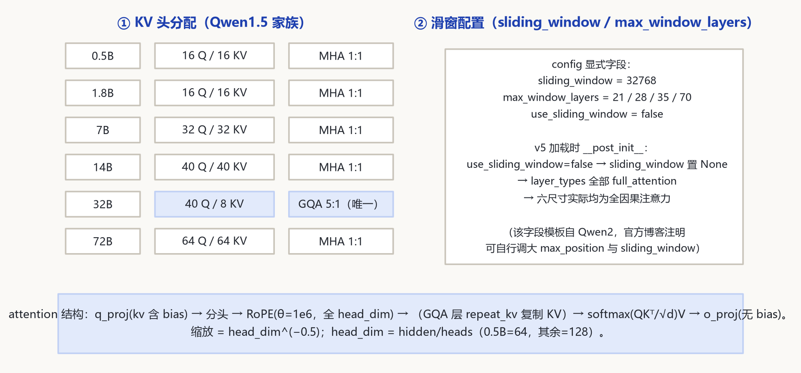

# Qwen 1.5 家族架构详解 — 0.5B / 1.8B / 7B / 14B / 32B / 72B（纯文本）

入口类：Qwen2ForCausalLM（model_type=qwen2，transformers≥4.37 原生支持，无需 trust_remote_code）；分词：Qwen2Tokenizer（tiktoken BPE，词表全系 151936/152064）；结构：SwiGLU + RMSNorm + RoPE θ=1e6 + 大尺寸 GQA；上下文：全系原生 32768；对话：ChatML（im_start/im_end）。

本页以 **本地 `E:\models\qwen\Qwen1.5-0.5B-Chat\config.json`** 为第一手锚点，其余五尺寸（1.8B/7B/14B/32B/72B-Chat）config 经 ModelScope 逐字段拉取核对，结构事实以 transformers v5 原生 `src\transformers\models\qwen2\modeling_qwen2.py / configuration_qwen2.py`（E:\transformers）为准。Qwen 1.5 没有自己的代码模块——它就是 Qwen2 的早期权重快照，config 里 model_type 直接写 qwen2。

## 1 家族全景：六个尺寸的架构对照

> 六尺寸均为纯文本 Dense 因果 LM，主干结构一致：embed_tokens → N 个 Qwen2DecoderLayer → 最终 RMSNorm → lm_head。差异集中在维度、层数、KV 头数（仅 32B GQA）与 tie 开关。参数量为按 config 逐模块复算。

### 1.1 核心超参数

| 字段 | 0.5B | 1.8B | 7B | 14B | 32B | 72B |
|---|---|---|---|---|---|---|
| architectures / model_type | Qwen2ForCausalLM / qwen2 | 同左 | 同左 | 同左 | 同左 | 同左 |
| hidden_size | 1024 | 2048 | 4096 | 5120 | 5120 | 8192 |
| num_hidden_layers | 24 | 24 | 32 | 40 | 64 | 80 |
| num_attention_heads (Q) | 16 | 16 | 32 | 40 | 40 | 64 |
| num_key_value_heads (KV) | 16 | 16 | 32 | 40 | 8 | 64 |
| head_dim | 64 | 128 | 128 | 128 | 128 | 128 |
| 头分配 | MHA 1:1 | MHA 1:1 | MHA 1:1 | MHA 1:1 | **GQA 5:1** | MHA 1:1 |
| intermediate_size | 2816 | 5504 | 11008 | 13696 | 27392 | 24576 |
| vocab_size | 151936 | 151936 | 151936 | 152064 | 152064 | 152064 |
| max_position_embeddings | 32768 | 32768 | 32768 | 32768 | 32768 | 32768 |
| rope_theta | 1e6 | 1e6 | 1e6 | 1e6 | 1e6 | 1e6 |
| sliding_window（配置字段） | 32768 | 32768 | 32768 | 32768 | 32768 | 32768 |
| use_sliding_window | false | false | false | false | false | false |
| max_window_layers | 21 | 21 | 28 | 35 | 35 | 70 |
| tie_word_embeddings | true | false | false | false | false | false |
| hidden_act / rms_norm_eps | silu / 1e-6 | 同左 | 同左 | 同左 | 同左 | 同左 |
| 参数量（按 config 复算） | ≈0.46B | ≈1.84B | ≈7.72B | ≈14.2B | ≈32.5B | ≈72.3B |

> 要点：① **32B 是全家族唯一 GQA**（40Q/8KV，5:1），其余五尺寸全是 MHA；② sliding_window=32768 是 Qwen2 模板遗留字段——v5 `__post_init__` 因 use_sliding_window=false 把它置 None，六尺寸实际全部 full_attention（详见 §5.2）；③ tie 只在 0.5B 为 true；④ 词表 14B/32B/72B 为 152064，小尺寸为 151936。

### 1.2 加载与分词规格

| 项 | 取值 | 来源 |
|---|---|---|
| 加载方式 | transformers≥4.37 原生 AutoModelForCausalLM.from_pretrained，免 trust_remote_code | Qwen 官方博客 qwen1.5；config auto_map 缺失即原生 |
| model_type | qwen2 | config 顶层 |
| tokenizer_class | Qwen2Tokenizer | tokenizer_config.json |
| chat_template | ChatML（im_start/im_end）已内置 | tokenizer_config.json |
| bos / eos / pad | bos=151643，eos=151645（Chat 版）；0.5B base 版 eos=bos=151643 | generation_config.json / tokenizer_config.json |

## 2 端到端数据流总览

> token id → embed_tokens 查表 → N 个 Qwen2DecoderLayer（input_layernorm: RMSNorm→Qwen2Attention→残差；post_attention_layernorm: RMSNorm→Qwen2MLP SwiGLU→残差）→ 最终 norm RMSNorm → lm_head 投影回词表。0.5B 的 lm_head 与 embed_tokens 共享权重（tie=true）。

### 2.1 架构图



> 全家族统一主干：`embed → N×Qwen2DecoderLayer → norm → lm_head`；差异在层数（24/24/32/40/64/80）、维度（1024→8192）、32B 的 GQA 与 0.5B 的 tie。

## 3 解码层解剖：Qwen2DecoderLayer（标准 pre-norm 双残差块）

> Qwen2DecoderLayer（modeling_qwen2.py:250-290）与后来 Qwen2 完全同源：先 RMSNorm 再进子层，残差在子层输出之后相加。与 Qwen1 的差别是——归一作用在子层**输入**（post_attention_layernorm 作用于注意力残差相加**之前**的 attn 输出，再与原残差相加），即标准 GPT 式 pre-norm。

```
Qwen2DecoderLayer.forward（modeling_qwen2.py:265-289）:
  residual = hidden_states
  hidden_states = input_layernorm(hidden_states)        # RMSNorm, eps 1e-6
  hidden_states, _, _ = self_attn(hidden_states, ...)
  hidden_states = residual + hidden_states              # ⊕1
  residual = hidden_states
  hidden_states = post_attention_layernorm(hidden_states)
  hidden_states = self.mlp(hidden_states)               # SwiGLU
  hidden_states = residual + hidden_states              # ⊕2
```

## 4 核心机制：SwiGLU · 分立 QKV 投影 · RoPE θ=1e6 · tie

### 4.1 ① SwiGLU MLP（Qwen2MLP）

三投影全部 bias=False（modeling_qwen2.py:34-47）：gate/up 把 d 投到 intermediate，down 把门控结果投回 d。与 Qwen1 的差别：intermediate 就是完整门控维（不再 ÷2）。

$$MLP(x) = down( silu(gate(x)) \odot up(x) )$$

```
self.gate_proj = Linear(hidden_size, intermediate_size, bias=False)
self.up_proj   = Linear(hidden_size, intermediate_size, bias=False)
self.down_proj = Linear(intermediate_size, hidden_size, bias=False)
# 0.5B inter 2816；7B inter 11008；32B inter 27392；72B inter 24576
```

### 4.2 ② 分立 Q/K/V/O 投影

不再是 Qwen1 的融合 c_attn：q/k/v 各一个 Linear，其中 q/k/v_proj 带 bias、o_proj 无 bias（modeling_qwen2.py:178-195）。这是 Qwen2 系（含本代）与 Qwen1 在投影形态上的直接代差。

```
q = q_proj(x)   # bias=True
k = k_proj(x)   # bias=True
v = v_proj(x)   # bias=True
# 分头 → RoPE（θ=1e6，全 head_dim）→ 32B GQA 层 repeat_kv 复制 KV
out = o_proj( attn_out )   # bias=False
scaling = head_dim ** -0.5
```

### 4.3 ③ RoPE 基频统一 1e6

Qwen2RotaryEmbedding（modeling_qwen2.py:50-94）按 head_dim 建逆频率表，base 统一取 config 的 rope_theta=1e6。全家族静态基频，不再有 Qwen1 的动态 NTK 与 LogN 开关——长上下文能力靠更大的训练窗口（32K）直接获得。

```
inv_freq_i = rope_theta ^ (-2i / head_dim) ,   rope_theta = 1e6
# head_dim：0.5B = 1024/16 = 64；其余尺寸 = hidden/heads = 128
# apply_rotary_pos_emb 作用于 q/k 全部 head_dim 维
```

### 4.4 ④ tie 与词表嵌入

embed_tokens 与 lm_head 的绑定由 tie_word_embeddings 控制：仅 0.5B 为 true（小模型省参数），1.8B 起全 false。Qwen2ForCausalLM 用 _tied_weights_keys 声明绑定关系（modeling_qwen2.py:398-）。

### 4.5 架构图



## 5 注意力机制：MHA 为主 · 32B 唯一 GQA · 滑窗字段实为国别遗留

### 5.1 KV 头分配

| 尺寸 | Q 头数 | KV 头数 | head_dim | GQA 分组 | Q 投影输出维 |
|---|---|---|---|---|---|
| 0.5B | 16 | 16 | 64 | MHA 1:1 | 16×64=1024 |
| 1.8B | 16 | 16 | 128 | MHA 1:1 | 16×128=2048 |
| 7B | 32 | 32 | 128 | MHA 1:1 | 32×128=4096 |
| 14B | 40 | 40 | 128 | MHA 1:1 | 40×128=5120 |
| 32B | 40 | 8 | 128 | **GQA 5:1** | 40×128=5120 |
| 72B | 64 | 64 | 128 | MHA 1:1 | 64×128=8192 |

> 32B 是全家族唯一 GQA：运行时 repeat_kv（modeling_qwen2.py:130-139）把 8 个 KV 头复制到 40 个 Q 头再做注意力。其余五尺寸 Q=KV，即 MHA。

### 5.2 滑窗字段的真相（sliding_window=32768 ≠ 真滑窗）

config 里显式写着 `sliding_window=32768`、`max_window_layers=21/28/35/35/70`，但 `use_sliding_window=false`。v5 configuration_qwen2.py 的 __post_init__ 据此把 sliding_window 置 None，layer_types 全部为 full_attention——**六尺寸实际都是全因果注意力，没有任何一层真开滑窗**。该字段是 Qwen2 模板的遗留占位（官方博客注明使用者可自行调大 max_position 与 sliding_window）。

```
v5 加载时 __post_init__:
  if use_sliding_window is False:
      sliding_window = None
  layer_types[i] = "sliding_attention" if (sliding_window 非 None 且 i >= max_window_layers)
                   else "full_attention"
# Qwen1.5 全系：sliding_window=None → 全部 full_attention
```

## 6 特殊 Token 与词表布局

| token | ID | 含义 | 来源 |
|---|---|---|---|
| pad_token_id | 151643 | endoftext 特殊 token，兼作 pad | config / tokenizer_config |
| eos_token_id（Chat 版） | 151645 | im_end（ChatML 结束） | generation_config.json |
| eos_token_id（0.5B base 版） | 151643 | endoftext（与 bos 同） | 0.5B base config |
| bos_token_id | 151643 | endoftext（Chat 版） | config |
| im_start / im_end | 151644 / 151645 | ChatML 对话模板起止标记 | tokenizer_config.json |
| vocab_size | 151936（0.5B/1.8B/7B）/ 152064（14B/32B/72B） | tiktoken BPE 词表 | config.json |

> ChatML 是 Qwen1.5 起写进 tokenizer_config.json 的内置对话模板：`<|im_start|>system\n...<|im_end|>\n<|im_start|>user\n...<|im_end|>\n<|im_start|>assistant\n...`——这与 Qwen1 把对话格式留在仓库代码里、tokenizer_config 只有 3 行的做法形成对照。

## 7 演进视角：Qwen 1 → Qwen 1.5，并指向 Qwen 2

| 维度 | Qwen 1（上一代） | Qwen 1.5（本代） |
|---|---|---|
| 代码形态 | 官方仓库 remote code（trust_remote_code） | 合并进 transformers≥4.37，Qwen2ForCausalLM 原生 |
| model_type | qwen | qwen2（无独立 1.5 模块） |
| QKV 投影 | 融合 c_attn：d→3d，无 bias | 分立 q/k/v_proj（q/k/v 带 bias）+ o_proj（无 bias） |
| 头结构 | 纯 MHA（Q=KV） | 小尺寸 MHA；**32B 首次 GQA（40Q/8KV）** |
| RoPE 基频 | 1e4 + 运行时动态 NTK（72B 直接 1e6） | 全系静态 rope_theta=1e6，无 NTK/logn 字段 |
| 长上下文技巧 | use_logn_attn（query 对数放大） | 取消；配置预留 sliding_window（本代实际关闭） |
| MLP | w1·silu(w2)，内维=inter/2 | 标准 SwiGLU：down(silu(gate)·up)，inter 即全门控维 |
| 归一化 | RMSNorm 1e-6 | RMSNorm 1e-6（延续） |
| LM Head | 全系列 tie=False | 仅 0.5B tie=True，其余 False |
| 词表 / 分词 | 151936/152064，QWenTokenizer(tiktoken) | 151936 统一口径，Qwen2Tokenizer；新增 im_start/im_end + ChatML 模板 |
| 原生上下文 | 训练 2048/8192，扩 32K | 全系原生 32768 |

> Qwen1.5 的定位：2024 春节前发布的"架构换血"一代——本体就是后来 Qwen2 的代码与配置形态（SwiGLU/RMSNorm/θ=1e6/分立投影），把 Qwen1 靠 remote code + NTK/logn 硬撑长上下文的做法，换成原生 32K、免 remote code、32B 引入 GQA。再往后的 Qwen2（2024 年中）沿同一 qwen2 代码路径扩展出 MoE 与更大尺寸，config 字段体系与本代完全兼容。

## 8 来源

1. 本地权威 config（Qwen1.5-0.5B-Chat，逐字段核对）
   `E:\models\qwen\Qwen1.5-0.5B-Chat\config.json（hidden 1024 / 24 层 / 16Q·16KV / head_dim 64 / inter 2816 / vocab 151936 / max_pos 32768 / sliding_window 32768 / max_window_layers 21 / rope_theta 1e6 / use_sliding_window false / tie=true / bos=151643 / eos=151645）`
2. transformers v5 原生源码（E:\transformers\src\transformers\models\qwen2\）
   `modeling_qwen2.py（Qwen2MLP 34-47；Qwen2RotaryEmbedding 50-94；repeat_kv 130-139；Qwen2Attention 168-226；Qwen2DecoderLayer 250-290；Qwen2Model 313-394；Qwen2ForCausalLM 398-）；configuration_qwen2.py（__post_init__ 处理 use_sliding_window/sliding_window/max_window_layers）`
3. 其余尺寸 config（ModelScope 拉取，2026-10-26 核对）
   `Qwen/Qwen1.5-1.8B-Chat（2048/24层/16·16/inter 5504/vocab 151936/mwl 21/tie false）；Qwen/Qwen1.5-7B-Chat（4096/32层/32·32/inter 11008/mwl 28）；Qwen/Qwen1.5-14B-Chat（5120/40层/40·40/inter 13696/vocab 152064/mwl 35）；Qwen/Qwen1.5-32B-Chat（5120/64层/40Q·8KV/inter 27392/vocab 152064/mwl 35）；Qwen/Qwen1.5-72B-Chat（8192/80层/64·64/inter 24576/vocab 152064/mwl 70）`
4. Qwen 官方博客：Qwen 1.5 发布说明
   `https://qwenlm.github.io/blog/qwen1.5/（2024 春节前发布；合并进 transformers≥4.37 免 remote code；全系 32K 上下文；ChatML 模板）`
5. Qwen 官方仓库与模型卡片
   `https://github.com/QwenLM/Qwen ；https://huggingface.co/Qwen ；https://modelscope.cn/organization/qwen`

> 标注约定：行号均指 E:\transformers\src\transformers\models\qwen2\modeling_qwen2.py。1.8B/7B/14B/32B/72B 未在本地落盘，其 config 数字来自 ModelScope 对应仓库 config.json 原文。参数量为按 config 逐模块复算（未含 RMSNorm 缩放项）。核验日期：2026-10-26。

页脚：Qwen 1.5 家族架构详解 · 数据来源：本地 0.5B config + transformers v5 qwen2 源码 + ModelScope 其余尺寸 config + Qwen 官方博客 · 仅供技术学习与论文研究。
