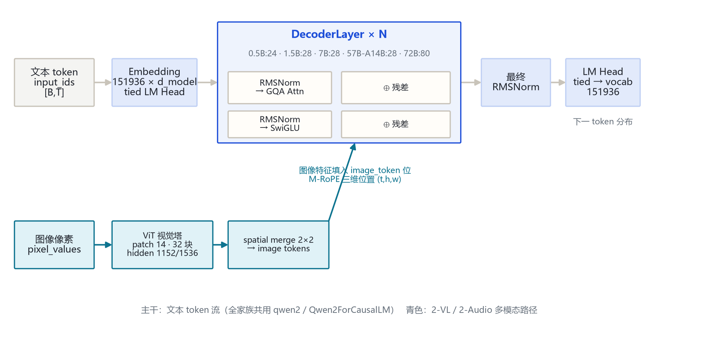
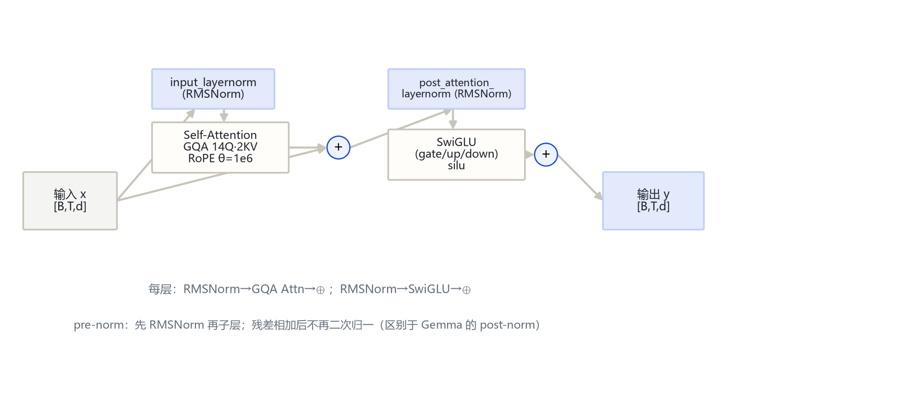
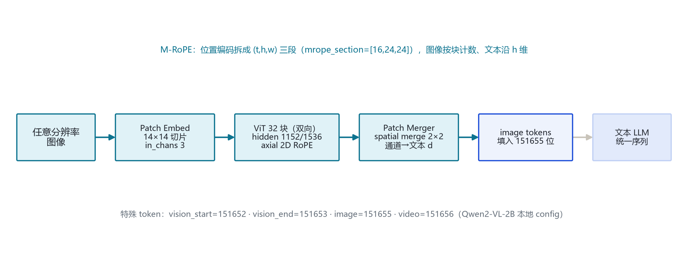

# Qwen 2 家族架构详解 — 0.5B / 1.5B / 7B / 57B-A14B(MoE) / 72B（文本 + 2-VL / 2-Audio 多模态）

- 徽标：入口类 Qwen2ForCausalLM（文本全系）/ Qwen2VLForConditionalGeneration（2-VL）
- 徽标：GQA 全系标配（最小 0.5B 即 14Q·2KV）· 滑窗注意力 sliding_window 32768 / max_window_layers
- 徽标：首个 MoE（57B-A14B，64 专家选 8 + 共享专家）· 2-VL（patch 14 · M-RoPE · 动态分辨率）
- 徽标：词表 151936 · RoPE θ=1e6 · RMSNorm ε=1e-6 · SwiGLU（silu）

本页以 **本机真实 `config.json`**（`E:\models\qwen\Qwen2-0.5B-Instruct` 与 `E:\models\qwen\Qwen2-VL-2B-Instruct`）+ **HF 官方 model card / config**（hf-mirror 拉取的 1.5B / 7B / 57B-A14B / 72B）与 **transformers 源码 `qwen2\modeling_qwen2.py`、`qwen2_vl\modeling_qwen2_vl.py`**（本地 E:\transformers，v5.21.0.dev0）为唯一依据。文本全系统一走 `qwen2` 模块（Qwen2ForCausalLM）；2-VL 走 `qwen2_vl`；MoE 走 `qwen2_moe`；2-Audio 走 `qwen2_audio`。所有数字均标注来源（config 字段或源码文件:行号）。

## 1 家族全景：五个尺寸的架构对照

> 0.5B / 1.5B 为小尺寸（tie_word_embeddings=true，词表 151936）；7B / 57B-A14B / 72B 为大尺寸（tie=false，词表 152064）。下表逐字段给出 config 实参；本地锚点为 0.5B 与 2-VL-2B，其余尺寸来自官方 HF config（hf-mirror，2026-10-26 核验）。

### 1.1 文本塔核心超参数

| 字段 | Qwen2-0.5B | Qwen2-1.5B | Qwen2-7B | Qwen2-57B-A14B (MoE) | Qwen2-72B |
|---|---|---|---|---|---|
| 入口类 architectures | Qwen2ForCausalLM | Qwen2ForCausalLM | Qwen2ForCausalLM | Qwen2MoeForCausalLM | Qwen2ForCausalLM |
| model_type | qwen2 | qwen2 | qwen2 | qwen2_moe | qwen2 |
| 形态 | Dense | Dense | Dense | **MoE（64 专家选 8）** | Dense |
| hidden_size | 896 | 1536 | 3584 | 3584 | 8192 |
| num_hidden_layers | 24 | 28 | 28 | 28 | 80 |
| num_attention_heads (Q) | 14 | 12 | 28 | 28 | 64 |
| num_key_value_heads (KV) | 2 | 2 | 4 | 4 | 8 |
| GQA 分组 | 7:1 | 6:1 | 7:1 | 7:1 | 8:1 |
| intermediate_size | 4864 | 8960 | 18944 | 18944 | 29568 |
| sliding_window | 32768 | 32768 | 131072 | 65536 | 131072 |
| max_window_layers | 24 | 28 | 28 | 28 | 80 |
| max_position_embeddings | 32768 | 32768 | 32768 | 32768 | 32768 |
| rope_theta | 1000000.0 | 1000000.0 | 1000000.0 | 1000000.0 | 1000000.0 |
| vocab_size | 151936 | 151936 | 152064 | 151936 | 152064 |
| tie_word_embeddings | true | true | false | false | false |
| num_experts / 每 token 激活 | — | — | — | 64 / 8 | — |

> 要点：**GQA 全系标配**——从最小 0.5B（14Q·2KV）到 72B（64Q·8KV）全部分组；这是 Qwen2 相对 Qwen1.5（仅大尺寸 GQA、小尺寸 MHA）的代际变化。滑窗窗口在小尺寸为 32768、大尺寸为 131072/65536。57B-A14B 是 Qwen 首个 MoE：总参数 57B、每 token 激活约 14B。

### 1.2 变体与部署规格

| 项目 | 取值 | 来源 |
|---|---|---|
| 2-VL 视觉塔（本地 2B） | hidden 1536 · 32 块 · 16 头 · patch 14 · temporal 2 · spatial_merge 2 | 本地 config vision_config |
| 2-VL 文本栈（2B） | hidden 1536 · 28 层 · 12Q·2KV · inter 8960 | 本地 config |
| 2-Audio | 走 qwen2_audio 模块（音频编码器 + 文本 LLM） | transformers 源码 |
| 2-Math | 代码/数学专精变体（base 同 2.5 系，数学训练） | 官方 model card |
| 2-Coder | 代码专精变体 | 官方 model card |
| 上下文长度 | 32K（文本 base）；2-VL 动态分辨率 | 官方 config / model card |
| 特殊 token | vision_start=151652 · vision_end=151653 · image=151655 · video=151656 | 本地 2-VL config |

## 2 端到端数据流总览

> 文本 token 经 Embedding（151936 × d_model，小尺寸与 LM Head 共享权重）→ **N 个 DecoderLayer**（pre-norm RMSNorm → GQA 注意力 → 残差；再 RMSNorm → SwiGLU → 残差）→ 最终 RMSNorm → LM Head。2-VL 另起一路：图像经 ViT（patch 14）编码、spatial merge 2×2 压成 image tokens，填入序列中 image_token（151655）位，统一走 M-RoPE 三维位置。

### 2.1 架构图



> 全家族统一主干：`Embedding → DecoderLayer×N → 最终 RMSNorm → LM Head`；差异集中在层数、维度、KV 头数、滑窗窗口，以及是否挂 ViT 视觉塔（2-VL）。

## 3 解码层解剖：pre-norm RMSNorm 残差块

> Qwen2 的每个解码层（`Qwen2DecoderLayer`，modeling_qwen2.py:250-290）含两组残差子层：注意力与 FFN，均为 **pre-norm**（先 RMSNorm 再子层，结果与残差相加）。五尺寸共享此结构，仅维度随尺寸缩放。

### 3.1 架构图



```
Qwen2DecoderLayer.forward（modeling_qwen2.py:261-290）:
  residual = hidden_states
  hidden_states = input_layernorm(hidden_states)          # RMSNorm
  hidden_states, _ = self_attn(hidden_states, position_embeddings, ...)
  hidden_states = residual + hidden_states                # ⊕1
  residual = hidden_states
  hidden_states = post_attention_layernorm(hidden_states) # RMSNorm
  hidden_states = self.mlp(hidden_states)                 # SwiGLU
  hidden_states = residual + hidden_states               # ⊕2
  return hidden_states
```

> 注意与 Gemma 3 的 post-norm 不同：Qwen2 只在子层**前**做 RMSNorm，残差相加后不再二次归一。Q/K/V/O 投影中 q/k/v 带 bias、o 不带 bias（modeling_qwen2.py:181-184）。

## 4 核心机制：GQA · 滑窗注意力 · SwiGLU · RoPE

### 4.1 ① GQA 分组与 repeat_kv

Qwen2 注意力把 Q 头数按 KV 头数分组，运行时 `repeat_kv` 把 K/V 从 KV 头复制到 Q 头数再做缩放点积注意力（modeling_qwen2.py:130-140, 198-225）。

$$\mathrm{Attn}(Q,K,V)=\mathrm{softmax}\!\left(\frac{QK^\top}{\sqrt{d_k}}+\mathrm{mask}\right)V$$

- 分组比：0.5B 7:1、1.5B 6:1、7B/57B-A14B 7:1、72B 8:1。
- `scaling = head_dim^-0.5`（modeling_qwen2.py:178）。

### 4.2 ② 滑窗注意力（layer_types 分层）

v5 的 `Qwen2Config.__post_init__` 按层索引生成 `layer_types`：当 `sliding_window is not None` 且层索引 `i >= max_window_layers` 时为 `sliding_attention`，否则 `full_attention`（configuration_qwen2.py:88-94）。`Qwen2Attention` 仅在 `layer_type == "sliding_attention"` 层挂上 `sliding_window`（modeling_qwen2.py:185）。

```
layer_types = ["sliding_attention" if (sliding_window is not None
               and i >= max_window_layers) else "full_attention"
               for i in range(num_hidden_layers)]
# Qwen2-0.5B: 24 层, max_window_layers=24
# Qwen2-7B:   28 层, max_window_layers=28, 窗 131072
```

> 踩坑：本机 config 与官方 HF config 均带 `use_sliding_window=false`，v5 `__post_init__` 据此把 `sliding_window` 置 None、全层退化为 `full_attention`（configuration_qwen2.py:84）。即当前 v5 推理时文本塔按全注意力运行；SWA 机制保留在源码中，供开启该开关的配置使用。

### 4.3 ③ RMSNorm 与 SwiGLU

RMSNorm 先 fp32 归一，再乘可学习权重 γ（modeling_qwen2.py:230-247）。FFN 为三投影门控 SwiGLU（silu 激活）。

$$\mathrm{RMS}(x)=\sqrt{\mathrm{mean}(x^2)+\epsilon},\qquad y=\gamma\cdot x/\mathrm{RMS}(x)$$

$$\mathrm{FFN}(x)=\mathrm{down}\big(\mathrm{silu}(\mathrm{gate}(x))\odot \mathrm{up}(x)\big)$$

### 4.4 ④ RoPE（θ=1e6）

旋转位置编码基频 `rope_theta=1000000.0`（本地 config）。逆频率 `inv_freq_i = base^(-2i/head_dim)`，对 Q/K 前若干维做旋转。2-VL 另用 M-RoPE（见 §6）。

### 4.5 ⑤ MoE（57B-A14B）

Qwen2 首个 MoE 走 `qwen2_moe`（Qwen2MoeForCausalLM）：`num_experts=64`、`num_experts_per_tok=8`，含共享专家。文本栈维度与 7B 相同（hidden 3584 / 28 层 / 28Q·4KV）。

## 5 注意力机制：GQA KV 头分配

### 5.1 各尺寸 KV 头分配（repeat_kv）

| 尺寸 | Q 头数 | KV 头数 | GQA 分组 | head_dim | Q 投影输出维 |
|---|---|---|---|---|---|
| 0.5B | 14 | 2 | 7:1 | 64 | 14×64=896 |
| 1.5B | 12 | 2 | 6:1 | 128 | 12×128=1536 |
| 7B | 28 | 4 | 7:1 | 128 | 28×128=3584 |
| 57B-A14B | 28 | 4 | 7:1 | 128 | 28×128=3584 |
| 72B | 64 | 8 | 8:1 | 128 | 64×128=8192 |

> `head_dim = hidden_size // num_attention_heads`（modeling_qwen2.py:176，无独立 head_dim 字段）。运行时 `repeat_kv` 把 K/V 复制到 Q 头数（modeling_qwen2.py:130-140）。

### 5.2 滑窗 vs 全局

| 层类型 | 掩码 | KV cache | 触发条件 |
|---|---|---|---|
| full_attention | 全因果 | 全历史 | i < max_window_layers 或 sliding_window=None |
| sliding_attention | 滑窗因果（窗 32768/131072） | 仅最近窗口 | i >= max_window_layers 且开启 SWA |

```
eager_attention_forward（modeling_qwen2.py:142-166）:
scaling  = head_dim ** -0.5
key/vals = repeat_kv(key, num_key_value_groups)
attn     = (query · keyᵀ) * scaling
attn     = softmax(attn + mask, fp32)
output   = attn @ value        # sliding_window 仅在 sliding 层传入（:220）
```

## 6 多模态：2-VL 视觉塔与文本融合

### 6.1 视觉塔 config（本地 2-B 锚点）

| 字段（vision_config） | 取值 | 字段 | 取值 |
|---|---|---|---|
| model_type（顶层） | qwen2_vl / Qwen2VLForConditionalGeneration | embed_dim | 1280 |
| depth（ViT 块数） | 32 | num_heads | 16 |
| in_chans | 3 | hidden_size | 1536 |
| patch_size | 14 | spatial_patch_size | 14 |
| temporal_patch_size | 2 | spatial_merge_size | 2 |

> 视觉塔由 `Qwen2VisionTransformerPretrainedModel` 构造（modeling_qwen2_vl.py:667）；PatchEmbed 278、PatchMerger 304、VisionAttention 369、Qwen2VLVisionBlock 452。投影后通道对齐文本 hidden（spatial_merge 2×2 把视觉 token 数再压 1/4）。

### 6.2 M-RoPE 与动态分辨率



2-VL 用多模态 RoPE：位置编码沿 (t,h,w) 三维拆分，`mrope_section=[16,24,24]`（本地 config rope_scaling）。图像按 patch 块计数、文本沿高度维排列，支持任意分辨率（动态分辨率，非 448 固定切图）。

```
Qwen2VLModel.get_rope_index / compute_3d_position_ids（modeling_qwen2_vl.py:918, 1095）:
  图像特征 → ViT(patch14) → spatial_merge 2×2 → image tokens
  填入 input_ids 中 image_token_id=151655 位
  位置 id 按 (t,h,w) 三维分别生成，文本沿 h 维递增
```

> 融合后文本 LLM 收到统一 inputs_embeds 继续前向（Qwen2VLForConditionalGeneration.forward，:1267）。transformers v5 中 VL 模型须用 `AutoModelForImageTextToText` 加载（`AutoModelForVision2Seq` 已移除）。

## 7 特殊 Token 与词表布局

| token | ID | 含义 | 来源 |
|---|---|---|---|
| bos_token_id | 151643 | 序列开始 | 本地 config |
| eos_token_id | 151645 | 序列结束 | 本地 config |
| vision_start_token_id | 151652 | 视觉块开始 | 本地 2-VL config |
| vision_end_token_id | 151653 | 视觉块结束 | 本地 2-VL config |
| vision_token_id | 151654 | 视觉占位 | 本地 2-VL config |
| image_token_id | 151655 | 图像特征占位 | 本地 2-VL config |
| video_token_id | 151656 | 视频特征占位 | 本地 2-VL config |

> 词表 `vocab_size=151936`（小尺寸）/152064（大尺寸，64 对齐补全）。特殊 token 151652–151656 仅在 2-VL config 顶层显式列出；纯文本 config 只有 bos/eos。

## 8 演进视角：Qwen1.5 → Qwen 2

| 维度 | Qwen1.5（基线） | Qwen 2（家族） |
|---|---|---|
| GQA | 仅大尺寸引入，小尺寸仍 MHA | **全系标配 GQA**（0.5B 即 14Q·2KV） |
| 滑窗注意力 | 无 | **引入 SWA**（sliding_window 32768/131072 + max_window_layers） |
| MoE | 无 | **首个 MoE**：57B-A14B（64 专家选 8 + 共享专家） |
| 多模态 | 无原生视觉 | **2-VL**（patch 14 · M-RoPE · 动态分辨率）+ 2-Audio |
| 上下文 | 32768 | 32768（文本 base）；大尺寸窗 131072 支持长上下文扩展 |
| 归一化 / 激活 | RMSNorm · SwiGLU | 相同（延续） |
| 词表 | 151936 | 151936（小）/ 152064（大） |

> Qwen 2 的主线升级：① GQA 从大尺寸下放到全系最小 0.5B；② 引入滑窗注意力 SWA（layer_types 分层）；③ 首个 MoE 57B-A14B（细粒度专家 + 共享专家）；④ 多模态 2-VL（patch 14 + M-RoPE + 动态分辨率）与 2-Audio。Qwen1.5 侧数字为官方公开口径；Qwen2 侧数字均来自本页 config 与源码。

## 9 来源

1. 本地权威 config（0.5B 文本，逐字段核对）
   `E:\models\qwen\Qwen2-0.5B-Instruct\config.json（hidden 896 / 24 层 / 14Q·2KV / inter 4864 / sliding 32768 / max_window_layers 24 / ropeθ1e6 / vocab 151936 / max 32768 / tie=true）`
2. 本地权威 config（2-VL-2B 多模态）
   `E:\models\qwen\Qwen2-VL-2B-Instruct\config.json（hidden 1536 / 28 层 / 12Q·2KV / vision_config: embed 1280·depth 32·patch14·temporal2·spatial_merge2 / vision_start·end 151652·151653 / image 151655 / video 151656）`
3. 其余尺寸 config（HF hf-mirror 拉取，2026-10-26 核验）
   `Qwen2-1.5B-Instruct（1536/28层/12Q·2KV/inter8960）；Qwen2-7B-Instruct（3584/28层/28Q·4KV/inter18944/sliding131072/vocab152064）；Qwen2-57B-A14B-Instruct（3584/28层/28Q·4KV/64专家选8/sliding65536）；Qwen2-72B-Instruct（8192/80层/64Q·8KV/inter29568）`
4. transformers 源码 modeling_qwen2.py（本地 E:\transformers）
   `Qwen2MLP 34；RotaryEmbedding 50；repeat_kv 130；eager attention 142；Qwen2Attention 168（head_dim 176 / scaling 178 / sliding_window 185）；RMSNorm 230；DecoderLayer 250；Qwen2Model 313；Qwen2ForCausalLM 398`
5. transformers 源码 configuration_qwen2.py
   `Qwen2Config 25（vocab 151936 / sliding_window 默认 4096 / max_window_layers 28）；__post_init__ 83（use_sliding_window 关闭则 sliding_window=None；layer_types 88-94）`
6. transformers 源码 modeling_qwen2_vl.py
   `Qwen2VLRotaryEmbedding 111；PatchEmbed 278；PatchMerger 304；VisionAttention 369；VisionBlock 452；VisionTransformer 667；TextModel 737；Qwen2VLModel 852（get_rope_index 918 / get_image_features 1041 / compute_3d_position_ids 1095 / forward 1146）；ForConditionalGeneration 1228`
7. Qwen2 技术报告（arXiv 2407.10671）
   `https://arxiv.org/abs/2407.10671（5 尺寸 0.5B/1.5B/7B/57B-A14B/72B；GQA；SWA；MoE；2-VL/2-Audio）`
8. Qwen2-VL 技术报告（arXiv 2409.12191）
   `https://arxiv.org/abs/2409.12191（patch 14 · M-RoPE · 动态分辨率）`
9. Qwen 官方组织页与 ModelScope 镜像
   `https://huggingface.co/Qwen ；https://modelscope.cn/organization/qwen`

> 标注约定：[S:n]=modeling_qwen2.py 行号；[CFG:n]=configuration_qwen2.py 行号。0.5B/2-VL-2B 为本地 config 实参，其余尺寸来自 HF hf-mirror config。访问与核验日期：2026-10-26。

---

*页脚：Qwen 2 家族架构详解 · 数据来源：本地/ModelScope config + transformers 源码 + arXiv 2407.10671 / 2409.12191 · 仅供技术学习与论文研究*
