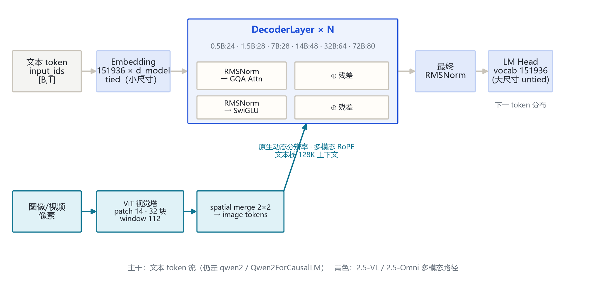
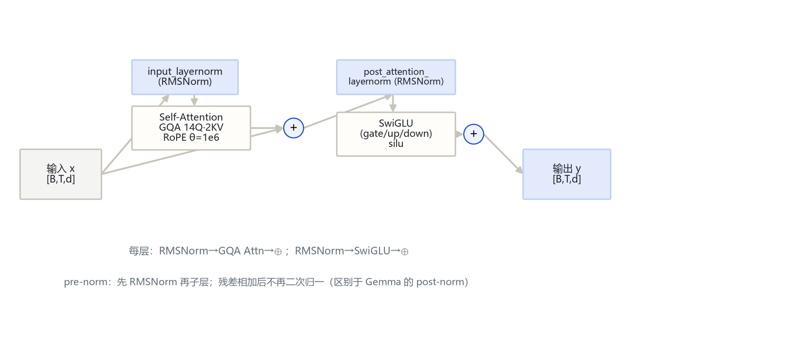
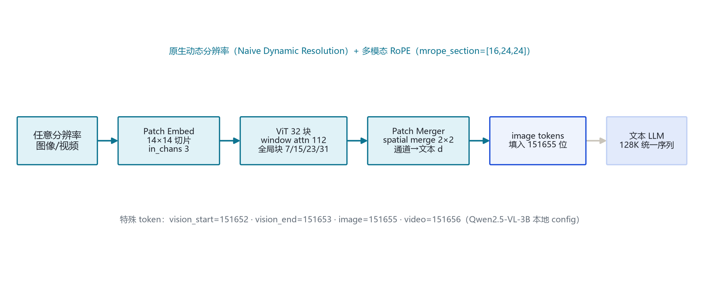

# Qwen 2.5 家族架构详解 — 0.5B / 1.5B / 7B / 14B / 32B / 72B（文本 + 2.5-VL 多模态）

- 徽标：入口类 Qwen2ForCausalLM（文本全系，仍走 qwen2 模块）/ Qwen2_5_VLForConditionalGeneration（2.5-VL）
- 徽标：文本架构延续 qwen2（0.5B 级 config 与 Qwen2-0.5B 同规格：896/24层/14Q·2KV/inter4864）
- 徽标：2.5-VL 上下文 128K · 视觉塔 window attention（窗 112，全局块 7/15/23/31）· 原生动态分辨率
- 徽标：新增 2.5-Coder / 2.5-Omni / 2.5-Max（闭源 API）· 词表 151936（小）/152064（大）

本页以 **本机真实 `config.json`**（`E:\models\qwen\Qwen2.5-0.5B-Instruct` 与 `E:\models\qwen\Qwen2.5-VL-3B-Instruct`）+ **HF 官方 model card / config**（hf-mirror 拉取的 1.5B/7B/14B/32B/72B 与 2.5-VL-7B/32B/72B）与 **transformers 源码 `qwen2\modeling_qwen2.py`、`qwen2_5_vl\modeling_qwen2_5_vl.py`**（本地 E:\transformers，v5.21.0.dev0）为唯一依据。文本全系仍走 `qwen2` 模块（Qwen2ForCausalLM）；2.5-VL 走 `qwen2_5_vl`；2.5-Omni 走 `qwen2_5_omni`。所有数字均标注来源（config 字段或源码文件:行号）。

## 1 家族全景：六个尺寸的架构对照

> Qwen2.5 文本栈与 Qwen2 共用 `qwen2` model_type（0.5B 级 config 与 Qwen2-0.5B 同规格），差异在层数/维度规模与滑窗阈值 `max_window_layers`。本地锚点为 0.5B 与 2.5-VL-3B，其余尺寸来自官方 HF config（hf-mirror，2026-10-26 核验）。

### 1.1 文本塔核心超参数

| 字段 | Qwen2.5-0.5B | Qwen2.5-1.5B | Qwen2.5-7B | Qwen2.5-14B | Qwen2.5-32B | Qwen2.5-72B |
|---|---|---|---|---|---|---|
| 入口类 | Qwen2ForCausalLM | Qwen2ForCausalLM | Qwen2ForCausalLM | Qwen2ForCausalLM | Qwen2ForCausalLM | Qwen2ForCausalLM |
| model_type | qwen2 | qwen2 | qwen2 | qwen2 | qwen2 | qwen2 |
| 形态 | Dense | Dense | Dense | Dense | Dense | Dense |
| hidden_size | 896 | 1536 | 3584 | 5120 | 5120 | 8192 |
| num_hidden_layers | 24 | 28 | 28 | 48 | 64 | 80 |
| num_attention_heads (Q) | 14 | 12 | 28 | 40 | 40 | 64 |
| num_key_value_heads (KV) | 2 | 2 | 4 | 8 | 8 | 8 |
| GQA 分组 | 7:1 | 6:1 | 7:1 | 5:1 | 5:1 | 8:1 |
| intermediate_size | 4864 | 8960 | 18944 | 13824 | 27648 | 29568 |
| sliding_window | 32768 | 32768 | 131072 | 131072 | 131072 | 131072 |
| max_window_layers | 21 | 21 | 28 | 70 | 70 | 70 |
| max_position_embeddings | 32768 | 32768 | 32768 | 32768 | 32768 | 32768 |
| rope_theta | 1000000.0 | 1000000.0 | 1000000.0 | 1000000.0 | 1000000.0 | 1000000.0 |
| vocab_size | 151936 | 151936 | 152064 | 152064 | 152064 | 152064 |
| tie_word_embeddings | true | true | false | false | false | false |

> 要点：**0.5B 级 config 与 Qwen2-0.5B 完全同规格**（hidden 896 / 24 层 / 14Q·2KV / inter 4864），唯一差别是 `max_window_layers` 由 24 调为 21。大尺寸（14B/32B/72B）`max_window_layers=70`（大于文本层数时 SWA 不触发）。GQA 全系延续。

### 1.2 变体与部署规格

| 项目 | 取值 | 来源 |
|---|---|---|
| 2.5-VL（本地 3B 锚点） | hidden 2048 · 36 层 · 16Q·2KV · inter 11008 · max_pos 128000 | 本地 config |
| 2.5-VL 视觉塔（3B） | hidden 1280 · depth 32 · patch 14 · window 112 · 全局块 [7,15,23,31] · out 2048 | 本地 vision_config |
| 2.5-VL 尺寸 | 3B / 7B / 32B / 72B（max_pos 均 128000） | HF config |
| 2.5-Coder | 代码专精变体（arXiv 2409.12186） | 官方 model card |
| 2.5-Omni | 全模态变体（走 qwen2_5_omni 模块） | transformers 源码 |
| 2.5-Max | 闭源 API 大 MoE（非开放权重） | 官方博客 |
| 上下文长度 | 32K（文本 base）；2.5-VL 128K | 官方 config / model card |

## 2 端到端数据流总览

> 文本 token 经 Embedding（151936 × d_model，小尺寸与 LM Head 共享）→ **N 个 DecoderLayer**（pre-norm RMSNorm → GQA 注意力 → 残差；再 RMSNorm → SwiGLU → 残差）→ 最终 RMSNorm → LM Head。2.5-VL 另起一路：图像/视频经 ViT（patch 14，window attention）编码、spatial merge 2×2 压成 image tokens，填入 image_token（151655）位，统一走多模态 RoPE。

### 2.1 架构图



> 全家族统一主干：`Embedding → DecoderLayer×N → 最终 RMSNorm → LM Head`；文本栈与 Qwen2 同构（qwen2 模块），差异在层数/维度与是否挂带 window attention 的 ViT（2.5-VL）。

## 3 解码层解剖：pre-norm RMSNorm 残差块

> Qwen2.5 文本层（`Qwen2DecoderLayer`，modeling_qwen2.py:250-290）与 Qwen2 完全同构：两组 pre-norm 残差子层。六尺寸共享此结构，仅维度随尺寸缩放。

### 3.1 架构图



```
Qwen2DecoderLayer.forward（modeling_qwen2.py:261-290）:
  residual = hidden_states
  hidden_states = input_layernorm(hidden_states)          # RMSNorm
  hidden_states, _ = self_attn(hidden_states, position_embeddings, ...)
  hidden_states = residual + hidden_states                # ⊕1
  residual = hidden_states
  hidden_states = post_attention_layernorm(hidden_states) # RMSNorm
  hidden_states = self.mlp(hidden_states)              # SwiGLU
  hidden_states = residual + hidden_states              # ⊕2
  return hidden_states
```

> 2.5-VL 文本层为 `Qwen2_5_VLDecoderLayer`（modeling_qwen2_5_vl.py:689），结构相同，仅位置编码换为多模态 RoPE。

## 4 核心机制：GQA · 滑窗注意力 · 原生动态分辨率 · 多模态 RoPE

### 4.1 ① GQA 分组与 repeat_kv

Qwen2.5 文本注意力与 Qwen2 一致：`repeat_kv` 把 K/V 从 KV 头复制到 Q 头数再做缩放点积注意力（modeling_qwen2.py:130-140, 198-225）。

$$\mathrm{Attn}(Q,K,V)=\mathrm{softmax}\!\left(\frac{QK^\top}{\sqrt{d_k}}+\mathrm{mask}\right)V$$

- 分组比：0.5B 7:1、1.5B 6:1、7B 7:1、14B/32B 5:1、72B 8:1。
- `scaling = head_dim^-0.5`（modeling_qwen2.py:178）。

### 4.2 ② 滑窗注意力（layer_types 分层）

v5 的 `Qwen2Config.__post_init__` 按层索引生成 `layer_types`：当 `sliding_window is not None` 且层索引 `i >= max_window_layers` 时为 `sliding_attention`，否则 `full_attention`（configuration_qwen2.py:88-94）。

```
layer_types = ["sliding_attention" if (sliding_window is not None
               and i >= max_window_layers) else "full_attention"
               for i in range(num_hidden_layers)]
# Qwen2.5-0.5B: 24 层, max_window_layers=21（顶部 3 层滑窗）
# Qwen2.5-72B:  80 层, max_window_layers=70（顶部 10 层滑窗）
```

> 踩坑：本机 config 与官方 HF config 均带 `use_sliding_window=false`，v5 `__post_init__` 据此把 `sliding_window` 置 None、全层退化为 `full_attention`（configuration_qwen2.py:84）。即当前 v5 推理时文本塔按全注意力运行。

### 4.3 ③ RMSNorm 与 SwiGLU

RMSNorm 先 fp32 归一再乘 γ（modeling_qwen2.py:230-247）；FFN 为三投影门控 SwiGLU（silu）。

$$\mathrm{RMS}(x)=\sqrt{\mathrm{mean}(x^2)+\epsilon},\qquad y=\gamma\cdot x/\mathrm{RMS}(x)$$

$$\mathrm{FFN}(x)=\mathrm{down}\big(\mathrm{silu}(\mathrm{gate}(x))\odot \mathrm{up}(x)\big)$$

### 4.4 ④ RoPE（θ=1e6）与多模态 RoPE

文本旋转位置编码基频 `rope_theta=1000000.0`。2.5-VL 用多模态 RoPE：`mrope_section=[16,24,24]`，位置沿 (t,h,w) 三维拆分（modeling_qwen2_5_vl.py:501-558, get_rope_index 941）。

### 4.5 ⑤ 原生动态分辨率（Naive Dynamic Resolution）

2.5-VL 不做 448 固定切图：按 patch 14×14 直接切任意分辨率图像，经 ViT window attention（窗 112，全局块 7/15/23/31）编码，再 spatial merge 2×2。支持高分辨率文档与长视频。

## 5 注意力机制：GQA KV 头分配

### 5.1 各尺寸 KV 头分配（repeat_kv）

| 尺寸 | Q 头数 | KV 头数 | GQA 分组 | head_dim | Q 投影输出维 |
|---|---|---|---|---|---|
| 0.5B | 14 | 2 | 7:1 | 64 | 14×64=896 |
| 1.5B | 12 | 2 | 6:1 | 128 | 12×128=1536 |
| 7B | 28 | 4 | 7:1 | 128 | 28×128=3584 |
| 14B | 40 | 8 | 5:1 | 128 | 40×128=5120 |
| 32B | 40 | 8 | 5:1 | 128 | 40×128=5120 |
| 72B | 64 | 8 | 8:1 | 128 | 64×128=8192 |

> `head_dim = hidden_size // num_attention_heads`（modeling_qwen2.py:176）。运行时 `repeat_kv` 复制 K/V（:130-140）。

### 5.2 滑窗 vs 全局

| 层类型 | 掩码 | KV cache | 触发条件 |
|---|---|---|---|
| full_attention | 全因果 | 全历史 | i < max_window_layers 或 sliding_window=None |
| sliding_attention | 滑窗因果（窗 32768/131072） | 仅最近窗口 | i >= max_window_layers 且开启 SWA |

```
eager_attention_forward（modeling_qwen2.py:142-166）:
scaling  = head_dim ** -0.5
key/vals = repeat_kv(key, num_key_value_groups)
attn     = (query · keyᵀ) * scaling
attn     = softmax(attn + mask, fp32)
output   = attn @ value        # sliding_window 仅在 sliding 层传入（:220）
```

## 6 多模态：2.5-VL 视觉塔与文本融合

### 6.1 视觉塔 config（本地 3-B 锚点）

| 字段（vision_config） | 取值 | 字段 | 取值 |
|---|---|---|---|
| model_type（顶层） | qwen2_5_vl / Qwen2_5_VLForConditionalGeneration | hidden_size | 1280 |
| depth（ViT 块数） | 32 | num_heads | 16 |
| patch_size | 14 | spatial_patch_size | 14 |
| temporal_patch_size | 2 | spatial_merge_size | 2 |
| window_size | 112 | fullatt_block_indexes | [7, 15, 23, 31] |
| out_hidden_size | 2048 | intermediate_size | 3420 |

> 视觉塔由 `Qwen2_5_VisionTransformerPretrainedModel` 构造（modeling_qwen2_5_vl.py:383）；PatchEmbed 94、PatchMerger 181、VisionAttention 255、VisionBlock 338。window attention：32 块中仅 7/15/23/31 为全局注意力，其余窗 112。

### 6.2 原生动态分辨率与多模态 RoPE



2.5-VL 用多模态 RoPE：`mrope_section=[16,24,24]`，位置沿 (t,h,w) 三维拆分（本地 config rope_scaling）。原生动态分辨率按 patch 14 直接切任意分辨率，不经 448 固定缩放。

```
Qwen2_5_VLModel.get_rope_index / compute_3d_position_ids（modeling_qwen2_5_vl.py:941, 1130）:
  图像特征 → ViT(patch14, window attn) → spatial_merge 2×2 → image tokens
  填入 input_ids 中 image_token_id=151655 位
  位置 id 按 (t,h,w) 三维分别生成，文本沿 h 维递增
```

> 融合后文本 LLM 收到统一 inputs_embeds 继续前向（Qwen2_5_VLForConditionalGeneration.forward，:1322）。transformers v5 中 VL 模型须用 `AutoModelForImageTextToText` 加载。

## 7 特殊 Token 与词表布局

| token | ID | 含义 | 来源 |
|---|---|---|---|
| bos_token_id | 151643 | 序列开始 | 本地 config |
| eos_token_id | 151645 | 序列结束 | 本地 config |
| vision_start_token_id | 151652 | 视觉块开始 | 本地 2.5-VL config |
| vision_end_token_id | 151653 | 视觉块结束 | 本地 2.5-VL config |
| vision_token_id | 151654 | 视觉占位 | 本地 2.5-VL config |
| image_token_id | 151655 | 图像特征占位 | 本地 2.5-VL config |
| video_token_id | 151656 | 视频特征占位 | 本地 2.5-VL config |

> 词表 `vocab_size=151936`（小尺寸）/152064（大尺寸，64 对齐补全）。特殊 token 151652–151656 仅在 2.5-VL config 顶层显式列出；纯文本 config 只有 bos/eos。

## 8 演进视角：Qwen 2 → Qwen 2.5

| 维度 | Qwen 2（基线） | Qwen 2.5（家族） |
|---|---|---|
| 文本架构 | qwen2 / Qwen2ForCausalLM | **完全延续 qwen2**（0.5B 级 config 同规格） |
| 滑窗阈值 | max_window_layers=24（0.5B） | **max_window_layers=21**（0.5B）；大尺寸=70 |
| 上下文（VL） | 2-VL 32K | **2.5-VL 128K**（max_position 128000） |
| 视觉塔 | patch 14 · 全局注意力 | **window attention**（窗 112，全局块 7/15/23/31）+ 原生动态分辨率 |
| 多模态 RoPE | M-RoPE [16,24,24] | 延续，扩展到 128K 长上下文 |
| 变体 | 2-VL / 2-Audio / 2-Math / 2-Coder | **新增 2.5-Coder / 2.5-Omni / 2.5-Max（闭源）** |
| 归一化 / 激活 | RMSNorm · SwiGLU | 相同（延续） |
| 词表 | 151936（小）/152064（大） | 相同（延续） |

> Qwen 2.5 的主线升级：① 文本架构延续 qwen2（0.5B 级 config 与 Qwen2-0.5B 同规格，仅 max_window_layers 24→21）；② 2.5-VL 上下文扩到 128K、视觉塔引入 window attention（窗 112，全局块 7/15/23/31）与原生动态分辨率；③ 新增 2.5-Coder、2.5-Omni、2.5-Max（闭源 API）。Qwen2 侧数字为官方公开口径；Qwen2.5 侧数字均来自本页 config 与源码。

## 9 来源

1. 本地权威 config（0.5B 文本，逐字段核对）
   `E:\models\qwen\Qwen2.5-0.5B-Instruct\config.json（hidden 896 / 24 层 / 14Q·2KV / inter 4864 / sliding 32768 / max_window_layers 21 / ropeθ1e6 / vocab 151936 / max 32768 / tie=true）`
2. 本地权威 config（2.5-VL-3B 多模态）
   `E:\models\qwen\Qwen2.5-VL-3B-Instruct\config.json（hidden 2048 / 36 层 / 16Q·2KV / inter 11008 / max_pos 128000 / max_window_layers 70 / vision_config: hidden1280·depth32·patch14·window112·fullatt[7,15,23,31]·out2048 / vision_start·end 151652·151653 / image 151655 / video 151656）`
3. 其余尺寸 config（HF hf-mirror 拉取，2026-10-26 核验）
   `Qwen2.5-1.5B-Instruct（1536/28层/12Q·2KV/inter8960/max_window21）；Qwen2.5-7B-Instruct（3584/28层/28Q·4KV/inter18944/sliding131072）；Qwen2.5-14B-Instruct（5120/48层/40Q·8KV/inter13824/max_window70）；Qwen2.5-32B-Instruct（5120/64层/40Q·8KV/inter27648/max_window70）；Qwen2.5-72B-Instruct（8192/80层/64Q·8KV/inter29568/max_window70）；Qwen2.5-VL-7B/32B/72B（max_pos 128000）`
4. transformers 源码 modeling_qwen2.py（本地 E:\transformers）
   `Qwen2MLP 34；RotaryEmbedding 50；repeat_kv 130；eager attention 142；Qwen2Attention 168（head_dim 176 / scaling 178 / sliding_window 185）；RMSNorm 230；DecoderLayer 250；Qwen2Model 313；Qwen2ForCausalLM 398`
5. transformers 源码 configuration_qwen2.py
   `Qwen2Config 25；__post_init__ 83（use_sliding_window 关闭则 sliding_window=None；layer_types 88-94）`
6. transformers 源码 modeling_qwen2_5_vl.py
   `RMSNorm 60；VisionPatchEmbed 94；VisionRotaryEmbedding 120；PatchMerger 181；VisionAttention 255；VisionBlock 338；VisionTransformer 383（permute_for_window_attn 419）；VLRotaryEmbedding 501；Qwen2MLP 560；VLAttention 603；VLDecoderLayer 689；VLTextModel 758；VLModel 873（get_rope_index 941 / get_image_features 1076 / compute_3d_position_ids 1130 / forward 1180）；ForConditionalGeneration 1281`
7. Qwen2.5 技术报告（arXiv 2412.15115）
   `https://arxiv.org/abs/2412.15115（7 尺寸 0.5B/1.5B/3B/7B/14B/32B/72B；qwen2 架构延续；2.5-VL 128K）`
8. Qwen2.5-VL 技术报告（arXiv 2502.13923）
   `https://arxiv.org/abs/2502.13923（window attention 窗 112 · 原生动态分辨率 · 多模态 RoPE）`
9. Qwen2.5-Coder 技术报告（arXiv 2409.12186）
   `https://arxiv.org/abs/2409.12186`
10. Qwen 官方组织页与 ModelScope 镜像
    `https://huggingface.co/Qwen ；https://modelscope.cn/organization/qwen`

> 标注约定：[S:n]=modeling_qwen2.py / modeling_qwen2_5_vl.py 行号；[CFG:n]=configuration_qwen2.py 行号。0.5B/2.5-VL-3B 为本地 config 实参，其余尺寸来自 HF hf-mirror config。访问与核验日期：2026-10-26。

---

*页脚：Qwen 2.5 家族架构详解 · 数据来源：本地/ModelScope config + transformers 源码 + arXiv 2412.15115 / 2502.13923 · 仅供技术学习与论文研究*
