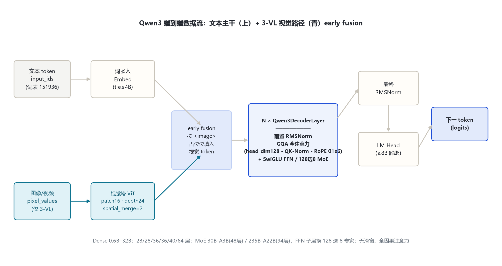
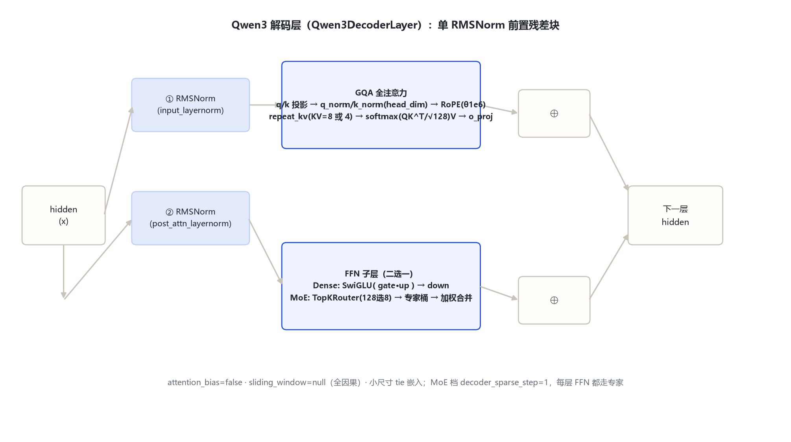
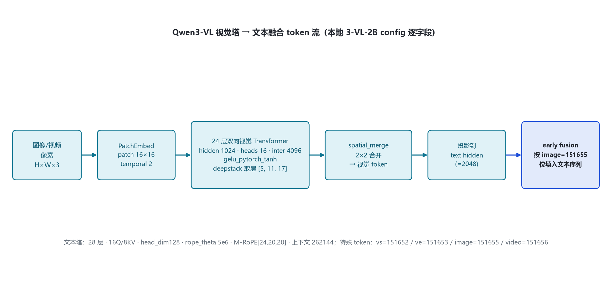

# Qwen 3 家族架构详解 — Dense 0.6B / 1.7B / 4B / 8B / 14B / 32B + MoE 30B-A3B / 235B-A22B（含 3-VL / ASR / Omni）

- 徽标：入口类 Qwen3ForCausalLM（Dense）/ Qwen3MoeForCausalLM（MoE）/ Qwen3VLForConditionalGeneration（3-VL）
- 徽标：原生 thinking 模式（`/think` `/no_think` 软切换、`enable_thinking` 硬开关、思维块用 `<think>...</think>` 编码进序列）
- 徽标：全注意力（无滑窗，`sliding_window=null`）· head_dim 128 · 逐头 Q/K RMSNorm（QK-Norm）· attention_bias=false
- 徽标：GQA 全系（8B 起 tie=False）· 词表 151936 · rope_theta 1e6（文本）· 基座 max_position 40960（3-VL 文本 262144）
- 徽标（青/多模态）：3-VL 视觉塔 patch 16 · spatial_merge 2 · text rope_theta 5e6（M-RoPE）；另有 3-ASR（qwen3_asr）、3-Omni-MoE（qwen3_omni_moe）、MTP（qwen3_next）

本页以 **各变体真实 `config.json`**（本地 `Qwen3-0.6B`、`Qwen3-VL-2B-Instruct`，以及经 hf-mirror 拉取的 1.7B / 4B / 8B / 14B / 32B / 30B-A3B / 235B-A22B 官方 config）与 **transformers 源码**（本地 `E:\transformers`，`models\qwen3\`、`models\qwen3_moe\`、`models\qwen3_vl\`、`models\qwen3_next\`）为唯一依据。所有数字均标注来源（config 字段或源码文件:行号）。

## 1 家族全景：文本塔核心超参数对照

> 下表 Dense 六档 + MoE 两档的文本塔字段，全部来自官方 config（2026-10-26 经 hf-mirror 逐字段核对；0.6B 为本地 `E:\models\qwen\Qwen3-0.6B\config.json`）。八档共用同一主干：RMSNorm 前置残差块、SwiGLU FFN、GQA、head_dim 128、逐头 Q/K RMSNorm、无注意力偏置。

| 字段 | 0.6B | 1.7B | 4B | 8B | 14B | 32B | 30B-A3B | 235B-A22B |
|---|---|---|---|---|---|---|---|---|
| 入口类 | Qwen3ForCausalLM | 同左 | 同左 | 同左 | 同左 | 同左 | Qwen3MoeForCausalLM | Qwen3MoeForCausalLM |
| model_type | qwen3 | qwen3 | qwen3 | qwen3 | qwen3 | qwen3 | qwen3_moe | qwen3_moe |
| **形态** | Dense | Dense | Dense | Dense | Dense | Dense | **MoE** | **MoE** |
| hidden_size | 1024 | 2048 | 2560 | 4096 | 5120 | 5120 | 2048 | 4096 |
| num_hidden_layers | 28 | 28 | 36 | 36 | 40 | 64 | 48 | 94 |
| num_attention_heads (Q) | 16 | 16 | 32 | 32 | 40 | 64 | 32 | 64 |
| num_key_value_heads (KV) | 8 | 8 | 8 | 8 | 8 | 8 | 4 | 4 |
| head_dim | 128 | 128 | 128 | 128 | 128 | 128 | 128 | 128 |
| intermediate_size（Dense FFN） | 3072 | 6144 | 9728 | 12288 | 17408 | 25600 | 6144 | 12288 |
| num_experts / 每 token 激活 | — | — | — | — | — | — | 128 / 8 | 128 / 8 |
| moe_intermediate_size | — | — | — | — | — | — | 768 | 1536 |
| tie_word_embeddings | true | true | true | false | false | false | false | false |
| vocab_size | 151936 | 151936 | 151936 | 151936 | 151936 | 151936 | 151936 | 151936 |
| max_position_embeddings | 40960 | 40960 | 40960 | 40960 | 40960 | 40960 | 40960 | 40960 |
| rope_theta | 1e6 | 1e6 | 1e6 | 1e6 | 1e6 | 1e6 | 1e6 | 1e6 |
| sliding_window | null | null | null | null | null | null | null | null |

> 要点：① **八档全部 `sliding_window=null`、`use_sliding_window=false`**——Qwen3 注意力从 Qwen2/Qwen2.5 的滑窗回到**全注意力**（源码里 `sliding_window` 仅当 `layer_type=="sliding_attention"` 才非空，qwen3 config 不设该字段，`modeling_qwen3.py:231`）；② **head_dim 统一 128**，故 Q 投影输出维 = Q 头数 × 128（如 32B：64×128=8192=hidden）；③ **MoE 两档 `decoder_sparse_step=1`**（每一层都是专家层），`num_experts=128`、每 token 选 8 个；config 中**无 shared_expert_intermediate_size 字段**——Qwen3 MoE 为纯 top-k 路由专家（这一点与 Qwen3.5 MoE 的显式共享专家不同，见演进章）；④ 小尺寸（≤4B）tie 共享嵌入，8B 起解绑。

### 1.1 变体与部署规格

| 变体 | 入口类 / model_type | 文本塔锚点 | 视觉塔 | 上下文 | 说明 |
|---|---|---|---|---|---|
| Qwen3-0.6B（本地） | Qwen3ForCausalLM / qwen3 | hidden 1024 · 28 层 · 16Q·8KV · inter 3072 | 无 | 40960 | 本地 config 逐字段核对 |
| 3-VL-2B（本地） | Qwen3VLForConditionalGeneration / qwen3_vl | hidden 2048 · 28 层 · 16Q·8KV · head_dim 128 · inter 6144 · rope_theta 5e6 | hidden 1024 · depth 24 · patch 16 · temporal 2 · spatial_merge 2 | 262144 | 本地 config 逐字段核对 |
| 3-VL-4B / 8B / 32B | 同左 | 沿用对应 Dense 文本塔 | 同一支视觉塔配置 | 262144 | 官方 model card（尺寸 exact 见 card，待确认项见 §9） |
| 3-VL-30B-A3B | Qwen3VLMoeForConditionalGeneration / qwen3_vl_moe | 30B-A3B 文本塔 + 视觉塔 | 同上 | 262144 | MoE 视觉版 |
| 3-ASR | qwen3_asr | 语音识别专用 | 音频编码器 | — | 源码 `models\qwen3_asr\` |
| 3-Omni | Qwen3OmniMoeForConditionalGeneration / qwen3_omni_moe | 全模态（文/图/音） | 视觉+音频双塔 | — | 源码 `models\qwen3_omni_moe\` |
| MTP | qwen3_next | 投机解码头（Multi-Token Prediction） | — | — | 源码 `models\qwen3_next\`，训练时多步预测 |

## 2 端到端数据流总览

> 文本 token → 词嵌入（小尺寸与 hidden 绑定）→ **N 个 Qwen3DecoderLayer**（前置 RMSNorm：注意力子层 + SwiGLU FFN 子层，均带残差）→ 最终 RMSNorm → LM Head（8B 起不绑定嵌入）。3-VL 多一路：图像/视频 patch 经视觉塔编码、spatial_merge 压缩、投影到文本 hidden 后，按 image/video 特殊 token 位 early-fusion 进同一序列。MoE 档把 FFN 子层换成 top-k 路由的 128 专家。

### 2.1 架构图



> 全家族统一主干：Embedding → N×DecoderLayer（GQA 全注意力 + SwiGLU/MoE-FFN）→ RMSNorm → LM Head；差异集中在层数、维度、MoE 路由，以及 3-VL 是否挂视觉塔。

## 3 解码层解剖：Qwen3 前置 RMSNorm 残差块

> `Qwen3DecoderLayer`（`modeling_qwen3.py:275-315`）含两组残差子层：注意力子层与 FFN 子层，均为**单 RMSNorm 前置**（无 post-norm，区别于 Gemma 3 的双 RMSNorm）。Dense 与 MoE 仅 FFN 子层不同。

### 3.1 架构图



```
Qwen3DecoderLayer.forward（modeling_qwen3.py:286-315）:
  residual = hidden_states
  hidden_states = input_layernorm(hidden_states)          # RMSNorm(hidden)
  hidden_states, _ = self_attn(hidden_states, ...)        # GQA + QK-Norm + RoPE
  hidden_states = residual + hidden_states                # ⊕1
  residual = hidden_states
  hidden_states = post_attention_layernorm(hidden_states)
  hidden_states = self.mlp(hidden_states)               # SwiGLU（Dense）/ 128选8 专家（MoE）
  hidden_states = residual + hidden_states               # ⊕2
  return hidden_states
```

## 4 核心机制：thinking · QK-Norm · GQA · MoE 路由

### 4.1 ① 原生 thinking 模式与软切换

Qwen3 是首个把「先思维、后作答」作为默认行为的 Qwen 代际。思维块直接以文本标记 `<think>...</think>` 编码进输出序列，推理产物与回答在同一流里。两层控制：

- **硬开关**：生成时 `enable_thinking=True/False`（默认 True）；关则直接作答（官方 quickstart）。
- **软切换**：在 user/system 消息里加 `/think` 或 `/no_think`，多轮对话跟随最近一条指令（官方文档原文：The model will follow the most recent instruction）。

```
用户: 把这堆数排个序 /think
模型: <think> 先确认输入…再选升序… </think>
      好的，结果是 …
用户: 换个方式，别说过程 /no_think
模型: <think>（本轮不输出思维）</think>  结果是 …
```

> 注意：Qwen3.5 起取消 `/think` 软切换、thinking 默认常开（见 §8）。

### 4.2 ② 逐头 Q/K RMSNorm（QK-Norm）

`Qwen3Attention` 在 Q/K 投影后、RoPE 前各过一个维度等于 `head_dim` 的 RMSNorm（`modeling_qwen3.py:229-230, 244-245`）：

$$q = \mathrm{q\_norm}(W_q x),\qquad k = \mathrm{k\_norm}(W_k x)$$

$$q,k = \mathrm{RoPE}(q,k;\theta=10^6)$$

$$\mathrm{Attn}(Q,K,V)=\mathrm{softmax}\!\left(\frac{QK^\top}{\sqrt{128}}+\text{mask}\right)V$$

> 注意力缩放固定为 `head_dim**-0.5 = 128^-0.5`（`modeling_qwen3.py:213`），不随 hidden 变。QK-Norm 稳定了逐头的分数幅度。

### 4.3 ③ GQA 与 KV 压缩

八档 KV 头数：Dense 0.6B–32B 一律 **8 个 KV 头**（Q 头数 16/16/32/32/40/64），MoE 两档 **4 个 KV 头**（32/64 个 Q 头）。运行时 `num_key_value_groups = Q头/KV头` 用 `repeat_kv` 把 K/V 复制到 Q 头数。

### 4.4 ④ MoE 路由（128 专家选 8，无共享专家）

`Qwen3MoeSparseMoeBlock`（`modeling_qwen3_moe.py:269-280`）= `Qwen3MoeTopKRouter`（线性打分 → softmax → top-8，归一化权重）+ `Qwen3MoeExperts`（每专家一份融合的 gate_up / down 参数）：

```
router_logits = x @ W_gate^T                      # (seq, 128)
probs = softmax(router_logits, fp32)              # model:259-260
top_w, top_idx = topk(probs, k=8)                 # model:261
top_w = top_w / top_w.sum(-1, keepdim=True)       # 归一化 model:263
# 按专家桶分 token，各自 SwiGLU 后按 top_w 加权合并 model:229-245
```

> config 侧：`num_experts=128`、`num_experts_per_tok=8`、`moe_intermediate_size` 30B-A3B=768 / 235B=1536、`decoder_sparse_step=1`（每层都走专家）；**无共享专家字段**。对照 Qwen3.5 MoE 显式带 `shared_expert_intermediate_size=512`（演进章）。

## 5 注意力机制：全注意力 · RoPE 1e6 · 无滑窗

### 5.1 GQA KV 头分配

| 尺寸 | Q 头数 | KV 头数 | GQA 分组 | head_dim | Q 投影输出维 |
|---|---|---|---|---|---|
| 0.6B / 1.7B | 16 | 8 | 2:1 | 128 | 2048 |
| 4B / 8B | 32 | 8 | 4:1 | 128 | 4096 |
| 14B | 40 | 8 | 5:1 | 128 | 5120 |
| 32B | 64 | 8 | 8:1 | 128 | 8192 |
| 30B-A3B | 32 | 4 | 8:1 | 128 | 4096 |
| 235B-A22B | 64 | 4 | 16:1 | 128 | 8192 |

### 5.2 与 Qwen2/Qwen2.5 的注意力差异

```
Qwen2/Qwen2.5:  sliding_window=4096（或 32768）+ max_window_layers，滑动窗口因果掩码
Qwen3:          sliding_window=null, use_sliding_window=false  → 全因果注意力
                新增逐头 q_norm/k_norm（head_dim 维 RMSNorm）
                head_dim 显式写进 config（=128），不再由 hidden/heads 隐式决定
```

> 源码：`modeling_qwen3.py:231` 仅当 `layer_type=="sliding_attention"` 才把 `sliding_window` 赋给注意力；qwen3 的 config 没有 `layer_types` 字段（`hasattr(config,"layer_types")` 为 False，208 行），故全部层走全注意力。

## 6 多模态：Qwen3-VL 视觉塔与 early fusion

### 6.1 视觉塔 config（本地 3-VL-2B 逐字段核对）

| 字段（vision_config） | 取值 | 字段 | 取值 |
|---|---|---|---|
| model_type | qwen3_vl（视觉子模型） | hidden_size | 1024 |
| depth（视觉层数） | 24 | num_heads | 16 |
| intermediate_size | 4096 | hidden_act | gelu_pytorch_tanh |
| patch_size | 16 | temporal_patch_size | 2 |
| spatial_merge_size | 2 | out_hidden_size | 2048（=文本 hidden） |
| deepstack_visual_indexes | [5, 11, 17] | num_position_embeddings | 2304 |

> 文本塔侧（text_config）：hidden 2048 · 28 层 · 16Q/8KV · head_dim 128 · inter 6144 · vocab 151936 · max_position 262144 · rope_theta 5e6，且 `rope_scaling.mrope_interleaved=true`、`mrope_section=[24,20,20]`（**M-RoPE**：对时间/高度/宽度三个维度分别分配旋转维度）。

### 6.2 图像 token 流（patch 16 → merge 2 → early fusion）



```
pixel_values (B,3,H,W)
  → PatchEmbed: patch 16×16、temporal_patch 2，切块
  → 24 层双向视觉 Transformer（deepstack 在第 5/11/17 层取特征）
  → spatial_merge_size=2：2×2 相邻 patch 合并为 1 个视觉 token
  → 投影到 out_hidden_size=2048（文本 hidden）
  → 按 <image> 占位（image_token_id=151655）位置 early-fusion 进文本序列
  → 与文本 token 一起过 28 层文本解码器（M-RoPE 给图像块空间/时间位置）
```

> 特殊 token：vision_start=151652、vision_end=151653、image=151655、video=151656（顶层 config）。**transformers v5 里此类多模态模型用 `AutoModelForImageTextToText` 加载**（`AutoModelForVision2Seq` 已移除）。

## 7 特殊 Token 与词表布局

| token | ID | 含义 | 来源 |
|---|---|---|---|
| bos_token_id | 151643 | `<|im_start|>` 会话开始 | 文本 config |
| eos_token_id | 151645 | `<|im_end|>` / 序列结束 | 文本 config |
| 思维标记 | `<think>` `</think>` | thinking 块（文本内编码，非离散 special id） | 官方 model card |
| 软切换指令 | `/think` `/no_think` | 用户/系统消息内文本指令 | 官方 quickstart |
| vision_start / vision_end | 151652 / 151653 | 图像块起止（3-VL 顶层） | 本地 3-VL config |
| image / video token | 151655 / 151656 | 图像/视频占位（3-VL 顶层） | 本地 3-VL config |

> 词表 `vocab_size=151936`（Qwen1–Qwen3 沿用同一词表，3.5 起扩到 248320，见演进章）。思维块不是新增 special token，而是输出序列里的普通文本标记——这使 thinking 模式可与普通对话流无缝混用。

## 8 演进视角：Qwen2.5 → Qwen3

| 维度 | Qwen2.5（基线） | Qwen3（家族） |
|---|---|---|
| 推理行为 | 无原生思维 | **原生 thinking（enable_thinking 默认开 + /think /no_think 软切换）** |
| 注意力 | GQA + 滑窗（sliding_window 4096 + max_window_layers） | **回归全注意力**（sliding_window=null），新增逐头 Q/K RMSNorm |
| head_dim | 由 hidden/heads 隐式决定 | **显式 head_dim=128** |
| MoE | Qwen2-MoE 57B-A14B（细粒度专家） | **两档 MoE**：30B-A3B / 235B-A22B，均 128 专家选 8，decoder_sparse_step=1 |
| 上下文（文本基座） | 32768 | 40960（文本 config）；3-VL 扩到 262144 |
| 视觉塔 | 2.5-VL：patch 14、M-RoPE、128K | **3-VL：patch 16**、text rope_theta 5e6、M-RoPE [24,20,20]、262144 |
| 词表 | 151936 | 151936（不变） |
| MTP / 变体 | 无 MTP | **MTP（qwen3_next）**、3-ASR、3-Omni-MoE |

> Qwen3 的主线升级：① 原生 thinking 模式与软切换；② 注意力回归全注意力并加 QK-Norm；③ MoE 两档（128 选 8，无共享专家）；④ 3-VL 视觉塔 patch 14→16、文本 RoPE theta 提到 5e6、上下文到 262144；⑤ MTP 投机解码与 ASR/Omni 变体。Qwen2.5 侧数字为官方公开口径；Qwen3 侧数字均来自本页 config 与源码。

## 9 来源

1. 本地权威 config（Qwen3-0.6B，逐字段核对）
   `E:\models\qwen\Qwen3-0.6B\config.json（hidden 1024 / 28 层 / 16Q·8KV / head_dim 128 / inter 3072 / vocab 151936 / max 40960 / sliding null / ropeθ1e6 / tie=true）`
2. 本地权威 config（Qwen3-VL-2B-Instruct，逐字段核对）
   `E:\models\qwen\Qwen3-VL-2B-Instruct\config.json（text: hidden 2048 / 28 层 / 16Q·8KV / head_dim 128 / inter 6144 / max 262144 / ropeθ5e6 / mrope[24,20,20]；vision: hidden 1024 / depth 24 / heads 16 / inter 4096 / patch 16 / temporal 2 / spatial_merge 2 / out 2048 / deepstack[5,11,17]）`
3. 官方 config 经 hf-mirror 拉取（2026-10-26 逐字段核对，存 `qwen3\_tools\_cfgpull\`）
   `Qwen3-1.7B（2048/28/16Q·8KV/inter6144）；Qwen3-4B（2560/36/32Q·8KV/inter9728/tie）；Qwen3-8B（4096/36/32Q·8KV/inter12288/untie）；Qwen3-14B（5120/40/40Q·8KV/inter17408）；Qwen3-32B（5120/64/64Q·8KV/inter25600）；Qwen3-30B-A3B（2048/48/32Q·4KV/128专家选8/moe_inter768）；Qwen3-235B-A22B（4096/94/64Q·4KV/128选8/moe_inter1536）`
4. transformers 源码（本地 E:\transformers\src\transformers\models\）
   `qwen3\modeling_qwen3.py：RMSNorm 49-66；SwiGLU MLP 69-83；RotaryEmbedding 85-200；Attention 203-272（q/k_norm 229-230、scaling 213、repeat_kv 212）；DecoderLayer 275-315；ForCausalLM 423-495`
   `qwen3_moe\modeling_qwen3_moe.py：Experts 209-246；TopKRouter 248-266；SparseMoeBlock 269-280；DecoderLayer 304-347`
   `qwen3_vl\、qwen3_next\、qwen3_asr\、qwen3_omni_moe\（类入口与模块结构）`
5. Qwen3 技术报告（arXiv 2505.09388）
   `https://arxiv.org/abs/2505.09388（MoE 两档 48/94 层、128 选 8；Dense 六档；strong-to-weak 蒸馏）`
6. Qwen3 官方博客
   `https://qwenlm.github.io/blog/qwen3/（thinking 模式、/think 与 /no_think 软切换、enable_thinking、各档层数/头数/上下文对照表）`
7. Qwen 官方文档 quickstart（软切换口径）
   `https://qwen.readthedocs.io/en/stable/getting_started/quickstart.html（/think 与 /no_think 多轮跟随最近指令）`
8. Qwen3-VL 技术报告（arXiv 2511.21631）
   `https://arxiv.org/pdf/2511.21631（3-VL 家族 2B/4B/8B/32B Dense + 30B-A3B/235B-A22B MoE）`

> 标注约定：[S:n]=modeling 文件行号。3-VL 4B/8B/32B 的 exact hidden/inter 沿用对应 Dense 文本塔（官方 model card），本地未逐一拉取 config；MoE 无共享专家系以本地 config 字段为准（官方 30B-A3B/235B config 无 shared_expert 字段）。访问与核验日期：2026-10-26。

---

*页脚：Qwen 3 家族架构详解 · 数据来源：本地/hf-mirror config + transformers 源码 + arXiv 2505.09388 / 2511.21631 / Qwen 官方资料 · 仅供技术学习与论文研究*
