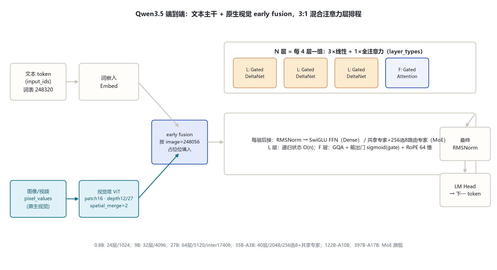
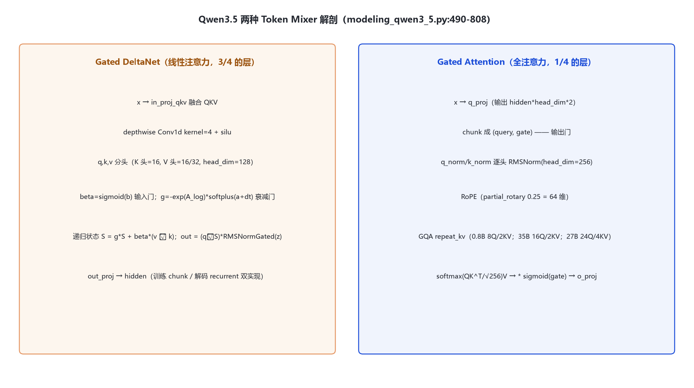

# Qwen 3.5 家族架构详解 — 0.8B / 9B / 27B / 35B-A3B / 122B-A10B / 397B-A17B（Gated DeltaNet + Gated Attention 混合）

- 徽标：入口类 Qwen3_5ForConditionalGeneration（Dense）/ Qwen3_5MoeForConditionalGeneration（MoE）
- 徽标：架构大改——**Gated DeltaNet（线性注意力，递归状态）+ Gated Attention（GQA 全注意力）3:1 混合**（每 4 层 3 线性 + 1 全注意力）
- 徽标：词表 248320（padded）· 原生多模态（early fusion · patch 16）· 上下文 262144 → YaRN 1M
- 徽标：MTP multi-steps（qwen3_next）· thinking 默认开、**取消 /think 软切换**
- 徽标（青/多模态）：全系原生视觉语言（text_config + vision_config 组合 config）

本页以 **本地真实 `config.json`**（`E:\models\qwen\Qwen3.5-0.8B-Instruct\config.json`、`E:\models\qwen\Qwen3.5-35B-A3B-GPTQ-Int4\config.json`）与 **transformers 源码**（本地 `E:\transformers`，`models\qwen3_5\`、`models\qwen3_5_moe\`）为唯一依据；27B 数字取自已核对的官方 model card（见 §9）。所有数字均标注来源。

## 1 家族全景：六个尺寸的架构对照

> 0.8B 与 35B-A3B 为本地 config 逐字段核对；9B/27B 数字来自官方 model card；122B-A10B / 397B-A17B 为 MoE 旗舰，公开精确 hidden/层数见官方 card（本页标注已核实项）。全家族共用 `layer_types` 周期：`[linear_attention ×3, full_attention ×1]` 重复（`full_attention_interval=4`）。

| 字段 | 0.8B | 9B | 27B | 35B-A3B | 122B-A10B | 397B-A17B |
|---|---|---|---|---|---|---|
| model_type | qwen3_5 | qwen3_5 | qwen3_5 | qwen3_5_moe | qwen3_5_moe | qwen3_5_moe |
| **形态** | Dense+视觉 | Dense+视觉 | Dense+视觉 | **MoE**+视觉 | **MoE**+视觉 | **MoE**+视觉 |
| hidden_size | 1024 | 4096 | 5120 | 2048 | 待确认（官方card） | 待确认（官方card） |
| num_hidden_layers | 24 | 32 | 64 | 40 | 待确认 | 待确认 |
| Gated Attn Q/KV 头 | 8 / 2 | — | 24 / 4 | 16 / 2 | — | — |
| head_dim（Gated Attn） | 256 | 256 | 256 | 256 | 256 | 256 |
| 线性注意力 K/V 头 | 16 / 16 | — | 16 / 48 | 16 / 32 | — | — |
| 线性注意力 head_dim | 128 | 128 | 128 | 128 | 128 | 128 |
| linear_conv_kernel_dim | 4 | 4 | 4 | 4 | 4 | 4 |
| intermediate（Dense FFN） | 3584 | 待确认 | 17408 | — | — | — |
| 专家（总/激活） | — | — | — | 256 / 8 | — | — |
| moe_intermediate_size | — | — | — | 512 | — | — |
| shared_expert_intermediate | — | — | — | 512 | — | — |
| vocab_size | 248320 | 248320 | 248320 | 248320 | 248320 | 248320 |
| max_position_embeddings | 262144 | 262144 | 262144 | 262144 | 262144 | 262144 |
| tie_word_embeddings | true | — | — | false | — | — |

> 要点：① **每 4 层 = 3×Gated DeltaNet（线性）+ 1×Gated Attention（全注意力）**，0.8B config 顶层直接给出 24 项 `layer_types` 序列验证（前 12 层为 L,L,L,F 重复 3 次）；② **线性注意力与全注意力头配置不同**：Gated Attention 用 GQA（如 35B：16Q/2KV，head_dim 256），线性注意力用独立的 K/V 头（35B：K16/V32，head_dim 128，depthwise conv kernel 4）；③ 27B 为 Dense 旗舰：64 层、hidden 5120、16 组混合、inter 17408；④ MoE 三档显式带**共享专家**（`shared_expert_intermediate_size=512`，35B config 核实），与 Qwen3 MoE 的纯路由不同。

### 1.1 本地 config 实参锚点

| 字段 | 0.8B（本地） | 35B-A3B-GPTQ-Int4（本地） |
|---|---|---|
| architectures | Qwen3_5ForConditionalGeneration | Qwen3_5MoeForConditionalGeneration |
| text.hidden_size | 1024 | 2048 |
| text.num_hidden_layers | 24 | 40 |
| text.num_attention_heads / kv | 8 / 2 | 16 / 2 |
| text.head_dim | 256 | 256 |
| text.intermediate_size | 3584 | （走 MoE） |
| text.num_experts / per_tok | — | 256 / 8 |
| text.moe_intermediate / shared_intermediate | — | 512 / 512 |
| text.linear_num_key/value_heads | 16 / 16 | 16 / 32 |
| text.linear_key/value_head_dim | 128 / 128 | 128 / 128 |
| text.linear_conv_kernel_dim | 4 | 4 |
| text.attn_output_gate | true | true |
| text.full_attention_interval | 4 | 4 |
| text.mtp_num_hidden_layers | 1 | 1 |
| text.rope_parameters | rope_type default · rope_theta 1e7 · partial_rotary_factor 0.25 · mrope_section [11,11,10] · mrope_interleaved true | 同左 |
| text.vocab / max_position | 248320 / 262144 | 248320 / 262144 |
| vision.hidden_size / depth | 768 / 12 | 1152 / 27 |
| vision.patch_size / spatial_merge / temporal | 16 / 2 / 2 | 16 / 2 / 2 |
| vision.out_hidden_size | 1024 | 2048 |
| 特殊 token | image 248056 · video 248057 · vs 248053 · ve 248054 · eos 248044 | 同左 |

## 2 端到端数据流总览

> 文本 token 与图像/视频像素两路输入 → 视觉塔（patch 16、depth 12/27、spatial_merge 2）编码投影 → 按 image 占位 early fusion 进统一序列 → **N 个 Qwen3_5DecoderLayer**（按 `layer_types` 交替：线性注意力层走 Gated DeltaNet 递归状态，全注意力层走 Gated Attention + 输出门 sigmoid(gate)；每层后接 SwiGLU FFN）→ 最终 RMSNorm → LM Head。

### 2.1 架构图



> 全家族统一主干；差异集中在层数、维度、GQA/线性头配比、MoE 路由与共享专家，以及视觉塔深度（0.8B depth12 / 35B depth27）。

## 3 解码层解剖：按 layer_types 二选一的 Token Mixer

> `Qwen3_5DecoderLayer`（`modeling_qwen3_5.py:848-901`）：`block_type = config.layer_types[layer_idx]`——`linear_attention` 则挂 `Qwen3_5GatedDeltaNet`，`full_attention` 则挂 `Qwen3_5Attention`；两种层都再接同一个 SwiGLU `Qwen3_5MLP`。前置 RMSNorm 残差结构。

### 3.1 架构图



```
Qwen3_5DecoderLayer.forward（modeling_qwen3_5.py:861-901）:
  residual = hidden_states
  hidden_states = input_layernorm(hidden_states)
  if block_type == "linear_attention":                 # 3/4 的层
      hidden_states = self.linear_attn(hidden_states, cache_params, ...)
  elif block_type == "full_attention":                # 1/4 的层
      hidden_states, _ = self.self_attn(hidden_states, position_embeddings, ...)
  hidden_states = residual + hidden_states
  residual = hidden_states
  hidden_states = post_attention_layernorm(hidden_states)
  hidden_states = self.mlp(hidden_states)             # SwiGLU
  hidden_states = residual + hidden_states
```

## 4 核心机制：Gated DeltaNet · Gated Attention 输出门 · MTP

### 4.1 ① Gated DeltaNet（线性注意力，3/4 的层）

`Qwen3_5GatedDeltaNet`（`modeling_qwen3_5.py:490-...`）用可学习门控 + 递归状态把注意力复杂度从 O(n²) 降到近 O(n)：

```
mixed_qkv = in_proj_qkv(x)                 # 融合 QKV
mixed_qkv = causal_conv1d(mixed_qkv, kernel=4, silu)   # depthwise 因果卷积
q, k, v = split(mixed_qkv)
beta = sigmoid(in_proj_b(x))                # 输入门
g = -exp(A_log) * softplus(in_proj_a(x) + dt_bias)     # 衰减门（delta rule）
# 递归更新状态 S：S = g*S + beta * v ⊗ k；out = (q ⊗ S) * RMSNormGated(z)
out = out_proj(core_attn_out)
```

> 训练时用 chunk 形式（`chunk_gated_delta_rule`），单 token 解码时用 recurrent 形式（`fused_recurrent_gated_delta_rule`），KV cache 里同时保存 conv_state 与 recurrent_state。35B 档 K/V 头配比 16/32（V 头多于 K 头），0.8B 为 16/16。

### 4.2 ② Gated Attention（全注意力，1/4 的层）与输出门

`Qwen3_5Attention`（`modeling_qwen3_5.py:736-808`）是带**输出门**的 GQA：

```
q_proj 输出 hidden*head_dim*2 → chunk 成 (query, gate)     # 输出门
query = q_norm(query); key = k_norm(k_proj(x))             # 逐头 QK-Norm
q,k = apply_rotary_pos_emb(q,k,cos,sin)                   # partial_rotary 0.25
attn = softmax(QK^T / head_dim^0.5 + mask) V
attn = attn.reshape(...) * sigmoid(gate)                   # attn_output_gate=true
out = o_proj(attn)
```

> RoPE 只作用在 256 维头的 0.25（=64 维，partial_rotary_factor=0.25）；这与 27B 官方卡「RoPE dim 64」一致。q/k_norm 仍是逐头 RMSNorm。

### 4.3 ③ MoE 路由 + 显式共享专家（35B 档核实）

`Qwen3_5MoeSparseMoeBlock`（`modeling_qwen3_5_moe.py:891-908`）= 共享专家（带 sigmoid 门）+ top-k 路由专家：

```
shared_out = shared_expert(x)                       # shared_expert_intermediate=512
shared_out = sigmoid(shared_expert_gate(x)) * shared_out
_, routing_w, idx = topk_router(x)                  # 256 专家选 8
expert_out = experts(x, idx, routing_w)
out = expert_out + shared_out                        # 共享 + 路由相加
```

> 对照 Qwen3 MoE（128 选 8、无共享专家）：Qwen3.5 MoE 专家数大幅扩到 256、每 token 选 8，并**显式引入共享专家**与路由器 aux loss（`router_aux_loss_coef=0.001`）。

### 4.4 ④ MTP multi-steps 与 thinking 默认开

- `mtp_num_hidden_layers=1`、`mtp_use_dedicated_embeddings=false`：训练时多步预测后续 token，推理时由 qwen3_next 投机解码加速。
- thinking 默认常开，且**取消 Qwen3 的 /think 与 /no_think 软切换**（官方 model card 口径）。

## 5 注意力机制：3:1 混合的层排程

### 5.1 两种注意力单元对照

| 单元 | 类型 | 0.8B 头配置 | 35B 头配置 | 27B 头配置 | 头维度 | 位置编码 |
|---|---|---|---|---|---|---|
| Gated DeltaNet | 线性（递归状态） | K16 / V16 | K16 / V32 | QK16 / V48 | 128 | 内置门控 + conv |
| Gated Attention | softmax 全注意力（GQA） | Q8 / KV2 | Q16 / KV2 | Q24 / KV4 | 256 | RoPE 64 维（partial 0.25） |

### 5.2 层排程（0.8B config 24 项 layer_types 实测）

```
0.8B (24 层): L L L F | L L L F | L L L F | L L L F | L L L F | L L L F
35B  (40 层): L L L F × 10
27B  (64 层): L L L F × 16（=16 组混合）
# L = linear_attention (Gated DeltaNet), F = full_attention (Gated Attention)
```

> 3/4 的层用线性注意力把长序列成本压到近 O(n)，1/4 的全注意力保留精确 recall——这是「复杂度近 O(n) 仍保注意力精度」的混合设计。

## 6 多模态：原生视觉语言（early fusion）

### 6.1 视觉塔 config（本地两档逐字段核对）

| 字段（vision_config） | 0.8B | 35B-A3B |
|---|---|---|
| hidden_size | 768 | 1152 |
| depth（层数） | 12 | 27 |
| num_heads | 12 | 16 |
| intermediate_size | 3072 | 4304 |
| patch_size / temporal_patch_size | 16 / 2 | 16 / 2 |
| spatial_merge_size | 2 | 2 |
| out_hidden_size（→文本 hidden） | 1024 | 2048 |
| hidden_act | gelu_pytorch_tanh | gelu_pytorch_tanh |

### 6.2 融合方式

```
pixel_values → PatchEmbed(patch16, temporal2) → depth 层双向 ViT
  → spatial_merge 2×2 → 投影到 out_hidden_size（=文本 hidden）
  → 按 image_token_id=248056 位 early-fusion 进文本序列
  → 文本解码器（M-RoPE section [11,11,10]）统一前向
```

> 与 Qwen3-VL 相比，Qwen3.5 把视觉能力**原生化**进主 config（不再是可选 VL 变体），全系 Dense/MoE 都带视觉塔。transformers v5 用 `AutoModelForImageTextToText` 加载。

## 7 特殊 Token 与词表布局

| token | ID | 含义 | 来源 |
|---|---|---|---|
| eos_token_id | 248044 | 序列结束 | text_config |
| image_token_id | 248056 | 图像占位 | 顶层 |
| video_token_id | 248057 | 视频占位 | 顶层 |
| vision_start / end | 248053 / 248054 | 图像块起止 | 顶层 |

> 词表 **248320（padded，对齐到 2 的整数次幂附近）**——从 Qwen1–Qwen3 的 151936 一次性扩到 248320。注意官方仓库名已去掉 `-Instruct` 后缀（`Qwen/Qwen3.5-0.8B`），本地目录名 `Qwen3.5-0.8B-Instruct` 是落盘别名。

## 8 演进视角：Qwen3 → Qwen3.5

| 维度 | Qwen3（基线） | Qwen3.5（家族） |
|---|---|---|
| 注意力 | 全注意力（GQA，head_dim 128）+ QK-Norm | **Gated DeltaNet 线性 + Gated Attention 全注意力 3:1 混合**（近 O(n)） |
| 输出门 | 无 | **attn_output_gate=true**（sigmoid(gate) 乘注意力输出） |
| 词表 | 151936 | **248320（padded）** |
| 上下文 | 文本 40960 / 3-VL 262144 | **262144 原生 → YaRN 1M** |
| 多模态 | 可选 3-VL 变体 | **全系原生视觉语言（early fusion 进主 config）** |
| MoE | 128 选 8，**无共享专家** | **256 选 8 + 显式共享专家**（aux loss 0.001） |
| MTP | qwen3_next（有） | **MTP multi-steps**（mtp_num_hidden_layers=1） |
| thinking | 默认开 + /think /no_think 软切换 | **默认常开、取消软切换** |
| 视觉 patch | 14（2.5-VL）→ 16（3-VL） | 16（全系原生） |

> Qwen3.5 的主线升级：① 注意力架构大改（Gated DeltaNet + Gated Attention 3:1 混合）；② 词表 151936→248320、上下文 262144→YaRN 1M；③ 多模态原生化；④ MoE 专家 128→256 并引入共享专家；⑤ thinking 取消软切换。Qwen3 侧数字来自本笔记 qwen3 目录；Qwen3.5 侧数字来自本地 config 与官方 model card。

## 9 来源

1. 本地权威 config（Qwen3.5-0.8B-Instruct，逐字段核对）
   `E:\models\qwen\Qwen3.5-0.8B-Instruct\config.json（Qwen3_5ForConditionalGeneration；text 1024/24层/8Q·2KV/head256/inter3584/线性K16·V16·head128·conv4/vocab248320/max262144/ropeθ1e7/partial0.25；vision 768/depth12/patch16）`
2. 本地权威 config（Qwen3.5-35B-A3B-GPTQ-Int4，逐字段核对）
   `E:\models\qwen\Qwen3.5-35B-A3B-GPTQ-Int4\config.json（Qwen3_5MoeForConditionalGeneration；text 2048/40层/16Q·2KV/head256/256专家选8/moe_inter512/shared_inter512/线性K16·V32·head128/conv4；vision 1152/depth27/patch16；GPTQ Int4，加载需 gptqmodel）`
3. transformers 源码（本地 E:\transformers\src\transformers\models\）
   `qwen3_5\modeling_qwen3_5.py：GatedDeltaNet 490-735；Attention(输出门) 736-808；MLP 811-824；RMSNorm(零中心) 827-845；DecoderLayer 848-901；VisionPatchMerger 968-996；ForConditionalGeneration 1754+`
   `qwen3_5_moe\modeling_qwen3_5_moe.py：Experts 832-870；TopKRouter 872-888；SparseMoeBlock(共享专家) 891-908`
4. 27B 官方 model card（已核对，见 bayon-note\Qwen\Qwen-27B架构对比-3.5-3.6-3.8.md）
   `https://huggingface.co/Qwen/Qwen3.5-27B（64层/hidden5120/16×(3GDN→FFN→1GA→FFN)/GDN V48·QK16·head128/GA Q24·KV4·head256/RoPE dim64/inter17408/262144→YaRN 1M）`
5. 9B 官方 model card（Microsoft Foundry 镜像，2026 核对）
   `hidden 4096 / 32 层 / 词表 248320 padded / 8×(3混合组)`
6. Qwen3.5 官方博客
   `https://qwen.ai/blog?id=qwen3.5（Gated DeltaNet + 稀疏 MoE 混合架构；397B 总参 / 17B 激活；原生多模态 agent）`
7. Qwen3.5-122B-A10B / 397B-A17B 官方说明
   `397B 总参 / 17B 激活；122B 总参 / 10B 激活（官方博客与 ModelScope 卡片，hidden/层数精确值以官方 card 为准，本页标待确认）`

> 标注约定：[S:n]=modeling 文件行号。122B-A10B / 397B-A17B 的 hidden/层数未在本地 config 逐一拉取，标「待确认（官方card）」；其余数字均来自本地 config 或已核实官方 card。访问与核验日期：2026-10-26。

---

*页脚：Qwen 3.5 家族架构详解 · 数据来源：本地 config + transformers 源码 + 官方 model card / 博客 · 仅供技术学习与论文研究*
