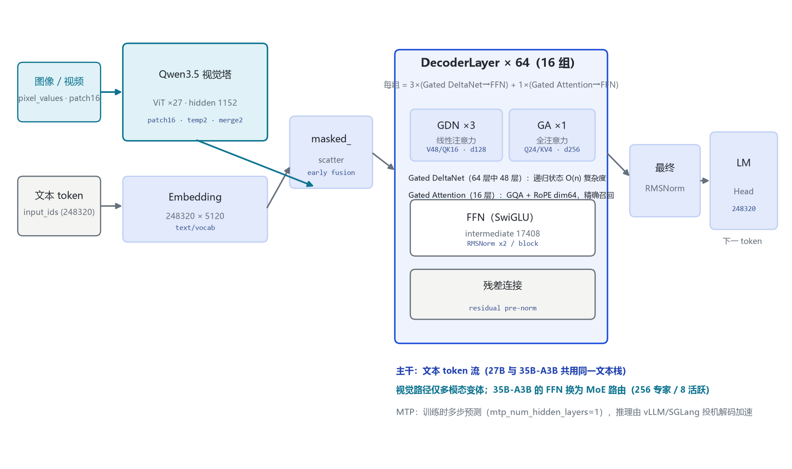
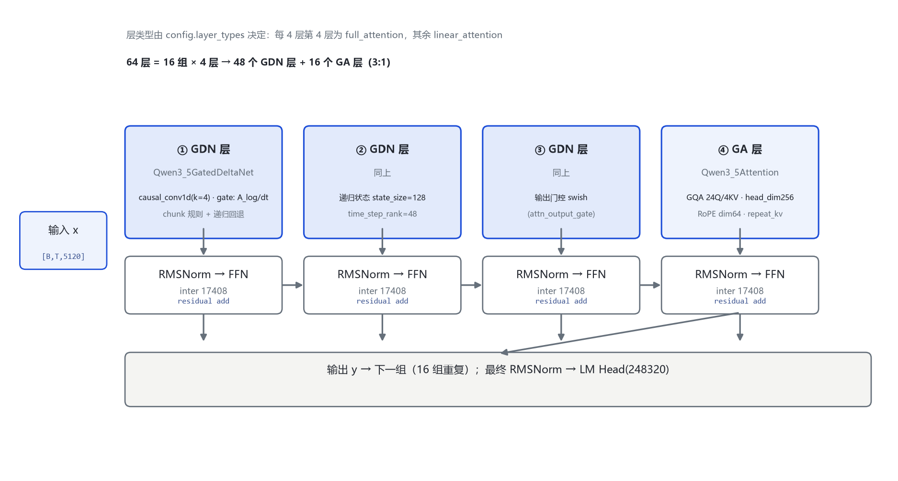
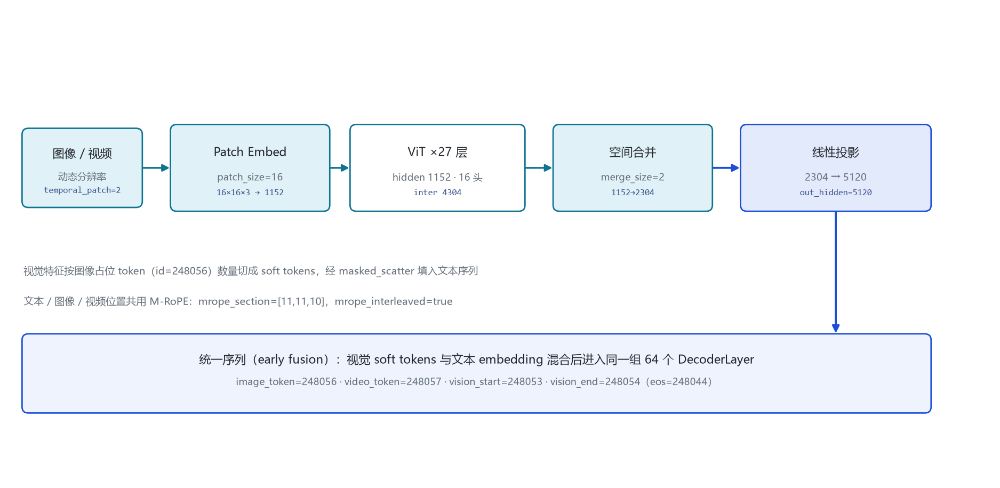

# Qwen3.6 家族架构详解 — 27B / 35B-A3B（原生多模态 · Gated DeltaNet + Gated Attention 3:1 混合）

- 入口类：Qwen3_5ForConditionalGeneration（27B）/ Qwen3_5MoeForConditionalGeneration（35B-A3B）
- 两个权重变体：27B（Dense 多模态）/ 35B-A3B（MoE 多模态）
- 架构与 Qwen3.5 完全一致：model_type qwen3_5 / qwen3_5_moe，Gated DeltaNet + Gated Attention 3:1 混合
- 词表 248,320（padded）· 原生上下文 262,144 · YaRN 扩至约 1,010,000 · MTP multi-steps
- 代际主题：稳定化 + 实用化 · Thinking Preservation（preserve_thinking）· interleaved thinking 默认只保留最新一条用户消息的思考块
- 发布日期：2026-04-22

本页以 **官方 model card 公布的 config.json 实参**（Qwen/Qwen3.6-27B、Qwen/Qwen3.6-35B-A3B，经 hf-mirror 拉取逐字段核对）与 **transformers 源码**（`E:\transformers\src\transformers\models\qwen3_5\`）为唯一依据。Qwen3.6 的定位是「基于 Qwen3.5 系列与社区反馈，优先稳定性与现实可用性」：架构图纸与 3.5 完全同构，换代的不是图纸，而是训练工艺与推理行为。所有数字均标注来源（config 字段或源码文件:行号）。

## 1 家族全景：27B / 35B-A3B 架构对照

> 两个变体均为组合 config（顶层 model_type + text_config + vision_config），字段逐列列出。27B 与 35B-A3B 的差异集中在：Dense vs MoE、hidden 维度、层数、专家路由；两种 token mixer（Gated DeltaNet / Gated Attention）、词表、RoPE 配置、视觉塔规格完全同构。

### 1.1 文本塔核心超参数

| 字段（text_config） | Qwen3.6-27B | Qwen3.6-35B-A3B |
|---|---|---|
| architectures（入口类） | Qwen3_5ForConditionalGeneration | Qwen3_5MoeForConditionalGeneration |
| **形态** | **Dense + 视觉塔（多模态）** | **MoE + 视觉塔（多模态）** |
| hidden_size | 5120 | 2048 |
| num_hidden_layers | 64 | 40 |
| hidden layout | 16×(3×GDN→FFN + 1×GA→FFN) | 10×(3×GDN→MoE + 1×GA→MoE) |
| num_attention_heads（GA 的 Q） | 24 | 16 |
| num_key_value_heads（GA 的 KV） | 4 | 2 |
| head_dim（GA） | 256 | 256 |
| partial_rotary_factor | 0.25（RoPE dim = 256×0.25 = 64） | 0.25（同左，RoPE dim 64） |
| linear_num_key_heads（GDN QK） | 16 | 16 |
| linear_num_value_heads（GDN V） | 48 | 32 |
| linear_key/value_head_dim | 128 / 128 | 128 / 128 |
| linear_conv_kernel_dim | 4（causal conv1d） | 4 |
| intermediate_size（Dense FFN） | 17,408 | —（Dense 路径不启用） |
| moe_intermediate_size | — | 512（每专家） |
| num_experts / num_experts_per_tok | — | 256 / 8 |
| shared_expert_intermediate_size | — | 512 |
| router_aux_loss_coef | — | 0.001 |
| full_attention_interval | 4（每 4 层 1 个 GA 层） | 4（同左） |
| attn_output_gate / gate 类型 | true / swish | true / swish |
| vocab_size | 248,320（padded） | 248,320（padded） |
| max_position_embeddings | 262,144 | 262,144 |
| rope_theta | 1e7 | 1e7 |
| mtp_num_hidden_layers | 1（MTP 投机头） | 1 |
| tie_word_embeddings | false | false |
| mrope_section / mrope_interleaved | [11,11,10] / true | [11,11,10] / true |

> 要点：**27B 是 Dense**（无 MoE 路由，FFN 为 SwiGLU，intermediate 17408）；**35B-A3B 是 MoE**（40 层、hidden 2048，每层 FFN 换为 256 细粒度专家路由 + 1 个共享专家，每 token 激活 8 个路由专家 + 共享专家）。两者的 token mixer 配置同构：每 4 层中前 3 层 Gated DeltaNet（线性注意力）、第 4 层 Gated Attention（GQA 全注意力）。

### 1.2 多模态与部署规格

| 字段 | Qwen3.6-27B | Qwen3.6-35B-A3B |
|---|---|---|
| 视觉塔层数 depth | 27 | 27 |
| 视觉塔 hidden / 中间维度 | 1152 / 4304 | 1152 / 4304 |
| 视觉塔注意力头数 | 16 | 16 |
| patch_size / temporal_patch_size | 16 / 2 | 16 / 2 |
| spatial_merge_size | 2 | 2 |
| out_hidden_size（投影到文本栈维度） | 5120（= 文本 hidden） | 2048（= 文本 hidden） |
| image_token_id / video_token_id | 248056 / 248057 | 248056 / 248057 |
| vision_start / vision_end token | 248053 / 248054 | 248053 / 248054 |
| eos_token_id / bos_token_id | 248044 / 248044 | 248044 / 248044 |
| 原生上下文 / YaRN 扩展 | 262,144 / 约 1,010,000（factor 4.0，original_max 262144） | 262,144 / 同左 |
| 兼容推理框架 | transformers / vLLM / SGLang / KTransformers | 同左 |
| BF16 权重体积 | 约 55.6 GB | 待确认（官方 card 未标注具体值） |

## 2 端到端数据流总览

> 文本 token 与图像/视频像素两路输入 → 图像经视觉塔（ViT×27，patch 16）编码、空间合并 2×2、线性投影到文本 hidden → 与文本 embedding 经 masked_scatter 填入图像占位 token 位（early fusion）→ 统一序列进入 **64 个解码层**（27B；35B-A3B 为 40 层）：每 4 层 3 个 Gated DeltaNet 线性层 + 1 个 Gated Attention 全注意力层 → 最终 RMSNorm → LM Head（248,320）。

### 2.1 架构图



> 全家族统一主干：Embedding → DecoderLayer 堆叠 → 最终 RMSNorm → LM Head（无 tie，27B 与 35B-A3B 均 tie=false）；多模态路径 early fusion，视觉特征不经过文本 embedding 查表，直接写入占位 token。

## 3 解码层解剖：每 4 层一组的 3:1 混合块

> 层类型由 `config.layer_types[layer_idx]` 决定：值为 `linear_attention` 的层实例化 `Qwen3_5GatedDeltaNet`，值为 `full_attention` 的层实例化 `Qwen3_5Attention`；两类层都各接一个 FFN 子层（Dense）或 MoE 子层（35B-A3B）。源码 `modular_qwen3_5.py:357-410`。

### 3.1 架构图



```
Qwen3_5DecoderLayer.forward（modular_qwen3_5.py:370-410）:
  residual = hidden_states
  hidden_states = input_layernorm(hidden_states)
  if block_type == "linear_attention":        # 每 4 层中前 3 层
      hidden_states = linear_attn(...)         # Qwen3_5GatedDeltaNet
  elif block_type == "full_attention":        # 每 4 层第 4 层
      hidden_states, _ = self_attn(...)         # Qwen3_5Attention（GQA + RoPE64）
  hidden_states = residual + hidden_states    # ⊕1
  residual = hidden_states
  hidden_states = post_attention_layernorm(hidden_states)
  hidden_states = mlp(hidden_states)          # Dense SwiGLU / MoE 路由
  hidden_states = residual + hidden_states    # ⊕2
  return hidden_states
```

> 注意：源码层循环**不**自己判 `(i+1)%4==0`——层类型是 config 里预生成好的 `layer_types` 列表，由 `configuration_qwen3_5.py` 的 `__post_init__` 按 `full_attention_interval=4` 展开（modular_qwen3_5.py:138）。

## 4 核心机制：Gated DeltaNet · 输出门控 · Thinking Preservation

### 4.1 ① Gated DeltaNet（线性注意力，递归状态）

`Qwen3_5GatedDeltaNet`（modeling_qwen3_5.py:490-650）是 Qwen3.5/3.6/3.8 共享的线性注意力单元：query/key/value 分别投影到 16（QK）/48（V，27B）个头、head_dim 128；先过 causal conv1d（kernel 4）做局部归纳，再走 chunk 化的门控 delta rule 规则（`torch_chunk_gated_delta_rule`，modeling_qwen3_5.py:287），跨块时以递归形式回退（`torch_recurrent_gated_delta_rule`，modeling_qwen3_5.py:424）。delta 状态形状 128、时间步秩 48（社区 GGUF 元数据口径）。

```
GDN 每 token 计算流（modeling_qwen3_5.py:536-650）:
  x → in_proj → (q, k, v, a_log, dt_bias, g, ...)     # 多头 QK16 / V48
  q,k,v = rotary_embed(q,k,v)                           # 位置注入
  v = causal_conv1d(v)                                  # 局部归纳，kernel=4
  h_t = A · h_{t-1} + (v_t ⊙ sigmoid(g_t)) · (σ(q_t)k_tᵀ)   # 递归更新
  y_t = h_t · σ(q_t)                                   # 线性注意力输出
  y = out_norm(y) → out_proj
```

> 设计意图：48/64 的层用递归状态把注意力复杂度从 O(n²) 降到接近 O(n)，这是 262K 原生上下文与长程 agent 任务吞吐的关键。

### 4.2 ② 输出门控（attn_output_gate = swish）

config 中 `attn_output_gate=true`、`output_gate_type="swish"`：注意力子层输出再经一个可学习门控与 swish 激活调制（modular_qwen3_5.py:208-340 内实现）。这是 Qwen3.5 起引入的稳定化手段，Qwen3.6 沿用同一配置。

### 4.3 ③ 3:1 混合的工程意义

64 层中 48 层线性 + 16 层全注意力：线性层负责长上下文吞吐，每 4 层第 4 层的 Gated Attention 负责需要精确定位/回忆的路径（如代码引用、文档回查）。官方 model card 的 Hidden Layout 一行原文：`16×(3×(Gated DeltaNet→FFN)→1×(Gated Attention→FFN))`。

### 4.4 ④ Thinking Preservation（本代主题）

Qwen3.6 训练时**额外**学习了保留并利用历史消息中的思考痕迹：

| 行为 | 默认（interleaved thinking） | preserve_thinking=True |
|---|---|---|
| 历史消息的思考块 | 只保留最新一条用户消息触发的思考块，更早的思考块丢弃 | 保留全部历史思考块并参与后续推理 |
| API 入口 | chat_template_kwargs 缺省 | chat_template_kwargs = {"preserve_thinking": True} |
| 适用场景 | 通用对话 | agent 长程任务：决策更一致、减少重复推理、降低 token 消耗 |

> 官方原文（Qwen3.6-27B model card）：默认只保留处理最新用户消息时生成的思考块（interleaved thinking）；Qwen3.6 经额外训练可通过 `preserve_thinking` 选项保留历史思考痕迹。另注意：Qwen3.6 **不官方支持** Qwen3 的 `/think`、`/nothink` 软切换，关闭思考需用 API 参数 `enable_thinking=False`。官方还建议上下文不少于 128K token 以保留思考能力。

## 5 注意力机制：GDN 与 GA 双路配置

### 5.1 两种 token mixer 对照

| 单元 | Gated DeltaNet（线性层，3/4） | Gated Attention（全注意力，1/4） |
|---|---|---|
| 源码类 | Qwen3_5GatedDeltaNet（modeling:490） | Qwen3_5Attention（modeling:736） |
| 27B 头配置 | V 48 / QK 16，head_dim 128 | Q 24 / KV 4（GQA），head_dim 256 |
| 35B-A3B 头配置 | V 32 / QK 16，head_dim 128 | Q 16 / KV 2（GQA），head_dim 256 |
| 位置编码 | 内置门控 delta 状态 + 部分 RoPE | RoPE dim = head_dim × 0.25 = 64 |
| KV cache | 递归状态（按层持有） | 标准 KV cache（GQA 4 KV 头） |
| 作用 | 长上下文 O(n) 吞吐 | 精确召回 / 精确定位 |

### 5.2 GQA 与 RoPE

```
GA 层（每 4 层第 4 层）:
  q = q_proj(x)          # 27B: 5120 → 24×256 = 6144
  k = k_proj(x)          # 27B: 5120 → 4×256  = 1024
  v = v_proj(x)         # 27B: 5120 → 4×256  = 1024
  q,k = apply_rotary_pos_emb(q,k, partial=64)   # 只转前 64 维（partial_rotary_factor 0.25）
  k,v = repeat_kv(k,v, n_rep=6)                 # 4 KV 头 → 24 Q 头
  y = softmax(q·kᵀ / √d_k + mask) · v
```

> RoPE 维度 64 而非 256：`partial_rotary_factor=0.25` 只把 head_dim 的前 1/4 送进旋转位置编码（configuration_qwen3_5.py 默认值），其余维度走 M-RoPE 的交错多路位置（mrope_section [11,11,10] 对应文本/图像/视频三路位置）。

## 6 多模态：视觉塔与 early fusion

### 6.1 视觉塔 config（27B 与 35B-A3B 同构）

| 字段（vision_config） | 取值 | 字段 | 取值 |
|---|---|---|---|
| depth（ViT 层数） | 27 | hidden_size | 1152 |
| intermediate_size | 4304 | num_heads | 16 |
| patch_size | 16 | temporal_patch_size | 2 |
| spatial_merge_size | 2 | out_hidden_size | 5120（27B）/ 2048（35B-A3B） |

> 视觉塔源码类 `Qwen3_5VisionModel`（modular_qwen3_5.py:436），继承 Qwen3VL 的视觉塔并去掉 deepstack 分支；投影后维度对齐文本 hidden（early fusion）。

### 6.2 token 流（图）



```
图像/视频 → Patch Embed（16×16×3 → 1152）→ ViT×27（hidden 1152）
→ 空间合并 merge_size=2（1152 → 2304）→ 线性投影（2304 → 文本 hidden）
→ 按 image_token_id=248056 占位切分 soft tokens
→ masked_scatter 填入文本序列 → 同一组 64 个 DecoderLayer
```

## 7 特殊 Token 与词表布局

| token | ID | 含义 | 来源 |
|---|---|---|---|
| image_token_id | 248056 | 图像特征占位 | config.vision_config / 顶层 |
| video_token_id | 248057 | 视频特征占位 | 同上 |
| vision_start_token_id | 248053 | 视觉块开始 | 顶层 |
| vision_end_token_id | 248054 | 视觉块结束 | 顶层 |
| eos / bos | 248044 | 文本结束（兼 bos） | 顶层 |
| vocab_size | 248320 | 词表（padded） | text_config |

> 词表 248,320 是 3.5 起的新规模（Qwen1–Qwen3 为 151,936）；248044–248057 这一段保留给 thinking 块标记与多模态占位。官方模型还提供 thinking 块的隐式编码（默认开启思考，`enable_thinking=False` 可关）。

## 8 演进视角：Qwen3.5 → Qwen3.6

| 维度 | Qwen3.5（基线） | Qwen3.6（本代） |
|---|---|---|
| 架构图纸 | qwen3_5 / qwen3_5_moe，GDN+GA 3:1 | **完全一致**（27B config 逐字段相同） |
| 发布 | 2026-02 系列发布 | 2026-04-22 |
| 定位 | 新架构首秀（线性注意力混合） | 基于社区反馈的**稳定化 + 实用化** |
| 历史思考块 | interleaved thinking：只保留最新用户消息的思考块 | **新增可选** preserve_thinking=True 保留全部历史思考 |
| 软切换 | 已移除 /think、/nothink | 同左（不官方支持），关思考用 enable_thinking 参数 |
| Agentic 能力 | 基线 | 强化：前端工作流、仓库级推理 |
| 量化版 | 无官方 | 无官方（3.8 起才有 FP8） |
| 上下文 | 262,144 → YaRN 1M | 262,144 → YaRN 约 1,010,000；建议 ≥128K 保思考 |

> Qwen3.6 的主线：**架构数字零变化，换代集中在训练工艺与推理行为**——稳定化、Agentic Coding 强化、Thinking Preservation（历史思考块可保留）。这为 3.8 的 Flexible Thinking Control（思考深度可按请求调节）埋下了行为接口的伏笔。

## 9 来源

1. Qwen/Qwen3.6-27B model card（Hugging Face，config.json 逐字段核对）
   `https://huggingface.co/Qwen/Qwen3.6-27B`
2. Qwen/Qwen3.6-27B model card（ModelScope）
   `https://modelscope.cn/models/qwen/Qwen3.6-27B`
3. Qwen/Qwen3.6-35B-A3B model card（Hugging Face，config.json 逐字段核对）
   `https://huggingface.co/Qwen/Qwen3.6-35B-A3B`
4. 已核实对比文件（27B 三代一致，组织者整理）
   `E:\transformers\bayon-note\Qwen\Qwen-27B架构对比-3.5-3.6-3.8.md`
5. transformers 源码 configuration_qwen3_5.py（本地 E:\transformers）
   `Qwen3_5TextConfig 默认值 L73-136；partial_rotary_factor 0.25 L106；full_attention_interval=4 L120；linear head 配置 L97-105；vision 默认 L145-156`
6. transformers 源码 modular_qwen3_5.py
   `__post_init__ L138；GatedDeltaNet L208；Attention L342；DecoderLayer 与层类型分支 L357-410；VisionModel L436；ForConditionalGeneration L644`
7. transformers 源码 modeling_qwen3_5.py
   `torch_chunk_gated_delta_rule L287；torch_recurrent_gated_delta_rule L424；Qwen3_5GatedDeltaNet L490；Qwen3_5Attention L736；Qwen3_5MLP L811`
8. Qwen 官方组织页
   `https://huggingface.co/Qwen`

> 标注约定：[config]=官方 model card 的 config.json 字段；[S:n]=modular/modeling_qwen3_5.py 行号。35B-A3B 的 BF16 体积官方未标注，记为待确认。核验日期：2026-10-26。

---

*页脚：Qwen3.6 家族架构详解 · 数据来源：官方 model card（hf-mirror 拉取）+ transformers 源码（E:\transformers）+ 已核实 27B 对比文件 · 仅供技术学习与论文研究*
