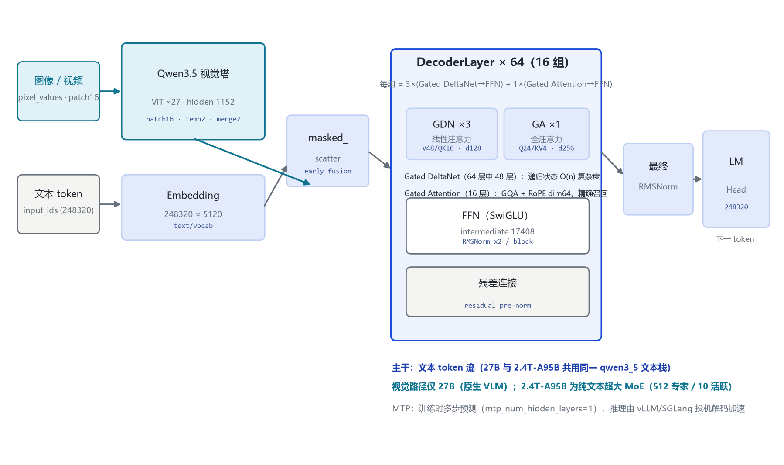
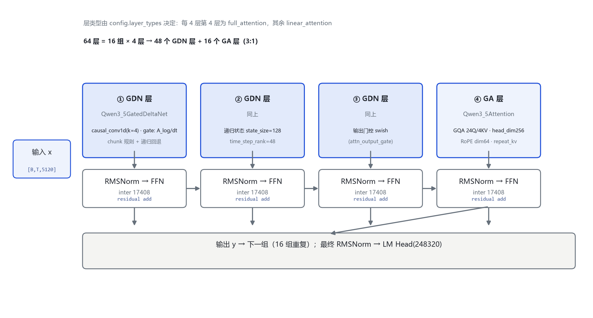
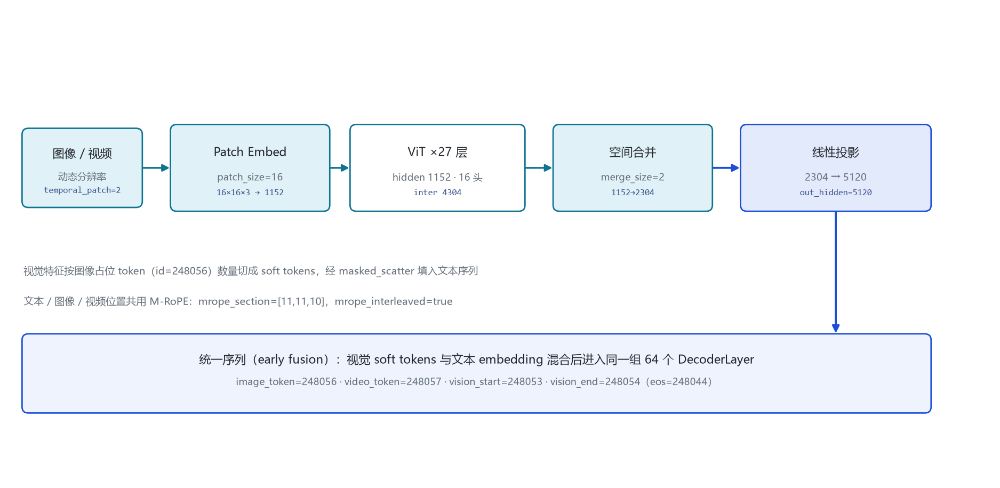

# Qwen3.8 家族架构详解 — 6B-Flash / 27B / 2.4T-A95B（原生多模态 · Flexible Thinking Control）

- 入口类：Qwen3_5ForConditionalGeneration（27B）/ Qwen3_5MoeForCausalLM（2.4T-A95B，纯文本）
- 三个权重变体：27B（Dense 多模态）/ 2.4T-A95B（超大 MoE 纯文本）/ 6B-Flash（规格待确认）
- 官方明示「Built on the architectural foundation of Qwen3.5」：model_type qwen3_5 / qwen3_5_moe，Gated DeltaNet + Gated Attention 3:1 混合
- 词表 248,320（padded）· 原生上下文 262,144 · YaRN 扩至约 1,000,000 · MTP multi-steps
- 代际主题：**Flexible Thinking Control**（默认开思考、可按请求关闭、reasoning_effort 三档、preserve_thinking 默认保留全部历史思考块）+ 能力代际跃升 + 官方 FP8 量化版 + TokenSpeed 引擎
- 发布：2026-08（论文 cite month=August year=2026；FP8 权重 2026-08-13 上线）

本页以 **官方 model card 公布的 config.json / README 实参**（Qwen/Qwen3.8-27B、Qwen/Qwen3.8-2.4T-A95B、Qwen/Qwen3.8-27B-FP8，经 hf-mirror 拉取逐字段核对）与 **transformers 源码**（`E:\transformers\src\transformers\models\qwen3_5\`）为唯一依据。Qwen3.8 的定位是「Qwen 开放模型家族至今最强的一代」：**架构图纸与 3.5/3.6 完全同构**，换代不在图纸，而在推理行为（Flexible Thinking Control）、后训练能力（agentic / 编码 benchmark 大幅跃升）与部署生态（官方 FP8、TokenSpeed）。

## 1 家族全景：6B-Flash / 27B / 2.4T-A95B 架构对照

> 27B 为组合 config（顶层 model_type + text_config + vision_config）的原生多模态 Dense；2.4T-A95B 为纯文本超大 MoE（config 中**无 vision_config**）。两者共用同一 qwen3_5 文本栈基因（3:1 混合、词表、RoPE 配置），差异集中在：hidden 维度、层数、MoE 路由规模。6B-Flash 的 HF/ModelScope 仓库在大陆镜像暂不可达，**全部规格待确认**，禁止编造。

### 1.1 文本塔核心超参数

| 字段（text_config） | Qwen3.8-27B | Qwen3.8-2.4T-A95B |
|---|---|---|
| architectures（入口类） | Qwen3_5ForConditionalGeneration | Qwen3_5MoeForCausalLM |
| **形态** | **Dense + 视觉塔（原生多模态）** | **超大 MoE · 纯文本（无视觉塔）** |
| hidden_size | 5120 | 8192 |
| num_hidden_layers | 64 | 92 |
| hidden layout（官方 README 原文） | 16×(3×(Gated DeltaNet→FFN)→1×(Gated Attention→FFN)) | 23×(3×(Gated DeltaNet→MoE)→1×(Gated Attention→MoE)) |
| num_attention_heads（GA 的 Q） | 24 | 64 |
| num_key_value_heads（GA 的 KV） | 4 | 4 |
| head_dim（GA） | 256 | 256 |
| partial_rotary_factor | 0.25（RoPE dim = 64） | 0.25（RoPE dim = 64） |
| linear_num_key_heads（GDN QK） | 16 | 16 |
| linear_num_value_heads（GDN V） | 48 | 128 |
| linear_key/value_head_dim | 128 / 128 | 128 / 128 |
| linear_conv_kernel_dim | 4（causal conv1d） | 4 |
| intermediate_size（Dense FFN） | 17,408 | —（全部为 MoE 路径） |
| moe_intermediate_size（每专家） | — | 2,048 |
| num_experts / num_experts_per_tok | — | 512 / 10 |
| shared_expert_intermediate_size | — | 2,048 |
| router_aux_loss_coef | — | 0.001 |
| full_attention_interval | 4（每 4 层 1 个 GA 层） | 4（同左，92 = 23×4） |
| attn_output_gate / gate 类型 | true / swish | true / swish |
| vocab_size | 248,320（padded） | 248,320（padded） |
| max_position_embeddings | 262,144 | 262,144 |
| mtp_num_hidden_layers | 1（MTP 投机头，multi-step 训练） | 1 |
| tie_word_embeddings | false | false |
| mrope_section / mrope_interleaved | [11,11,10] / true | 纯文本（多模态位置配置不启用） |
| 总参数 / 激活参数 | 27B（Dense） | **2.4T 总参 / 95B 激活**（10 routed experts + 1 shared） |

> 要点：**27B 与 3.5/3.6-27B 逐字段相同**（64 层 / hidden 5120 / inter 17408 / GA 24Q·4KV·head256 / GDN QK16·V48·head128）；**2.4T-A95B 是首次开放的 Max 级纯文本模型**——hidden 8192、92 层、GDN V 头数从 48 升到 128、GA Q 头数从 24 升到 64，FFN 全部换成 512 专家的 MoE（每 token 激活 10 个路由专家 + 1 个共享专家，单专家 intermediate 仅 2048，细粒度路由换总规模）。

### 1.2 多模态与部署规格

| 字段 | Qwen3.8-27B | Qwen3.8-2.4T-A95B | Qwen3.8-6B-Flash |
|---|---|---|---|
| 视觉塔 | 有（规格与 3.6-27B 同构，见 §6） | **无（纯文本）** | 待确认 |
| 输入模态 | 文本 + 图像 + 视频 | **仅文本** | 待确认 |
| 思考模式 | 默认开 · 可按请求关闭 | **所有交互强制思考，不可关闭** | 待确认 |
| reasoning_effort | xhigh（默认）/ medium / low | xhigh / medium / low | 待确认 |
| preserve_thinking | **默认开**（保留全部历史思考块） | 默认开 | 待确认 |
| 原生上下文 / 扩展 | 262,144 / 约 1,000,000（YaRN factor 4.0，original_max 262144） | 262,144 / 约 1,010,000 | 待确认 |
| 兼容推理框架 | transformers / vLLM / SGLang / **TokenSpeed** | 同左 | 待确认 |
| 官方 FP8 版 | 有（Qwen3.8-27B-FP8，2026-08-13） | — | — |
| FP8 量化方式 | fine-grained block size 128，性能与原版几乎一致 | — | — |
| FP8 权重体积 | 约 29 GB（NGC 校验页标注 28.77 GB） | — | — |
| 面向硬件 | vLLM / RTX50 / Hopper | — | — |
| BF16 权重体积（27B） | 约 55.6 GB | 待确认（官方 card 未标注） | 待确认 |

> 与云版 Qwen3.8-Max 的区别（官方 README 明示）：**Max 版额外支持 vision 输入、non-thinking 模式、默认 1M 上下文、内置工具**；开放权重的 2.4T-A95B 是纯文本、强制思考版本，27B 则是开放权重中首个支持关闭思考的本代模型。

## 2 端到端数据流总览

> 文本 token 与图像/视频像素两路输入（仅 27B；2.4T-A95B 为纯文本单路）→ 图像经视觉塔（ViT×27，patch 16）编码、空间合并 2×2、线性投影到文本 hidden → 与文本 embedding 经 masked_scatter 填入图像占位 token 位（early fusion）→ 统一序列进入 **64 个解码层**（27B；2.4T-A95B 为 92 层）：每 4 层 3 个 Gated DeltaNet 线性层 + 1 个 Gated Attention 全注意力层 → 最终 RMSNorm → LM Head（248,320）。

### 2.1 架构图



> 全家族统一主干：Embedding → DecoderLayer 堆叠 → 最终 RMSNorm → LM Head（无 tie，27B 与 2.4T 均 tie=false）；多模态路径 early fusion，视觉特征不经过文本 embedding 查表，直接写入占位 token。

## 3 解码层解剖：每 4 层一组的 3:1 混合块

> 层类型由 `config.layer_types[layer_idx]` 决定：值为 `linear_attention` 的层实例化 `Qwen3_5GatedDeltaNet`，值为 `full_attention` 的层实例化 `Qwen3_5Attention`；两类层都各接一个 FFN 子层（27B Dense SwiGLU）或 MoE 子层（2.4T：每路由 token 经 router 选 10 个专家 + 共享专家）。源码 `modular_qwen3_5.py:357-410`。27B 共 16 组；2.4T 共 23 组（92 层，layer_types 列表 92 项 = 23 组×4）。

### 3.1 架构图



```
Qwen3_5DecoderLayer.forward（modular_qwen3_5.py:370-410）:
  residual = hidden_states
  hidden_states = input_layernorm(hidden_states)
  if block_type == "linear_attention":        # 每 4 层中前 3 层
      hidden_states = linear_attn(...)         # Qwen3_5GatedDeltaNet
  elif block_type == "full_attention":        # 每 4 层第 4 层
      hidden_states, _ = self_attn(...)         # Qwen3_5Attention（GQA + RoPE64）
  hidden_states = residual + hidden_states    # ⊕1
  residual = hidden_states
  hidden_states = post_attention_layernorm(hidden_states)
  hidden_states = mlp(hidden_states)          # 27B: Dense SwiGLU；2.4T: MoE 路由
  hidden_states = residual + hidden_states    # ⊕2
  return hidden_states
```

> 注意：源码层循环**不**自己判 `(i+1)%4==0`——层类型是 config 里预生成好的 `layer_types` 列表，由 `configuration_qwen3_5.py` 的 `__post_init__` 按 `full_attention_interval=4` 展开（modular_qwen3_5.py:138）。

## 4 核心机制：Gated DeltaNet · Flexible Thinking Control · TokenSpeed / FP8

### 4.1 ① Gated DeltaNet（线性注意力，递归状态）

`Qwen3_5GatedDeltaNet`（modeling_qwen3_5.py:490-650）是 Qwen3.5/3.6/3.8 共享的线性注意力单元：query/key/value 分别投影到 16（QK）/ 48（V，27B）或 16 / 128（V，2.4T）个头、head_dim 128；先过 causal conv1d（kernel 4）做局部归纳，再走 chunk 化的门控 delta rule（`torch_chunk_gated_delta_rule`，modeling_qwen3_5.py:287），跨块时以递归形式回退（`torch_recurrent_gated_delta_rule`，modeling_qwen3_5.py:424）。

```
GDN 每 token 计算流（modeling_qwen3_5.py:536-650）:
  x → in_proj → (q, k, v, a_log, dt_bias, g, ...)     # 27B: QK16/V48；2.4T: QK16/V128
  q,k,v = rotary_embed(q,k,v)                           # 位置注入
  v = causal_conv1d(v)                                  # 局部归纳，kernel=4
  h_t = A · h_{t-1} + (v_t ⊙ sigmoid(g_t)) · (σ(q_t)k_tᵀ)   # 递归更新
  y_t = h_t · σ(q_t)                                   # 线性注意力输出
  y = out_norm(y) → out_proj
```

> 设计意图：3/4 的层用递归状态把注意力复杂度从 O(n²) 降到接近 O(n)，这是 262K 原生上下文与长程 agent 任务吞吐的关键。

### 4.2 ② Flexible Thinking Control（本代主题）

Qwen3.8 把 3.6 的「思考块保留」开关升级为完整的推理行为控制面（官方 README 原文逐项）：

| 行为项 | 默认值 | 可按请求调节 | 官方原文依据 |
|---|---|---|---|
| 思考模式 enable_thinking | **默认开**（先输出 `<think>…</think>` 再回答） | `chat_template_kwargs={"enable_thinking": False}` 切换为 Instruct 直答模式 | 3.8-27B README「Thinking mode is on by default and can be disabled per request」 |
| 推理深度 reasoning_effort | **xhigh**（复杂任务充分分析） | xhigh / medium / low（控速控成本） | 3.8-27B README「xhigh (default)…medium…low」 |
| 历史思考块 preserve_thinking | **默认开**（保留全部历史消息的思考块，保持完整推理轨迹） | `preserve_thinking=False` 退回到只保留最新用户消息的思考块 | 3.8-27B README「By default, Qwen3.8 retains thinking blocks from all historical messages」 |

> 与 3.6 的行为差异：3.6 默认 interleaved thinking（只留最新一条用户消息的思考块），`preserve_thinking` 是**可选**开关；3.8 默认反转为**全开保留**，且新增按请求关闭思考与三档推理深度。官方还提示：多轮 agent 任务里调低 reasoning effort 不一定省总时——每轮更快但可能分析不足、失败重试反而增加总延迟与 token 消耗。
>
> **例外**：2.4T-A95B「requires thinking mode for all interactions…thinking cannot be disabled」（纯文本强制思考版）；reasoning_effort 三档与 preserve_thinking 默认开同样适用。

### 4.3 ③ TokenSpeed 与 FP8 部署生态

- **TokenSpeed**：官方 README 首次将其与 SGLang、vLLM 并列推荐为生产级 serving 引擎（Qwen3.8 Recipe：`lightseek.org/tokenspeed/recipes/models#qwen3-8`）。
- **官方 FP8 量化版**（Qwen3.8-27B-FP8，2026-08-13 上线）：fine-grained fp8 quantization、block size 128、性能与原版「nearly identical」；权重约 29 GB（NGC 校验页 28.77 GB），面向 RTX50 / Hopper 与 vLLM 部署。这是 Qwen 开放主系列**首个官方量化发布**（3.5/3.6 均无官方量化）。

## 5 注意力机制：GDN 与 GA 双路配置

### 5.1 两种 token mixer 对照

| 单元 | Gated DeltaNet（线性层，3/4） | Gated Attention（全注意力，1/4） |
|---|---|---|
| 源码类 | Qwen3_5GatedDeltaNet（modeling:490） | Qwen3_5Attention（modeling:736） |
| 27B 头配置 | V 48 / QK 16，head_dim 128 | Q 24 / KV 4（GQA），head_dim 256 |
| 2.4T-A95B 头配置 | V 128 / QK 16，head_dim 128 | Q 64 / KV 4（GQA），head_dim 256 |
| 位置编码 | 内置门控 delta 状态 + 部分 RoPE | RoPE dim = head_dim × 0.25 = 64 |
| KV cache | 递归状态（按层持有） | 标准 KV cache（GQA 4 KV 头） |
| 作用 | 长上下文 O(n) 吞吐 | 精确召回 / 精确定位 |

### 5.2 GQA 与 RoPE

```
GA 层（每 4 层第 4 层）:
  q = q_proj(x)          # 27B: 5120 → 24×256 = 6144；2.4T: 8192 → 64×256 = 16384
  k = k_proj(x)          # 27B: 5120 → 4×256  = 1024；2.4T: 8192 → 4×256 = 1024
  v = v_proj(x)         # 同上
  q,k = apply_rotary_pos_emb(q,k, partial=64)   # 只转前 64 维（partial_rotary_factor 0.25）
  k,v = repeat_kv(k,v)                           # 4 KV 头 → 27B: 24 Q 头；2.4T: 64 Q 头
  y = softmax(q·kᵀ / √d_k + mask) · v
```

> RoPE 维度 64 而非 256：`partial_rotary_factor=0.25` 只把 head_dim 的前 1/4 送进旋转位置编码；27B 其余维度走 M-RoPE 的交错多路位置（mrope_section [11,11,10] 对应文本/图像/视频三路位置）。

## 6 多模态：视觉塔与 early fusion

### 6.1 视觉塔 config（27B，与 3.6-27B 同构）

| 字段（vision_config） | 取值 | 字段 | 取值 |
|---|---|---|---|
| depth（ViT 层数） | 27 | hidden_size | 1152 |
| intermediate_size | 4304 | num_heads | 16 |
| patch_size | 16 | temporal_patch_size | 2 |
| spatial_merge_size | 2 | out_hidden_size | 5120（= 文本 hidden） |

> **2.4T-A95B 无视觉塔**（config 无 vision_config），官方 README 明示「Multimodal inputs are not supported」；多模态能力在开放权重侧只由 27B 承担，云版 Qwen3.8-Max 才同时开放 vision + non-thinking。

### 6.2 token 流（图，27B）



```
图像/视频 → Patch Embed（16×16×3 → 1152）→ ViT×27（hidden 1152）
→ 空间合并 merge_size=2（1152 → 2304）→ 线性投影（2304 → 文本 hidden 5120）
→ 按 image_token_id=248056 占位切分 soft tokens
→ masked_scatter 填入文本序列 → 同一组 64 个 DecoderLayer
```

> 长视频提示（官方 Best Practices）：默认 video_preprocessor_config 偏保守，小时级视频建议把 longest_edge 调到 469,762,048（约 224K video tokens）以提高帧率采样。

## 7 特殊 Token 与词表布局

| token | ID | 含义 | 来源 |
|---|---|---|---|
| image_token_id | 248056 | 图像特征占位（仅 27B） | config.vision_config / 顶层 |
| video_token_id | 248057 | 视频特征占位（仅 27B） | 同上 |
| vision_start_token_id | 248053 | 视觉块开始（仅 27B） | 顶层 |
| vision_end_token_id | 248054 | 视觉块结束（仅 27B） | 顶层 |
| eos / bos | 248044 | 文本结束（兼 bos） | 顶层 |
| vocab_size | 248320 | 词表（padded） | text_config |

> 词表 248,320 与 3.5/3.6 完全一致；248044–248057 这一段保留给 thinking 块标记与多模态占位。本代思考块格式固定为 `<think>\n…\n</think>\n\n`，先出思考再出正文。

## 8 演进视角：Qwen3.6 → Qwen3.8

| 维度 | Qwen3.6（基线） | Qwen3.8（本代） |
|---|---|---|
| 架构图纸 | qwen3_5 / qwen3_5_moe，GDN+GA 3:1 | **完全一致**（27B config 逐字段相同；官方原文「Built on the architectural foundation of Qwen3.5」） |
| 发布 | 2026-04-22 | 2026-08（论文 month=August 2026；FP8 2026-08-13） |
| 思考模式 | 默认开；interleaved thinking 默认只留最新思考块 | **Flexible Thinking Control**：默认开可关、reasoning_effort 三档、preserve_thinking 默认全开 |
| 历史思考块 | preserve_thinking 可选开 | 默认开（反转默认值），可显式关 |
| 旗舰开放模型 | 35B-A3B（多模态 MoE） | **2.4T-A95B（纯文本超大 MoE，95B 激活）——首次开放 Max 级模型** |
| 官方量化 | 无 | **首个官方 FP8**（fine-grained block 128，约 29GB） |
| 推理引擎 | transformers / vLLM / SGLang / KTransformers | 新增并列推荐 **TokenSpeed** |
| Agentic / 编码能力 | 基线 | 大幅跃升（见下表） |
| 上下文 | 262,144 → YaRN 约 1,010,000 | 262,144 → YaRN 约 1,000,000（factor 4.0） |

### 8.1 3.8-27B vs 3.6-27B 官方 benchmark 对比（逐格摘自 3.8-27B README）

| Benchmark | Qwen3.8-27B | Qwen3.6-27B | 维度 |
|---|---|---|---|
| Terminal Bench 2.1 (Terminus) | **73.0** | 63.4 | agentic terminal coding |
| SWE-bench Pro | **61.7** | 53.5 | agentic coding |
| NL2Repo-Bench | **42.3** | 36.2 | 仓库级代码生成 |
| DeepSWE 1.1 | **42.2** | 13.3 | agentic coding |
| QwenSWEBench | **79.0** | 49.3 | 软件工程 |
| CoWorkBench | **70.7** | 61.0 | 长程办公任务 |
| JobBench | **33.4** | 21.8 | 职业任务 |
| Agents' Last Exam（Pass@1 / Score） | **20.4 / 42.9** | 10.6 / 27.3 | 前沿 agentic |
| IFBench | **79.5** | 69.1 | 指令遵循 |
| GPQA Diamond | 89.2 | 87.8 | 科学推理 |
| HLE | 30.8 | 24.0 | 多学科推理 |
| LiveCodeBench v6 | **90.3** | 83.9 | 竞赛编码 |
| OSWorld-Verified | **84.3** | 63.9 | computer use（VL） |
| WebArena-Verified | **64.8** | 48.8 | browser use（VL） |
| AndroidWorld | **81.9** | 70.3 | mobile use（VL） |
| RecreationBench | **47.1** | 29.8 | 应用复刻（VL） |
| SWE-MM | **38.6** | 25.7 | 多模态软件工程 |
| Vision2Web | **62.9** | 45.0 | 视觉网页开发 |
| MathVision（With CI） | **94.6** | 85.1（仅 Without CI 口径） | 视觉数学 |
| OmniDocBench 1.5 | 91.1 | 89.4 | 文档智能 |
| RealWorldQA | 85.9 | 84.1 | 真实世界感知 |
| ERQA | 65.5 | 62.5 | 具身智能 |

> 2.4T-A95B（开放权重纯文本版）的官方 benchmark：Terminal Bench 2.1 86.6、SWE-bench Pro 67.7、DeepSWE 1.1 56.6、QwenSWEBench 80.7（2.4T README，对比列含 Opus4.8 / Fable5 / GPT5.6Sol / Qwen3.7-Max）。
>
> Qwen3.8 的主线：**架构图纸零变化，换代在行为与能力**——Flexible Thinking Control 把「要不要思考、想多深、留不留思考」全部交给调用方按请求控制；后训练让 agentic 与编码能力跨代跃升（DeepSWE 1.1 从 13.3 到 42.2 是最大涨幅）；部署侧补上官方 FP8 与 TokenSpeed；2.4T-A95B 首次把 Max 级纯文本模型开放权重。

## 9 来源

1. Qwen/Qwen3.8-27B model card（Hugging Face，config.json + README 逐字段/逐格核对）
   `https://huggingface.co/Qwen/Qwen3.8-27B`
2. Qwen/Qwen3.8-2.4T-A95B model card（Hugging Face，config.json + README）
   `https://huggingface.co/Qwen/Qwen3.8-2.4T-A95B`
3. Qwen/Qwen3.8-27B-FP8 model card（Hugging Face，fine-grained fp8 block 128 口径）
   `https://huggingface.co/Qwen/Qwen3.8-27B-FP8`
4. Qwen 官方组织页
   `https://huggingface.co/Qwen`
5. Qwen3.8 官方博客（论文 cite：Qwen3.8-Max: A New Bar for Coding and Cowork，month=August 2026）
   `https://qwen.ai/blog?id=qwen3.8`
6. SGLang Qwen3.8 Cookbook
   `https://docs.sglang.io/cookbook/autoregressive/Qwen/Qwen3.8`
7. vLLM Qwen3.8 Recipe
   `https://recipes.vllm.ai/Qwen/Qwen3.8-27B`
8. TokenSpeed Qwen3.8 Recipe
   `https://lightseek.org/tokenspeed/recipes/models#qwen3-8`
9. NVIDIA NGC FP8 校验页（权重 28.77 GB）
   `https://catalog.ngc.nvidia.com/orgs/nim/qwen/models/qwen3.8-27b/hf-017b9c7-fp8-nim-checksum/version-history`
10. 已核实对比文件（27B 三代一致，组织者整理）
    `E:\transformers\bayon-note\Qwen\Qwen-27B架构对比-3.5-3.6-3.8.md`
11. transformers 源码 configuration_qwen3_5.py / modular_qwen3_5.py / modeling_qwen3_5.py（本地 E:\transformers，行号同 3.6 篇）

> 标注约定：[config]=官方 model card 的 config.json 字段；[README]=官方 README 原文口径。**待确认清单**：Qwen3.8-6B-Flash 的仓库位置与全部规格（hf-mirror 与 ModelScope 暂返回 401/404，禁止编造）；2.4T-A95B 的 BF16 权重体积（官方 card 未标注）。核验日期：2026-10-26。

---

*页脚：Qwen3.8 家族架构详解 · 数据来源：官方 model card（hf-mirror 拉取）+ transformers 源码（E:\transformers）+ 已核实 27B 对比文件 · 仅供技术学习与论文研究*
